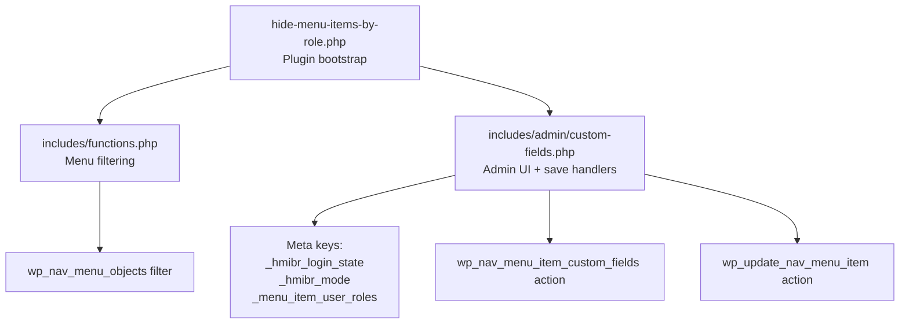
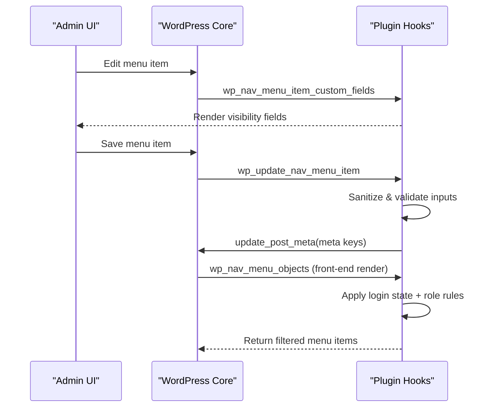
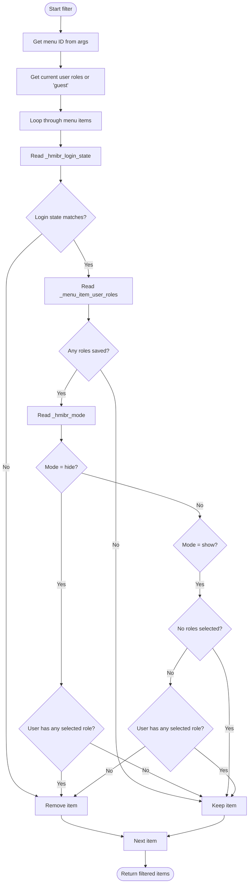
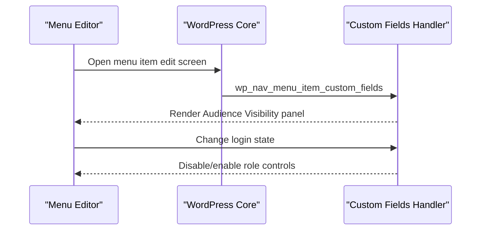
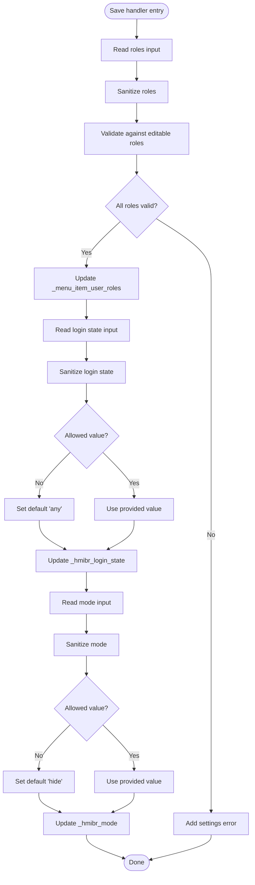
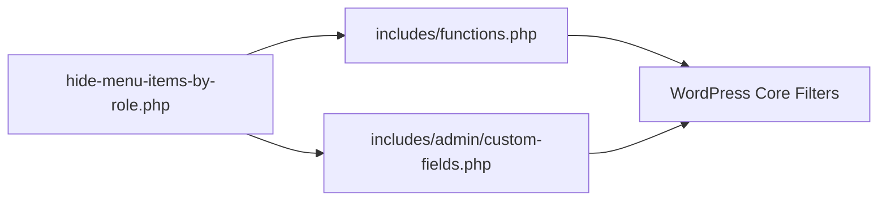

# API Reference

<cite>
**Referenced Files in This Document**
- [hide-menu-items-by-role.php](file://hide-menu-items-by-role.php)
- [functions.php](file://includes/functions.php)
- [custom-fields.php](file://includes/admin/custom-fields.php)
- [README.txt](file://README.txt)
</cite>

## Table of Contents
1. [Introduction](#introduction)
2. [Project Structure](#project-structure)
3. [Core Components](#core-components)
4. [Architecture Overview](#architecture-overview)
5. [Detailed Component Analysis](#detailed-component-analysis)
6. [Dependency Analysis](#dependency-analysis)
7. [Performance Considerations](#performance-considerations)
8. [Troubleshooting Guide](#troubleshooting-guide)
9. [Conclusion](#conclusion)
10. [Appendices](#appendices)

## Introduction
This document provides the API reference for the Hide Menu Items by Role plugin. It covers:
- The WordPress filter hook used to hide or show menu items based on user roles and login state
- Admin interface hooks for adding and saving custom visibility fields
- Meta keys used for data storage
- Data structures, validation rules, and sanitization processes
- Extension points for developers to add custom visibility logic or integrate with other plugins

The plugin allows administrators to control menu item visibility per item using:
- Login state (Everyone, Logged-in only, Logged-out only)
- Visibility mode (Hide from these roles, Show only to these roles)
- One or more user roles

## Project Structure
The plugin is organized into a small set of files:
- Plugin bootstrap and admin asset enqueueing
- Core filtering logic for menu items
- Admin UI integration for custom fields and saving

**Diagram sources**
- [hide-menu-items-by-role.php:20-46](file://hide-menu-items-by-role.php#L20-L46)
- [functions.php:1-49](file://includes/functions.php#L1-L49)
- [custom-fields.php:1-147](file://includes/admin/custom-fields.php#L1-L147)

**Section sources**
- [hide-menu-items-by-role.php:1-54](file://hide-menu-items-by-role.php#L1-L54)
- [functions.php:1-50](file://includes/functions.php#L1-L50)
- [custom-fields.php:1-147](file://includes/admin/custom-fields.php#L1-L147)

## Core Components
- Filter hook: `wp_nav_menu_objects`
  - Purpose: Filter menu items at runtime based on login state and role-based visibility
  - Callback: `hmi_hide_menu_items_based_on_role($items, $args)`
  - Parameters:
    - `$items`: Array of menu item objects
    - `$args`: Object containing menu context; includes `$args->menu->term_id` for the current menu ID
  - Return value: Modified array of menu item objects after applying visibility rules
  - Priority: Default (10), accepted args: 2

- Action hooks for admin integration:
  - `wp_nav_menu_item_custom_fields`
    - Purpose: Render custom visibility fields in the menu editor
    - Callback: `hmi_custom_menu_item_fields($id, $item, $depth, $args)`
  - `wp_update_nav_menu_item`
    - Purpose: Save custom visibility settings when a menu item is saved
    - Callback: `hmi_save_custom_menu_item_fields($menu_id, $menu_item_db_id, $menu_item_data)`

- Meta keys:
  - `_hmibr_login_state`: Stores login-state visibility rule (`any`, `logged_in`, `logged_out`)
  - `_hmibr_mode`: Stores visibility mode (`hide`, `show`)
  - `_menu_item_user_roles`: Stores selected user roles (array)

**Section sources**
- [functions.php:1-49](file://includes/functions.php#L1-L49)
- [custom-fields.php:1-147](file://includes/admin/custom-fields.php#L1-L147)

## Architecture Overview
The plugin integrates with WordPress through core hooks:
- On the front end, it filters menu items via `wp_nav_menu_objects`
- In the admin area, it adds custom fields via `wp_nav_menu_item_custom_fields` and saves them via `wp_update_nav_menu_item`

**Diagram sources**
- [custom-fields.php:94-146](file://includes/admin/custom-fields.php#L94-L146)
- [functions.php:49-49](file://includes/functions.php#L49-L49)

## Detailed Component Analysis

### Filter Hook: wp_nav_menu_objects
- Callback: `hmi_hide_menu_items_based_on_role($items, $args)`
- Behavior:
  - Reads the current menu ID from `$args->menu->term_id`
  - Determines current user roles (or guest if not logged in)
  - For each menu item:
    - Reads `_hmibr_login_state` and applies immediate hide/show based on login state
    - If no roles are configured, keeps the item visible
    - Reads `_hmibr_mode` and `_menu_item_user_roles` to apply hide/show logic:
      - Mode `hide`: hides the item if the user has any of the selected roles
      - Mode `show`: shows the item only if the user has at least one of the selected roles; if none selected, shows to everyone
- Return value: Filtered array of menu item objects

**Diagram sources**
- [functions.php:2-48](file://includes/functions.php#L2-L48)

**Section sources**
- [functions.php:1-49](file://includes/functions.php#L1-L49)

### Admin Action Hook: wp_nav_menu_item_custom_fields
- Callback: `hmi_custom_menu_item_fields($id, $item, $depth, $args)`
- Responsibilities:
  - Renders an “Audience Visibility” panel with:
    - Login state selector (`any`, `logged_in`, `logged_out`)
    - Visibility mode selector (`hide`, `show`)
    - User roles checkboxes
  - Disables role-related controls when login state is set to “Logged-out users only”
- Hook usage:
  - Registered with priority 10 and accepts 4 parameters

**Diagram sources**
- [custom-fields.php:3-94](file://includes/admin/custom-fields.php#L3-L94)

**Section sources**
- [custom-fields.php:1-94](file://includes/admin/custom-fields.php#L1-L94)

### Admin Action Hook: wp_update_nav_menu_item
- Callback: `hmi_save_custom_menu_item_fields($menu_id, $menu_item_db_id, $menu_item_data)`
- Responsibilities:
  - Sanitizes and validates submitted values:
    - Roles: sanitized via text field sanitizer and validated against editable roles
    - Login state: sanitized via key sanitizer and restricted to allowed values
    - Mode: sanitized via key sanitizer and restricted to allowed values
  - Saves meta keys:
    - `_menu_item_user_roles`
    - `_hmibr_login_state`
    - `_hmibr_mode`
  - Also stores menu context meta:
    - `_menu_item_menu_id`
    - `_menu_item_menu_name`
- Hook usage:
  - Registered with priority 10 and accepts 3 parameters

**Diagram sources**
- [custom-fields.php:97-146](file://includes/admin/custom-fields.php#L97-L146)

**Section sources**
- [custom-fields.php:96-147](file://includes/admin/custom-fields.php#L96-L147)

### Data Storage Schema
- Meta keys:
  - `_hmibr_login_state`
    - Type: string
    - Allowed values: `any`, `logged_in`, `logged_out`
  - `_hmibr_mode`
    - Type: string
    - Allowed values: `hide`, `show`
  - `_menu_item_user_roles`
    - Type: array of strings
    - Values must be valid, editable roles

Validation and sanitization:
- Roles are sanitized and validated against `get_editable_roles()`
- Login state and mode are sanitized via key sanitizer and constrained to whitelists
- Errors are added via `add_settings_error` when invalid roles are submitted

**Section sources**
- [custom-fields.php:97-146](file://includes/admin/custom-fields.php#L97-L146)

### Extension Points
- Extend or replace the filtering logic:
  - Hook into `wp_nav_menu_objects` to implement custom visibility rules
  - Access meta keys `_hmibr_login_state`, `_hmibr_mode`, and `_menu_item_user_roles` on menu items
- Integrate with other plugins:
  - Read or write the same meta keys to coordinate visibility across systems
  - Use the existing admin fields or provide your own via `wp_nav_menu_item_custom_fields`
- Conditional logic tips:
  - Respect the login state check before evaluating role-based rules
  - When mode is `show` and no roles are selected, treat as visible to all

**Section sources**
- [functions.php:1-49](file://includes/functions.php#L1-L49)
- [custom-fields.php:1-147](file://includes/admin/custom-fields.php#L1-L147)

## Dependency Analysis
- Bootstrap file enqueues admin assets and includes core modules
- Core filtering depends on WordPress functions:
  - `is_user_logged_in()`, `wp_get_current_user()`
  - `get_post_meta()`
- Admin UI depends on:
  - `wp_roles()->get_names()`
  - `get_editable_roles()`
  - `sanitize_key()`, `sanitize_text_field()`
  - `update_post_meta()`, `add_settings_error()`

**Diagram sources**
- [hide-menu-items-by-role.php:20-46](file://hide-menu-items-by-role.php#L20-L46)
- [functions.php:1-49](file://includes/functions.php#L1-L49)
- [custom-fields.php:1-147](file://includes/admin/custom-fields.php#L1-L147)

**Section sources**
- [hide-menu-items-by-role.php:1-54](file://hide-menu-items-by-role.php#L1-L54)
- [functions.php:1-49](file://includes/functions.php#L1-L49)
- [custom-fields.php:1-147](file://includes/admin/custom-fields.php#L1-L147)

## Performance Considerations
- Early exit on login state:
  - If login state does not match, the item is removed immediately without checking roles
- Skip role checks when no roles are configured:
  - Reduces unnecessary processing for items without role restrictions
- Avoid heavy operations inside loops:
  - Only read post meta once per item and use simple array comparisons

[No sources needed since this section provides general guidance]

## Troubleshooting Guide
- Invalid role selection:
  - The plugin validates roles against editable roles and displays an error message if invalid
- Unexpected visibility:
  - Verify `_hmibr_login_state`, `_hmibr_mode`, and `_menu_item_user_roles` meta values
  - Ensure the current user’s roles match expectations
- Admin UI fields disabled:
  - When login state is set to “Logged-out users only”, role-related controls are intentionally disabled

**Section sources**
- [custom-fields.php:107-120](file://includes/admin/custom-fields.php#L107-L120)
- [custom-fields.php:63-91](file://includes/admin/custom-fields.php#L63-L91)

## Conclusion
The Hide Menu Items by Role plugin exposes clear extension points via standard WordPress hooks. Developers can rely on the documented filter and actions to integrate custom visibility logic, while the plugin handles sanitization, validation, and persistence of visibility settings.

[No sources needed since this section summarizes without analyzing specific files]

## Appendices

### API Summary Table
- Filter: `wp_nav_menu_objects`
  - Callback: `hmi_hide_menu_items_based_on_role($items, $args)`
  - Parameters:
    - `$items`: array of menu item objects
    - `$args`: object with menu context including `$args->menu->term_id`
  - Returns: modified array of menu item objects

- Action: `wp_nav_menu_item_custom_fields`
  - Callback: `hmi_custom_menu_item_fields($id, $item, $depth, $args)`
  - Purpose: Render custom visibility fields in the menu editor

- Action: `wp_update_nav_menu_item`
  - Callback: `hmi_save_custom_menu_item_fields($menu_id, $menu_item_db_id, $menu_item_data)`
  - Purpose: Save visibility settings to post meta

**Section sources**
- [functions.php:49-49](file://includes/functions.php#L49-L49)
- [custom-fields.php:94-94](file://includes/admin/custom-fields.php#L94-L94)
- [custom-fields.php:146-146](file://includes/admin/custom-fields.php#L146-L146)