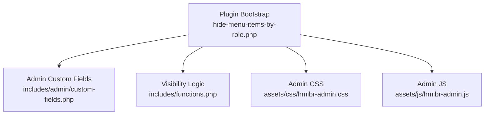
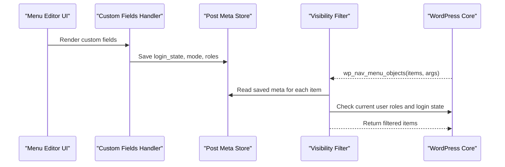
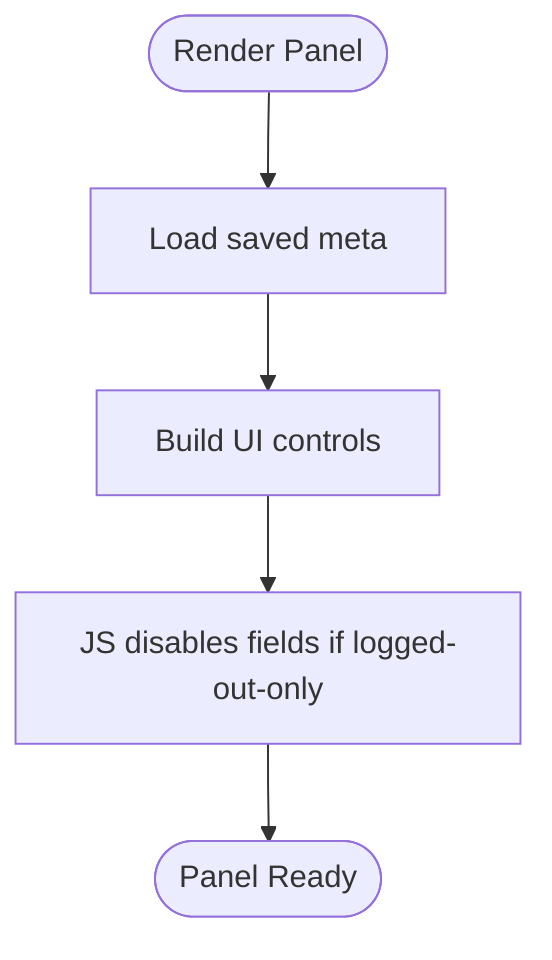
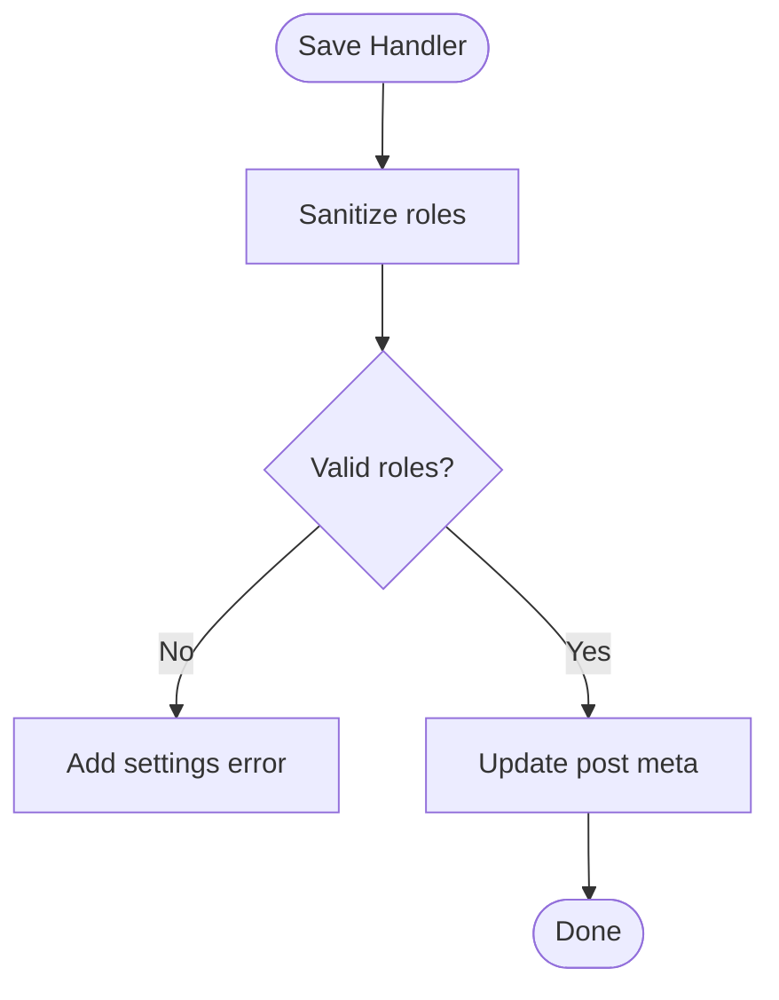
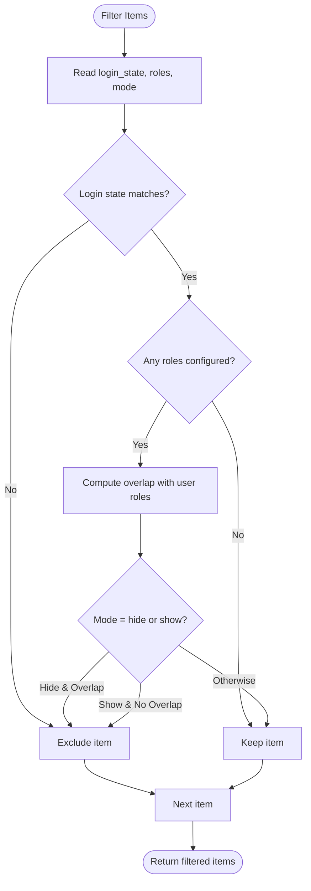
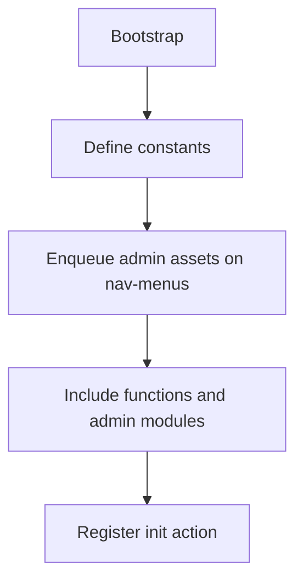
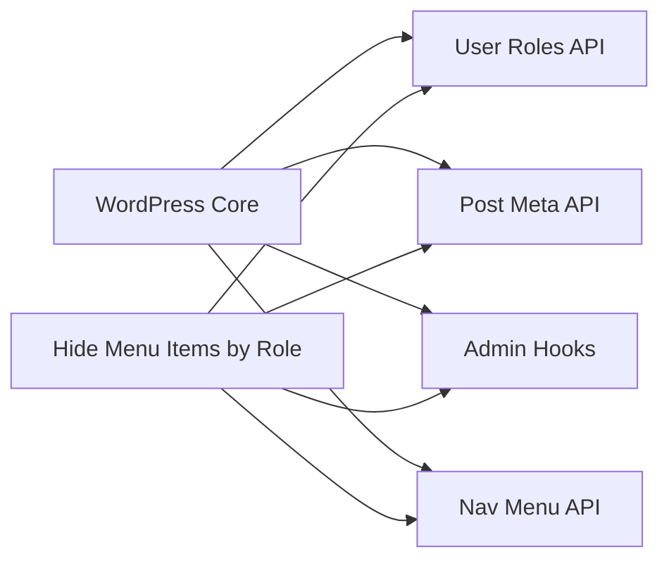

# Extension Points

<cite>
**Referenced Files in This Document**
- [hide-menu-items-by-role.php](file://hide-menu-items-by-role.php)
- [functions.php](file://includes/functions.php)
- [custom-fields.php](file://includes/admin/custom-fields.php)
- [README.txt](file://README.txt)
</cite>

## Table of Contents
1. [Introduction](#introduction)
2. [Project Structure](#project-structure)
3. [Core Components](#core-components)
4. [Architecture Overview](#architecture-overview)
5. [Detailed Component Analysis](#detailed-component-analysis)
6. [Dependency Analysis](#dependency-analysis)
7. [Performance Considerations](#performance-considerations)
8. [Troubleshooting Guide](#troubleshooting-guide)
9. [Conclusion](#conclusion)
10. [Appendices](#appendices)

## Introduction
This document explains the extension points and architecture patterns in the Hide Menu Items by Role plugin, focusing on how developers can customize visibility logic, integrate new role types or authentication states, modify admin interface behavior, create custom field types, implement alternative visibility algorithms, and integrate with other plugins while maintaining compatibility and following WordPress coding standards.

The plugin leverages WordPress core hooks to:
- Render custom fields in the menu editor UI
- Persist configuration per menu item
- Filter menu items at runtime based on login state and user roles

It is designed for extensibility through filters and actions, enabling third-party code to alter behavior without modifying core plugin files.

## Project Structure
The plugin follows a simple, modular structure:
- Plugin bootstrap file defines constants, enqueues admin assets, and includes required modules
- Admin module adds custom fields and saves settings
- Core logic applies visibility rules via a filter

**Diagram sources**
- [hide-menu-items-by-role.php:16-46](file://hide-menu-items-by-role.php#L16-L46)
- [custom-fields.php:1-147](file://includes/admin/custom-fields.php#L1-L147)
- [functions.php:1-50](file://includes/functions.php#L1-L50)

**Section sources**
- [hide-menu-items-by-role.php:16-54](file://hide-menu-items-by-role.php#L16-L54)
- [custom-fields.php:1-147](file://includes/admin/custom-fields.php#L1-L147)
- [functions.php:1-50](file://includes/functions.php#L1-L50)

## Core Components
- Plugin bootstrap: Defines constants, enqueues admin assets on the nav-menus screen, and includes required files. It also provides an initialization hook point for future features.
- Admin custom fields: Adds “Audience Visibility” panel in the menu editor, including login state, mode (hide/show), and role selection. It validates and persists these values as post meta for each menu item.
- Visibility logic: Filters menu items during rendering to apply login state and role-based rules.

Key extension points exposed by the plugin:
- Hook into menu item rendering via the core filter used by the plugin’s visibility function
- Extend admin UI via WordPress menu editor hooks
- Add custom roles or authentication states by integrating with WordPress roles and user state checks

**Section sources**
- [hide-menu-items-by-role.php:16-54](file://hide-menu-items-by-role.php#L16-L54)
- [custom-fields.php:1-147](file://includes/admin/custom-fields.php#L1-L147)
- [functions.php:1-50](file://includes/functions.php#L1-L50)

## Architecture Overview
The plugin uses a separation-of-concerns pattern:
- Bootstrap layer: Asset management and inclusion of modules
- Admin layer: UI rendering and data persistence
- Runtime layer: Filtering menu items based on stored configuration and current user context

**Diagram sources**
- [custom-fields.php:3-94](file://includes/admin/custom-fields.php#L3-L94)
- [custom-fields.php:97-146](file://includes/admin/custom-fields.php#L97-L146)
- [functions.php:2-49](file://includes/functions.php#L2-L49)

## Detailed Component Analysis

### Admin Custom Fields (UI and Persistence)
Responsibilities:
- Render “Audience Visibility” panel with controls for login state, mode, and roles
- Disable role-related controls when login state is set to “Logged-out users only”
- Validate and save selected roles, login state, and mode as post meta

Extension opportunities:
- Add additional fields (e.g., custom capabilities, IP ranges, time windows) by extending the render function and saving corresponding meta
- Introduce conditional logic to show/hide fields based on other criteria
- Customize validation rules beyond built-in role checks

**Diagram sources**
- [custom-fields.php:3-94](file://includes/admin/custom-fields.php#L3-L94)

Persistence flow:
- Validates roles against editable roles
- Sanitizes inputs
- Saves roles, login state, and mode to post meta

**Diagram sources**
- [custom-fields.php:97-146](file://includes/admin/custom-fields.php#L97-L146)

**Section sources**
- [custom-fields.php:3-94](file://includes/admin/custom-fields.php#L3-L94)
- [custom-fields.php:97-146](file://includes/admin/custom-fields.php#L97-L146)

### Visibility Logic (Runtime Filtering)
Responsibilities:
- Apply login state rules first (any/logged_in/logged_out)
- If no roles are configured, keep the item visible
- Apply hide/show mode based on intersection between user roles and configured roles

Algorithm overview:
- For each menu item:
  - Read login state; exclude item if it conflicts with current login state
  - If no roles configured, continue (keep item)
  - Determine mode (hide/show) and compute overlap between user roles and configured roles
  - Exclude item according to mode and overlap

**Diagram sources**
- [functions.php:2-49](file://includes/functions.php#L2-L49)

**Section sources**
- [functions.php:2-49](file://includes/functions.php#L2-L49)

### Plugin Bootstrap and Initialization
Responsibilities:
- Define plugin constants for directory paths and URLs
- Enqueue admin CSS/JS only on the nav-menus screen
- Include required modules
- Provide an initialization action hook for future extensions

**Diagram sources**
- [hide-menu-items-by-role.php:16-54](file://hide-menu-items-by-role.php#L16-L54)

**Section sources**
- [hide-menu-items-by-role.php:16-54](file://hide-menu-items-by-role.php#L16-L54)

## Dependency Analysis
The plugin depends on WordPress core APIs for:
- User roles and capabilities
- Post meta storage for menu items
- Admin hooks for menu editor customization
- Navigation menu filtering

**Diagram sources**
- [functions.php:2-49](file://includes/functions.php#L2-L49)
- [custom-fields.php:3-146](file://includes/admin/custom-fields.php#L3-L146)
- [hide-menu-items-by-role.php:21-46](file://hide-menu-items-by-role.php#L21-L46)

**Section sources**
- [functions.php:2-49](file://includes/functions.php#L2-L49)
- [custom-fields.php:3-146](file://includes/admin/custom-fields.php#L3-L146)
- [hide-menu-items-by-role.php:21-46](file://hide-menu-items-by-role.php#L21-L46)

## Performance Considerations
- The visibility filter runs on every menu render. Keep custom logic efficient:
  - Avoid heavy computations inside loops over menu items
  - Cache expensive lookups where appropriate
- The plugin short-circuits role checks when login state alone determines visibility, improving performance for logged-out-only scenarios.

[No sources needed since this section provides general guidance]

## Troubleshooting Guide
Common issues and resolutions:
- Invalid role selections: The plugin validates roles against editable roles and will add a settings error if invalid roles are submitted. Ensure your custom roles are registered before saving.
- Unexpected visibility: Verify that login state and mode settings are correctly saved and that user roles match expectations.
- UI fields disabled unexpectedly: When login state is set to “Logged-out users only,” role-related fields are disabled by design.

Relevant implementation references:
- Validation and error handling for role selection
- Saving and sanitizing of login state and mode fields

**Section sources**
- [custom-fields.php:97-146](file://includes/admin/custom-fields.php#L97-L146)

## Conclusion
The Hide Menu Items by Role plugin offers clear extension points through WordPress hooks and a clean separation of concerns:
- Use the existing filter to implement alternative visibility algorithms
- Extend the admin UI to support new fields and validation
- Integrate custom roles and authentication states by leveraging WordPress APIs
- Maintain compatibility by adhering to WordPress coding standards and avoiding direct modifications to plugin files

By following these patterns, you can safely extend functionality while preserving upgrade compatibility.

[No sources needed since this section summarizes without analyzing specific files]

## Appendices

### How to Add Custom Visibility Logic Beyond Built-in Role-Based Filtering
Approaches:
- Implement an alternative algorithm using the same filter the plugin uses. Your callback can inspect the same metadata and override visibility decisions.
- Combine multiple conditions (e.g., custom capabilities, time-based rules, geographic restrictions) by reading additional meta fields you introduce via the admin UI.

Integration tips:
- Preserve the plugin’s precedence: respect login state checks before applying custom logic
- Ensure your logic returns the modified items array consistently

Reference:
- [functions.php:2-49](file://includes/functions.php#L2-L49)

**Section sources**
- [functions.php:2-49](file://includes/functions.php#L2-L49)

### Integrating New User Role Types or Custom Authentication States
- Register custom roles using WordPress roles API so they appear in the role selector and are recognized by the plugin’s validation.
- For custom authentication states (e.g., “verified”, “trial”), store a flag in post meta and check it in your custom visibility logic.
- Update the admin UI to expose these new options and persist them alongside existing fields.

References:
- Role validation and listing: [custom-fields.php:8-58](file://includes/admin/custom-fields.php#L8-L58)
- Saving custom fields: [custom-fields.php:97-146](file://includes/admin/custom-fields.php#L97-L146)

**Section sources**
- [custom-fields.php:8-58](file://includes/admin/custom-fields.php#L8-L58)
- [custom-fields.php:97-146](file://includes/admin/custom-fields.php#L97-L146)

### Modifying Admin Interface Behavior and Appearance
- Add or remove fields in the “Audience Visibility” panel by extending the render function and adding corresponding save handlers.
- Style your additions using the plugin’s admin stylesheet or enqueue your own styles on the nav-menus screen.
- Use the provided JavaScript pattern to conditionally enable/disable fields based on other settings.

References:
- Field rendering and JS toggling: [custom-fields.php:3-94](file://includes/admin/custom-fields.php#L3-L94)
- Asset enqueueing: [hide-menu-items-by-role.php:21-42](file://hide-menu-items-by-role.php#L21-L42)

**Section sources**
- [custom-fields.php:3-94](file://includes/admin/custom-fields.php#L3-L94)
- [hide-menu-items-by-role.php:21-42](file://hide-menu-items-by-role.php#L21-L42)

### Creating Custom Field Types
Steps:
- Add a new control in the render function and assign a unique meta key
- Sanitize and validate input in the save handler
- Read the meta in your visibility logic and incorporate it into your algorithm

References:
- Rendering example: [custom-fields.php:22-60](file://includes/admin/custom-fields.php#L22-L60)
- Save and sanitize example: [custom-fields.php:97-146](file://includes/admin/custom-fields.php#L97-L146)

**Section sources**
- [custom-fields.php:22-60](file://includes/admin/custom-fields.php#L22-L60)
- [custom-fields.php:97-146](file://includes/admin/custom-fields.php#L97-L146)

### Implementing Alternative Visibility Algorithms
Patterns:
- Short-circuit early based on high-priority conditions (e.g., login state)
- Compute overlaps or intersections efficiently
- Return the modified items array after processing all items

Reference:
- Algorithm structure and precedence: [functions.php:2-49](file://includes/functions.php#L2-L49)

**Section sources**
- [functions.php:2-49](file://includes/functions.php#L2-L49)

### Integrating With Other WordPress Plugins
- Use WordPress hooks to coordinate with other plugins’ lifecycle events
- Respect capability checks and role definitions introduced by other plugins
- Avoid hard dependencies; use feature detection where possible

[No sources needed since this section provides general guidance]

### Maintaining Compatibility and Following Coding Standards
- Do not edit plugin core files; use hooks and filters to extend behavior
- Follow WordPress coding standards for PHP, HTML, and JavaScript
- Sanitize and validate all inputs; escape outputs
- Test against the minimum supported WordPress version indicated in the plugin metadata

References:
- Plugin metadata and requirements: [hide-menu-items-by-role.php:1-14](file://hide-menu-items-by-role.php#L1-L14), [README.txt:1-10](file://README.txt#L1-L10)

**Section sources**
- [hide-menu-items-by-role.php:1-14](file://hide-menu-items-by-role.php#L1-L14)
- [README.txt:1-10](file://README.txt#L1-L10)