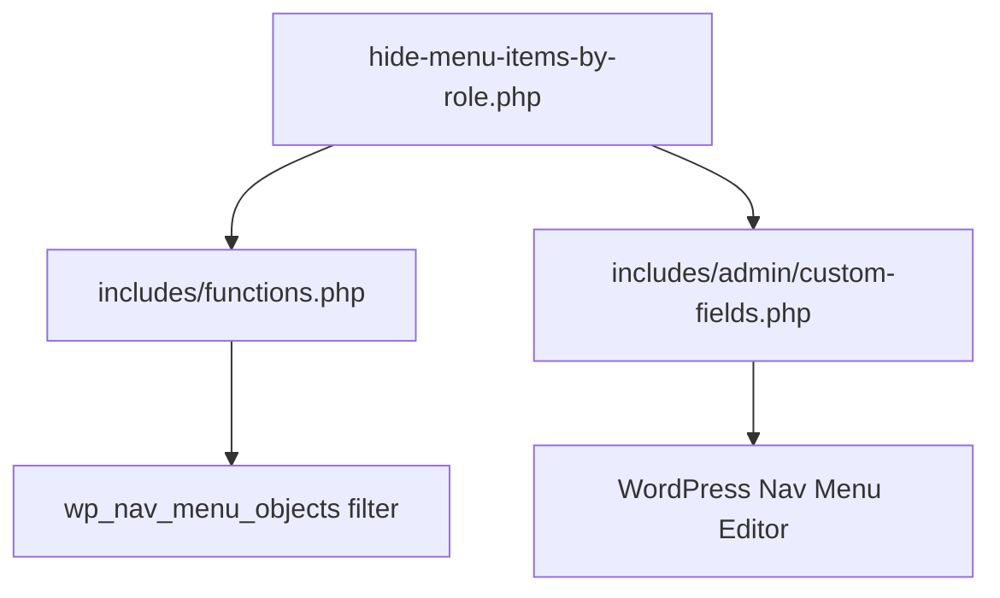
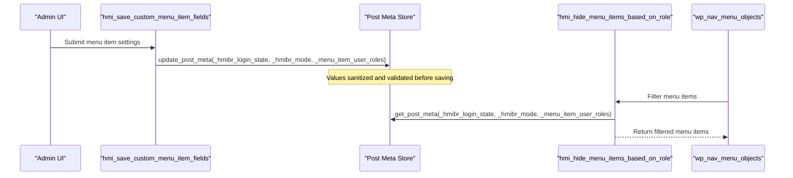
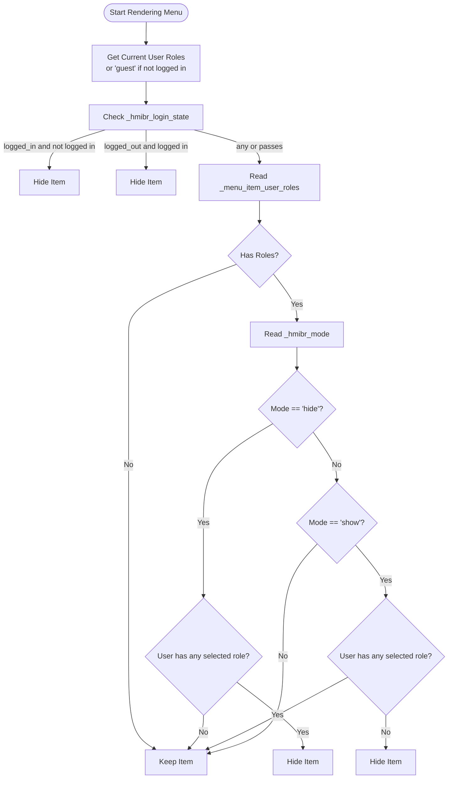
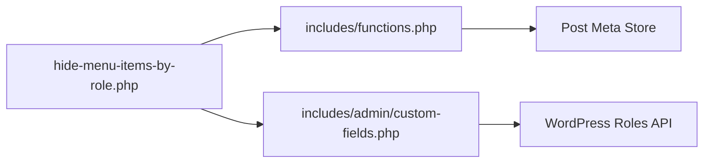

# Meta Keys & Data Storage

<cite>
**Referenced Files in This Document**
- [hide-menu-items-by-role.php](file://hide-menu-items-by-role.php)
- [functions.php](file://includes/functions.php)
- [custom-fields.php](file://includes/admin/custom-fields.php)
</cite>

## Table of Contents
1. [Introduction](#introduction)
2. [Project Structure](#project-structure)
3. [Core Components](#core-components)
4. [Architecture Overview](#architecture-overview)
5. [Detailed Component Analysis](#detailed-component-analysis)
6. [Dependency Analysis](#dependency-analysis)
7. [Performance Considerations](#performance-considerations)
8. [Troubleshooting Guide](#troubleshooting-guide)
9. [Conclusion](#conclusion)

## Introduction
This document explains the meta keys used by the Hide Menu Items by Role plugin for data storage and runtime behavior. It focuses on:
- `_hmibr_login_state`: Controls visibility based on login state (everyone, logged-in, logged-out).
- `_hmibr_mode`: Controls hide/show behavior modes (hide from roles vs show only to roles).
- `_menu_item_user_roles`: Stores arrays of user roles affected by visibility rules.

It covers data types, validation rules, sanitization processes, default values, programmatic access examples using WordPress functions, data structure formats, array formats for role lists, and best practices for data manipulation.

## Project Structure
The plugin organizes its code into a main bootstrap file and two include files:
- Main plugin file enqueues admin assets and includes core logic.
- Admin custom fields handle UI and persistence of meta values.
- Runtime filtering applies visibility rules when rendering menus.

**Diagram sources**
- [hide-menu-items-by-role.php:20-46](file://hide-menu-items-by-role.php#L20-L46)
- [functions.php:1-49](file://includes/functions.php#L1-L49)
- [custom-fields.php:1-147](file://includes/admin/custom-fields.php#L1-L147)

**Section sources**
- [hide-menu-items-by-role.php:16-46](file://hide-menu-items-by-role.php#L16-L46)

## Core Components
- Login State Visibility (`_hmibr_login_state`): Determines whether a menu item is visible to everyone, logged-in users only, or logged-out users only.
- Mode (`_hmibr_mode`): Determines whether to hide items from selected roles or show items only to selected roles.
- Roles (`_menu_item_user_roles`): Array of user role slugs that the mode applies to.

These components are persisted as post meta attached to menu items and applied at runtime during menu rendering.

**Section sources**
- [custom-fields.php:5-8](file://includes/admin/custom-fields.php#L5-L8)
- [functions.php:15-43](file://includes/functions.php#L15-L43)

## Architecture Overview
The plugin integrates with WordPress through:
- Admin UI hooks to render and save custom fields for menu items.
- The `wp_nav_menu_objects` filter to apply visibility rules when rendering menus.

**Diagram sources**
- [custom-fields.php:96-146](file://includes/admin/custom-fields.php#L96-L146)
- [functions.php:1-49](file://includes/functions.php#L1-L49)

## Detailed Component Analysis

### Meta Key: `_hmibr_login_state`
Purpose:
- Controls visibility based on login state.

Data Type:
- String.

Allowed Values:
- `any` (Everyone)
- `logged_in` (Logged-in users only)
- `logged_out` (Logged-out users only)

Default Value:
- `any` if not set.

Validation Rules:
- Must be one of the allowed values; otherwise defaults to `any`.

Sanitization Process:
- Sanitized via `sanitize_key()` and then validated against an allowlist.

Runtime Behavior:
- If set to `logged_in`, the item is hidden for non-logged-in users.
- If set to `logged_out`, the item is hidden for logged-in users.
- If set to `any`, no login-state-based hiding occurs.

Programmatic Access Examples:
- Read:
  - Use `get_post_meta($item_id, '_hmibr_login_state', true)` to retrieve the value.
- Update:
  - Use `update_post_meta($item_id, '_hmibr_login_state', $value)` where `$value` is one of the allowed strings.
- Delete:
  - Use `delete_post_meta($item_id, '_hmibr_login_state')` to remove the key, causing it to revert to the default `any`.

Best Practices:
- Always validate against the allowed list before saving.
- Prefer `sanitize_key()` for incoming values.
- When reading, treat empty results as `any`.

**Section sources**
- [custom-fields.php:129-135](file://includes/admin/custom-fields.php#L129-L135)
- [functions.php:16-24](file://includes/functions.php#L16-L24)

### Meta Key: `_hmibr_mode`
Purpose:
- Controls hide/show behavior relative to selected roles.

Data Type:
- String.

Allowed Values:
- `hide` (Hide from these roles)
- `show` (Show only to these roles)

Default Value:
- `hide` if not set.

Validation Rules:
- Must be one of the allowed values; otherwise defaults to `hide`.

Sanitization Process:
- Sanitized via `sanitize_key()` and then validated against an allowlist.

Runtime Behavior:
- With `hide`:
  - If the current user has any of the selected roles, the item is hidden.
- With `show`:
  - If the current user does not have any of the selected roles, the item is hidden.
  - If no roles are selected in `show` mode, the item remains visible to everyone.

Programmatic Access Examples:
- Read:
  - Use `get_post_meta($item_id, '_hmibr_mode', true)` to retrieve the value.
- Update:
  - Use `update_post_meta($item_id, '_hmibr_mode', $value)` where `$value` is either `hide` or `show`.
- Delete:
  - Use `delete_post_meta($item_id, '_hmibr_mode')` to remove the key, causing it to revert to the default `hide`.

Best Practices:
- Validate against the allowed list before saving.
- Combine with `_menu_item_user_roles` appropriately depending on mode.
- When reading, treat empty results as `hide`.

**Section sources**
- [custom-fields.php:137-143](file://includes/admin/custom-fields.php#L137-L143)
- [functions.php:32-43](file://includes/functions.php#L32-L43)

### Meta Key: `_menu_item_user_roles`
Purpose:
- Stores the list of user roles that the visibility mode applies to.

Data Type:
- Array of strings (role slugs).

Format:
- Indexed array of role slugs, e.g., `['subscriber', 'editor']`.

Default Value:
- Empty array if not set.

Validation Rules:
- Each role must exist in the system’s editable roles. Invalid roles cause a settings error and prevent saving.

Sanitization Process:
- Each role is sanitized via `sanitize_text_field()`.
- Validation ensures each role exists in `get_editable_roles()`.

Runtime Behavior:
- If empty, no role-based filtering occurs (the item remains visible unless login state hides it).
- If populated, the mode determines how overlap between the current user’s roles and this list affects visibility.

Programmatic Access Examples:
- Read:
  - Use `get_post_meta($item_id, '_menu_item_user_roles', true)` to retrieve the array.
- Update:
  - Use `update_post_meta($item_id, '_menu_item_user_roles', $roles_array)` where `$roles_array` is an array of valid role slugs.
- Delete:
  - Use `delete_post_meta($item_id, '_menu_item_user_roles')` to remove the key, effectively clearing the role list.

Best Practices:
- Always sanitize individual role values with `sanitize_text_field()`.
- Validate each role against `get_editable_roles()` before saving.
- Ensure the stored value is always an array; cast to array when reading to avoid type issues.

**Section sources**
- [custom-fields.php:99-123](file://includes/admin/custom-fields.php#L99-L123)
- [functions.php:26-36](file://includes/functions.php#L26-L36)

### Data Flow and Processing Logic
The runtime processing follows a clear sequence:
1. Determine the current user’s roles (or `guest` if not logged in).
2. Apply login state visibility first.
3. If roles are configured, apply mode-based hide/show logic.

**Diagram sources**
- [functions.php:7-43](file://includes/functions.php#L7-L43)

**Section sources**
- [functions.php:1-49](file://includes/functions.php#L1-L49)

## Dependency Analysis
- The main plugin file includes both the runtime filter and the admin custom fields.
- The runtime filter depends on post meta values to decide visibility.
- The admin custom fields depend on WordPress roles API to present and validate role selections.

**Diagram sources**
- [hide-menu-items-by-role.php:44-46](file://hide-menu-items-by-role.php#L44-L46)
- [functions.php:1-49](file://includes/functions.php#L1-L49)
- [custom-fields.php:1-147](file://includes/admin/custom-fields.php#L1-L147)

**Section sources**
- [hide-menu-items-by-role.php:44-46](file://hide-menu-items-by-role.php#L44-L46)

## Performance Considerations
- Reading post meta inside a loop can add overhead. Consider caching per-item meta values if you process many menu items.
- Avoid unnecessary updates; only write meta when values change.
- Keep role lists minimal to reduce comparison costs during runtime filtering.

[No sources needed since this section provides general guidance]

## Troubleshooting Guide
Common issues and resolutions:
- Invalid role selected:
  - Cause: A role slug not present in the system’s editable roles.
  - Resolution: Ensure roles are valid and saved only after validation against `get_editable_roles()`.
- Unexpected visibility:
  - Cause: Incorrect combination of login state and mode/roles.
  - Resolution: Verify `_hmibr_login_state`, `_hmibr_mode`, and `_menu_item_user_roles` values for the specific menu item.
- Field disabled unexpectedly:
  - Cause: When login state is set to “logged-out users only,” the mode and roles fields are disabled in the UI.
  - Resolution: Change login state to allow editing of mode and roles.

**Section sources**
- [custom-fields.php:63-91](file://includes/admin/custom-fields.php#L63-L91)
- [custom-fields.php:107-120](file://includes/admin/custom-fields.php#L107-L120)

## Conclusion
The Hide Menu Items by Role plugin uses three meta keys to control menu visibility:
- `_hmibr_login_state`: String with allowed values `any`, `logged_in`, `logged_out`; defaults to `any`.
- `_hmibr_mode`: String with allowed values `hide`, `show`; defaults to `hide`.
- `_menu_item_user_roles`: Array of role slugs; defaults to empty array.

All values are sanitized and validated before being saved. At runtime, login state is evaluated first, followed by mode-based role checks. Follow the best practices outlined above to ensure reliable and secure data handling.

[No sources needed since this section summarizes without analyzing specific files]