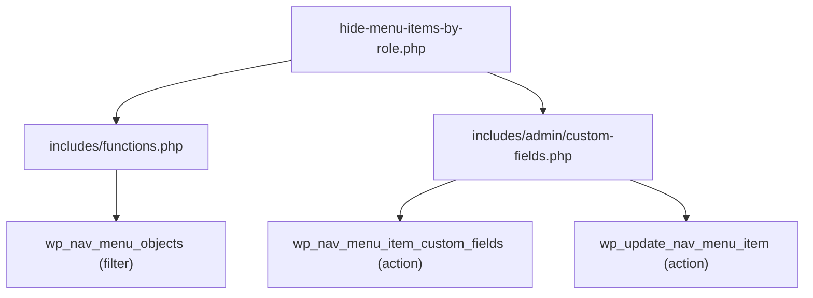
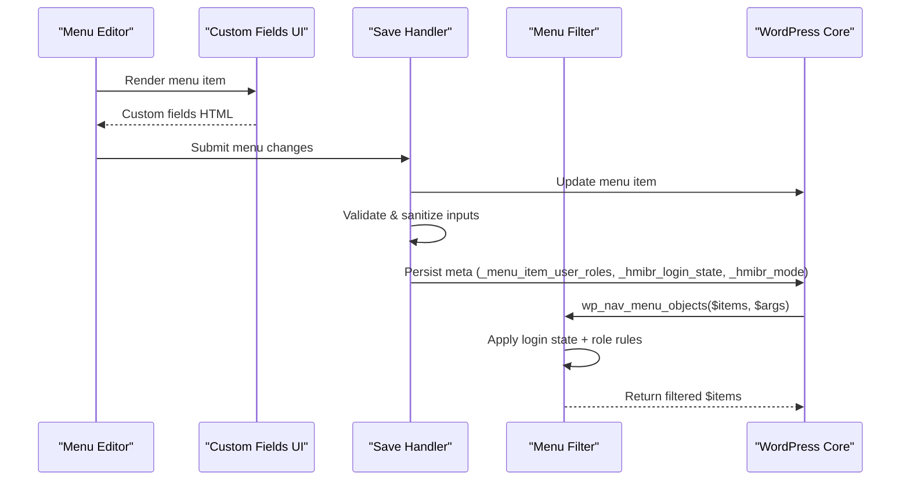
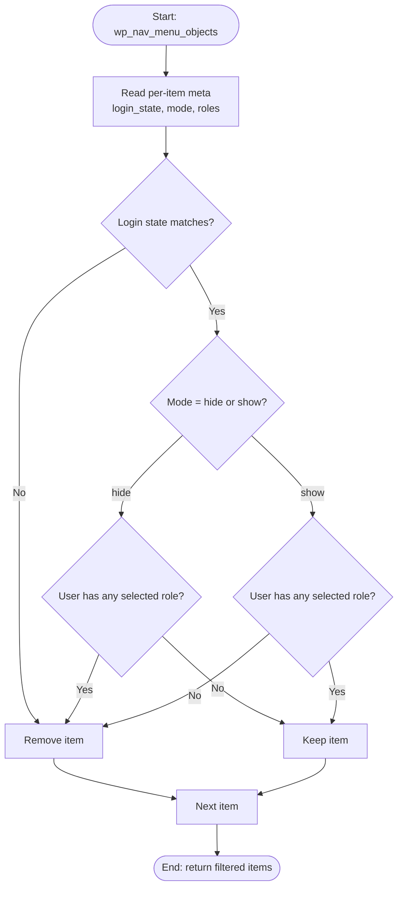
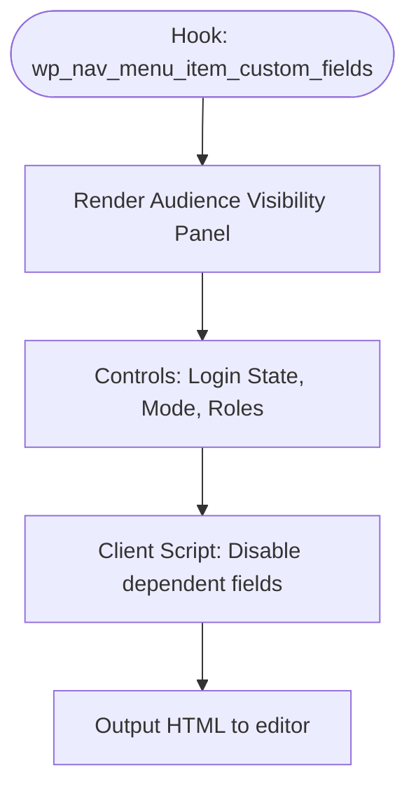
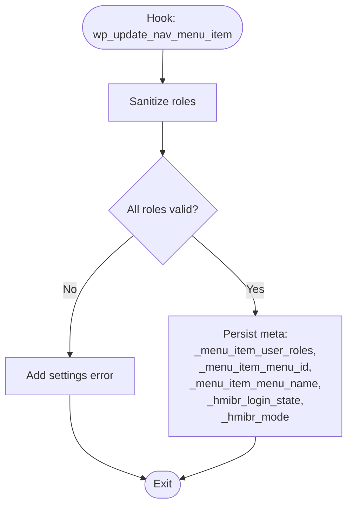
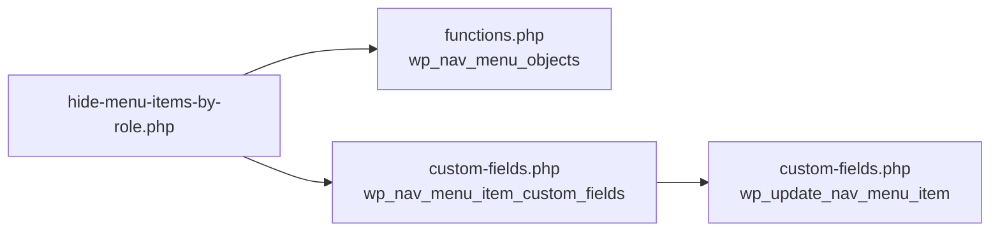

# WordPress Hooks

<cite>
**Referenced Files in This Document**
- [hide-menu-items-by-role.php](file://hide-menu-items-by-role.php)
- [functions.php](file://includes/functions.php)
- [custom-fields.php](file://includes/admin/custom-fields.php)
- [README.txt](file://README.txt)
</cite>

## Table of Contents
1. [Introduction](#introduction)
2. [Project Structure](#project-structure)
3. [Core Components](#core-components)
4. [Architecture Overview](#architecture-overview)
5. [Detailed Component Analysis](#detailed-component-analysis)
6. [Dependency Analysis](#dependency-analysis)
7. [Performance Considerations](#performance-considerations)
8. [Troubleshooting Guide](#troubleshooting-guide)
9. [Conclusion](#conclusion)

## Introduction
This document explains the WordPress hooks used by the Hide Menu Items by Role plugin to control menu item visibility based on user roles and login state. It focuses on:
- The `wp_nav_menu_objects` filter for runtime filtering of menu items.
- The `wp_nav_menu_item_custom_fields` action for extending the menu editor UI with custom fields.
- The `wp_update_nav_menu_item` action for persisting custom field data when saving menus.

It also provides practical guidance for implementing similar logic in themes or other plugins, including parameter validation, error handling, and performance considerations.

## Project Structure
The plugin is organized into a main entry file and modular includes:
- Main plugin bootstrap and admin asset enqueueing.
- Core filtering logic attached to `wp_nav_menu_objects`.
- Admin UI extension and persistence logic attached to menu editor hooks.

**Diagram sources**
- [hide-menu-items-by-role.php:20-46](file://hide-menu-items-by-role.php#L20-L46)
- [functions.php:49-49](file://includes/functions.php#L49-L49)
- [custom-fields.php:94-94](file://includes/admin/custom-fields.php#L94-L94)
- [custom-fields.php:146-146](file://includes/admin/custom-fields.php#L146-L146)

**Section sources**
- [hide-menu-items-by-role.php:1-54](file://hide-menu-items-by-role.php#L1-L54)
- [functions.php:1-50](file://includes/functions.php#L1-L50)
- [custom-fields.php:1-147](file://includes/admin/custom-fields.php#L1-L147)

## Core Components
- Runtime menu filtering via `wp_nav_menu_objects`:
  - Applies role-based and login-state rules to hide or show menu items at render time.
- Admin UI extension via `wp_nav_menu_item_custom_fields`:
  - Adds an “Audience Visibility” panel with controls for login state, mode (hide/show), and user roles.
- Data persistence via `wp_update_nav_menu_item`:
  - Validates and saves custom meta for each menu item during save operations.

**Section sources**
- [functions.php:2-49](file://includes/functions.php#L2-L49)
- [custom-fields.php:3-94](file://includes/admin/custom-fields.php#L3-L94)
- [custom-fields.php:97-146](file://includes/admin/custom-fields.php#L97-L146)

## Architecture Overview
The plugin integrates with WordPress core through three primary hooks:
- `wp_nav_menu_objects`: Filters the final list of menu objects before rendering.
- `wp_nav_menu_item_custom_fields`: Injects custom fields into the menu editor UI.
- `wp_update_nav_menu_item`: Persists custom field values to post meta when saving a menu.

**Diagram sources**
- [custom-fields.php:3-94](file://includes/admin/custom-fields.php#L3-L94)
- [custom-fields.php:97-146](file://includes/admin/custom-fields.php#L97-L146)
- [functions.php:2-49](file://includes/functions.php#L2-L49)

## Detailed Component Analysis

### wp_nav_menu_objects Filter Hook
Purpose:
- Modify the array of menu items before they are rendered to the front end.
- Implement visibility rules based on current user’s login state and roles.

Parameters:
- `$menu_items` (array): The full set of menu item objects to be filtered.
- `$args` (object): Arguments passed to `wp_nav_menu()`, including the menu object and context.

Return value:
- Modified `$menu_items` array after applying visibility rules.

Behavior summary:
- Reads per-item meta for login state, mode, and allowed roles.
- If login state does not match the current user, the item is removed.
- If mode is “hide” and the user has any of the selected roles, the item is removed.
- If mode is “show” and the user has none of the selected roles, the item is removed.
- Returns the filtered array.

Usage example pattern:
- Add your own callback to `wp_nav_menu_objects` to implement additional filters (e.g., capability checks, custom taxonomies).
- Always validate `$args` and `$menu_items` types before processing.
- Avoid heavy operations inside the loop; cache lookups where possible.

**Diagram sources**
- [functions.php:2-49](file://includes/functions.php#L2-L49)

**Section sources**
- [functions.php:2-49](file://includes/functions.php#L2-L49)

### wp_nav_menu_item_custom_fields Action Hook
Purpose:
- Extend the menu editor interface to add custom fields for audience visibility.

Parameters:
- `$id` (int): Menu item ID.
- `$item` (object): Menu item object.
- `$depth` (int): Depth level for indentation.
- `$args` (object): Additional arguments passed to the hook.

Behavior summary:
- Outputs an “Audience Visibility” panel containing:
  - Login state selector (Everyone, Logged-in only, Logged-out only).
  - Mode selector (Hide from these roles / Show only to these roles).
  - Multi-select checkboxes for user roles.
- Includes client-side script to disable dependent fields when “Logged-out users only” is selected.

Usage example pattern:
- Add your own callback to `wp_nav_menu_item_custom_fields` to inject additional fields.
- Use proper escaping and nonces if you handle AJAX or form submissions.
- Ensure IDs and names are unique per menu item.

**Diagram sources**
- [custom-fields.php:3-94](file://includes/admin/custom-fields.php#L3-L94)

**Section sources**
- [custom-fields.php:3-94](file://includes/admin/custom-fields.php#L3-L94)

### wp_update_nav_menu_item Action Hook
Purpose:
- Persist custom field data when a menu item is saved.

Parameters:
- `$menu_id` (int): The menu term ID being updated.
- `$menu_item_db_id` (int): The menu item post ID.
- `$menu_item_data` (array): Data submitted for the menu item.

Behavior summary:
- Sanitizes and validates submitted roles against editable roles.
- Saves `_menu_item_user_roles`, `_menu_item_menu_id`, `_menu_item_menu_name`.
- Saves `_hmibr_login_state` and `_hmibr_mode` with strict allowlists.
- Uses settings errors to report invalid selections.

Usage example pattern:
- Add your own callback to `wp_update_nav_menu_item` to persist additional custom fields.
- Always sanitize input and validate against known allowlists.
- Use `update_post_meta` for persistence and `add_settings_error` for user feedback.

**Diagram sources**
- [custom-fields.php:97-146](file://includes/admin/custom-fields.php#L97-L146)

**Section sources**
- [custom-fields.php:97-146](file://includes/admin/custom-fields.php#L97-L146)

## Dependency Analysis
The plugin’s hooks and their relationships:

**Diagram sources**
- [hide-menu-items-by-role.php:44-46](file://hide-menu-items-by-role.php#L44-L46)
- [functions.php:49-49](file://includes/functions.php#L49-L49)
- [custom-fields.php:94-94](file://includes/admin/custom-fields.php#L94-L94)
- [custom-fields.php:146-146](file://includes/admin/custom-fields.php#L146-L146)

**Section sources**
- [hide-menu-items-by-role.php:44-46](file://hide-menu-items-by-role.php#L44-L46)
- [functions.php:49-49](file://includes/functions.php#L49-L49)
- [custom-fields.php:94-94](file://includes/admin/custom-fields.php#L94-L94)
- [custom-fields.php:146-146](file://includes/admin/custom-fields.php#L146-L146)

## Performance Considerations
- Minimize database reads:
  - The filter reads per-item meta for every menu item. For large menus, consider caching meta values or batching queries where appropriate.
- Early exits:
  - When login state is “Logged-out users only,” role checks are skipped to reduce overhead.
- Avoid heavy computations in loops:
  - Keep the `wp_nav_menu_objects` callback lightweight; defer expensive logic to admin or background tasks.
- Asset loading:
  - Admin assets are enqueued only on the nav-menus screen to avoid unnecessary load elsewhere.

[No sources needed since this section provides general guidance]

## Troubleshooting Guide
Common issues and resolutions:
- Invalid role selection:
  - The save handler validates roles against editable roles and reports errors via settings errors. Ensure roles exist and are editable by the current user.
- Unexpected visibility:
  - Verify that login state and mode are correctly configured per item. Remember that “Logged-out users only” disables role-based checks.
- Meta not saving:
  - Confirm that your custom fields are properly named and that your `wp_update_nav_menu_item` callback runs and persists meta.
- Front-end not reflecting changes:
  - Clear caches and ensure the filter is active. Check that your theme calls `wp_nav_menu()` so the filter can run.

**Section sources**
- [custom-fields.php:107-120](file://includes/admin/custom-fields.php#L107-L120)
- [functions.php:15-24](file://includes/functions.php#L15-L24)

## Conclusion
The Hide Menu Items by Role plugin leverages three key WordPress hooks to provide flexible menu visibility:
- `wp_nav_menu_objects` for runtime filtering based on login state and roles.
- `wp_nav_menu_item_custom_fields` for extending the menu editor UI.
- `wp_update_nav_menu_item` for safe persistence of custom configuration.

When implementing similar functionality in themes or other plugins, prioritize input validation, allowlist enforcement, and efficient data access patterns to maintain reliability and performance.

[No sources needed since this section summarizes without analyzing specific files]