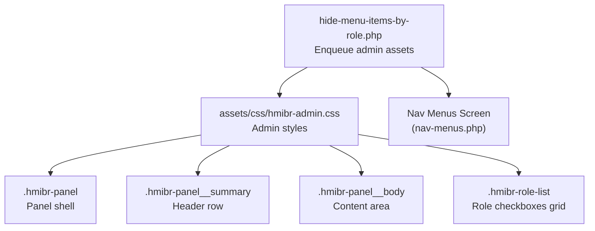
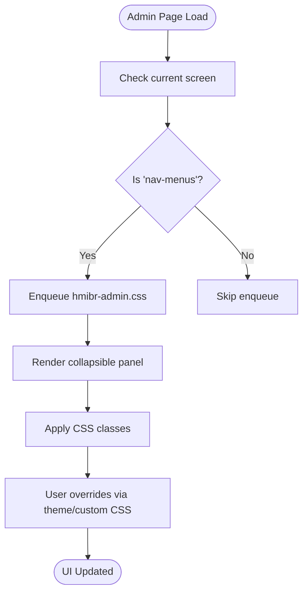
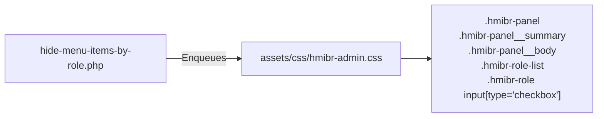

# CSS Customization

<cite>
**Referenced Files in This Document**
- [hmibr-admin.css](file://assets/css/hmibr-admin.css)
- [hide-menu-items-by-role.php](file://hide-menu-items-by-role.php)
</cite>

## Table of Contents
1. [Introduction](#introduction)
2. [Project Structure](#project-structure)
3. [Core Components](#core-components)
4. [Architecture Overview](#architecture-overview)
5. [Detailed Component Analysis](#detailed-component-analysis)
6. [Dependency Analysis](#dependency-analysis)
7. [Performance Considerations](#performance-considerations)
8. [Troubleshooting Guide](#troubleshooting-guide)
9. [Conclusion](#conclusion)
10. [Appendices](#appendices)

## Introduction
This document explains how to customize the admin interface styling for the Hide Menu Items by Role plugin. It covers all available CSS classes, their purposes, and practical guidance on overriding default styles through child themes or custom CSS plugins. You will find examples for changing colors, fonts, spacing, and layout, along with responsive design considerations, browser compatibility notes, and tips for maintaining WordPress admin theme consistency.

The plugin’s admin UI is a collapsible “Audience Visibility” panel that appears in the WordPress navigation menu editor. Its appearance is controlled by a dedicated stylesheet loaded only on the nav-menus screen.

## Project Structure
The plugin loads its admin stylesheet conditionally when editing menus. The main plugin file enqueues the CSS asset on the correct admin screen, ensuring styles are applied only where needed.

**Diagram sources**
- [hide-menu-items-by-role.php:21-42](file://hide-menu-items-by-role.php#L21-L42)
- [hmibr-admin.css:21-261](file://assets/css/hmibr-admin.css#L21-L261)

**Section sources**
- [hide-menu-items-by-role.php:21-42](file://hide-menu-items-by-role.php#L21-L42)

## Core Components
This section documents the primary CSS classes used by the plugin’s admin interface and what each one controls.

- .hmibr-panel
  - Purpose: Container for the collapsible panel. Controls outer margin, background, border, rounded corners, and overflow behavior.
  - Typical overrides: background-color, border, border-radius, box-shadow, margin.

- .hmibr-panel__summary
  - Purpose: Header row of the panel (clickable summary). Manages flex layout, padding, background color, text color, cursor, user-select behavior, hover state, focus-visible outline, and open-state bottom border.
  - Typical overrides: background-color, color, padding, font-size, border-bottom, outline.

- .hmibr-panel__icon and .hmibr-panel__chevron
  - Purpose: Icon and chevron elements inside the header. Control size, color, transitions, and chevron rotation when closed.
  - Typical overrides: width/height, color, transform transition duration.

- .hmibr-panel__title
  - Purpose: Title text within the header. Controls typography and alignment.
  - Typical overrides: font-size, font-weight, line-height, color.

- .hmibr-panel__body
  - Purpose: Content container below the header. Controls padding and background.
  - Typical overrides: padding, background-color.

- .hmibr-field-row and related labels
  - Purpose: Layout rows for visibility controls and labels. Uses flexbox with wrapping and gap.
  - Typical overrides: gap, margin, font-size, line-height, color.

- select (within .hmibr-panel)
  - Purpose: Styled dropdowns for visibility mode and other selects. Includes custom arrow, borders, focus states, disabled state, and hover effects.
  - Typical overrides: border-color, background-image (arrow), focus ring, disabled colors.

- .hmibr-roles-title
  - Purpose: Label above the role checkboxes. Controls typography and spacing.
  - Typical overrides: font-size, font-weight, color, margin-bottom.

- .hmibr-role-list
  - Purpose: Grid layout for role checkboxes. Uses auto-fit columns with minimum widths and gaps.
  - Typical overrides: grid-template-columns, gap, align-items.

- .hmibr-role and .hmibr-role__name
  - Purpose: Each role item row and its label text. Flex layout with gap and typography.
  - Typical overrides: font-size, color, gap, min-width.

- .hmibr-role input[type="checkbox"]
  - Purpose: Custom-styled checkbox inputs. Removes native appearance, sets size, border, radius, transitions, checked state with checkmark icon, focus ring, and disabled cursor.
  - Typical overrides: border-color, background-color, background-image (checkmark), focus ring, width/height, border-radius.

- .hmibr-disabled
  - Purpose: Utility class to visually disable fields when certain visibility modes are selected. Applies reduced opacity and not-allowed cursor to nested inputs/selects.
  - Typical overrides: opacity, cursor.

**Section sources**
- [hmibr-admin.css:8-15](file://assets/css/hmibr-admin.css#L8-L15)
- [hmibr-admin.css:21-27](file://assets/css/hmibr-admin.css#L21-L27)
- [hmibr-admin.css:33-100](file://assets/css/hmibr-admin.css#L33-L100)
- [hmibr-admin.css:106-181](file://assets/css/hmibr-admin.css#L106-L181)
- [hmibr-admin.css:187-261](file://assets/css/hmibr-admin.css#L187-L261)

## Architecture Overview
The plugin’s admin styles are scoped to the nav-menus screen and encapsulated under a consistent naming scheme. This makes it safe to override without affecting other parts of WordPress admin.

**Diagram sources**
- [hide-menu-items-by-role.php:21-42](file://hide-menu-items-by-role.php#L21-L42)
- [hmibr-admin.css:21-261](file://assets/css/hmibr-admin.css#L21-L261)

## Detailed Component Analysis

### Panel Shell (.hmibr-panel)
- Behavior: Provides a bordered, rounded container with hidden overflow to keep internal content neatly contained.
- Customization tips:
  - Change background-color to match your brand.
  - Adjust border-radius for softer or sharper corners.
  - Add box-shadow for elevation if desired.

**Section sources**
- [hmibr-admin.css:21-27](file://assets/css/hmibr-admin.css#L21-L27)

### Panel Header (.hmibr-panel__summary)
- Behavior: Acts as a clickable header with hover and focus-visible states; adds a bottom border when the panel is open.
- Customization tips:
  - Modify background-color and color for contrast.
  - Increase padding for a more spacious header.
  - Customize focus-visible outline to match your admin theme.

**Section sources**
- [hmibr-admin.css:33-66](file://assets/css/hmibr-admin.css#L33-L66)

### Icons and Chevron (.hmibr-panel__icon, .hmibr-panel__chevron)
- Behavior: Displays icons and a chevron that rotates when the panel is closed.
- Customization tips:
  - Resize icons by adjusting width/height.
  - Change color to align with your theme.
  - Tweak transition timing for smoother animations.

**Section sources**
- [hmibr-admin.css:68-91](file://assets/css/hmibr-admin.css#L68-L91)

### Panel Title (.hmibr-panel__title)
- Behavior: Styles the title text within the header.
- Customization tips:
  - Adjust font-size, font-weight, and line-height for emphasis.
  - Change color to match your admin palette.

**Section sources**
- [hmibr-admin.css:93-100](file://assets/css/hmibr-admin.css#L93-L100)

### Panel Body (.hmibr-panel__body)
- Behavior: Wraps the control fields with padding and white background.
- Customization tips:
  - Increase padding for more breathing room.
  - Override background-color if you want a subtle tint.

**Section sources**
- [hmibr-admin.css:106-109](file://assets/css/hmibr-admin.css#L106-L109)

### Field Rows and Labels (.hmibr-field-row, .hmibr-field-label)
- Behavior: Organizes visibility controls and labels using flexbox with wrap and gap.
- Customization tips:
  - Adjust gap to tighten or loosen spacing between controls.
  - Modify font-size and line-height for readability.
  - Change color to match your theme.

**Section sources**
- [hmibr-admin.css:112-136](file://assets/css/hmibr-admin.css#L112-L136)

### Select Inputs (within .hmibr-panel)
- Behavior: Custom-styled dropdowns with a custom arrow, hover/focus/disabled states, and focus rings tied to the WordPress admin theme color variable.
- Customization tips:
  - Replace the arrow background-image with a different SVG if needed.
  - Customize border-color and focus ring to match your theme.
  - Adjust height and padding for larger or smaller controls.

**Section sources**
- [hmibr-admin.css:138-181](file://assets/css/hmibr-admin.css#L138-L181)

### Role Titles and List (.hmibr-roles-title, .hmibr-role-list)
- Behavior: Presents a grid of role checkboxes with auto-fit columns and consistent gaps.
- Customization tips:
  - Change grid-template-columns to force more or fewer columns.
  - Adjust gap to increase/decrease spacing between items.
  - Align items vertically with align-items.

**Section sources**
- [hmibr-admin.css:187-202](file://assets/css/hmibr-admin.css#L187-L202)

### Role Items (.hmibr-role, .hmibr-role__name)
- Behavior: Each role row uses flexbox to align the checkbox and label text.
- Customization tips:
  - Increase gap for more space between checkbox and label.
  - Adjust font-size and color for better hierarchy.

**Section sources**
- [hmibr-admin.css:204-220](file://assets/css/hmibr-admin.css#L204-L220)

### Role Checkboxes (.hmibr-role input[type="checkbox"])
- Behavior: Fully styled checkboxes with custom appearance, transitions, checked state with an inline SVG checkmark, focus ring, and disabled cursor.
- Customization tips:
  - Change border-color and background-color for unchecked state.
  - Replace the checked background-image to use a different checkmark style.
  - Adjust width/height and border-radius for square or rounded checkboxes.
  - Customize focus ring to match your admin theme.

**Section sources**
- [hmibr-admin.css:222-261](file://assets/css/hmibr-admin.css#L222-L261)

### Disabled State (.hmibr-disabled)
- Behavior: Reduces opacity and disables pointer events for nested inputs/selects when certain visibility modes lock fields.
- Customization tips:
  - Adjust opacity to make disabled fields more or less prominent.
  - Override cursor for nested elements if needed.

**Section sources**
- [hmibr-admin.css:8-15](file://assets/css/hmibr-admin.css#L8-L15)

## Dependency Analysis
The plugin’s stylesheet is enqueued only on the nav-menus screen, which prevents unnecessary CSS from loading elsewhere in the admin. This targeted loading improves performance and reduces conflicts.

**Diagram sources**
- [hide-menu-items-by-role.php:21-42](file://hide-menu-items-by-role.php#L21-L42)
- [hmibr-admin.css:21-261](file://assets/css/hmibr-admin.css#L21-L261)

**Section sources**
- [hide-menu-items-by-role.php:21-42](file://hide-menu-items-by-role.php#L21-L42)

## Performance Considerations
- Scoped Loading: Styles load only on the nav-menus screen, minimizing overhead.
- Minimal Overrides: Prefer targeting specific classes rather than global resets to avoid heavy repaints.
- Avoid Deep Selectors: Use direct class selectors (e.g., .hmibr-panel .hmibr-role-list) instead of overly deep descendant chains.
- Limit Animations: Keep transitions short and simple to maintain responsiveness.

[No sources needed since this section provides general guidance]

## Troubleshooting Guide
- Styles Not Applying
  - Verify you are on the nav-menus screen; styles are enqueued only there.
  - Ensure your custom CSS loads after the plugin’s stylesheet.
  - Inspect the DOM to confirm class names exist and are not overridden.

- Conflicts With Theme or Plugins
  - Use more specific selectors (e.g., .wp-admin .hmibr-panel) if necessary.
  - Wrap your overrides in a media query to target desktop/mobile separately.

- Checkbox Appearance Issues
  - Confirm appearance: none is applied and background-image is set for checked state.
  - If another plugin resets checkbox styles, add !important sparingly or increase specificity.

- Focus Ring Missing
  - Ensure your environment supports :focus-visible or provide a fallback outline.

**Section sources**
- [hide-menu-items-by-role.php:21-42](file://hide-menu-items-by-role.php#L21-L42)
- [hmibr-admin.css:59-62](file://assets/css/hmibr-admin.css#L59-L62)
- [hmibr-admin.css:253-257](file://assets/css/hmibr-admin.css#L253-L257)

## Conclusion
By understanding the plugin’s CSS architecture and class responsibilities, you can safely customize the admin interface while preserving WordPress admin consistency. Use the provided class references to adjust colors, typography, spacing, and layout. Load your overrides after the plugin stylesheet and scope them appropriately to avoid conflicts. For responsive adjustments, leverage the existing grid and flex layouts and refine gaps and column counts as needed.

[No sources needed since this section summarizes without analyzing specific files]

## Appendices

### How to Override Default Styling
- Child Theme
  - Add your custom CSS to your child theme’s stylesheet.
  - Ensure it loads after the plugin’s stylesheet (WordPress typically handles order automatically when enqueuing correctly).
- Custom CSS Plugin
  - Use a plugin like “Simple Custom CSS and JS” to inject overrides.
  - Place your rules at the end so they take precedence.

Best Practices
- Scope selectors to .wp-admin to avoid front-end leakage.
- Prefer modifying variables like --wp-admin-theme-color indirectly via higher-specificity rules.
- Test across browsers and devices; verify focus states and accessibility.

Common Visual Modifications
- Colors
  - Change .hmibr-panel background-color and border-color.
  - Update .hmibr-panel__summary background-color and color.
  - Adjust .hmibr-role input[type="checkbox"] border-color and background-color.
- Fonts
  - Modify .hmibr-panel__title, .hmibr-field-label, and .hmibr-role typography.
- Spacing
  - Adjust .hmibr-panel__body padding and .hmibr-role-list gap.
- Layout
  - Change .hmibr-role-list grid-template-columns to fit more or fewer roles per row.
  - Adjust .hmibr-field-row gap for tighter or looser control spacing.

Responsive Design Considerations
- The role list uses a responsive grid with auto-fit columns; tweak minmax values to control breakpoints.
- On narrow screens, reduce padding and font sizes for compactness.
- Ensure checkboxes remain accessible and large enough to tap on touch devices.

Browser Compatibility
- Modern browsers support flexbox, grid, :focus-visible, and CSS variables.
- For older browsers, provide fallbacks for :focus-visible and consider polyfills if necessary.
- The plugin avoids experimental features beyond widely supported ones.

Maintaining WordPress Admin Consistency
- Use the same color palette and typography as the WordPress admin.
- Respect admin spacing conventions and component heights.
- Align focus rings and outlines with the admin theme color variable.

[No sources needed since this section provides general guidance]