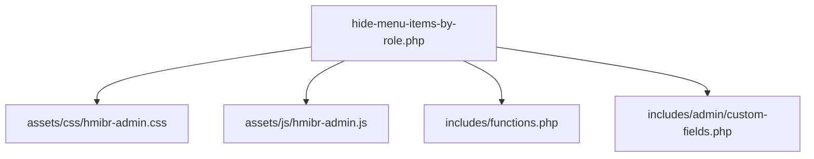
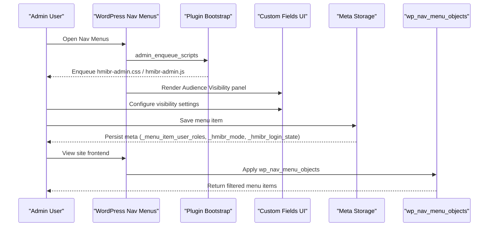
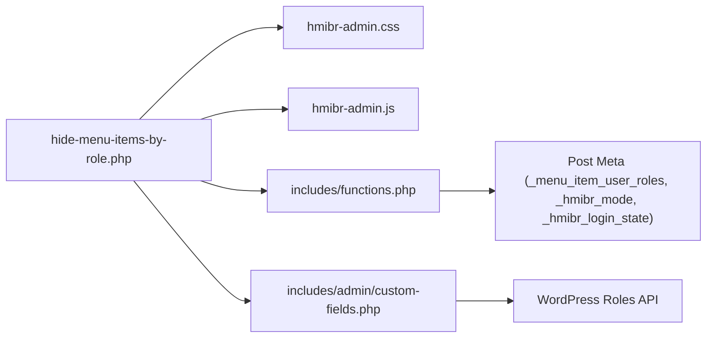

# Customization Guide

<cite>
**Referenced Files in This Document**
- [hide-menu-items-by-role.php](file://hide-menu-items-by-role.php)
- [hmibr-admin.css](file://assets/css/hmibr-admin.css)
- [hmibr-admin.js](file://assets/js/hmibr-admin.js)
- [functions.php](file://includes/functions.php)
- [custom-fields.php](file://includes/admin/custom-fields.php)
- [README.txt](file://README.txt)
</cite>

## Table of Contents
1. [Introduction](#introduction)
2. [Project Structure](#project-structure)
3. [Core Components](#core-components)
4. [Architecture Overview](#architecture-overview)
5. [Detailed Component Analysis](#detailed-component-analysis)
6. [Dependency Analysis](#dependency-analysis)
7. [Performance Considerations](#performance-considerations)
8. [Troubleshooting Guide](#troubleshooting-guide)
9. [Conclusion](#conclusion)
10. [Appendices](#appendices)

## Introduction
This guide explains how to customize and extend the Hide Menu Items by Role plugin. It focuses on:
- Styling the admin interface via CSS (hmibr-admin.css)
- Enhancing admin interactivity via JavaScript (hmibr-admin.js)
- Adding or customizing user roles for menu visibility
- Overriding default behavior using WordPress hooks and filters
- Optimizing performance for large menus
- Ensuring compatibility with popular themes and plugins
- Practical customization scenarios and implementation approaches

The plugin adds an “Audience Visibility” panel in the WordPress menu editor, allowing you to control visibility based on login state and user roles. It uses core WordPress filters to hide or show menu items at runtime without requiring front-end JavaScript.

**Section sources**
- [README.txt:10-20](file://README.txt#L10-L20)

## Project Structure
Key files and their responsibilities:
- Plugin bootstrap and asset enqueueing: hide-menu-items-by-role.php
- Admin styles: assets/css/hmibr-admin.css
- Admin scripts: assets/js/hmibr-admin.js
- Core filtering logic: includes/functions.php
- Admin UI fields and saving logic: includes/admin/custom-fields.php

**Diagram sources**
- [hide-menu-items-by-role.php:20-46](file://hide-menu-items-by-role.php#L20-L46)
- [functions.php:1-49](file://includes/functions.php#L1-L49)
- [custom-fields.php:1-147](file://includes/admin/custom-fields.php#L1-L147)

**Section sources**
- [hide-menu-items-by-role.php:16-46](file://hide-menu-items-by-role.php#L16-L46)

## Core Components
- Admin asset loader: Enqueues CSS and JS only on the nav-menus screen.
- Admin UI: Adds a collapsible “Audience Visibility” panel with controls for login state, mode (hide/show), and role checkboxes.
- Save handler: Sanitizes and persists meta values for each menu item.
- Runtime filter: Hides or shows menu items based on current user roles and login state.

**Section sources**
- [hide-menu-items-by-role.php:20-46](file://hide-menu-items-by-role.php#L20-L46)
- [custom-fields.php:1-94](file://includes/admin/custom-fields.php#L1-L94)
- [custom-fields.php:96-147](file://includes/admin/custom-fields.php#L96-L147)
- [functions.php:1-49](file://includes/functions.php#L1-L49)

## Architecture Overview
High-level flow:
- On the nav-menus page, the plugin enqueues its CSS and JS.
- The admin UI renders additional fields per menu item.
- When a menu is saved, the plugin validates and stores meta data.
- At runtime, the plugin filters menu objects to apply visibility rules.

**Diagram sources**
- [hide-menu-items-by-role.php:20-46](file://hide-menu-items-by-role.php#L20-L46)
- [custom-fields.php:1-94](file://includes/admin/custom-fields.php#L1-L94)
- [custom-fields.php:96-147](file://includes/admin/custom-fields.php#L96-L147)
- [functions.php:1-49](file://includes/functions.php#L1-L49)

## Detailed Component Analysis

### CSS Customization (hmibr-admin.css)
The stylesheet defines the “Audience Visibility” panel and its interactive states. Key areas to customize:
- Panel shell and header: .hmibr-panel, .hmibr-panel__summary
- Panel body layout: .hmibr-panel__body, .hmibr-field-row
- Select styling: .hmibr-panel select
- Role checkboxes grid and labels: .hmibr-role-list, .hmibr-role, .hmibr-role input[type="checkbox"]
- Disabled state: .hmibr-disabled

Guidelines:
- Use existing class names to override colors, spacing, typography, and focus states.
- To change the panel background or border, target .hmibr-panel.
- To adjust the role checkbox grid density, modify .hmibr-role-list grid properties.
- To style disabled fields, extend .hmibr-disabled and its children.

Example customization targets:
- Panel header hover/focus: .hmibr-panel__summary:hover, .hmibr-panel__summary:focus-visible
- Select dropdown appearance: .hmibr-panel select, :focus, :disabled
- Checkbox checked state: .hmibr-role input[type="checkbox"]:checked

**Section sources**
- [hmibr-admin.css:1-262](file://assets/css/hmibr-admin.css#L1-L262)

### JavaScript Interactivity (hmibr-admin.js)
The script enhances the admin experience by:
- Disabling the mode and role fields when “Logged-out users only” is selected.
- Applying visual disabled states via the .hmibr-disabled class.
- Updating field states dynamically on changes to the login state selector.

Enhancement ideas:
- Add validation feedback when no roles are selected in “Show only to these roles”.
- Debounce rapid changes to improve responsiveness.
- Integrate with WordPress’s notice system to warn about conflicting settings.

Implementation notes:
- The script selects elements by attribute selectors tied to menu item IDs.
- It toggles disabled states and CSS classes accordingly.

**Section sources**
- [hmibr-admin.js:1-41](file://assets/js/hmibr-admin.js#L1-L41)

### Adding New Roles or Customizing Role Behaviors
Roles are sourced from WordPress’s built-in roles API. To add or customize roles:
- Register new roles using WordPress functions such as add_role() and assign capabilities.
- The plugin will automatically include newly registered roles in the role checkboxes.
- To restrict which roles appear in the UI, hook into the roles list generation before rendering the panel.

Behavioral customization:
- Extend the runtime filter to consider additional conditions (e.g., user meta, capabilities).
- Adjust the save handler to validate against a whitelist of allowed roles if needed.

**Section sources**
- [custom-fields.php:8-58](file://includes/admin/custom-fields.php#L8-L58)
- [functions.php:1-49](file://includes/functions.php#L1-L49)

### Overriding Default Functionality via Hooks and Filters
Primary extension points:
- wp_nav_menu_objects: Modify menu items before rendering.
- wp_nav_menu_item_custom_fields: Customize the admin UI fields.
- wp_update_nav_menu_item: Intercept saving of menu item meta.

Common overrides:
- Change visibility logic: Hook into wp_nav_menu_objects to implement custom rules.
- Replace the UI panel: Hook into wp_nav_menu_item_custom_fields to render your own controls.
- Alter saved meta: Hook into wp_update_nav_menu_item to sanitize or transform stored values.

Best practices:
- Preserve original meta keys unless you fully replace them.
- Ensure sanitization and validation when handling $_POST data.
- Keep dependencies minimal; avoid heavy computations in hot paths like wp_nav_menu_objects.

**Section sources**
- [functions.php:49-49](file://includes/functions.php#L49-L49)
- [custom-fields.php:94-94](file://includes/admin/custom-fields.php#L94-L94)
- [custom-fields.php:146-146](file://includes/admin/custom-fields.php#L146-L146)

### Performance Optimization Techniques
Optimization strategies:
- Early exit on login state: If the login state rule resolves to hide, skip role checks entirely.
- Minimize meta reads: Cache user roles and menu item meta where appropriate.
- Avoid heavy operations in wp_nav_menu_objects: Keep logic simple and fast.
- Defer non-critical JS: Load scripts only on nav-menus and ensure they are lightweight.

Current implementation highlights:
- Login state check occurs first and can short-circuit further processing.
- Role arrays are intersected efficiently to determine overlap.

**Section sources**
- [functions.php:15-24](file://includes/functions.php#L15-L24)
- [functions.php:32-43](file://includes/functions.php#L32-L43)

### Compatibility Considerations
- Theme compatibility: Styles are scoped to admin panels and use standard WordPress admin classes. Avoid overriding global admin styles unintentionally.
- Plugin conflicts: If another plugin modifies nav-menus UI, ensure your hooks run at appropriate priorities.
- Accessibility: The panel uses semantic 
/
 and keyboard-friendly focus states. Maintain this when customizing.

**Section sources**
- [hmibr-admin.css:1-262](file://assets/css/hmibr-admin.css#L1-L262)

## Dependency Analysis
Component relationships:
- Plugin bootstrap enqueues assets and loads includes.
- Admin UI depends on WordPress roles API to render available roles.
- Runtime filter depends on post meta values to decide visibility.

**Diagram sources**
- [hide-menu-items-by-role.php:20-46](file://hide-menu-items-by-role.php#L20-L46)
- [custom-fields.php:8-58](file://includes/admin/custom-fields.php#L8-L58)
- [functions.php:12-43](file://includes/functions.php#L12-L43)

**Section sources**
- [hide-menu-items-by-role.php:20-46](file://hide-menu-items-by-role.php#L20-L46)
- [custom-fields.php:8-58](file://includes/admin/custom-fields.php#L8-L58)
- [functions.php:12-43](file://includes/functions.php#L12-L43)

## Performance Considerations
- Prefer early exits: If login state determines visibility, avoid role checks.
- Limit scope: Only load admin assets on nav-menus screens.
- Keep JS minimal: Use event delegation and avoid reflow-heavy operations.
- Validate inputs: Prevent unnecessary database writes by validating roles during save.

[No sources needed since this section provides general guidance]

## Troubleshooting Guide
Common issues and resolutions:
- Fields not updating: Ensure the login state selector triggers the update function. Verify that the script runs after DOM ready.
- Styles not applied: Confirm that hmibr-admin.css is enqueued on nav-menus and that your custom CSS has sufficient specificity.
- Roles not appearing: Check that roles are registered and accessible via the roles API.
- Settings not saving: Inspect the save handler to ensure meta keys match expectations and values are sanitized.

Debugging tips:
- Temporarily log meta values during save to verify persistence.
- Use browser dev tools to inspect element classes and attributes.
- Disable other plugins temporarily to isolate conflicts.

**Section sources**
- [hmibr-admin.js:5-40](file://assets/js/hmibr-admin.js#L5-L40)
- [custom-fields.php:96-147](file://includes/admin/custom-fields.php#L96-L147)

## Conclusion
You can extensively customize the Hide Menu Items by Role plugin by:
- Styling the admin UI through targeted CSS classes
- Extending interactivity with lightweight JavaScript enhancements
- Adding or restricting roles and adjusting role-based behaviors
- Overriding default functionality via WordPress hooks and filters
- Optimizing performance by leveraging early exits and efficient logic
- Ensuring compatibility with themes and plugins through scoped styles and careful hook usage

[No sources needed since this section summarizes without analyzing specific files]

## Appendices

### Common Customization Scenarios

- Scenario 1: Change panel colors and typography
  - Target .hmibr-panel, .hmibr-panel__summary, .hmibr-panel__title, and .hmibr-panel__body to adjust colors, fonts, and spacing.
  - Reference: [hmibr-admin.css:21-109](file://assets/css/hmibr-admin.css#L21-L109)

- Scenario 2: Restrict visible roles in the UI
  - Hook into the roles list generation before rendering the panel to filter out certain roles.
  - Reference: [custom-fields.php:8-58](file://includes/admin/custom-fields.php#L8-L58)

- Scenario 3: Add a capability-based rule alongside roles
  - Extend the runtime filter to check user capabilities in addition to roles.
  - Reference: [functions.php:1-49](file://includes/functions.php#L1-L49)

- Scenario 4: Improve accessibility of the panel
  - Ensure focus outlines and keyboard navigation remain intact when customizing styles.
  - Reference: [hmibr-admin.css:59-62](file://assets/css/hmibr-admin.css#L59-L62)

- Scenario 5: Optimize for very large menus
  - Implement early exits based on login state and minimize meta reads.
  - Reference: [functions.php:15-24](file://includes/functions.php#L15-L24)

**Section sources**
- [hmibr-admin.css:21-109](file://assets/css/hmibr-admin.css#L21-L109)
- [custom-fields.php:8-58](file://includes/admin/custom-fields.php#L8-L58)
- [functions.php:1-49](file://includes/functions.php#L1-L49)