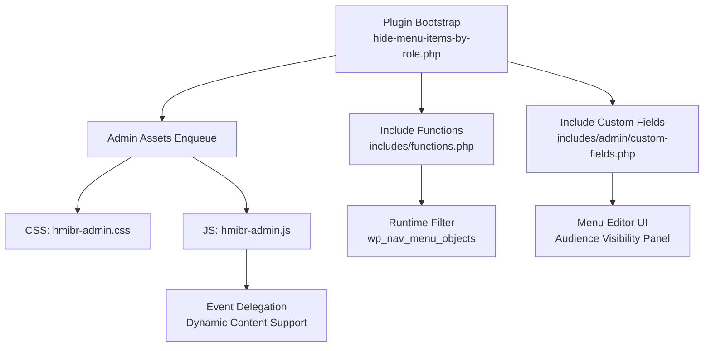
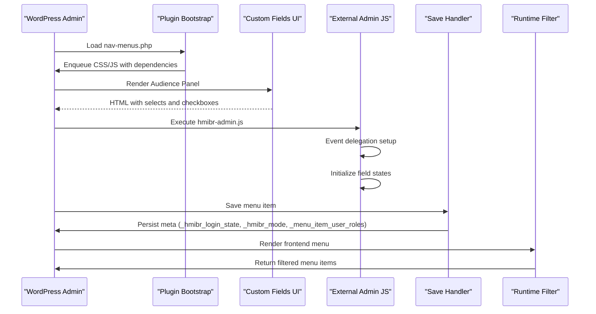
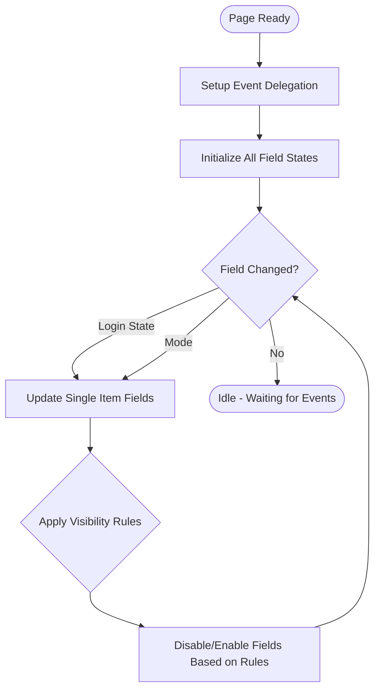
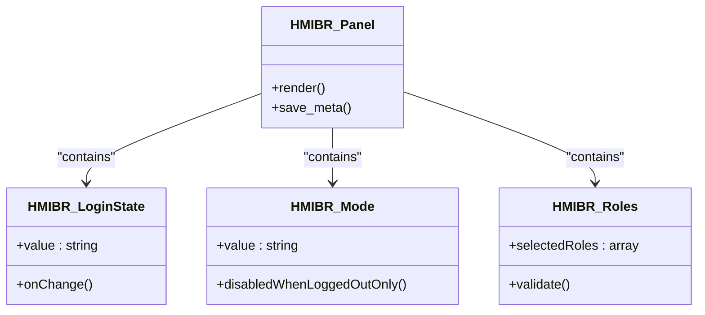
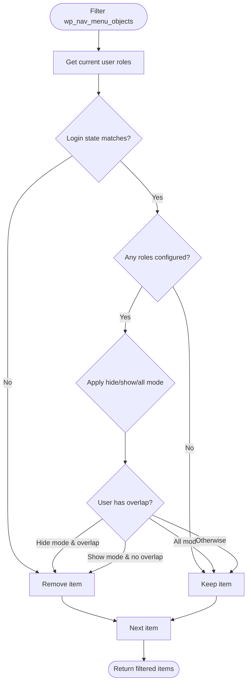
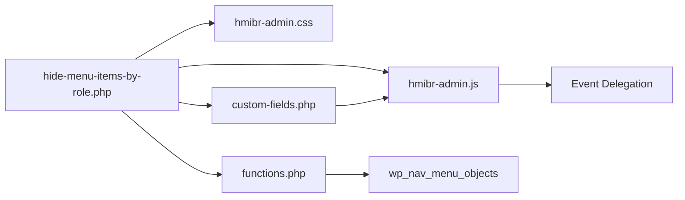

# JavaScript Enhancement

<cite>
**Referenced Files in This Document**
- [hide-menu-items-by-role.php](file://hide-menu-items-by-role.php)
- [hmibr-admin.js](file://assets/js/hmibr-admin.js)
- [custom-fields.php](file://includes/admin/custom-fields.php)
- [functions.php](file://includes/functions.php)
- [hmibr-admin.css](file://assets/css/hmibr-admin.css)
- [README.txt](file://README.txt)
</cite>

## Update Summary
**Changes Made**
- Updated JavaScript architecture section to reflect external file implementation
- Added new event delegation patterns documentation
- Enhanced visibility modes handling explanation
- Updated extensibility points for modern jQuery practices
- Improved performance considerations section

## Table of Contents
1. [Introduction](#introduction)
2. [Project Structure](#project-structure)
3. [Core Components](#core-components)
4. [Architecture Overview](#architecture-overview)
5. [Detailed Component Analysis](#detailed-component-analysis)
6. [Dependency Analysis](#dependency-analysis)
7. [Performance Considerations](#performance-considerations)
8. [Troubleshooting Guide](#troubleshooting-guide)
9. [Conclusion](#conclusion)
10. [Appendices](#appendices)

## Introduction
This document explains how to extend the Hide Menu Items by Role plugin's admin JavaScript for enhanced interactions in the WordPress menu editor. It focuses on:
- The modern jQuery-based behavior using external file implementation and event delegation
- How to hook into visibility changes to add validation, animations, or additional UI feedback
- Extending the role selection interface and adding new field types
- Integrating with other WordPress admin features safely

The goal is to help you build robust enhancements while avoiding conflicts with other plugins and WordPress core.

## Project Structure
The plugin organizes its code into clear layers with modern JavaScript architecture:
- Plugin bootstrap and asset enqueueing
- Admin UI fields (PHP)
- External admin JavaScript (jQuery with event delegation)
- Runtime filtering logic (PHP)
- Dedicated CSS styling

**Diagram sources**
- [hide-menu-items-by-role.php:20-46](file://hide-menu-items-by-role.php#L20-L46)
- [custom-fields.php:1-126](file://includes/admin/custom-fields.php#L1-L126)
- [functions.php:1-56](file://includes/functions.php#L1-L56)
- [hmibr-admin.js:1-51](file://assets/js/hmibr-admin.js#L1-L51)

**Section sources**
- [hide-menu-items-by-role.php:16-58](file://hide-menu-items-by-role.php#L16-L58)
- [custom-fields.php:1-126](file://includes/admin/custom-fields.php#L1-L126)
- [functions.php:1-56](file://includes/functions.php#L1-L56)

## Core Components
- Asset enqueueing ensures the plugin's CSS and JS load only on the nav-menus screen with proper dependencies.
- The custom fields PHP renders an "Audience" panel with:
  - Login state selector (any, logged-in, logged-out)
  - Mode selector (show to all roles, hide for selected roles, show only to selected roles)
  - Role checkboxes
- The external admin JS uses event delegation to handle login state and mode changes efficiently.
- The runtime filter hides or shows menu items based on current user roles and saved settings.

Key responsibilities:
- hide-menu-items-by-role.php: defines constants, enqueues assets, includes files
- custom-fields.php: renders UI and saves meta values
- hmibr-admin.js: modular functions with event delegation for field state management
- functions.php: filters menu objects at runtime
- hmibr-admin.css: comprehensive styling for the audience panel

**Section sources**
- [hide-menu-items-by-role.php:20-58](file://hide-menu-items-by-role.php#L20-L58)
- [custom-fields.php:1-126](file://includes/admin/custom-fields.php#L1-L126)
- [hmibr-admin.js:1-51](file://assets/js/hmibr-admin.js#L1-L51)
- [functions.php:1-56](file://includes/functions.php#L1-L56)
- [hmibr-admin.css:1-273](file://assets/css/hmibr-admin.css#L1-L273)

## Architecture Overview
The admin experience flows as follows with modern JavaScript patterns:
- On the nav-menus page, the plugin enqueues its script and styles with proper dependencies.
- The menu item editor includes a custom panel with visibility controls.
- Event delegation handles login state and mode changes dynamically.
- On save, PHP validates and persists meta values.
- At runtime, the plugin filters menu items based on current user context and saved settings.

**Diagram sources**
- [hide-menu-items-by-role.php:20-58](file://hide-menu-items-by-role.php#L20-L58)
- [custom-fields.php:1-126](file://includes/admin/custom-fields.php#L1-L126)
- [hmibr-admin.js:1-51](file://assets/js/hmibr-admin.js#L1-L51)
- [functions.php:1-56](file://includes/functions.php#L1-L56)

## Detailed Component Analysis

### Modern Admin JavaScript Architecture (hmibr-admin.js)
What it does:
- Uses external file implementation with proper jQuery initialization
- Implements event delegation for dynamic content support
- Provides modular functions for field state management
- Handles three visibility modes: all, hide, show
- Supports both login state and mode changes efficiently

Key architectural improvements:
- **Event Delegation**: Uses `$(document).on('change', ...)` pattern for better performance
- **Modular Design**: Separate functions for individual item updates and bulk operations
- **Enhanced Selectors**: More specific selectors targeting individual menu items
- **State Management**: Clear logic for disabling/enabling fields based on visibility rules

Extensibility points:
- Hook into the delegated change events to run custom validation or show feedback
- Add animations when enabling/disabling fields using the existing class system
- Integrate with third-party UI libraries after field state changes
- Extend the updateItemFields function for custom field behaviors

Recommended approach:
- Use the existing modular function structure for consistency
- Leverage event delegation for any custom handlers
- Follow the established naming conventions for IDs and classes
- Debounce heavy operations if needed

**Diagram sources**
- [hmibr-admin.js:5-51](file://assets/js/hmibr-admin.js#L5-L51)

**Section sources**
- [hmibr-admin.js:5-51](file://assets/js/hmibr-admin.js#L5-L51)

### Enhanced Admin UI Fields (custom-fields.php)
What it does:
- Renders a collapsible "Audience" panel using native details/summary elements
- Provides enhanced field options:
  - Login state selector (any, logged-in, logged-out)
  - Mode selector (show to all roles, hide for selected roles, show only to selected roles)
  - Role checkboxes with improved UX
- Includes proper sanitization and validation for all inputs
- Saves sanitized meta values on menu update

Extensibility points:
- Add new fields alongside existing ones with proper naming conventions
- Enhance the panel with additional sections or tabs
- Provide better UX with tooltips, descriptions, or conditional hints
- Extend the validation logic for custom fields

Best practices:
- Keep IDs unique per menu item using the item ID suffix
- Sanitize and validate all inputs before saving
- Use WordPress admin classes for consistent styling
- Follow the established field naming patterns for JavaScript integration

**Diagram sources**
- [custom-fields.php:1-126](file://includes/admin/custom-fields.php#L1-L126)

**Section sources**
- [custom-fields.php:1-126](file://includes/admin/custom-fields.php#L1-L126)

### Runtime Filtering (functions.php)
What it does:
- Reads current user roles and login status
- Applies login state rules first (early exit if mismatched)
- If no roles are configured, keeps the item visible
- Applies hide/show/all mode against user roles
- Returns filtered menu items with optimized performance

Extensibility points:
- Add new pre-filters to short-circuit processing
- Introduce capability checks or custom conditions
- Log decisions for debugging
- Extend role matching logic for custom user types

**Diagram sources**
- [functions.php:1-56](file://includes/functions.php#L1-L56)

**Section sources**
- [functions.php:1-56](file://includes/functions.php#L1-L56)

### Adding Custom Behaviors on Visibility Changes
To extend the existing interaction with modern patterns:
- Listen to the same delegated change events used by the plugin
- Validate new fields conditionally based on login state or mode
- Provide feedback via admin notices or inline messages
- Animate transitions when enabling/disabling fields using existing CSS classes

Example patterns:
- Validation: ensure required fields are filled when mode is "show"
- Animations: fade-in/out role checkboxes when switching modes
- Feedback: show a small notice explaining why certain fields are disabled
- Integration: sync with external tools when visibility settings change

Implementation tips:
- Use jQuery's `.on('change', ...)` with event delegation for dynamically added items
- Avoid blocking the UI; debounce expensive operations
- Respect WordPress admin accessibility standards (aria attributes, keyboard navigation)
- Follow the existing class naming conventions for visual feedback

[No sources needed since this section provides general guidance]

### Extending the Role Selection Interface
Ways to enhance the role selection UI:
- Add grouping or search/filter for roles
- Add presets (e.g., "All Editors")
- Add conditional fields (e.g., show extra options when specific roles are selected)
- Implement role hierarchy visualization

Guidelines:
- Keep IDs and names unique per menu item following the established patterns
- Maintain compatibility with WordPress's menu item structure
- Ensure your additions are saved and loaded correctly
- Follow the existing CSS class naming conventions for styling

[No sources needed since this section provides general guidance]

### Integrating With Other WordPress Admin Features
Common integrations:
- Add a button to copy settings across multiple menu items
- Sync settings with a custom taxonomy or post meta
- Use WordPress media library or date pickers for advanced configurations
- Integrate with role management plugins

Integration best practices:
- Enqueue dependencies only when needed
- Avoid overriding global jQuery behaviors
- Use WordPress hooks and actions rather than DOM manipulation where possible
- Follow the event delegation pattern for consistency

[No sources needed since this section provides general guidance]

## Dependency Analysis
The plugin's components depend on each other as follows with modern architecture:
- Bootstrap loads assets and includes PHP modules
- Custom fields render UI and work with external JavaScript
- Admin JS depends on jQuery and uses event delegation for selectors
- Runtime filter depends on saved meta values
- CSS provides comprehensive styling for all components

**Diagram sources**
- [hide-menu-items-by-role.php:20-58](file://hide-menu-items-by-role.php#L20-L58)
- [custom-fields.php:1-126](file://includes/admin/custom-fields.php#L1-L126)
- [functions.php:1-56](file://includes/functions.php#L1-L56)
- [hmibr-admin.js:1-51](file://assets/js/hmibr-admin.js#L1-L51)

**Section sources**
- [hide-menu-items-by-role.php:20-58](file://hide-menu-items-by-role.php#L20-L58)
- [custom-fields.php:1-126](file://includes/admin/custom-fields.php#L1-L126)
- [functions.php:1-56](file://includes/functions.php#L1-L56)

## Performance Considerations
- The runtime filter performs early exits for login state mismatches to avoid unnecessary role checks.
- In the admin UI, event delegation eliminates the need for multiple event listeners.
- External JavaScript file improves caching and reduces inline script overhead.
- Modular function structure allows for better code organization and potential lazy loading.
- Avoid heavy computations in change handlers; debounce if needed.
- Minimize DOM queries by leveraging the existing selector patterns.

[No sources needed since this section provides general guidance]

## Troubleshooting Guide
Common issues and resolutions:
- Fields not disabling:
  - Verify selectors match the plugin's naming conventions
  - Ensure your script runs after the plugin's initialization
  - Check that event delegation is properly set up
- Conflicts with other plugins:
  - Scope your jQuery selectors to the plugin's containers
  - Avoid global overrides of jQuery methods
  - Use event delegation to avoid conflicts with dynamic content
- Settings not saving:
  - Confirm your input names and IDs follow the expected pattern
  - Validate and sanitize inputs before saving
  - Check that the save handler is properly hooked

Debugging steps:
- Open browser console and check for jQuery errors
- Inspect DOM to confirm selectors exist
- Temporarily disable other plugins to isolate conflicts
- Check network tab to verify external JS file is loading

**Section sources**
- [hmibr-admin.js:5-51](file://assets/js/hmibr-admin.js#L5-L51)
- [custom-fields.php:74-126](file://includes/admin/custom-fields.php#L74-L126)

## Conclusion
You can confidently extend the Hide Menu Items by Role plugin by:
- Hooking into the existing delegated change events for login state and mode
- Adding validation, animations, and UI feedback tailored to your needs
- Extending the role selection interface with new fields and presets
- Integrating with other WordPress admin features while following best practices
- Leveraging the modern external JavaScript architecture for better maintainability

By adhering to the guidelines above and following the established patterns, you will maintain compatibility, improve usability, and keep performance optimal.

[No sources needed since this section summarizes without analyzing specific files]

## Appendices

### Best Practices for WordPress Admin JavaScript Development
- Always wrap code in jQuery(document).ready(...)
- Use event delegation for dynamic content
- Scope selectors to avoid conflicts
- Follow WordPress admin UI conventions and accessibility guidelines
- Avoid modifying global variables or overriding core behaviors
- Organize code into modular functions for better maintainability
- Use external JavaScript files for better caching and performance

[No sources needed since this section provides general guidance]

### Example Extension Scenarios
- Add a tooltip explaining why fields are disabled when login state is "logged out only"
- Show a confirmation dialog before changing mode to "show"
- Integrate with a third-party role manager plugin to sync roles
- Add custom validation for role combinations
- Implement animated transitions between different visibility modes

[No sources needed since this section provides general guidance]

### Modern JavaScript Patterns Used
- **Event Delegation**: Efficient handling of dynamic content through `$(document).on()`
- **Modular Functions**: Separation of concerns with dedicated functions for specific tasks
- **Enhanced Selectors**: More precise targeting of DOM elements for better performance
- **State Management**: Clear logic for managing field enable/disable states
- **External File Architecture**: Better caching, organization, and maintainability

[No sources needed since this section provides general guidance]