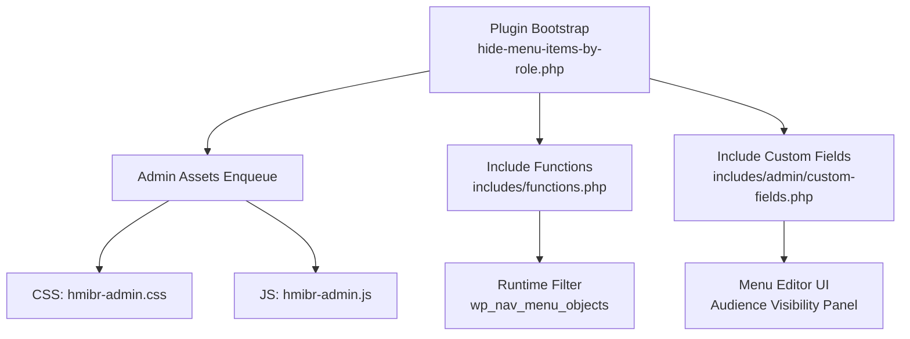
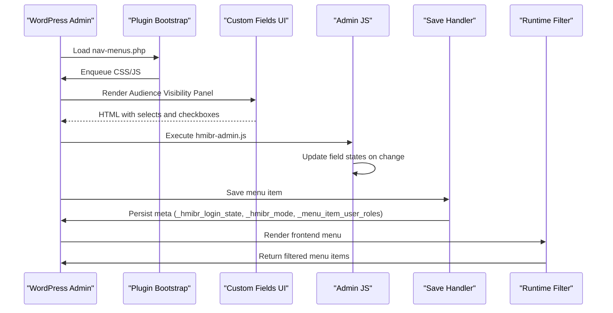
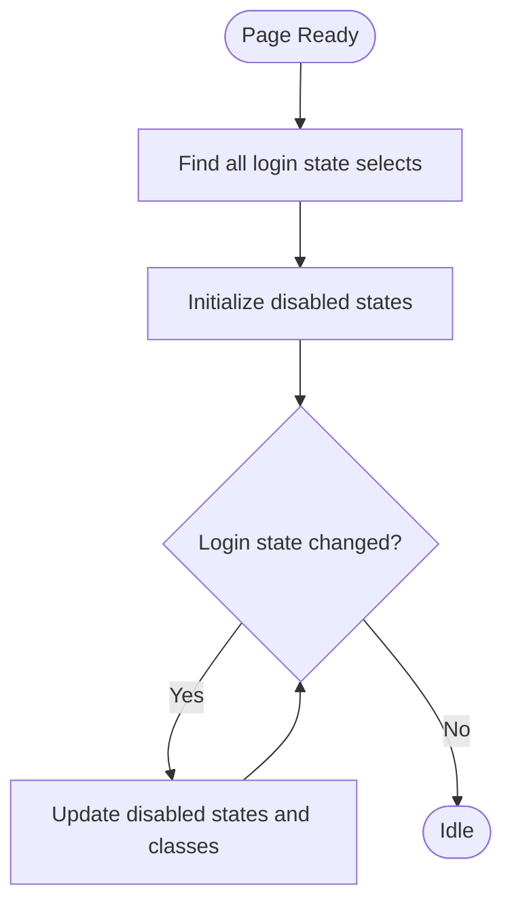
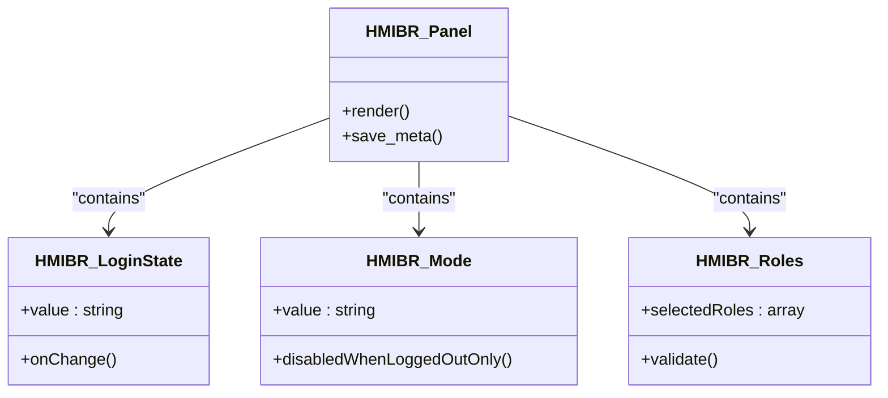
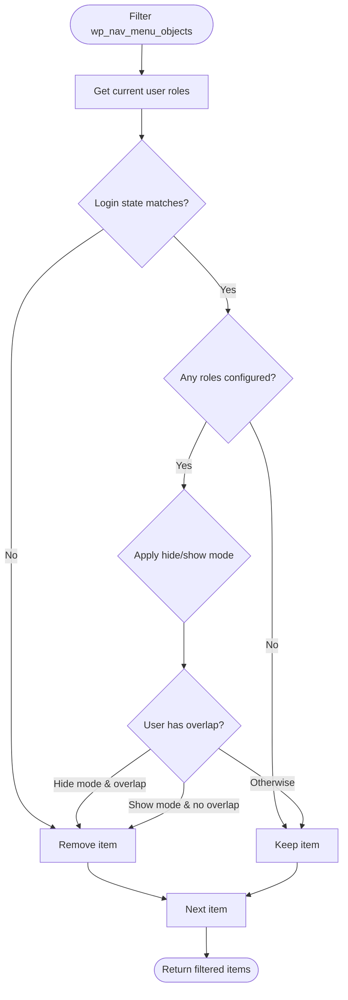
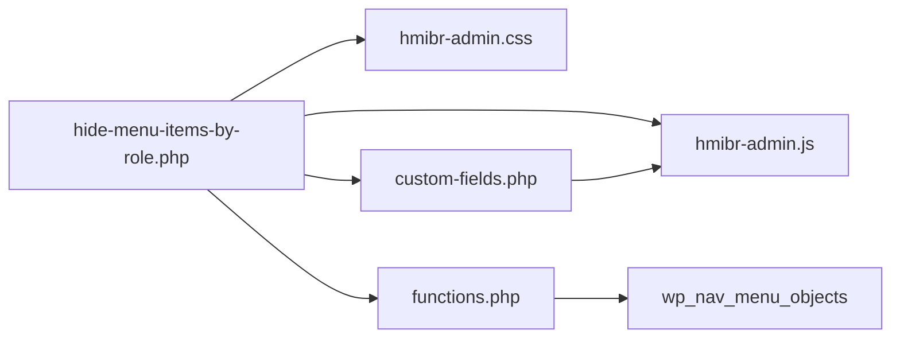

# JavaScript Enhancement

<cite>
**Referenced Files in This Document**
- [hide-menu-items-by-role.php](file://hide-menu-items-by-role.php)
- [hmibr-admin.js](file://assets/js/hmibr-admin.js)
- [custom-fields.php](file://includes/admin/custom-fields.php)
- [functions.php](file://includes/functions.php)
- [README.txt](file://README.txt)
</cite>

## Table of Contents
1. [Introduction](#introduction)
2. [Project Structure](#project-structure)
3. [Core Components](#core-components)
4. [Architecture Overview](#architecture-overview)
5. [Detailed Component Analysis](#detailed-component-analysis)
6. [Dependency Analysis](#dependency-analysis)
7. [Performance Considerations](#performance-considerations)
8. [Troubleshooting Guide](#troubleshooting-guide)
9. [Conclusion](#conclusion)
10. [Appendices](#appendices)

## Introduction
This document explains how to extend the Hide Menu Items by Role plugin’s admin JavaScript for enhanced interactions in the WordPress menu editor. It focuses on:
- The existing jQuery-based behavior that disables fields when visibility is restricted to logged-out users only
- How to hook into visibility changes to add validation, animations, or additional UI feedback
- Extending the role selection interface and adding new field types
- Integrating with other WordPress admin features safely

The goal is to help you build robust enhancements while avoiding conflicts with other plugins and WordPress core.

## Project Structure
The plugin organizes its code into clear layers:
- Plugin bootstrap and asset enqueueing
- Admin UI fields (PHP)
- Admin JavaScript (jQuery)
- Runtime filtering logic (PHP)

**Diagram sources**
- [hide-menu-items-by-role.php:20-42](file://hide-menu-items-by-role.php#L20-L42)
- [custom-fields.php:1-94](file://includes/admin/custom-fields.php#L1-L94)
- [functions.php:1-49](file://includes/functions.php#L1-L49)

**Section sources**
- [hide-menu-items-by-role.php:16-46](file://hide-menu-items-by-role.php#L16-L46)
- [custom-fields.php:1-94](file://includes/admin/custom-fields.php#L1-L94)
- [functions.php:1-49](file://includes/functions.php#L1-L49)

## Core Components
- Asset enqueueing ensures the plugin’s CSS and JS load only on the nav-menus screen.
- The custom fields PHP renders an “Audience Visibility” panel with:
  - Login state selector
  - Mode selector (hide/show)
  - Role checkboxes
- The admin JS listens for login state changes and disables related controls when necessary.
- The runtime filter hides or shows menu items based on current user roles and saved settings.

Key responsibilities:
- hide-menu-items-by-role.php: defines constants, enqueues assets, includes files
- custom-fields.php: renders UI and saves meta values
- hmibr-admin.js: updates field states based on login state
- functions.php: filters menu objects at runtime

**Section sources**
- [hide-menu-items-by-role.php:20-46](file://hide-menu-items-by-role.php#L20-L46)
- [custom-fields.php:1-146](file://includes/admin/custom-fields.php#L1-L146)
- [hmibr-admin.js:1-41](file://assets/js/hmibr-admin.js#L1-L41)
- [functions.php:1-49](file://includes/functions.php#L1-L49)

## Architecture Overview
The admin experience flows as follows:
- On the nav-menus page, the plugin enqueues its script and styles.
- The menu item editor includes a custom panel with visibility controls.
- When the login state changes, jQuery updates disabled states and visual classes.
- On save, PHP validates and persists meta values.
- At runtime, the plugin filters menu items based on current user context and saved settings.

**Diagram sources**
- [hide-menu-items-by-role.php:20-46](file://hide-menu-items-by-role.php#L20-L46)
- [custom-fields.php:1-146](file://includes/admin/custom-fields.php#L1-L146)
- [hmibr-admin.js:1-41](file://assets/js/hmibr-admin.js#L1-L41)
- [functions.php:1-49](file://includes/functions.php#L1-L49)

## Detailed Component Analysis

### Admin JavaScript Behavior (hmibr-admin.js)
What it does:
- Finds all login state selectors by name prefix
- For each, reads the selected value
- If set to “logged out only”, disables:
  - The mode selector
  - The role checkboxes container
- Adds/removes a CSS class to visually indicate disabled state
- Re-runs this logic whenever any login state selector changes

Extensibility points:
- Hook into the change event to run custom validation or show feedback
- Add animations when enabling/disabling fields
- Integrate with third-party UI libraries (e.g., select2) after disabling/enabling

Recommended approach:
- Wrap your custom logic inside the same change handler or call a shared function from there
- Use event delegation if dynamic menu items are added later
- Debounce heavy operations if needed

**Diagram sources**
- [hmibr-admin.js:5-41](file://assets/js/hmibr-admin.js#L5-L41)

**Section sources**
- [hmibr-admin.js:5-41](file://assets/js/hmibr-admin.js#L5-L41)

### Admin UI Fields (custom-fields.php)
What it does:
- Renders a collapsible “Audience Visibility” panel using native details/summary elements
- Provides:
  - Login state selector
  - Mode selector (hide/show)
  - Role checkboxes
- Includes inline script to disable fields when login state is “logged out only”
- Saves sanitized meta values on menu update

Extensibility points:
- Add new fields (e.g., device type, URL patterns) alongside existing ones
- Enhance the panel with additional sections or tabs
- Provide better UX with tooltips, descriptions, or conditional hints

Best practices:
- Keep IDs unique per menu item
- Sanitize and validate all inputs before saving
- Use WordPress admin classes for consistent styling

**Diagram sources**
- [custom-fields.php:1-146](file://includes/admin/custom-fields.php#L1-L146)

**Section sources**
- [custom-fields.php:1-146](file://includes/admin/custom-fields.php#L1-L146)

### Runtime Filtering (functions.php)
What it does:
- Reads current user roles
- Applies login state rules first (early exit if mismatched)
- If no roles are configured, keeps the item visible
- Applies hide/show mode against user roles
- Returns filtered menu items

Extensibility points:
- Add new pre-filters to short-circuit processing
- Introduce capability checks or custom conditions
- Log decisions for debugging

**Diagram sources**
- [functions.php:1-49](file://includes/functions.php#L1-L49)

**Section sources**
- [functions.php:1-49](file://includes/functions.php#L1-L49)

### Adding Custom Behaviors on Visibility Changes
To extend the existing interaction:
- Listen to the same change event used by the plugin
- Validate new fields conditionally based on login state or mode
- Provide feedback via admin notices or inline messages
- Animate transitions when enabling/disabling fields

Example patterns:
- Validation: ensure required fields are filled when mode is “show”
- Animations: fade-in/out role checkboxes when switching modes
- Feedback: show a small notice explaining why certain fields are disabled

Implementation tips:
- Use jQuery’s .on('change', ...) with event delegation for dynamically added items
- Avoid blocking the UI; debounce expensive operations
- Respect WordPress admin accessibility standards (aria attributes, keyboard navigation)

[No sources needed since this section provides general guidance]

### Extending the Role Selection Interface
Ways to enhance the role selection UI:
- Add grouping or search/filter for roles
- Add presets (e.g., “All Editors”)
- Add conditional fields (e.g., show extra options when specific roles are selected)

Guidelines:
- Keep IDs and names unique per menu item
- Maintain compatibility with WordPress’s menu item structure
- Ensure your additions are saved and loaded correctly

[No sources needed since this section provides general guidance]

### Integrating With Other WordPress Admin Features
Common integrations:
- Add a button to copy settings across multiple menu items
- Sync settings with a custom taxonomy or post meta
- Use WordPress media library or date pickers for advanced configurations

Integration best practices:
- Enqueue dependencies only when needed
- Avoid overriding global jQuery behaviors
- Use WordPress hooks and actions rather than DOM manipulation where possible

[No sources needed since this section provides general guidance]

## Dependency Analysis
The plugin’s components depend on each other as follows:
- Bootstrap loads assets and includes PHP modules
- Custom fields render UI and include inline scripts
- Admin JS depends on jQuery and targets specific selectors
- Runtime filter depends on saved meta values

**Diagram sources**
- [hide-menu-items-by-role.php:20-46](file://hide-menu-items-by-role.php#L20-L46)
- [custom-fields.php:1-146](file://includes/admin/custom-fields.php#L1-L146)
- [functions.php:1-49](file://includes/functions.php#L1-L49)

**Section sources**
- [hide-menu-items-by-role.php:20-46](file://hide-menu-items-by-role.php#L20-L46)
- [custom-fields.php:1-146](file://includes/admin/custom-fields.php#L1-L146)
- [functions.php:1-49](file://includes/functions.php#L1-L49)

## Performance Considerations
- The runtime filter performs early exits for login state mismatches to avoid unnecessary role checks.
- In the admin UI, field disabling is lightweight and scoped to relevant selectors.
- Avoid heavy computations in change handlers; debounce if needed.
- Minimize DOM queries by caching selectors when appropriate.

[No sources needed since this section provides general guidance]

## Troubleshooting Guide
Common issues and resolutions:
- Fields not disabling:
  - Verify selectors match the plugin’s naming conventions
  - Ensure your script runs after the plugin’s initialization
- Conflicts with other plugins:
  - Scope your jQuery selectors to the plugin’s containers
  - Avoid global overrides of jQuery methods
- Settings not saving:
  - Confirm your input names and IDs follow the expected pattern
  - Validate and sanitize inputs before saving

Debugging steps:
- Open browser console and check for jQuery errors
- Inspect DOM to confirm selectors exist
- Temporarily disable other plugins to isolate conflicts

**Section sources**
- [hmibr-admin.js:5-41](file://assets/js/hmibr-admin.js#L5-L41)
- [custom-fields.php:96-146](file://includes/admin/custom-fields.php#L96-L146)

## Conclusion
You can confidently extend the Hide Menu Items by Role plugin by:
- Hooking into the existing change events for login state and mode
- Adding validation, animations, and UI feedback tailored to your needs
- Extending the role selection interface with new fields and presets
- Integrating with other WordPress admin features while following best practices

By adhering to the guidelines above, you will maintain compatibility, improve usability, and keep performance optimal.

[No sources needed since this section summarizes without analyzing specific files]

## Appendices

### Best Practices for WordPress Admin JavaScript Development
- Always wrap code in jQuery(document).ready(...)
- Use event delegation for dynamic content
- Scope selectors to avoid conflicts
- Follow WordPress admin UI conventions and accessibility guidelines
- Avoid modifying global variables or overriding core behaviors

[No sources needed since this section provides general guidance]

### Example Extension Scenarios
- Add a tooltip explaining why fields are disabled when login state is “logged out only”
- Show a confirmation dialog before changing mode to “show”
- Integrate with a third-party role manager plugin to sync roles

[No sources needed since this section provides general guidance]