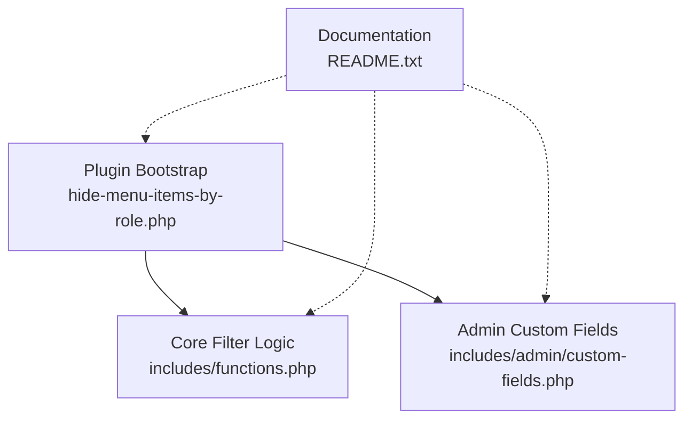
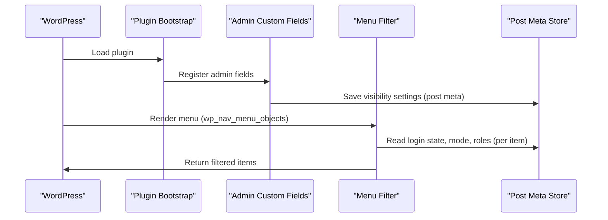
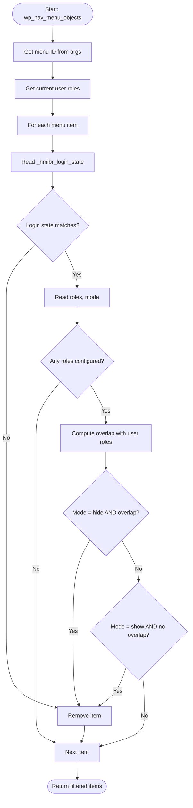
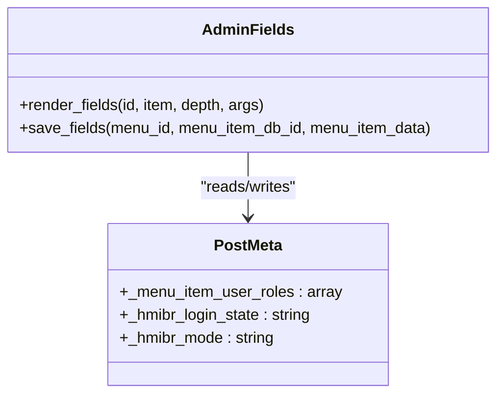
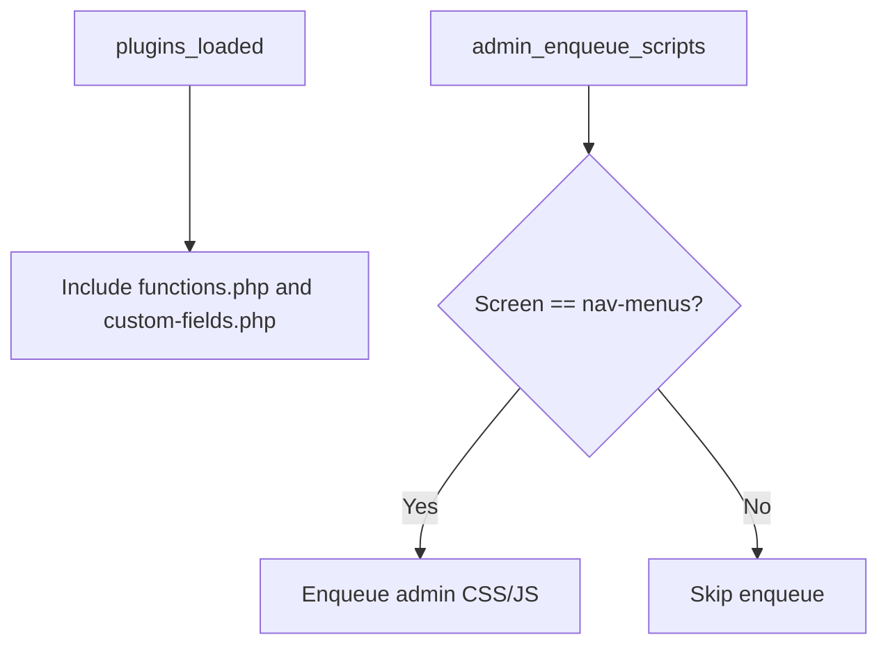
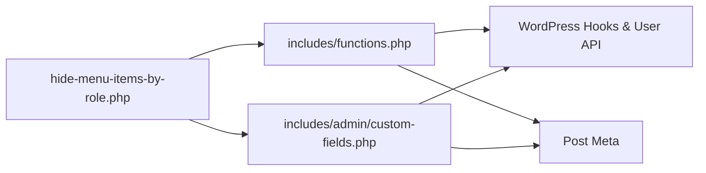

# Performance Optimization

<cite>
**Referenced Files in This Document**
- [hide-menu-items-by-role.php](file://hide-menu-items-by-role.php)
- [functions.php](file://includes/functions.php)
- [custom-fields.php](file://includes/admin/custom-fields.php)
- [README.txt](file://README.txt)
</cite>

## Table of Contents
1. [Introduction](#introduction)
2. [Project Structure](#project-structure)
3. [Core Components](#core-components)
4. [Architecture Overview](#architecture-overview)
5. [Detailed Component Analysis](#detailed-component-analysis)
6. [Dependency Analysis](#dependency-analysis)
7. [Performance Considerations](#performance-considerations)
8. [Troubleshooting Guide](#troubleshooting-guide)
9. [Conclusion](#conclusion)
10. [Appendices](#appendices)

## Introduction
This document provides performance-focused guidance for the Hide Menu Items by Role plugin. It explains how menu filtering works, where performance costs arise, and how to optimize large menus with many visibility rules. It also covers efficient database access patterns, caching strategies, monitoring techniques, memory considerations, and trade-offs between flexibility and speed.

## Project Structure
The plugin is organized into a small set of focused files:
- Plugin bootstrap and asset loading
- Core menu filtering logic
- Admin UI for configuring visibility per menu item
- Documentation and metadata

**Diagram sources**
- [hide-menu-items-by-role.php:16-49](file://hide-menu-items-by-role.php#L16-L49)
- [functions.php:1-50](file://includes/functions.php#L1-L50)
- [custom-fields.php:1-147](file://includes/admin/custom-fields.php#L1-L147)
- [README.txt:1-100](file://README.txt#L1-L100)

**Section sources**
- [hide-menu-items-by-role.php:16-49](file://hide-menu-items-by-role.php#L16-L49)
- [functions.php:1-50](file://includes/functions.php#L1-L50)
- [custom-fields.php:1-147](file://includes/admin/custom-fields.php#L1-L147)
- [README.txt:1-100](file://README.txt#L1-L100)

## Core Components
- Plugin bootstrap: defines constants, enqueues admin assets on the nav-menus screen, and includes core files.
- Core filter: hooks into WordPress’s menu rendering pipeline to hide or show items based on login state and user roles.
- Admin fields: adds configuration UI for visibility settings and persists them as post meta for each menu item.

Key responsibilities:
- Early-exit checks for login state to avoid unnecessary role processing when not needed.
- Reading and applying mode (hide/show) against configured roles.
- Persisting and validating user-selected roles and modes.

**Section sources**
- [hide-menu-items-by-role.php:16-49](file://hide-menu-items-by-role.php#L16-L49)
- [functions.php:1-50](file://includes/functions.php#L1-L50)
- [custom-fields.php:1-147](file://includes/admin/custom-fields.php#L1-L147)

## Architecture Overview
The plugin integrates with WordPress at two points:
- Admin side: custom fields are added to the menu editor and saved via update hooks.
- Frontend/Admin rendering: the wp_nav_menu_objects filter processes menu items during navigation generation.

**Diagram sources**
- [hide-menu-items-by-role.php:44-49](file://hide-menu-items-by-role.php#L44-L49)
- [custom-fields.php:96-146](file://includes/admin/custom-fields.php#L96-L146)
- [functions.php:1-50](file://includes/functions.php#L1-L50)

## Detailed Component Analysis

### Menu Filtering Pipeline
The core filtering function runs on every menu render. It:
- Reads the current menu ID from args.
- Gets the current user’s roles (or treats guests as a single role).
- Iterates over all menu items.
- Applies early-exit logic based on login state.
- Reads per-item meta for roles, mode, and login state.
- Computes overlap between user roles and configured roles.
- Removes items according to hide/show mode.

**Diagram sources**
- [functions.php:2-48](file://includes/functions.php#L2-L48)

**Section sources**
- [functions.php:2-48](file://includes/functions.php#L2-L48)

### Admin Custom Fields and Persistence
The admin panel adds:
- Visibility dropdown (Everyone / Logged-out only / Logged-in only)
- Mode dropdown (Hide from these roles / Show only to these roles)
- Role checkboxes

On save, it validates roles against editable roles and persists:
- Roles array
- Login state
- Mode

**Diagram sources**
- [custom-fields.php:3-94](file://includes/admin/custom-fields.php#L3-L94)
- [custom-fields.php:96-146](file://includes/admin/custom-fields.php#L96-L146)

**Section sources**
- [custom-fields.php:3-94](file://includes/admin/custom-fields.php#L3-L94)
- [custom-fields.php:96-146](file://includes/admin/custom-fields.php#L96-L146)

### Plugin Bootstrap and Asset Loading
The bootstrap file:
- Defines plugin constants.
- Enqueues CSS/JS only on the nav-menus admin page.
- Includes core files.
- Initializes the plugin via plugins_loaded.

**Diagram sources**
- [hide-menu-items-by-role.php:16-49](file://hide-menu-items-by-role.php#L16-L49)

**Section sources**
- [hide-menu-items-by-role.php:16-49](file://hide-menu-items-by-role.php#L16-L49)

## Dependency Analysis
- The bootstrap depends on WordPress hooks and loads the core logic and admin fields.
- The core filter depends on:
  - Current user context (roles)
  - Per-item post meta (login state, mode, roles)
- Admin fields depend on:
  - WordPress roles API
  - Post meta storage

**Diagram sources**
- [hide-menu-items-by-role.php:44-49](file://hide-menu-items-by-role.php#L44-L49)
- [functions.php:1-50](file://includes/functions.php#L1-L50)
- [custom-fields.php:1-147](file://includes/admin/custom-fields.php#L1-L147)

**Section sources**
- [hide-menu-items-by-role.php:44-49](file://hide-menu-items-by-role.php#L44-L49)
- [functions.php:1-50](file://includes/functions.php#L1-L50)
- [custom-fields.php:1-147](file://includes/admin/custom-fields.php#L1-L147)

## Performance Considerations

### Menu Filtering Process and Its Impact
- The filter runs on every menu render, iterating all items and reading post meta for each.
- For large menus with many items, this can cause repeated meta reads and CPU overhead due to per-item decisions.
- Early login-state checks reduce work when the rule is “logged-out only,” but role-based checks still occur for other cases.

Optimization levers:
- Minimize the number of menu items that require role checks.
- Prefer “logged-out only” rules where possible to short-circuit role evaluation.
- Keep role lists concise and avoid excessive combinations.

**Section sources**
- [functions.php:2-48](file://includes/functions.php#L2-L48)
- [README.txt:55-62](file://README.txt#L55-L62)

### Strategies for Large Menus with Many Visibility Rules
- Consolidate rules: group similar items under shared roles to reduce unique configurations.
- Use “logged-out only” where feasible to bypass role checks.
- Limit the number of roles per item; fewer roles mean faster intersection checks.
- Avoid deep nested menus if they increase iteration overhead significantly.
- Precompute common role sets at runtime if you extend the plugin (e.g., cache user role sets per request).

[No sources needed since this section provides general guidance]

### Efficient Database Queries and Caching Mechanisms
Current behavior:
- Each menu item triggers get_post_meta calls for three keys: login state, mode, and roles.
- Repeated calls across many items can lead to multiple database queries or autoloaded meta lookups.

Recommended approaches:
- Batch meta reads: load all relevant meta for the current menu in one query and reuse within the loop.
- Cache per-request: store computed user role sets and resolved visibility flags in a static or transient scoped to the request.
- Object cache: persist frequently accessed role-to-menu mappings using WordPress object cache (e.g., wp_cache_get/wp_cache_set) keyed by menu ID and user role set hash.
- Autoload caution: avoid making large arrays autoloaded; prefer targeted caching.

Implementation hints:
- On first access for a given menu, fetch all meta once and index by item ID.
- Cache user role sets per request to avoid repeated role resolution.
- Invalidate caches on menu updates (on wp_update_nav_menu_item).

**Section sources**
- [functions.php:12-36](file://includes/functions.php#L12-L36)
- [custom-fields.php:96-146](file://includes/admin/custom-fields.php#L96-L146)

### Performance Monitoring Techniques and Identifying Bottlenecks
- Enable WordPress debug logging to capture slow queries and hook execution times.
- Use profiling tools (e.g., Query Monitor, New Relic, Blackfire) to identify:
  - High frequency of get_post_meta calls
  - Long-running loops in menu filters
  - Excessive memory usage during menu rendering
- Add timing markers around the filter to measure per-menu cost.
- Track the number of items processed and meta reads per menu render.

[No sources needed since this section provides general guidance]

### Memory Usage Considerations
- Avoid storing large arrays in post meta; keep role lists minimal.
- Do not duplicate data structures inside the filter loop; reuse variables.
- Unset temporary arrays after use to free memory.
- Be cautious with global or static caches; ensure proper scoping and cleanup.

[No sources needed since this section provides general guidance]

### Best Practices for High-Traffic Sites
- Favor simple rules: “logged-out only” where applicable to skip role checks.
- Reduce the total number of menu items and simplify hierarchy.
- Use object caching for role-to-menu mappings and precomputed visibility flags.
- Ensure theme renders menus efficiently (avoid redundant menu builds).
- Monitor and alert on spikes in menu render time and memory usage.

[No sources needed since this section provides general guidance]

### Trade-offs Between Flexibility and Performance
- More granular rules (many roles, complex modes) increase CPU and I/O costs.
- Caching improves performance but reduces real-time responsiveness to role changes until cache invalidation occurs.
- Early-exit logic (login state) improves average-case performance but may not help when most items require role checks.
- Balancing act: design rules to minimize per-item complexity while preserving required visibility semantics.

**Section sources**
- [functions.php:15-44](file://includes/functions.php#L15-L44)
- [README.txt:48-62](file://README.txt#L48-L62)

## Troubleshooting Guide
Symptoms and resolutions:
- Slow menu rendering:
  - Check for excessive menu items and deep nesting.
  - Review per-item role lists; reduce size and complexity.
  - Validate that “logged-out only” is used where appropriate to bypass role checks.
- Unexpected visibility:
  - Verify saved meta values for login state, mode, and roles.
  - Confirm current user roles match expectations.
- High memory usage:
  - Inspect for large role arrays or duplicated data structures.
  - Ensure caches are properly scoped and cleared on updates.

Validation steps:
- Inspect post meta for a sample menu item to confirm stored values.
- Temporarily disable the filter to isolate whether slowness originates here.
- Use profiling tools to pinpoint hotspots in the filter loop.

**Section sources**
- [functions.php:2-48](file://includes/functions.php#L2-L48)
- [custom-fields.php:96-146](file://includes/admin/custom-fields.php#L96-L146)

## Conclusion
The Hide Menu Items by Role plugin integrates cleanly with WordPress to control menu visibility. For optimal performance:
- Leverage early-exit logic by using “logged-out only” rules where possible.
- Optimize meta access through batching and caching.
- Keep role configurations minimal and well-scoped.
- Monitor performance continuously and adjust rules and caching strategies accordingly.
These practices balance flexibility with efficiency, ensuring responsive menus even under heavy traffic.

[No sources needed since this section summarizes without analyzing specific files]

## Appendices

### Key Implementation Paths
- Menu filter entry point: [functions.php:2-48](file://includes/functions.php#L2-L48)
- Admin field rendering and saving: [custom-fields.php:3-94](file://includes/admin/custom-fields.php#L3-L94), [custom-fields.php:96-146](file://includes/admin/custom-fields.php#L96-L146)
- Plugin bootstrap and includes: [hide-menu-items-by-role.php:16-49](file://hide-menu-items-by-role.php#L16-L49)

[No sources needed since this section references already analyzed files]