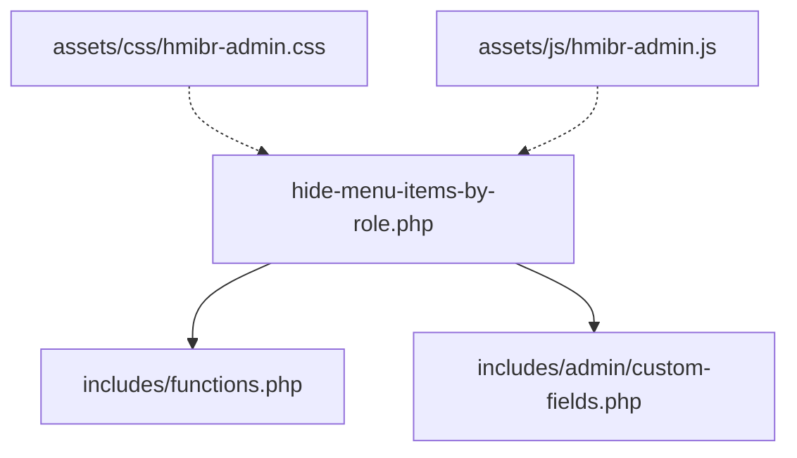
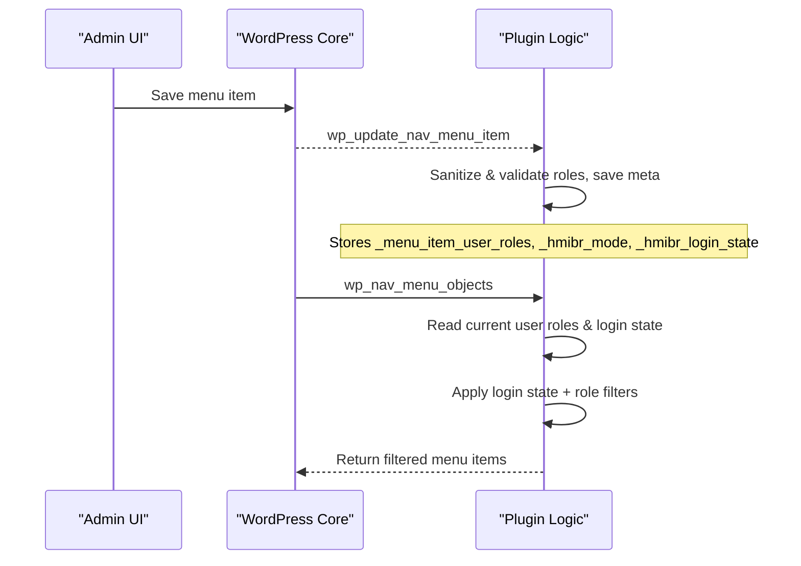
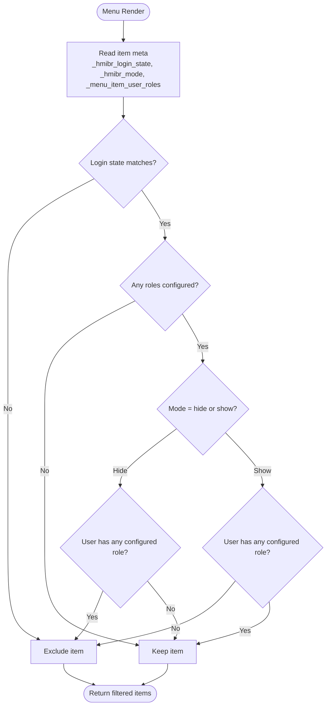
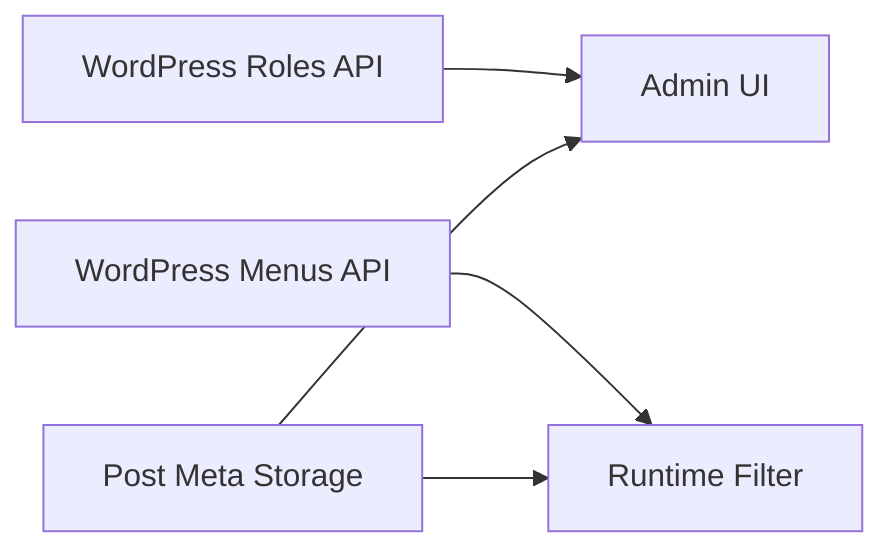

# Role Customization

<cite>
**Referenced Files in This Document**
- [hide-menu-items-by-role.php](file://hide-menu-items-by-role.php)
- [functions.php](file://includes/functions.php)
- [custom-fields.php](file://includes/admin/custom-fields.php)
- [README.txt](file://README.txt)
</cite>

## Table of Contents
1. [Introduction](#introduction)
2. [Project Structure](#project-structure)
3. [Core Components](#core-components)
4. [Architecture Overview](#architecture-overview)
5. [Detailed Component Analysis](#detailed-component-analysis)
6. [Dependency Analysis](#dependency-analysis)
7. [Performance Considerations](#performance-considerations)
8. [Troubleshooting Guide](#troubleshooting-guide)
9. [Conclusion](#conclusion)

## Introduction
This document explains how to extend user role support in the Hide Menu Items by Role plugin. It covers:
- Registering custom roles and making them available in menu item visibility controls
- Understanding and modifying the role filtering logic
- Implementing conditional behavior based on capabilities, user meta, or external APIs
- Handling role inheritance and capability mapping
- Performance considerations when working with many custom roles

The plugin integrates with WordPress menus to hide or show items based on login state and user roles. The admin UI provides fields for visibility mode (hide/show), login state, and role selection.

## Project Structure
The plugin is organized into a main bootstrap file, core filtering logic, and admin UI components:
- Main plugin file initializes assets and includes core files
- Core functions hook into WordPress to filter menu items at runtime
- Admin custom fields add UI controls and persist settings per menu item

**Diagram sources**
- [hide-menu-items-by-role.php:20-46](file://hide-menu-items-by-role.php#L20-L46)
- [hide-menu-items-by-role.php:44-53](file://hide-menu-items-by-role.php#L44-L53)

**Section sources**
- [hide-menu-items-by-role.php:1-54](file://hide-menu-items-by-role.php#L1-L54)

## Core Components
- Plugin bootstrap and asset loading: enqueues admin CSS/JS on the Menus screen and includes core modules.
- Admin UI: adds an “Audience Visibility” panel to each menu item with fields for login state, visibility mode, and role checkboxes.
- Runtime filtering: hooks into WordPress menu rendering to apply visibility rules based on login state and roles.

Key responsibilities:
- Admin UI renders available roles via WordPress roles API and persists selections per menu item.
- Runtime logic reads saved metadata and current user context to decide whether to include or exclude a menu item.

**Section sources**
- [hide-menu-items-by-role.php:20-46](file://hide-menu-items-by-role.php#L20-L46)
- [custom-fields.php:3-94](file://includes/admin/custom-fields.php#L3-L94)
- [functions.php:2-49](file://includes/functions.php#L2-L49)

## Architecture Overview
The plugin follows a simple architecture:
- Admin side: Adds custom fields to the menu editor and saves them as post meta for each menu item.
- Frontend/Admin rendering: Filters menu objects during navigation generation to apply visibility rules.

**Diagram sources**
- [custom-fields.php:96-146](file://includes/admin/custom-fields.php#L96-L146)
- [functions.php:2-49](file://includes/functions.php#L2-L49)

## Detailed Component Analysis

### Admin UI: Role Selection and Field Behavior
- The admin panel lists all roles using the WordPress roles API and renders checkboxes for each role.
- When “Logged-out users only” is selected, role-related fields are disabled to prevent invalid configurations.
- Saved values include:
  - Login state: any, logged_in, logged_out
  - Mode: hide, show
  - Roles: array of role slugs

Extensibility points:
- To add new fields or modify existing ones, hook into the same admin action used to render custom menu fields.
- To restrict or augment the list of selectable roles, filter the roles array before rendering.

Best practices:
- Always sanitize and validate posted values against allowed sets.
- Use WordPress roles API to ensure consistency with registered roles.

**Section sources**
- [custom-fields.php:3-94](file://includes/admin/custom-fields.php#L3-L94)
- [custom-fields.php:96-146](file://includes/admin/custom-fields.php#L96-L146)

### Runtime Filtering: Role-Based Visibility Logic
- On menu render, the plugin:
  - Reads the current user’s roles (or treats non-logged-in users as guests).
  - Applies login state rules first (any, logged_in, logged_out).
  - If no roles are configured for the item, it keeps the item visible.
  - Applies mode logic:
    - Hide mode: remove the item if the user has any of the configured roles.
    - Show mode: remove the item unless the user has at least one of the configured roles.

**Diagram sources**
- [functions.php:2-49](file://includes/functions.php#L2-L49)

**Section sources**
- [functions.php:2-49](file://includes/functions.php#L2-L49)

### How to Register Custom Roles and Make Them Available
To register a custom role and make it appear in the role selection UI:
- Register the role using WordPress roles API during plugin/theme initialization.
- Ensure the role slug is consistent across your codebase.
- The admin UI automatically lists roles via the roles API; once registered, the role will be selectable.

Considerations:
- Validate that the role exists before saving to avoid invalid entries.
- If you need to limit which roles can be selected, filter the roles list before rendering.

Example approach (conceptual):
- Hook into the appropriate initialization point to call the roles API and define the role and its capabilities.
- Optionally, provide a filter to adjust the list of selectable roles in the admin UI.

[No sources needed since this section provides general guidance]

### Modifying the Role Filtering Logic
You can customize the filtering behavior by hooking into the same filter used by the plugin to process menu items. Typical modifications include:
- Adding capability checks beyond roles (e.g., require a specific capability).
- Incorporating user meta conditions (e.g., membership level, subscription status).
- Integrating external APIs (e.g., third-party membership services) to determine visibility.

Guidelines:
- Preserve the original login state and role checks unless you intentionally replace them.
- Cache expensive operations (API calls, heavy meta queries) to avoid repeated work per menu item.
- Maintain performance by short-circuiting early when possible.

[No sources needed since this section provides general guidance]

### Conditional Behavior Based on Capabilities, Meta, or External APIs
- Capability-based conditions:
  - After determining the user’s roles, check required capabilities and include/exclude accordingly.
- User meta conditions:
  - Retrieve relevant user meta and combine with role checks to refine visibility.
- External API conditions:
  - For remote checks, cache results keyed by user ID and item ID to minimize requests.
  - Fallback to safe defaults (e.g., keep item visible) when the API is unavailable.

Implementation tips:
- Wrap external calls in timeouts and error handling.
- Avoid blocking menu rendering; consider asynchronous patterns where feasible.

[No sources needed since this section provides general guidance]

### Handling Role Inheritance and Capability Mapping
- WordPress does not have native role inheritance like some systems; instead, capabilities are mapped to roles.
- To simulate inheritance:
  - Map higher-level roles to lower-level capabilities and roles as needed.
  - Expand the effective role set for a user by combining base roles with derived roles from capabilities or meta.
- When implementing custom logic:
  - Compute an effective role set for the current user.
  - Use this effective set for comparisons against configured roles.

[No sources needed since this section provides general guidance]

## Dependency Analysis
The plugin depends on WordPress core APIs for roles, menus, and post meta. The main dependencies are:
- WordPress roles API for listing and validating roles
- WordPress menu system hooks for adding fields and filtering items
- Post meta storage for configuration per menu item

**Diagram sources**
- [custom-fields.php:3-94](file://includes/admin/custom-fields.php#L3-L94)
- [functions.php:2-49](file://includes/functions.php#L2-L49)

**Section sources**
- [custom-fields.php:3-94](file://includes/admin/custom-fields.php#L3-L94)
- [functions.php:2-49](file://includes/functions.php#L2-L49)

## Performance Considerations
- Minimize database reads:
  - Cache user roles and computed effective roles per request.
  - Cache external API responses keyed by user and item identifiers.
- Short-circuit evaluation:
  - Apply login state checks first; skip role checks when not needed.
- Bulk operations:
  - Avoid per-item heavy computations; precompute where possible.
- Admin UX:
  - Disable irrelevant fields (as implemented) to reduce accidental misconfiguration.

[No sources needed since this section provides general guidance]

## Troubleshooting Guide
Common issues and resolutions:
- Custom roles not appearing in the UI:
  - Ensure roles are registered before the admin UI loads.
  - Verify role slugs match exactly what is stored in meta.
- Unexpected visibility:
  - Confirm login state setting and mode (hide/show) are correct.
  - Check that the user actually has the expected roles/capabilities.
- Validation errors:
  - Ensure only valid roles are submitted; the plugin validates against editable roles.
- Performance problems with many roles:
  - Reduce unnecessary role checks by leveraging login state and early exits.
  - Cache expensive computations and API calls.

**Section sources**
- [custom-fields.php:96-146](file://includes/admin/custom-fields.php#L96-L146)
- [functions.php:2-49](file://includes/functions.php#L2-L49)

## Conclusion
By registering custom roles through WordPress and leveraging the plugin’s admin UI and runtime filter, you can tailor menu visibility to complex business requirements. Extend the filtering logic to incorporate capabilities, user meta, and external data while maintaining performance and usability. Proper validation, caching, and clear configuration options ensure reliable behavior even with large numbers of custom roles.