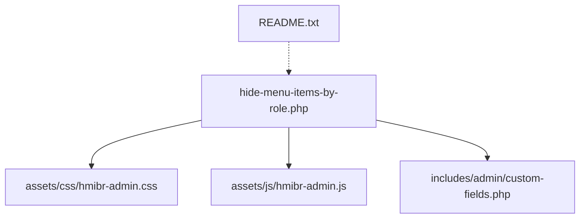
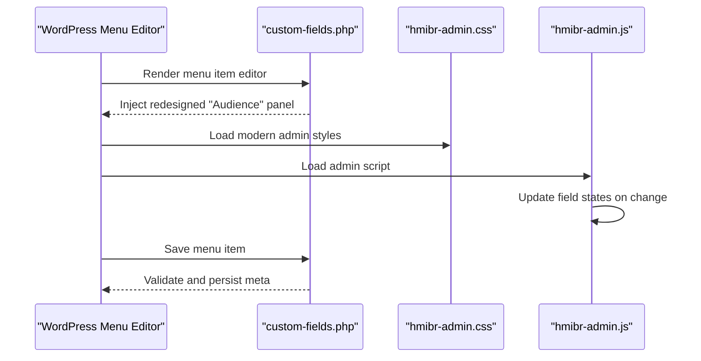
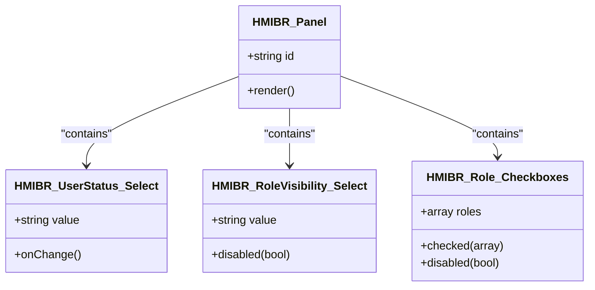
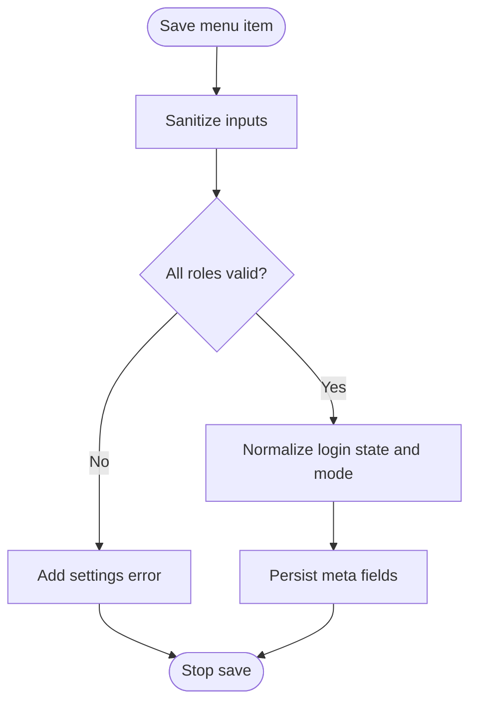
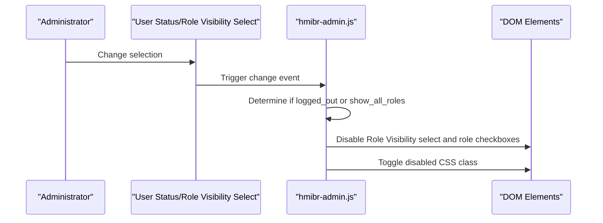
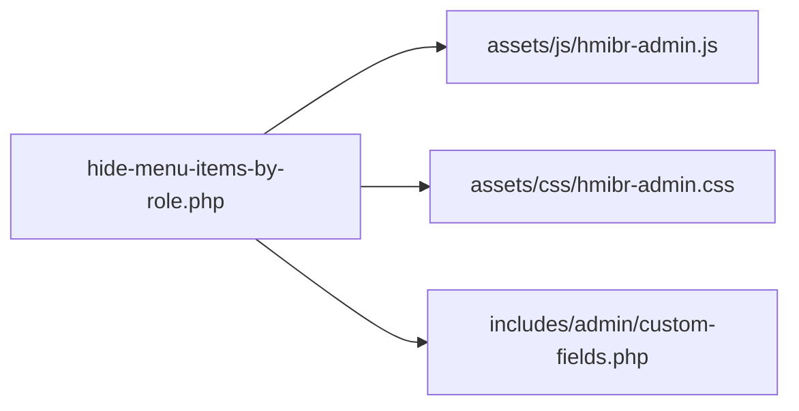

# Admin Interface & User Experience

<cite>
**Referenced Files in This Document**
- [hide-menu-items-by-role.php](file://hide-menu-items-by-role.php)
- [custom-fields.php](file://includes/admin/custom-fields.php)
- [hmibr-admin.css](file://assets/css/hmibr-admin.css)
- [hmibr-admin.js](file://assets/js/hmibr-admin.js)
- [README.txt](file://README.txt)
</cite>

## Update Summary
**Changes Made**
- Updated all sections to reflect the complete redesign of the menu item editor
- Revised the collapsible panel structure from "Audience Visibility" to "Audience"
- Updated field labels and terminology throughout the documentation
- Enhanced descriptions of the modern CSS styling approach
- Updated accessibility features to reflect the new semantic HTML5 structure
- Revised step-by-step guides to match the new interface terminology

## Table of Contents
1. [Introduction](#introduction)
2. [Project Structure](#project-structure)
3. [Core Components](#core-components)
4. [Architecture Overview](#architecture-overview)
5. [Detailed Component Analysis](#detailed-component-analysis)
6. [Dependency Analysis](#dependency-analysis)
7. [Performance Considerations](#performance-considerations)
8. [Troubleshooting Guide](#troubleshooting-guide)
9. [Conclusion](#conclusion)

## Introduction
This document explains the admin interface and user experience for the redesigned "Audience" panel that extends the WordPress menu editor. It covers the modern collapsible panel design built with semantic HTML5, enhanced field layouts, improved color coding, interactive behaviors, validation, accessibility features, responsive behavior, CSS styling approach, customization guidance, and error handling. The goal is to help administrators configure visibility rules confidently and understand how the plugin integrates with the native menu editor through its completely redesigned interface.

## Project Structure
The plugin adds a redesigned collapsible "Audience" panel into the WordPress menu item editor using modern semantic HTML5 structure. The key files are:
- Plugin bootstrap and asset enqueueing
- Custom fields rendering and saving logic with new panel structure
- Modern admin CSS for the redesigned panel and fields
- Admin JavaScript for dynamic interactivity
- Documentation and changelog

**Diagram sources**
- [hide-menu-items-by-role.php:20-46](file://hide-menu-items-by-role.php#L20-L46)
- [custom-fields.php:1-126](file://includes/admin/custom-fields.php#L1-L126)
- [hmibr-admin.css:1-273](file://assets/css/hmibr-admin.css#L1-L273)
- [hmibr-admin.js:1-51](file://assets/js/hmibr-admin.js#L1-L51)
- [README.txt:10-30](file://README.txt#L10-L30)

**Section sources**
- [hide-menu-items-by-role.php:16-50](file://hide-menu-items-by-role.php#L16-L50)
- [README.txt:10-30](file://README.txt#L10-L30)

## Core Components
- Redesigned "Audience" panel (collapsible details/summary UI with semantic HTML5)
- User Status selector (Everyone / Logged-out users only / Logged-in users only)
- Role Visibility Mode (Show to all roles / Hide for selected roles / Show only to selected roles)
- Role checkboxes grid with modern styling
- Field disabling logic when "Logged-out users only" or "Show to all roles" is selected
- Validation and saving of custom fields
- Modern admin styles and JS interactivity

Key responsibilities:
- Rendering the redesigned panel and fields inside the menu editor
- Enabling/disabling dependent fields based on login state and role visibility mode
- Validating and sanitizing saved values
- Styling and accessibility enhancements with modern CSS

**Section sources**
- [custom-fields.php:3-72](file://includes/admin/custom-fields.php#L3-L72)
- [custom-fields.php:74-126](file://includes/admin/custom-fields.php#L74-L126)
- [hmibr-admin.js:5-51](file://assets/js/hmibr-admin.js#L5-L51)
- [hmibr-admin.css:1-273](file://assets/css/hmibr-admin.css#L1-L273)

## Architecture Overview
The plugin hooks into the WordPress menu editor to inject the redesigned panel and save its data. On the front end, it uses core filters to enforce visibility rules. The admin UI is enhanced with modern CSS and jQuery for improved UX with semantic HTML5 structure.

**Diagram sources**
- [custom-fields.php:3-126](file://includes/admin/custom-fields.php#L3-L126)
- [hmibr-admin.css:1-273](file://assets/css/hmibr-admin.css#L1-L273)
- [hmibr-admin.js:5-51](file://assets/js/hmibr-admin.js#L5-L51)

## Detailed Component Analysis

### Redesigned Collapsible "Audience" Panel
- Built using semantic HTML5 `
/
` for native collapsibility and accessibility.
- Header includes an icon, title, and chevron; chevron rotates when collapsed.
- Body contains:
  - Two-field row: User Status and Role Visibility selects
  - Role checkboxes grid with modern styling

Visual design highlights:
- Panel background and border match WordPress admin aesthetics with modern rounded corners.
- Header has subtle hover and focus states with improved spacing.
- Chevron rotation indicates open/closed state with smooth transitions.
- Enhanced typography and spacing throughout the panel.

Accessibility:
- Uses semantic `
/
` for built-in keyboard and screen reader support.
- Focus-visible outlines ensure clear focus indicators.
- Decorative SVG icons are marked aria-hidden.
- Labels are associated with inputs via for/id attributes.

**Updated** Complete redesign with semantic HTML5 structure and modern CSS styling

**Section sources**
- [custom-fields.php:17-69](file://includes/admin/custom-fields.php#L17-L69)
- [hmibr-admin.css:32-120](file://assets/css/hmibr-admin.css#L32-L120)

#### Class Diagram: Panel and Fields

**Diagram sources**
- [custom-fields.php:30-67](file://includes/admin/custom-fields.php#L30-L67)

### Field Layouts, Color Coding, and Interactive Elements
- Two-field row layout uses flexbox for responsive alignment with improved spacing.
- Select inputs have consistent height, padding, and custom dropdown arrow with modern styling.
- Focus states use the WordPress theme color variable for consistency.
- Disabled elements get reduced opacity and not-allowed cursor with visual feedback.
- Role checkboxes use a grid layout with auto-fit columns for responsiveness.
- Checked state uses the theme color and a checkmark icon with smooth transitions.

Color coding and states:
- Default borders and text colors align with WordPress admin defaults.
- Focus rings highlight active controls with proper contrast.
- Disabled state applies a dimmed appearance and prevents interaction.

Responsive considerations:
- Flex wrap and grid auto-fit ensure usability on smaller screens.
- Select widths adapt to container size with improved scaling.

**Updated** Enhanced visual design with modern CSS and improved responsive behavior

**Section sources**
- [hmibr-admin.css:122-192](file://assets/css/hmibr-admin.css#L122-L192)
- [hmibr-admin.css:198-273](file://assets/css/hmibr-admin.css#L198-L273)

### Field Validation System
Validation occurs during save:
- Sanitizes role selections and other inputs.
- Validates roles against editable roles.
- Adds settings errors if invalid roles are submitted.
- Normalizes login state and mode to allowed values before saving.

User feedback:
- Invalid configurations trigger WordPress settings error notices.
- Administrators see inline messages indicating the issue.

Data persistence:
- Saves role array, menu ID, menu name, login state, and mode per menu item.

**Section sources**
- [custom-fields.php:74-126](file://includes/admin/custom-fields.php#L74-L126)

#### Flowchart: Save and Validation Logic

**Diagram sources**
- [custom-fields.php:74-126](file://includes/admin/custom-fields.php#L74-L126)

### JavaScript-Powered Interactivity
Behavior:
- When "User Status" is set to "Logged-out users only", the Role Visibility select and role checkboxes are disabled.
- When "Role Visibility" is set to "Show to all roles", the role checkboxes are disabled.
- The parent containers receive a disabled visual class to reflect the locked state.
- Updates occur both on page load and whenever any field changes.

Implementation notes:
- Iterates over all User Status selects to support multiple menu items.
- Extracts the menu item ID from the field name to scope updates correctly.
- Toggles disabled attributes and CSS classes accordingly.

**Updated** Enhanced interactivity supporting both user status and role visibility modes

**Section sources**
- [hmibr-admin.js:5-51](file://assets/js/hmibr-admin.js#L5-L51)
- [custom-fields.php:30-67](file://includes/admin/custom-fields.php#L30-L67)

#### Sequence Diagram: Dynamic Field Enabling/Disabling

**Diagram sources**
- [hmibr-admin.js:5-51](file://assets/js/hmibr-admin.js#L5-L51)

### Accessibility Considerations
- Semantic `
/
` provides built-in keyboard and screen reader support.
- Focus-visible outlines ensure clear focus indicators.
- Decorative SVG icons are marked aria-hidden.
- Labels are associated with inputs via for/id attributes.
- Disabled states provide visual cues and prevent interaction.

Recommendations:
- Keep labels descriptive and concise.
- Ensure sufficient color contrast for focus and disabled states.
- Test with keyboard-only navigation and screen readers.

**Updated** Enhanced accessibility with semantic HTML5 structure

**Section sources**
- [custom-fields.php:17-69](file://includes/admin/custom-fields.php#L17-L69)
- [hmibr-admin.css:70-73](file://assets/css/hmibr-admin.css#L70-L73)
- [hmibr-admin.css:179-192](file://assets/css/hmibr-admin.css#L179-L192)
- [hmibr-admin.css:264-272](file://assets/css/hmibr-admin.css#L264-L272)

### Responsive Design Aspects
- Flexbox row wraps fields on narrow screens with improved spacing.
- Grid-based role list adapts column count automatically.
- Select inputs scale within their containers with better sizing.
- Checkboxes remain accessible and clickable across devices.

**Updated** Enhanced responsive design with improved mobile experience

**Section sources**
- [hmibr-admin.css:122-138](file://assets/css/hmibr-admin.css#L122-L138)
- [hmibr-admin.css:207-213](file://assets/css/hmibr-admin.css#L207-L213)

### CSS Styling Approach and Customization
Styling approach:
- Scoped classes prefixed with hmibr- to avoid conflicts.
- Uses CSS variables for theme color to stay consistent with WordPress admin.
- Provides hover, focus, disabled, and checked states for interactive elements.
- Inline SVG backgrounds for dropdown arrows and checkmarks.
- Modern CSS properties including flexbox, grid, and smooth transitions.

Customization guidance:
- Override theme color variable to match your site's branding.
- Adjust panel spacing, font sizes, and border radius by targeting .hmibr-panel and related classes.
- Modify disabled opacity or cursor by editing .hmibr-disabled and related selectors.
- Customize checkbox and select appearances by overriding specific input styles.

Best practices:
- Use child selectors to keep overrides scoped.
- Preserve focus and disabled semantics when customizing.
- Test across browsers for consistent appearance.

**Updated** Modern CSS architecture with enhanced styling capabilities

**Section sources**
- [hmibr-admin.css:1-273](file://assets/css/hmibr-admin.css#L1-L273)

### Error Handling and User Notification System
- On save, invalid roles produce settings errors displayed in the admin UI.
- Errors are added to the settings error stack and shown to the administrator.
- Login state and mode are normalized to safe values to prevent unexpected behavior.

Operational flow:
- If validation fails, the save process stops after adding the error notice.
- Otherwise, sanitized and validated values are persisted.

**Section sources**
- [custom-fields.php:85-98](file://includes/admin/custom-fields.php#L85-L98)
- [custom-fields.php:107-122](file://includes/admin/custom-fields.php#L107-L122)

## Dependency Analysis
The plugin's admin assets are enqueued conditionally on the menu editor screen. The custom fields file renders the redesigned panel and handles saving. Styles and scripts enhance the UI and interactivity with modern CSS and JavaScript.

**Diagram sources**
- [hide-menu-items-by-role.php:20-50](file://hide-menu-items-by-role.php#L20-L50)
- [custom-fields.php:1-126](file://includes/admin/custom-fields.php#L1-L126)

**Section sources**
- [hide-menu-items-by-role.php:20-50](file://hide-menu-items-by-role.php#L20-L50)

## Performance Considerations
- Client-side disabling avoids unnecessary server requests when fields are locked.
- Validation runs only on save, minimizing overhead during editing.
- Using native `
` reduces JavaScript dependency for collapsing behavior.
- CSS-driven visuals minimize reflows and repaints.
- Modern CSS properties improve rendering performance.

[No sources needed since this section provides general guidance]

## Troubleshooting Guide
Common issues and resolutions:
- Fields appear enabled when they should be disabled:
  - Verify that "User Status" is set to "Logged-out users only".
  - Confirm that "Role Visibility" is not set to "Show to all roles".
  - Confirm that the JavaScript is loaded and not blocked by another script.
- Changes do not persist:
  - Check for settings error notices indicating invalid roles.
  - Ensure roles exist and are editable by the current user.
- Styles look incorrect:
  - Inspect whether custom CSS overrides conflict with hmibr- classes.
  - Clear caches and verify the correct version of assets is enqueued.

Steps to diagnose:
- Open browser developer tools and inspect the redesigned "Audience" panel.
- Check console for JavaScript errors.
- Review network tab to confirm assets are loading.
- Temporarily disable conflicting plugins or themes to isolate issues.

**Updated** Troubleshooting guide updated for new interface terminology

**Section sources**
- [hmibr-admin.js:5-51](file://assets/js/hmibr-admin.js#L5-L51)
- [custom-fields.php:85-98](file://includes/admin/custom-fields.php#L85-L98)

## Conclusion
The redesigned "Audience" panel provides a clear, accessible, and responsive way to control menu item visibility by role and login state. Its modern design follows WordPress admin conventions while utilizing semantic HTML5 structure, enhanced validation, and improved interactivity ensure a smooth configuration experience. Administrators can customize the appearance through well-scoped CSS and rely on robust validation and error notifications to maintain accurate configurations.

[No sources needed since this section summarizes without analyzing specific files]

## Appendices

### Step-by-Step Guide: Navigating the Admin Interface
1. Go to Appearance > Menus in the WordPress admin.
2. Expand a menu item to reveal its settings.
3. Locate the redesigned "Audience" panel at the bottom of the item settings.
4. Set "User Status" to:
   - Everyone
   - Logged-out users only
   - Logged-in users only
5. Choose "Role Visibility":
   - Show to all roles
   - Hide for selected roles
   - Show only to selected roles
6. Select one or more user roles affected by the rule.
7. Save the menu.

Notes:
- When "Logged-out users only" is selected, Role Visibility and role checkboxes are disabled.
- When "Show to all roles" is selected, role checkboxes are disabled.
- If invalid roles are submitted, you will see an error notice upon saving.

**Updated** Step-by-step guide updated for new interface terminology and functionality

**Section sources**
- [README.txt:34-42](file://README.txt#L34-L42)
- [custom-fields.php:30-67](file://includes/admin/custom-fields.php#L30-L67)
- [custom-fields.php:85-98](file://includes/admin/custom-fields.php#L85-L98)