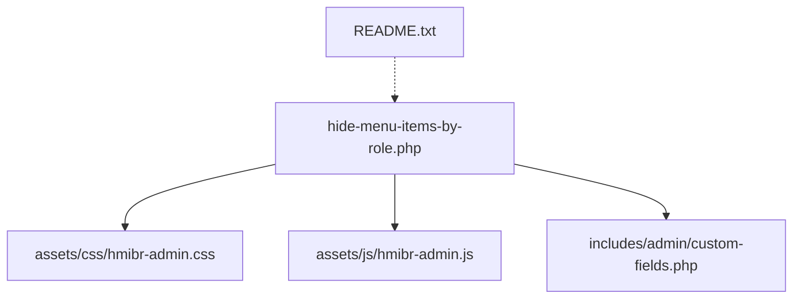
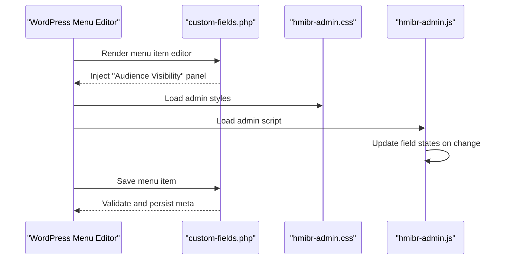
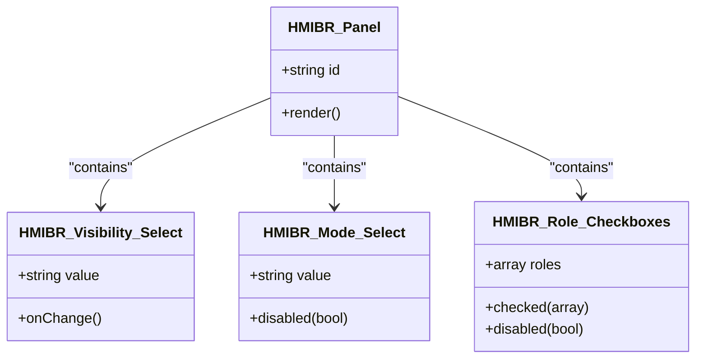
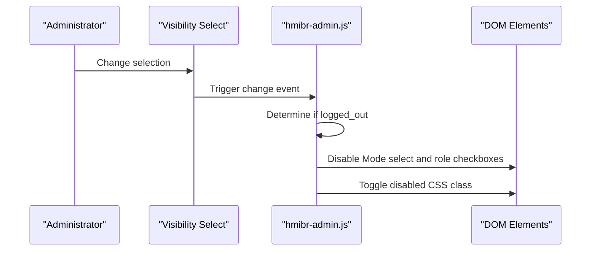
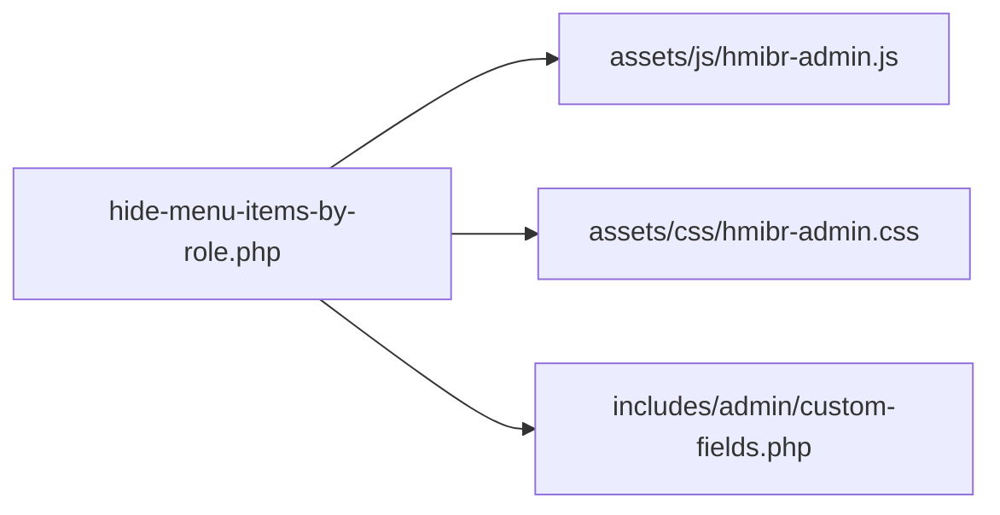

# Admin Interface & User Experience

<cite>
**Referenced Files in This Document**
- [hide-menu-items-by-role.php](file://hide-menu-items-by-role.php)
- [custom-fields.php](file://includes/admin/custom-fields.php)
- [hmibr-admin.css](file://assets/css/hmibr-admin.css)
- [hmibr-admin.js](file://assets/js/hmibr-admin.js)
- [README.txt](file://README.txt)
</cite>

## Table of Contents
1. [Introduction](#introduction)
2. [Project Structure](#project-structure)
3. [Core Components](#core-components)
4. [Architecture Overview](#architecture-overview)
5. [Detailed Component Analysis](#detailed-component-analysis)
6. [Dependency Analysis](#dependency-analysis)
7. [Performance Considerations](#performance-considerations)
8. [Troubleshooting Guide](#troubleshooting-guide)
9. [Conclusion](#conclusion)

## Introduction
This document explains the admin interface and user experience for the “Audience Visibility” panel that extends the WordPress menu editor. It covers the collapsible panel design, field layouts, color coding, interactive behaviors, validation, accessibility, responsive behavior, CSS styling approach, customization guidance, and error handling. The goal is to help administrators configure visibility rules confidently and understand how the plugin integrates with the native menu editor.

## Project Structure
The plugin adds a collapsible “Audience Visibility” panel into the WordPress menu item editor. The key files are:
- Plugin bootstrap and asset enqueueing
- Custom fields rendering and saving logic
- Admin CSS for the panel and fields
- Admin JavaScript for dynamic interactivity
- Documentation and changelog

**Diagram sources**
- [hide-menu-items-by-role.php:20-42](file://hide-menu-items-by-role.php#L20-L42)
- [custom-fields.php:1-147](file://includes/admin/custom-fields.php#L1-L147)
- [hmibr-admin.css:1-262](file://assets/css/hmibr-admin.css#L1-L262)
- [hmibr-admin.js:1-41](file://assets/js/hmibr-admin.js#L1-L41)
- [README.txt:10-30](file://README.txt#L10-L30)

**Section sources**
- [hide-menu-items-by-role.php:16-46](file://hide-menu-items-by-role.php#L16-L46)
- [README.txt:10-30](file://README.txt#L10-L30)

## Core Components
- Audience Visibility panel (collapsible details/summary UI)
- Visibility selector (Everyone / Logged-out users only / Logged-in users only)
- Menu Item Visibility Mode (Hide from these roles / Show only to these roles)
- Role checkboxes grid
- Field disabling logic when “Logged-out users only” is selected
- Validation and saving of custom fields
- Admin styles and JS interactivity

Key responsibilities:
- Rendering the panel and fields inside the menu editor
- Enabling/disabling dependent fields based on login state
- Validating and sanitizing saved values
- Styling and accessibility enhancements

**Section sources**
- [custom-fields.php:3-94](file://includes/admin/custom-fields.php#L3-L94)
- [custom-fields.php:96-147](file://includes/admin/custom-fields.php#L96-L147)
- [hmibr-admin.js:5-41](file://assets/js/hmibr-admin.js#L5-L41)
- [hmibr-admin.css:7-262](file://assets/css/hmibr-admin.css#L7-L262)

## Architecture Overview
The plugin hooks into the WordPress menu editor to inject a new panel and save its data. On the front end, it uses core filters to enforce visibility rules. The admin UI is enhanced with CSS and jQuery for better UX.

**Diagram sources**
- [custom-fields.php:3-94](file://includes/admin/custom-fields.php#L3-L94)
- [custom-fields.php:96-147](file://includes/admin/custom-fields.php#L96-L147)
- [hmibr-admin.css:1-262](file://assets/css/hmibr-admin.css#L1-L262)
- [hmibr-admin.js:5-41](file://assets/js/hmibr-admin.js#L5-L41)

## Detailed Component Analysis

### Collapsible “Audience Visibility” Panel
- Built using HTML 
/
 for native collapsibility and accessibility.
- Header includes an icon, title, and chevron; chevron rotates when collapsed.
- Body contains:
  - Two-field row: Visibility and Mode selects
  - Role checkboxes grid

Visual design highlights:
- Panel background and border match WordPress admin aesthetics.
- Header has subtle hover and focus states.
- Chevron rotation indicates open/closed state.

Accessibility:
- Uses semantic 
/
.
- Focus-visible outlines for keyboard navigation.
- Icons are decorative and hidden from assistive tech.

**Section sources**
- [custom-fields.php:10-61](file://includes/admin/custom-fields.php#L10-L61)
- [hmibr-admin.css:21-109](file://assets/css/hmibr-admin.css#L21-L109)

#### Class Diagram: Panel and Fields

**Diagram sources**
- [custom-fields.php:22-59](file://includes/admin/custom-fields.php#L22-L59)

### Field Layouts, Color Coding, and Interactive Elements
- Two-field row layout uses flexbox for responsive alignment.
- Select inputs have consistent height, padding, and custom dropdown arrow.
- Focus states use the WordPress theme color variable for consistency.
- Disabled elements get reduced opacity and not-allowed cursor.
- Role checkboxes use a grid layout with auto-fit columns for responsiveness.
- Checked state uses the theme color and a checkmark icon.

Color coding and states:
- Default borders and text colors align with WordPress admin defaults.
- Focus rings highlight active controls.
- Disabled state applies a dimmed appearance and prevents interaction.

Responsive considerations:
- Flex wrap and grid auto-fit ensure usability on smaller screens.
- Select widths adapt to container size.

**Section sources**
- [hmibr-admin.css:111-181](file://assets/css/hmibr-admin.css#L111-L181)
- [hmibr-admin.css:187-262](file://assets/css/hmibr-admin.css#L187-L262)

### Field Validation System
Validation occurs during save:
- Sanitizes role selections and other inputs.
- Validates roles against editable roles.
- Adds settings errors if invalid roles are submitted.
- Normalizes login state and mode to allowed values before saving.

User feedback:
- Invalid configurations trigger WordPress settings error notices.
- Administrators see inline messages indicating the issue.

Data persistence:
- Saves role array, menu ID, menu name, login state, and mode per menu item.

**Section sources**
- [custom-fields.php:96-147](file://includes/admin/custom-fields.php#L96-L147)

#### Flowchart: Save and Validation Logic

**Diagram sources**
- [custom-fields.php:96-147](file://includes/admin/custom-fields.php#L96-L147)

### JavaScript-Powered Interactivity
Behavior:
- When “Visibility” is set to “Logged-out users only”, the Mode select and role checkboxes are disabled.
- The parent containers receive a disabled visual class to reflect the locked state.
- Updates occur both on page load and whenever any Visibility select changes.

Implementation notes:
- Iterates over all Visibility selects to support multiple menu items.
- Extracts the menu item ID from the field name to scope updates correctly.
- Toggles disabled attributes and CSS classes accordingly.

**Section sources**
- [hmibr-admin.js:5-41](file://assets/js/hmibr-admin.js#L5-L41)
- [custom-fields.php:63-91](file://includes/admin/custom-fields.php#L63-L91)

#### Sequence Diagram: Dynamic Field Enabling/Disabling

**Diagram sources**
- [hmibr-admin.js:5-41](file://assets/js/hmibr-admin.js#L5-L41)

### Accessibility Considerations
- Semantic 
/
 provides built-in keyboard and screen reader support.
- Focus-visible outlines ensure clear focus indicators.
- Decorative SVG icons are marked aria-hidden.
- Labels are associated with inputs via for/id attributes.
- Disabled states provide visual cues and prevent interaction.

Recommendations:
- Keep labels descriptive and concise.
- Ensure sufficient color contrast for focus and disabled states.
- Test with keyboard-only navigation and screen readers.

**Section sources**
- [custom-fields.php:10-61](file://includes/admin/custom-fields.php#L10-L61)
- [hmibr-admin.css:59-62](file://assets/css/hmibr-admin.css#L59-L62)
- [hmibr-admin.css:168-181](file://assets/css/hmibr-admin.css#L168-L181)
- [hmibr-admin.css:253-261](file://assets/css/hmibr-admin.css#L253-L261)

### Responsive Design Aspects
- Flexbox row wraps fields on narrow screens.
- Grid-based role list adapts column count automatically.
- Select inputs scale within their containers.
- Checkboxes remain accessible and clickable across devices.

**Section sources**
- [hmibr-admin.css:111-127](file://assets/css/hmibr-admin.css#L111-L127)
- [hmibr-admin.css:196-202](file://assets/css/hmibr-admin.css#L196-L202)

### CSS Styling Approach and Customization
Styling approach:
- Scoped classes prefixed with hmibr- to avoid conflicts.
- Uses CSS variables for theme color to stay consistent with WordPress admin.
- Provides hover, focus, disabled, and checked states for interactive elements.
- Inline SVG backgrounds for dropdown arrows and checkmarks.

Customization guidance:
- Override theme color variable to match your site’s branding.
- Adjust panel spacing, font sizes, and border radius by targeting .hmibr-panel and related classes.
- Modify disabled opacity or cursor by editing .hmibr-disabled and related selectors.
- Customize checkbox and select appearances by overriding specific input styles.

Best practices:
- Use child selectors to keep overrides scoped.
- Preserve focus and disabled semantics when customizing.
- Test across browsers for consistent appearance.

**Section sources**
- [hmibr-admin.css:1-262](file://assets/css/hmibr-admin.css#L1-L262)

### Error Handling and User Notification System
- On save, invalid roles produce settings errors displayed in the admin UI.
- Errors are added to the settings error stack and shown to the administrator.
- Login state and mode are normalized to safe values to prevent unexpected behavior.

Operational flow:
- If validation fails, the save process stops after adding the error notice.
- Otherwise, sanitized and validated values are persisted.

**Section sources**
- [custom-fields.php:107-120](file://includes/admin/custom-fields.php#L107-L120)
- [custom-fields.php:129-143](file://includes/admin/custom-fields.php#L129-L143)

## Dependency Analysis
The plugin’s admin assets are enqueued conditionally on the menu editor screen. The custom fields file renders the panel and handles saving. Styles and scripts enhance the UI and interactivity.

**Diagram sources**
- [hide-menu-items-by-role.php:20-42](file://hide-menu-items-by-role.php#L20-L42)
- [custom-fields.php:1-147](file://includes/admin/custom-fields.php#L1-L147)

**Section sources**
- [hide-menu-items-by-role.php:20-46](file://hide-menu-items-by-role.php#L20-L46)

## Performance Considerations
- Client-side disabling avoids unnecessary server requests when fields are locked.
- Validation runs only on save, minimizing overhead during editing.
- Using native 
 reduces JavaScript dependency for collapsing behavior.
- CSS-driven visuals minimize reflows and repaints.

[No sources needed since this section provides general guidance]

## Troubleshooting Guide
Common issues and resolutions:
- Fields appear enabled when they should be disabled:
  - Verify that “Visibility” is set to “Logged-out users only”.
  - Confirm that the JavaScript is loaded and not blocked by another script.
- Changes do not persist:
  - Check for settings error notices indicating invalid roles.
  - Ensure roles exist and are editable by the current user.
- Styles look incorrect:
  - Inspect whether custom CSS overrides conflict with hmibr- classes.
  - Clear caches and verify the correct version of assets is enqueued.

Steps to diagnose:
- Open browser developer tools and inspect the “Audience Visibility” panel.
- Check console for JavaScript errors.
- Review network tab to confirm assets are loading.
- Temporarily disable conflicting plugins or themes to isolate issues.

**Section sources**
- [hmibr-admin.js:5-41](file://assets/js/hmibr-admin.js#L5-L41)
- [custom-fields.php:107-120](file://includes/admin/custom-fields.php#L107-L120)

## Conclusion
The “Audience Visibility” panel provides a clear, accessible, and responsive way to control menu item visibility by role and login state. Its design follows WordPress admin conventions, while its validation and interactivity ensure a smooth configuration experience. Administrators can customize the appearance through well-scoped CSS and rely on robust validation and error notifications to maintain accurate configurations.

[No sources needed since this section summarizes without analyzing specific files]

## Appendices

### Step-by-Step Guide: Navigating the Admin Interface
1. Go to Appearance > Menus in the WordPress admin.
2. Expand a menu item to reveal its settings.
3. Locate the “Audience Visibility” panel at the bottom of the item settings.
4. Set “Visibility” to:
   - Everyone
   - Logged-out users only
   - Logged-in users only
5. Choose “Menu Item Visibility Mode”:
   - Hide from these roles
   - Show only to these roles
6. Select one or more user roles affected by the rule.
7. Save the menu.

Notes:
- When “Logged-out users only” is selected, Mode and role checkboxes are disabled.
- If invalid roles are submitted, you will see an error notice upon saving.

**Section sources**
- [README.txt:22-30](file://README.txt#L22-L30)
- [custom-fields.php:63-91](file://includes/admin/custom-fields.php#L63-L91)
- [custom-fields.php:107-120](file://includes/admin/custom-fields.php#L107-L120)