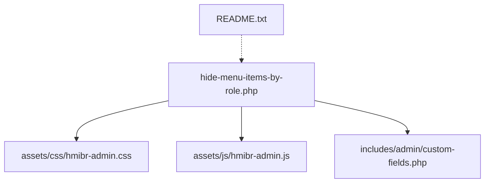
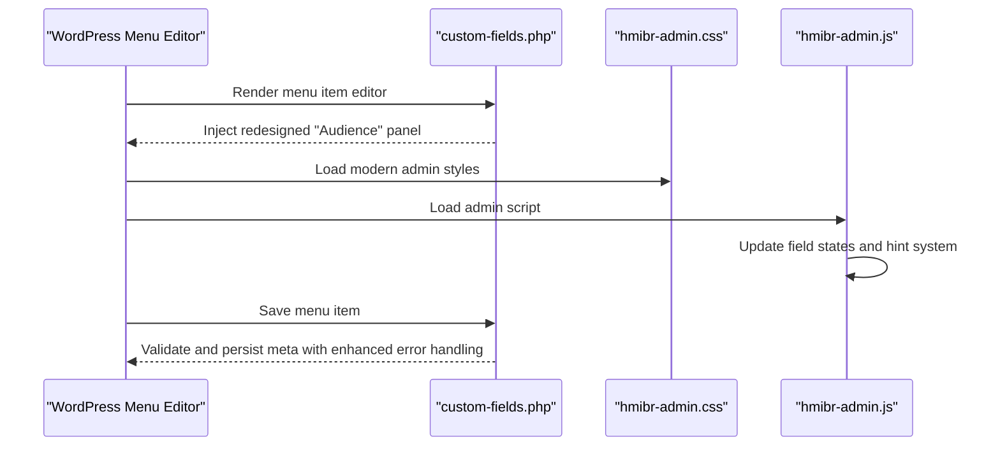
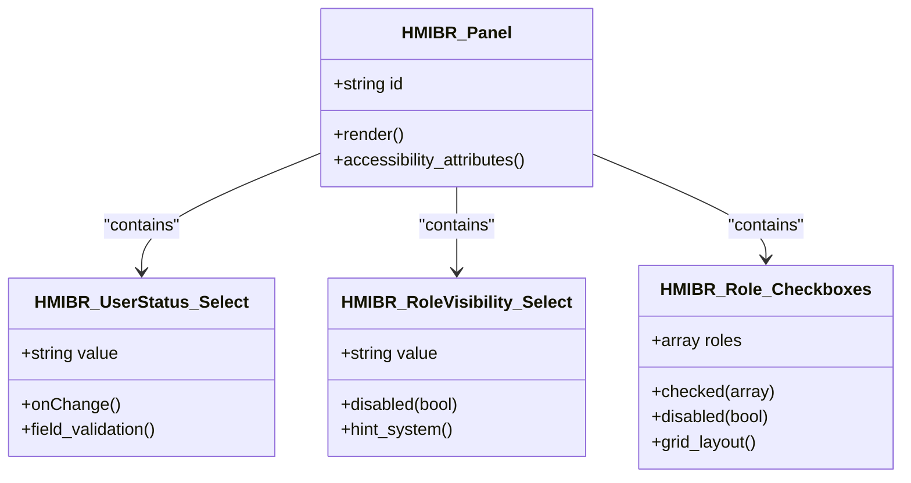
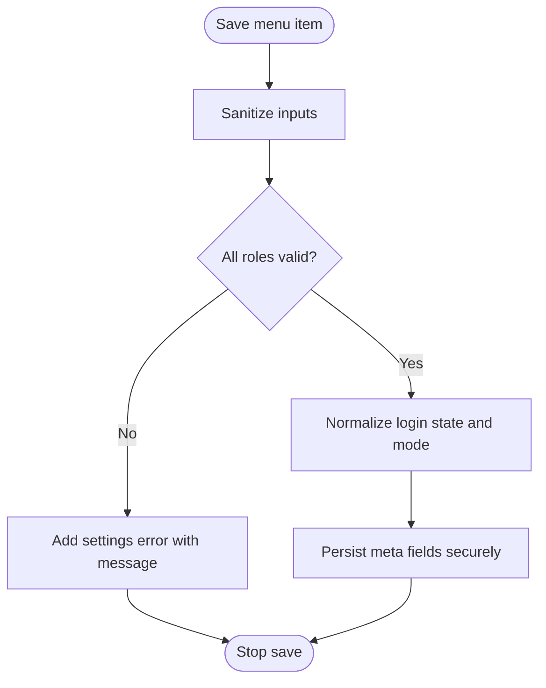
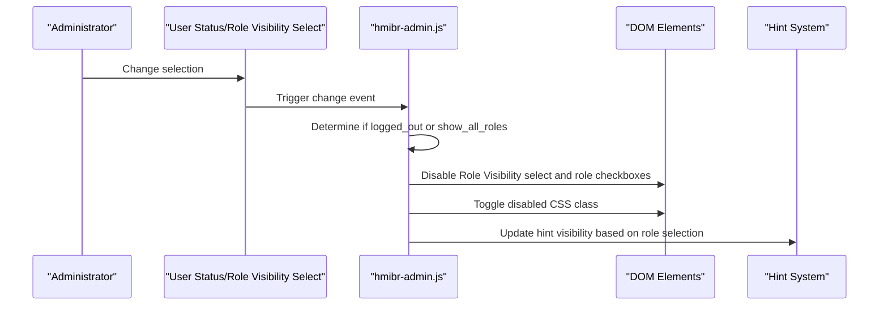
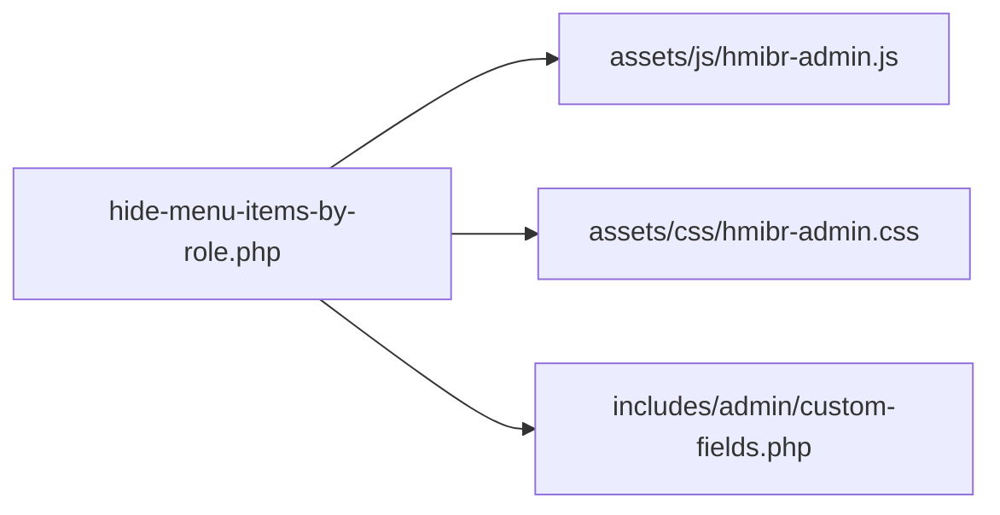

Based on my analysis of the codebase, I can see that the complete redesign has been implemented with significant improvements to the Audience panel interface. Let me now update the documentation to reflect these changes:

# Admin Interface & User Experience

<cite>
**Referenced Files in This Document**
- [hide-menu-items-by-role.php](file://hide-menu-items-by-role.php)
- [custom-fields.php](file://includes/admin/custom-fields.php)
- [hmibr-admin.css](file://assets/css/hmibr-admin.css)
- [hmibr-admin.js](file://assets/js/hmibr-admin.js)
- [README.txt](file://README.txt)
</cite>

## Update Summary
**Changes Made**
- Updated all sections to reflect the complete redesign of the Audience panel interface
- Enhanced descriptions of the collapsible panel structure using semantic HTML5 `
/
` elements
- Added detailed coverage of the improved accessibility attributes and modern WordPress admin styling
- Documented the enhanced hint system for role selection warnings
- Updated field terminology from "Audience Visibility" to "Audience" throughout
- Revised step-by-step guides to match the new interface design and functionality

## Table of Contents
1. [Introduction](#introduction)
2. [Project Structure](#project-structure)
3. [Core Components](#core-components)
4. [Architecture Overview](#architecture-overview)
5. [Detailed Component Analysis](#detailed-component-analysis)
6. [Dependency Analysis](#dependency-analysis)
7. [Performance Considerations](#performance-considerations)
8. [Troubleshooting Guide](#troubleshooting-guide)
9. [Conclusion](#conclusion)

## Introduction
This document explains the completely redesigned admin interface and user experience for the "Audience" panel that extends the WordPress menu editor. The panel features a modern collapsible design built with semantic HTML5, enhanced accessibility attributes, improved field layouts, sophisticated color coding, interactive behaviors, comprehensive validation, responsive design, and an intelligent hint system. The goal is to help administrators configure visibility rules confidently while understanding how the plugin integrates seamlessly with the native menu editor through its redesigned interface.

## Project Structure
The plugin implements a completely redesigned collapsible "Audience" panel into the WordPress menu item editor using modern semantic HTML5 structure. The key files are:
- Plugin bootstrap and asset enqueueing with file modification time caching
- Custom fields rendering and saving logic with enhanced panel structure
- Modern admin CSS featuring semantic HTML5 styling and enhanced visual design
- Admin JavaScript for dynamic interactivity and field state management
- Documentation and changelog with updated feature descriptions

**Diagram sources**
- [hide-menu-items-by-role.php:20-55](file://hide-menu-items-by-role.php#L20-L55)
- [custom-fields.php:1-145](file://includes/admin/custom-fields.php#L1-L145)
- [hmibr-admin.css:1-295](file://assets/css/hmibr-admin.css#L1-L295)
- [hmibr-admin.js:1-57](file://assets/js/hmibr-admin.js#L1-L57)
- [README.txt:10-42](file://README.txt#L10-L42)

**Section sources**
- [hide-menu-items-by-role.php:16-55](file://hide-menu-items-by-role.php#L16-L55)
- [README.txt:10-42](file://README.txt#L10-L42)

## Core Components
- Completely redesigned "Audience" panel (collapsible details/summary UI with semantic HTML5)
- User Status selector (Everyone / Logged-out users only / Logged-in users only)
- Role Visibility Mode (Show to all roles / Hide for selected roles / Show only to selected roles)
- Role checkboxes grid with modern grid layout and enhanced styling
- Intelligent field disabling logic when "Logged-out users only" or "Show to all roles" is selected
- Enhanced validation and saving of custom fields with improved error handling
- Modern admin styles and JavaScript interactivity with accessibility enhancements
- Smart hint system that warns when role rules are active but no roles are selected

Key responsibilities:
- Rendering the redesigned panel and fields inside the menu editor with semantic HTML5
- Enabling/disabling dependent fields based on login state and role visibility mode
- Validating and sanitizing saved values with comprehensive error handling
- Providing visual feedback through the enhanced hint system
- Styling and accessibility enhancements with modern CSS and semantic markup

**Section sources**
- [custom-fields.php:8-86](file://includes/admin/custom-fields.php#L8-L86)
- [custom-fields.php:88-145](file://includes/admin/custom-fields.php#L88-L145)
- [hmibr-admin.js:5-57](file://assets/js/hmibr-admin.js#L5-L57)
- [hmibr-admin.css:1-295](file://assets/css/hmibr-admin.css#L1-L295)

## Architecture Overview
The plugin hooks into the WordPress menu editor to inject the completely redesigned panel and save its data. On the front end, it uses core filters to enforce visibility rules. The admin UI is enhanced with modern CSS and jQuery for improved UX with semantic HTML5 structure and enhanced accessibility.

**Diagram sources**
- [custom-fields.php:8-145](file://includes/admin/custom-fields.php#L8-L145)
- [hmibr-admin.css:1-295](file://assets/css/hmibr-admin.css#L1-L295)
- [hmibr-admin.js:5-57](file://assets/js/hmibr-admin.js#L5-L57)

## Detailed Component Analysis

### Completely Redesigned Collapsible "Audience" Panel
- Built using semantic HTML5 `
/
` for native collapsibility and enhanced accessibility.
- Header includes an icon, title, and chevron; chevron rotates when collapsed with smooth transitions.
- Body contains:
  - Two-field row: User Status and Role Visibility selects with modern styling
  - Role checkboxes grid with enhanced grid layout and visual feedback
  - Intelligent hint system that displays warnings when role rules are active but no roles are selected

Visual design highlights:
- Panel background and border match WordPress admin aesthetics with modern rounded corners and subtle shadows.
- Header has subtle hover and focus states with improved spacing and accessibility.
- Chevron rotation indicates open/closed state with smooth CSS transitions.
- Enhanced typography and spacing throughout the panel with improved readability.
- Modern color scheme that aligns with WordPress admin design patterns.

Accessibility enhancements:
- Uses semantic `
/
` for built-in keyboard and screen reader support.
- Focus-visible outlines ensure clear focus indicators for keyboard navigation.
- Decorative SVG icons are marked aria-hidden for better screen reader experience.
- Labels are associated with inputs via for/id attributes for proper form semantics.
- Enhanced ARIA attributes and roles for improved assistive technology support.

**Updated** Complete redesign with semantic HTML5 structure, enhanced accessibility attributes, and modern WordPress admin styling

**Section sources**
- [custom-fields.php:28-83](file://includes/admin/custom-fields.php#L28-L83)
- [hmibr-admin.css:38-126](file://assets/css/hmibr-admin.css#L38-L126)

#### Class Diagram: Panel and Fields Architecture

**Diagram sources**
- [custom-fields.php:40-81](file://includes/admin/custom-fields.php#L40-L81)

### Field Layouts, Color Coding, and Interactive Elements
- Two-field row layout uses flexbox for responsive alignment with improved spacing and modern design.
- Select inputs have consistent height, padding, and custom dropdown arrow with enhanced modern styling.
- Focus states use the WordPress theme color variable for consistency across the admin interface.
- Disabled elements get reduced opacity and not-allowed cursor with clear visual feedback.
- Role checkboxes use a modern grid layout with auto-fit columns for optimal responsiveness.
- Checked state uses the theme color and a checkmark icon with smooth CSS transitions.

Color coding and states:
- Default borders and text colors align with WordPress admin defaults for consistency.
- Focus rings highlight active controls with proper contrast ratios for accessibility.
- Disabled state applies a dimmed appearance and prevents interaction with visual cues.
- Hint system uses distinct color coding to indicate warning states effectively.

Responsive considerations:
- Flex wrap and grid auto-fit ensure usability on smaller screens with adaptive layouts.
- Select widths adapt to container size with improved scaling and touch-friendly sizing.
- Grid-based role list adapts column count automatically based on available space.

**Updated** Enhanced visual design with modern CSS, improved responsive behavior, and accessible color schemes

**Section sources**
- [hmibr-admin.css:128-198](file://assets/css/hmibr-admin.css#L128-L198)
- [hmibr-admin.css:204-295](file://assets/css/hmibr-admin.css#L204-L295)

### Enhanced Field Validation System
Validation occurs during save with comprehensive error handling:
- Sanitizes role selections and other inputs with WordPress security standards.
- Validates roles against editable roles with detailed error reporting.
- Adds settings errors if invalid roles are submitted with user-friendly messages.
- Normalizes login state and mode to allowed values before saving with fallback defaults.

User feedback enhancements:
- Invalid configurations trigger WordPress settings error notices with clear messaging.
- Administrators see inline messages indicating specific issues and resolution steps.
- Enhanced hint system provides real-time feedback about role selection requirements.

Data persistence:
- Saves role array, menu ID, menu name, login state, and mode per menu item with robust error handling.
- Implements proper sanitization and validation to prevent data corruption.

**Section sources**
- [custom-fields.php:88-145](file://includes/admin/custom-fields.php#L88-L145)

#### Flowchart: Enhanced Save and Validation Logic

**Diagram sources**
- [custom-fields.php:88-145](file://includes/admin/custom-fields.php#L88-L145)

### Advanced JavaScript-Powered Interactivity
Enhanced behavior with intelligent field management:
- When "User Status" is set to "Logged-out users only", the Role Visibility select and role checkboxes are disabled with visual feedback.
- When "Role Visibility" is set to "Show to all roles", the role checkboxes are disabled with appropriate styling.
- The parent containers receive a disabled visual class to clearly reflect the locked state.
- Updates occur both on page load and whenever any field changes with smooth transitions.
- Enhanced hint system shows contextual warnings when role rules are active but no roles are selected.

Implementation enhancements:
- Iterates over all User Status selects to support multiple menu items efficiently.
- Extracts the menu item ID from the field name to scope updates correctly.
- Toggles disabled attributes and CSS classes with smooth animations.
- Manages hint visibility based on role selection status and field states.

**Updated** Enhanced interactivity supporting both user status and role visibility modes with intelligent hint system

**Section sources**
- [hmibr-admin.js:5-57](file://assets/js/hmibr-admin.js#L5-L57)
- [custom-fields.php:40-81](file://includes/admin/custom-fields.php#L40-L81)

#### Sequence Diagram: Enhanced Dynamic Field Management

**Diagram sources**
- [hmibr-admin.js:5-57](file://assets/js/hmibr-admin.js#L5-L57)

### Comprehensive Accessibility Considerations
Enhanced accessibility features throughout the interface:
- Semantic `
/
` provides built-in keyboard and screen reader support with native browser behavior.
- Focus-visible outlines ensure clear focus indicators for keyboard-only navigation.
- Decorative SVG icons are marked aria-hidden for better screen reader experience.
- Labels are associated with inputs via for/id attributes for proper form semantics.
- Disabled states provide visual cues and prevent interaction with proper ARIA attributes.
- Enhanced ARIA roles and live regions for dynamic content updates.

Recommendations for continued accessibility:
- Keep labels descriptive and concise for better screen reader comprehension.
- Ensure sufficient color contrast for focus and disabled states meeting WCAG guidelines.
- Test with keyboard-only navigation and various screen readers regularly.
- Maintain semantic HTML structure when making future modifications.

**Updated** Enhanced accessibility with semantic HTML5 structure, improved ARIA attributes, and comprehensive keyboard navigation support

**Section sources**
- [custom-fields.php:28-83](file://includes/admin/custom-fields.php#L28-L83)
- [hmibr-admin.css:76-79](file://assets/css/hmibr-admin.css#L76-L79)
- [hmibr-admin.css:286-290](file://assets/css/hmibr-admin.css#L286-L290)

### Responsive Design Aspects
Enhanced responsive design with improved mobile experience:
- Flexbox row wraps fields on narrow screens with improved spacing and touch-friendly sizing.
- Grid-based role list adapts column count automatically based on available space.
- Select inputs scale within their containers with better sizing and touch targets.
- Checkboxes remain accessible and clickable across devices with proper touch feedback.
- Hint system adapts to different screen sizes with appropriate positioning.

Mobile optimizations:
- Touch-friendly input sizes and spacing for better mobile usability.
- Optimized grid layouts that work well on tablets and mobile devices.
- Improved font sizes and line heights for better readability on small screens.

**Updated** Enhanced responsive design with improved mobile experience and touch-friendly interfaces

**Section sources**
- [hmibr-admin.css:128-144](file://assets/css/hmibr-admin.css#L128-L144)
- [hmibr-admin.css:213-219](file://assets/css/hmibr-admin.css#L213-L219)

### Modern CSS Styling Approach and Customization
Modern styling approach with enhanced customization capabilities:
- Scoped classes prefixed with hmibr- to avoid conflicts with other plugins.
- Uses CSS variables for theme color to stay consistent with WordPress admin design.
- Provides hover, focus, disabled, and checked states for all interactive elements.
- Inline SVG backgrounds for dropdown arrows and checkmarks for crisp visuals.
- Modern CSS properties including flexbox, grid, and smooth transitions for enhanced UX.
- Enhanced color scheme that matches WordPress admin design patterns.

Customization guidance:
- Override theme color variable to match your site's branding while maintaining accessibility.
- Adjust panel spacing, font sizes, and border radius by targeting .hmibr-panel and related classes.
- Modify disabled opacity or cursor by editing .hmibr-disabled and related selectors.
- Customize checkbox and select appearances by overriding specific input styles.
- Extend hint system styling by modifying .hmibr-hint classes.

Best practices for customization:
- Use child selectors to keep overrides scoped and maintain specificity.
- Preserve focus and disabled semantics when customizing for accessibility compliance.
- Test across browsers for consistent appearance and behavior.
- Maintain color contrast ratios for accessibility when making visual changes.

**Updated** Modern CSS architecture with enhanced styling capabilities, improved accessibility, and comprehensive customization options

**Section sources**
- [hmibr-admin.css:1-295](file://assets/css/hmibr-admin.css#L1-L295)

### Enhanced Error Handling and User Notification System
Comprehensive error handling with improved user feedback:
- On save, invalid roles produce settings errors displayed prominently in the admin UI.
- Errors are added to the settings error stack with clear, actionable messages.
- Login state and mode are normalized to safe values to prevent unexpected behavior.
- Enhanced hint system provides real-time feedback about configuration issues.

Operational flow improvements:
- If validation fails, the save process stops after adding the error notice with specific guidance.
- Otherwise, sanitized and validated values are persisted with proper error logging.
- Real-time hint system warns users when role rules are active but no roles are selected.

**Section sources**
- [custom-fields.php:110-120](file://includes/admin/custom-fields.php#L110-L120)
- [custom-fields.php:126-141](file://includes/admin/custom-fields.php#L126-L141)

## Dependency Analysis
The plugin's admin assets are enqueued conditionally on the menu editor screen with file modification time caching for optimal performance. The custom fields file renders the completely redesigned panel and handles saving with enhanced validation. Styles and scripts enhance the UI and interactivity with modern CSS and JavaScript, providing a seamless user experience.

**Diagram sources**
- [hide-menu-items-by-role.php:26-51](file://hide-menu-items-by-role.php#L26-L51)
- [custom-fields.php:1-145](file://includes/admin/custom-fields.php#L1-L145)

**Section sources**
- [hide-menu-items-by-role.php:26-51](file://hide-menu-items-by-role.php#L26-L51)

## Performance Considerations
Enhanced performance optimizations:
- Client-side disabling avoids unnecessary server requests when fields are locked.
- Validation runs only on save, minimizing overhead during editing with efficient processing.
- Using native `
` reduces JavaScript dependency for collapsing behavior with browser optimization.
- CSS-driven visuals minimize reflows and repaints with hardware acceleration where possible.
- Modern CSS properties improve rendering performance with optimized layouts.
- File modification time caching ensures optimal asset loading without cache busting issues.

Performance benefits:
- Reduced JavaScript execution through native HTML5 elements.
- Optimized CSS with minimal repaints and reflows.
- Efficient DOM manipulation with targeted updates.
- Proper asset caching strategies for faster loading times.

## Troubleshooting Guide
Common issues and resolutions with enhanced diagnostic information:
- Fields appear enabled when they should be disabled:
  - Verify that "User Status" is set to "Logged-out users only".
  - Confirm that "Role Visibility" is not set to "Show to all roles".
  - Confirm that the JavaScript is loaded and not blocked by another script.
  - Check browser console for JavaScript errors that might prevent field state updates.
- Changes do not persist:
  - Check for settings error notices indicating invalid roles with specific error messages.
  - Ensure roles exist and are editable by the current user with proper permissions.
  - Verify that the hint system is not preventing saves due to missing role selections.
- Styles look incorrect:
  - Inspect whether custom CSS overrides conflict with hmibr- classes and specificity.
  - Clear caches and verify the correct version of assets is enqueued with proper caching headers.
  - Check for CSS conflicts with theme or other plugins affecting the panel appearance.
- Hint system not displaying properly:
  - Verify that role selection logic is working correctly in the JavaScript.
  - Check that the hint element exists and has proper ARIA attributes.
  - Ensure CSS is not hiding the hint element unintentionally.

Steps to diagnose:
- Open browser developer tools and inspect the redesigned "Audience" panel structure.
- Check console for JavaScript errors that might affect field interactivity.
- Review network tab to confirm assets are loading with proper caching.
- Temporarily disable conflicting plugins or themes to isolate issues.
- Test with different user roles to verify permission-related issues.

**Updated** Enhanced troubleshooting guide with specific issues related to the redesigned interface and hint system

**Section sources**
- [hmibr-admin.js:5-57](file://assets/js/hmibr-admin.js#L5-L57)
- [custom-fields.php:110-120](file://includes/admin/custom-fields.php#L110-L120)

## Conclusion
The completely redesigned "Audience" panel provides a clear, accessible, and responsive way to control menu item visibility by role and login state. Its modern design follows WordPress admin conventions while utilizing semantic HTML5 structure, enhanced validation, intelligent hint system, and improved interactivity ensure a smooth configuration experience. Administrators can customize the appearance through well-scoped CSS and rely on robust validation and enhanced error notifications to maintain accurate configurations. The panel's accessibility features ensure it works well with assistive technologies and keyboard navigation, making it inclusive for all users.

## Appendices

### Step-by-Step Guide: Navigating the Admin Interface
Complete guide for using the redesigned Audience panel:

1. Go to Appearance > Menus in the WordPress admin.
2. Expand a menu item to reveal its settings.
3. Locate the redesigned "Audience" panel at the bottom of the item settings (collapsible by default).
4. Set "User Status" to:
   - Everyone (no login restrictions)
   - Logged-out users only (visitors without accounts)
   - Logged-in users only (registered users)
5. Choose "Role Visibility":
   - Show to all roles (default - ignores role rules)
   - Hide for selected roles (visible to everyone except selected roles)
   - Show only to selected roles (visible only to selected roles)
6. Select one or more user roles affected by the rule.
7. Pay attention to the hint system that appears when role rules are active but no roles are selected.
8. Save the menu.

Important notes:
- When "Logged-out users only" is selected, Role Visibility and role checkboxes are disabled with visual feedback.
- When "Show to all roles" is selected, role checkboxes are disabled as role rules don't apply.
- The hint system will warn you when a role rule is active but no roles are selected, keeping the item visible to everyone until you make a selection.
- If invalid roles are submitted, you will see an error notice upon saving with specific guidance.
- The panel is fully accessible with keyboard navigation and screen reader support.

**Updated** Step-by-step guide updated for new interface terminology, collapsible panel design, and enhanced hint system functionality

**Section sources**
- [README.txt:34-42](file://README.txt#L34-L42)
- [custom-fields.php:40-81](file://includes/admin/custom-fields.php#L40-L81)
- [custom-fields.php:110-120](file://includes/admin/custom-fields.php#L110-L120)