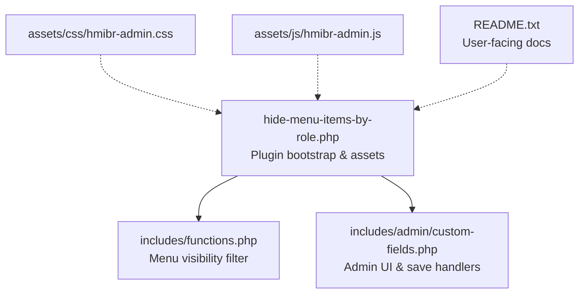
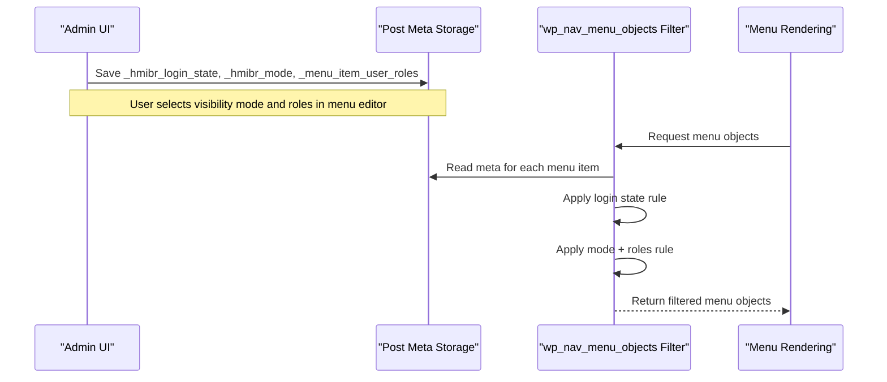
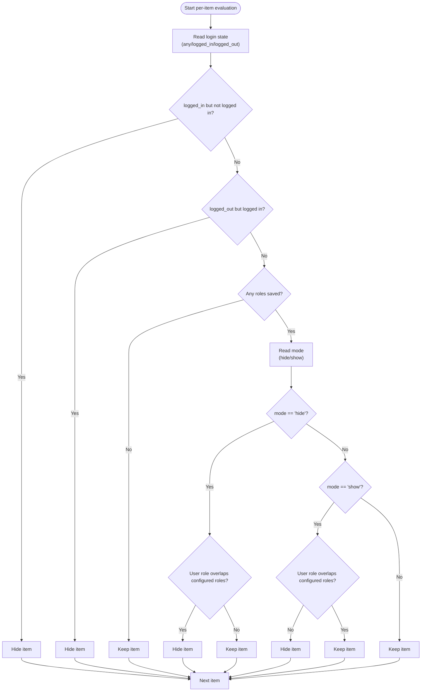
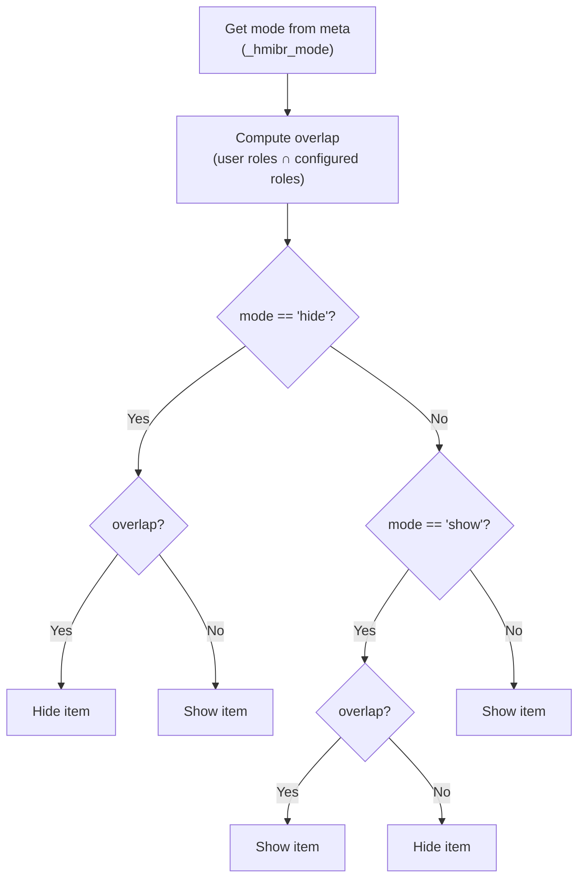
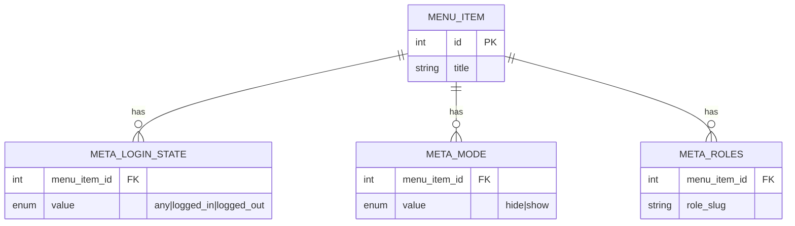
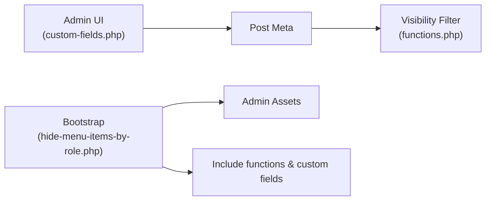

# Dual Mode Operation (Hide vs Show)

<cite>
**Referenced Files in This Document**
- [hide-menu-items-by-role.php](file://hide-menu-items-by-role.php)
- [functions.php](file://includes/functions.php)
- [custom-fields.php](file://includes/admin/custom-fields.php)
- [README.txt](file://README.txt)
</cite>

## Table of Contents
1. [Introduction](#introduction)
2. [Project Structure](#project-structure)
3. [Core Components](#core-components)
4. [Architecture Overview](#architecture-overview)
5. [Detailed Component Analysis](#detailed-component-analysis)
6. [Dependency Analysis](#dependency-analysis)
7. [Performance Considerations](#performance-considerations)
8. [Troubleshooting Guide](#troubleshooting-guide)
9. [Conclusion](#conclusion)

## Introduction
This document explains the dual mode operation that supports both “hide from roles” and “show only to roles” logic for WordPress menu items. It details how mode selection affects role configuration interpretation, resulting visibility behavior, internal switching logic, data storage format, consistency across menu items, and guidance for choosing the appropriate mode. It also addresses conflicts and edge cases when mixing modes within the same menu structure.

## Project Structure
The plugin is organized into a main entry file, core filtering logic, admin custom fields for menu configuration, assets, and documentation:
- Main plugin bootstrap and asset enqueueing
- Core filter hook that evaluates visibility per menu item
- Admin UI to configure login state, mode, and roles per menu item
- Documentation describing features and usage

**Diagram sources**
- [hide-menu-items-by-role.php:20-46](file://hide-menu-items-by-role.php#L20-L46)
- [functions.php:1-50](file://includes/functions.php#L1-L50)
- [custom-fields.php:1-147](file://includes/admin/custom-fields.php#L1-L147)

**Section sources**
- [hide-menu-items-by-role.php:1-54](file://hide-menu-items-by-role.php#L1-L54)
- [functions.php:1-50](file://includes/functions.php#L1-L50)
- [custom-fields.php:1-147](file://includes/admin/custom-fields.php#L1-L147)
- [README.txt:10-63](file://README.txt#L10-L63)

## Core Components
- Plugin bootstrap: registers admin assets on the menu editor screen and includes required files.
- Admin custom fields: adds an “Audience Visibility” panel with fields for login state, mode (hide/show), and user roles; saves these values as post meta for each menu item.
- Visibility filter: runs during menu rendering to decide whether to show or hide each menu item based on current user context, login state, mode, and selected roles.

Key responsibilities:
- Data capture and persistence of mode and roles per menu item.
- Runtime evaluation of visibility using the stored mode and roles.
- Early exit optimization when login state alone resolves visibility.

**Section sources**
- [hide-menu-items-by-role.php:20-46](file://hide-menu-items-by-role.php#L20-L46)
- [custom-fields.php:3-94](file://includes/admin/custom-fields.php#L3-L94)
- [custom-fields.php:96-147](file://includes/admin/custom-fields.php#L96-L147)
- [functions.php:1-50](file://includes/functions.php#L1-L50)

## Architecture Overview
The system uses a classic WordPress pattern:
- Admin UI writes configuration to post meta for each menu item.
- The runtime filter reads this meta and applies rules to the menu object list before output.

**Diagram sources**
- [custom-fields.php:96-147](file://includes/admin/custom-fields.php#L96-L147)
- [functions.php:1-50](file://includes/functions.php#L1-L50)

## Detailed Component Analysis

### Dual Mode Logic: Hide vs Show
The visibility decision follows a two-stage process:
1. Login state check: If the login state rule excludes the current visitor, the item is hidden immediately.
2. Role-based mode check:
   - Hide mode (“Hide from these roles”): Hide the item if the current user has any of the configured roles.
   - Show mode (“Show only to these roles”): Hide the item unless the current user has at least one of the configured roles. If no roles are configured in show mode, the item remains visible to everyone.

**Diagram sources**
- [functions.php:15-45](file://includes/functions.php#L15-L45)

#### Examples: Identical Role Settings, Different Modes
Assume the same set of roles is configured for a menu item. The outcome depends on the selected mode:
- Hide mode with roles [editor]:
  - Editor sees the item as hidden.
  - Subscriber sees the item as visible.
- Show mode with roles [editor]:
  - Editor sees the item as visible.
  - Subscriber sees the item as hidden.

These examples illustrate that the same role configuration can produce opposite visibility outcomes depending on the chosen mode.

**Section sources**
- [functions.php:32-45](file://includes/functions.php#L32-L45)
- [README.txt:48-53](file://README.txt#L48-L53)

### Internal Switching Logic and Filtering Algorithm
- The mode is read from post meta `_hmibr_mode`, defaulting to `hide` if not set.
- The algorithm computes overlap between the current user’s roles and the configured roles for the item.
- In hide mode, overlap means hide; in show mode, lack of overlap means hide (unless no roles are configured).

**Diagram sources**
- [functions.php:32-45](file://includes/functions.php#L32-L45)

**Section sources**
- [functions.php:32-45](file://includes/functions.php#L32-L45)

### Data Storage Format and Consistency
Per menu item, the plugin stores:
- `_hmibr_login_state`: One of `any`, `logged_in`, `logged_out`.
- `_hmibr_mode`: One of `hide`, `show`.
- `_menu_item_user_roles`: Array of role slugs.

Consistency mechanisms:
- Validation ensures only allowed values are saved for login state and mode.
- Roles are validated against editable roles before saving.
- Defaults are applied when values are missing: login state defaults to `any`, mode defaults to `hide`.

**Diagram sources**
- [custom-fields.php:122-143](file://includes/admin/custom-fields.php#L122-L143)
- [custom-fields.php:107-123](file://includes/admin/custom-fields.php#L107-L123)

**Section sources**
- [custom-fields.php:107-143](file://includes/admin/custom-fields.php#L107-L143)
- [functions.php:16-35](file://includes/functions.php#L16-L35)

### Choosing the Appropriate Mode
Use hide mode when you want broad visibility with exceptions:
- Example: Show most content to everyone except specific roles (e.g., hide sensitive links from editors).

Use show mode when you want restricted access:
- Example: Show administrative links only to administrators or editors.

Guidance:
- Prefer hide mode for “default-visible with exclusions.”
- Prefer show mode for “default-hidden with inclusions.”
- When using show mode without selecting any roles, the item will be visible to everyone by design to avoid accidental hiding during setup.

**Section sources**
- [README.txt:48-53](file://README.txt#L48-L53)
- [functions.php:41-44](file://includes/functions.php#L41-L44)

### Mixing Modes Within the Same Menu
It is safe to mix hide and show modes across different menu items in the same menu because the evaluation is performed per item. However, consider:
- Cognitive load: Users may confuse why some items follow exclusion logic while others follow inclusion logic.
- Maintenance: Clearly document intended behavior for each item.
- Edge case: Ensure consistent expectations around empty role sets in show mode (visible to all).

Best practices:
- Use hide mode for general audience items with a few exceptions.
- Use show mode for privileged sections requiring explicit role membership.
- Avoid overly complex combinations that could lead to confusion; group related items under consistent modes where possible.

[No sources needed since this section provides general guidance]

## Dependency Analysis
The plugin’s runtime dependency chain:
- Admin UI writes meta via custom field save handler.
- The visibility filter reads meta and applies rules.
- Assets are enqueued only on the menu editor screen.

**Diagram sources**
- [hide-menu-items-by-role.php:20-46](file://hide-menu-items-by-role.php#L20-L46)
- [custom-fields.php:96-147](file://includes/admin/custom-fields.php#L96-L147)
- [functions.php:1-50](file://includes/functions.php#L1-L50)

**Section sources**
- [hide-menu-items-by-role.php:20-46](file://hide-menu-items-by-role.php#L20-L46)
- [custom-fields.php:96-147](file://includes/admin/custom-fields.php#L96-L147)
- [functions.php:1-50](file://includes/functions.php#L1-L50)

## Performance Considerations
- Early login-state checks short-circuit further processing when login state alone determines visibility, reducing overhead.
- Role overlap computation is minimal and performed only when necessary (roles are present and login state does not resolve visibility).
- Asset enqueueing is limited to the menu editor screen to avoid unnecessary loading elsewhere.

Recommendations:
- Keep role lists concise and relevant.
- Avoid excessive nested menus with many conditional items if performance becomes a concern.

**Section sources**
- [functions.php:15-24](file://includes/functions.php#L15-L24)
- [hide-menu-items-by-role.php:20-41](file://hide-menu-items-by-role.php#L20-L41)

## Troubleshooting Guide
Common issues and resolutions:
- Item unexpectedly hidden:
  - Check login state setting; ensure it matches the intended audience.
  - Verify mode and roles; confirm whether hide or show mode aligns with intent.
- Item unexpectedly visible:
  - In show mode, verify that at least one configured role matches the current user.
  - Remember that show mode with no roles selected shows the item to everyone.
- Fields disabled in admin:
  - When login state is set to “Logged-out users only,” the mode and roles fields are intentionally disabled to prevent conflicting configurations.

Validation and defaults:
- Only allowed values are accepted for login state and mode; invalid inputs are normalized to defaults.
- Roles are validated against editable roles before saving.

**Section sources**
- [custom-fields.php:63-90](file://includes/admin/custom-fields.php#L63-L90)
- [custom-fields.php:107-143](file://includes/admin/custom-fields.php#L107-L143)
- [functions.php:15-45](file://includes/functions.php#L15-L45)
- [README.txt:55-63](file://README.txt#L55-L63)

## Conclusion
The plugin’s dual mode operation enables flexible control over menu visibility:
- Hide mode excludes specified roles from seeing an item.
- Show mode includes only specified roles to see an item.
The mode selection directly changes how role configurations are interpreted, allowing identical role settings to yield different visibility outcomes. The system persists mode and roles per menu item and applies them consistently during rendering. By understanding the internal logic and choosing the appropriate mode for your use case, you can implement clear, maintainable visibility rules across your menus.