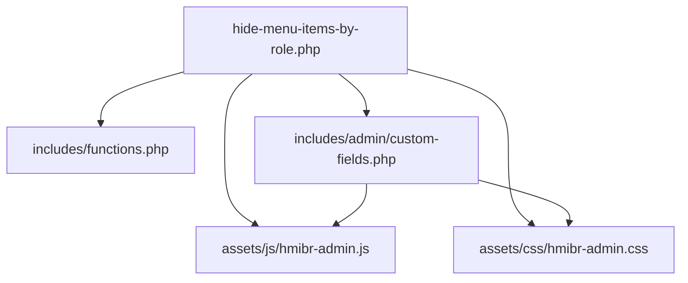
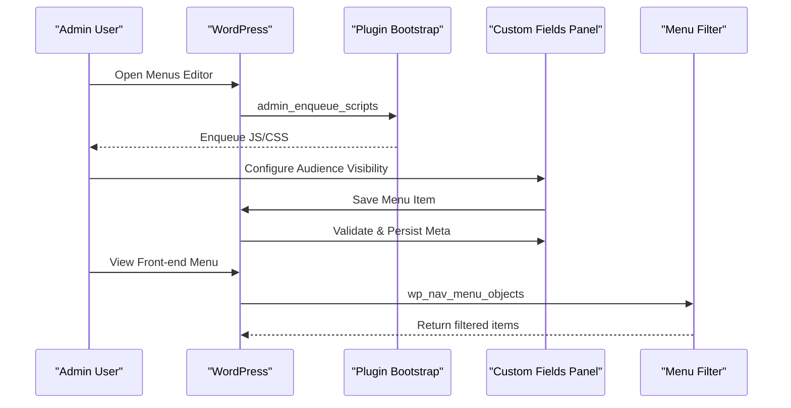
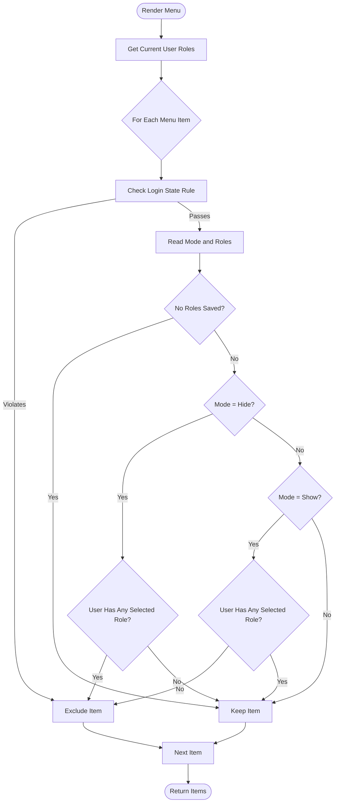
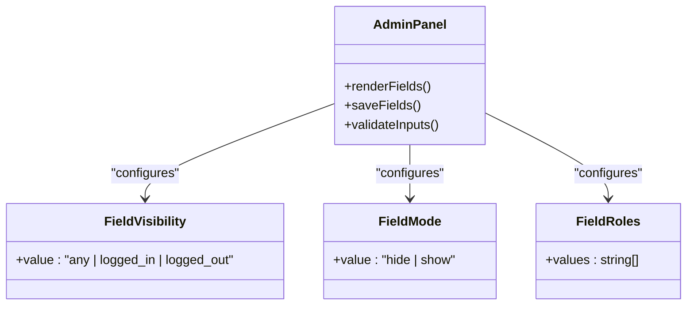
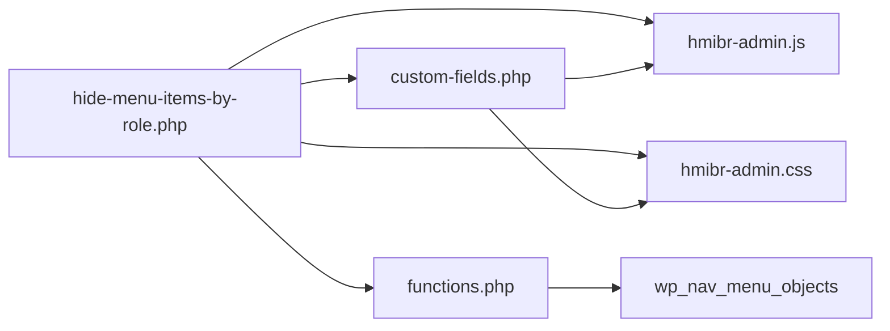

# Features Guide

<cite>
**Referenced Files in This Document**
- [hide-menu-items-by-role.php](file://hide-menu-items-by-role.php)
- [functions.php](file://includes/functions.php)
- [custom-fields.php](file://includes/admin/custom-fields.php)
- [hmibr-admin.js](file://assets/js/hmibr-admin.js)
- [hmibr-admin.css](file://assets/css/hmibr-admin.css)
</cite>

## Table of Contents
1. [Introduction](#introduction)
2. [Project Structure](#project-structure)
3. [Core Components](#core-components)
4. [Architecture Overview](#architecture-overview)
5. [Detailed Component Analysis](#detailed-component-analysis)
6. [Dependency Analysis](#dependency-analysis)
7. [Performance Considerations](#performance-considerations)
8. [Troubleshooting Guide](#troubleshooting-guide)
9. [Conclusion](#conclusion)

## Introduction
This plugin filters WordPress navigation menus based on the current user’s role and login state. It provides an admin interface to configure per-menu-item visibility rules, supports dual mode operation (hide from roles or show only to roles), and enforces conditional behavior between login state and role-based controls. The result is a flexible system for member-only content, admin-exclusive menus, and public-facing navigation elements.

## Project Structure
The plugin is organized into a main entry file, core filtering logic, admin UI components, and supporting assets:
- Main plugin bootstrap and asset enqueueing
- Core menu filtering function hooked into WordPress
- Admin custom fields panel with validation and conditional behavior
- Admin JavaScript for dynamic field enabling/disabling
- Admin CSS for the collapsible “Audience Visibility” panel

**Diagram sources**
- [hide-menu-items-by-role.php:20-46](file://hide-menu-items-by-role.php#L20-L46)
- [functions.php:1-50](file://includes/functions.php#L1-L50)
- [custom-fields.php:1-147](file://includes/admin/custom-fields.php#L1-L147)
- [hmibr-admin.js:1-41](file://assets/js/hmibr-admin.js#L1-L41)
- [hmibr-admin.css:1-262](file://assets/css/hmibr-admin.css#L1-L262)

**Section sources**
- [hide-menu-items-by-role.php:1-54](file://hide-menu-items-by-role.php#L1-L54)

## Core Components
- Role-based menu filtering: Filters menu items at runtime using the current user’s roles and saved meta values.
- Login state controls: Restricts visibility to logged-in or logged-out users.
- Dual mode operation: Supports both “Hide from these roles” and “Show only to these roles.”
- Admin interface: Collapsible “Audience Visibility” panel with field validation and conditional behavior.
- Assets: Admin JS/CSS to enhance UX and enforce constraints.

Key responsibilities:
- Bootstrap and enqueue admin assets only on the Menus screen.
- Hook into WordPress menu rendering to filter items.
- Provide and persist configuration via custom fields.
- Validate inputs and conditionally disable irrelevant fields.

**Section sources**
- [hide-menu-items-by-role.php:20-46](file://hide-menu-items-by-role.php#L20-L46)
- [functions.php:1-50](file://includes/functions.php#L1-L50)
- [custom-fields.php:1-147](file://includes/admin/custom-fields.php#L1-L147)

## Architecture Overview
The plugin integrates with WordPress through hooks:
- On admin pages, it enqueues scripts/styles for the Menus editor.
- When saving menu items, it validates and persists configuration.
- During front-end menu rendering, it filters items based on login state and roles.

**Diagram sources**
- [hide-menu-items-by-role.php:20-46](file://hide-menu-items-by-role.php#L20-L46)
- [custom-fields.php:96-147](file://includes/admin/custom-fields.php#L96-L147)
- [functions.php:1-50](file://includes/functions.php#L1-L50)

## Detailed Component Analysis

### Role-Based Menu Visibility
- The plugin reads the current user’s roles and compares them against saved role selections for each menu item.
- If no roles are configured for an item, it remains visible by default.
- Two modes control behavior:
  - Hide from these roles: Items are hidden when the user has any selected role.
  - Show only to these roles: Items are shown only if the user has at least one selected role; otherwise hidden.

**Diagram sources**
- [functions.php:1-50](file://includes/functions.php#L1-L50)

**Section sources**
- [functions.php:1-50](file://includes/functions.php#L1-L50)

### Login State Controls
- Three visibility options:
  - Everyone: No restriction based on login state.
  - Logged-in users only: Hide from guests.
  - Logged-out users only: Hide from logged-in users.
- When set to “Logged-out users only,” the plugin disables the role-based controls and mode selector to prevent conflicting configurations.

Behavioral highlights:
- Login state check runs before role checks to short-circuit early when possible.
- Disabling fields ensures consistent rule sets and avoids ambiguous configurations.

**Section sources**
- [functions.php:15-24](file://includes/functions.php#L15-L24)
- [custom-fields.php:63-91](file://includes/admin/custom-fields.php#L63-L91)
- [hmibr-admin.js:5-41](file://assets/js/hmibr-admin.js#L5-L41)

### Dual Mode Operation
- Hide from these roles: Use this when you want to exclude specific roles while keeping the item visible to others.
- Show only to these roles: Use this to restrict visibility to specific roles only.
- If no roles are selected in “Show only to these roles,” the item is shown to everyone.

Practical guidance:
- Prefer “Show only to these roles” for exclusive areas (e.g., admin-only).
- Prefer “Hide from these roles” for general menus where most roles should see items except a few.

**Section sources**
- [functions.php:32-45](file://includes/functions.php#L32-L45)
- [custom-fields.php:36-45](file://includes/admin/custom-fields.php#L36-L45)

### Admin Interface Components
- Collapsible “Audience Visibility” panel:
  - Uses a native details/summary element styled for consistency.
  - Contains three primary controls:
    - Visibility (login state)
    - Menu Item Visibility Mode (hide/show)
    - Select the user roles (checkbox list)
- Field validation:
  - Only valid WordPress roles are accepted.
  - Allowed values for login state and mode are enforced during save.
- Conditional behavior:
  - When “Logged-out users only” is selected, the mode and role checkboxes are disabled to avoid conflicts.
  - Visual feedback indicates disabled state.

**Diagram sources**
- [custom-fields.php:1-94](file://includes/admin/custom-fields.php#L1-L94)
- [custom-fields.php:96-147](file://includes/admin/custom-fields.php#L96-L147)

**Section sources**
- [custom-fields.php:1-147](file://includes/admin/custom-fields.php#L1-L147)
- [hmibr-admin.js:1-41](file://assets/js/hmibr-admin.js#L1-L41)
- [hmibr-admin.css:1-262](file://assets/css/hmibr-admin.css#L1-L262)

### Practical Examples

- Member-only content
  - Set Visibility to “Logged-in users only.”
  - Choose “Show only to these roles” and select Subscriber (and other members’ roles).
  - Result: Only logged-in members see the item.

- Admin-exclusive menus
  - Set Visibility to “Logged-in users only.”
  - Choose “Show only to these roles” and select Administrator.
  - Result: Only administrators can see the item.

- Public-facing navigation elements
  - Leave Visibility as “Everyone.”
  - Choose “Hide from these roles” and select roles that should not see the item (if needed).
  - Result: Visible to all except excluded roles.

- Mixed scenario
  - Visibility: “Logged-in users only.”
  - Mode: “Hide from these roles,” select Contributor.
  - Result: All logged-in users except Contributors see the item.

[No sources needed since this section provides conceptual examples]

## Dependency Analysis
- Entry point enqueues admin assets only on the Menus screen and includes core files.
- Admin custom fields hook into WordPress menu editor lifecycle to render and save fields.
- Front-end filtering hooks into WordPress menu rendering pipeline.

**Diagram sources**
- [hide-menu-items-by-role.php:20-46](file://hide-menu-items-by-role.php#L20-L46)
- [custom-fields.php:94-147](file://includes/admin/custom-fields.php#L94-L147)
- [functions.php:49-50](file://includes/functions.php#L49-L50)

**Section sources**
- [hide-menu-items-by-role.php:20-46](file://hide-menu-items-by-role.php#L20-L46)
- [custom-fields.php:94-147](file://includes/admin/custom-fields.php#L94-L147)
- [functions.php:49-50](file://includes/functions.php#L49-L50)

## Performance Considerations
- Early exit on login state: The filter first evaluates login state to quickly exclude items without further processing.
- Minimal overhead: Filtering occurs only during menu rendering and uses lightweight meta lookups.
- Best practices:
  - Avoid selecting too many roles per item; keep role lists concise.
  - Use “Show only to these roles” for highly restrictive items to reduce ambiguity.
  - Prefer “Hide from these roles” for broad visibility with small exclusions.
  - Test changes in staging to ensure expected visibility across roles.

[No sources needed since this section provides general guidance]

## Troubleshooting Guide
- Item still visible to unintended roles
  - Verify the selected roles match the intended audience.
  - Confirm the mode is set correctly (“Hide from these roles” vs “Show only to these roles”).
  - Ensure the login state is not restricting unexpectedly.

- Fields appear disabled
  - When Visibility is set to “Logged-out users only,” the mode and role fields are intentionally disabled to prevent conflicting rules. Change Visibility to “Everyone” or “Logged-in users only” to enable them.

- Changes not saving
  - Confirm that the form submission includes the custom fields.
  - Check for invalid role names; only valid WordPress roles are accepted.

- Menu not filtering on front end
  - Ensure the theme calls standard WordPress menu functions so the filter hook applies.
  - Clear caches if a caching plugin is active.

**Section sources**
- [custom-fields.php:96-147](file://includes/admin/custom-fields.php#L96-L147)
- [functions.php:15-24](file://includes/functions.php#L15-L24)

## Conclusion
This plugin offers a straightforward yet powerful way to tailor navigation menus to your site’s audience. By combining login state controls with role-based visibility and dual mode operation, you can create secure, role-aware menus with minimal effort. Use the provided admin interface to configure rules per menu item, validate settings, and rely on the built-in performance optimizations for smooth operation.