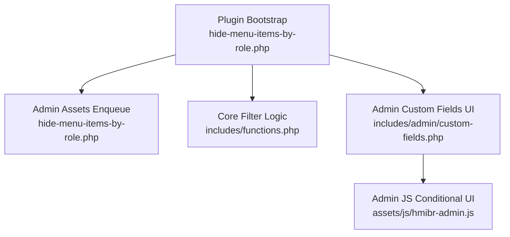
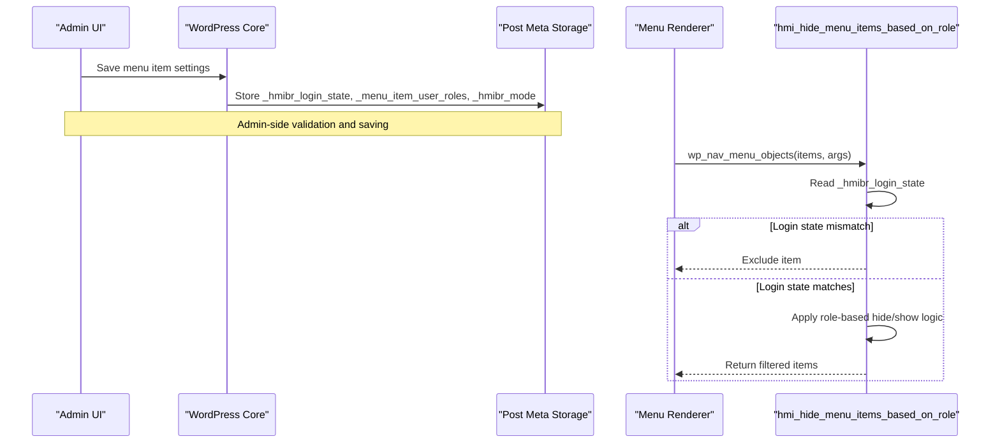
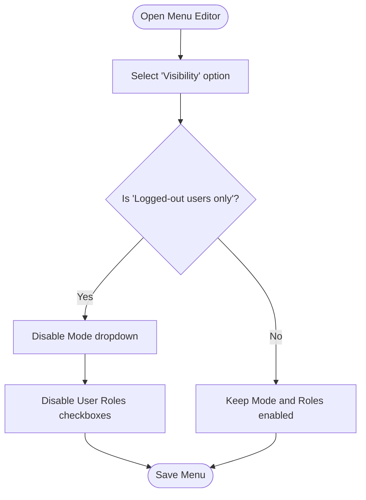
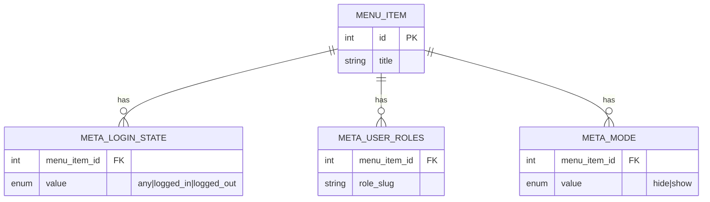
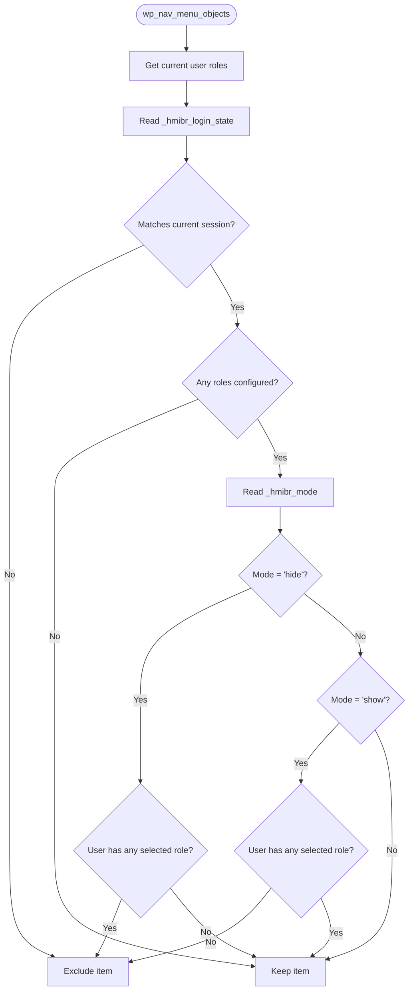
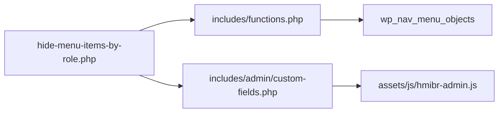

# Login State Controls

<cite>
**Referenced Files in This Document**
- [hide-menu-items-by-role.php](file://hide-menu-items-by-role.php)
- [functions.php](file://includes/functions.php)
- [custom-fields.php](file://includes/admin/custom-fields.php)
- [hmibr-admin.js](file://assets/js/hmibr-admin.js)
- [README.txt](file://README.txt)
</cite>

## Table of Contents
1. [Introduction](#introduction)
2. [Project Structure](#project-structure)
3. [Core Components](#core-components)
4. [Architecture Overview](#architecture-overview)
5. [Detailed Component Analysis](#detailed-component-analysis)
6. [Dependency Analysis](#dependency-analysis)
7. [Performance Considerations](#performance-considerations)
8. [Troubleshooting Guide](#troubleshooting-guide)
9. [Conclusion](#conclusion)

## Introduction
This document explains how the plugin detects a visitor’s authentication status and applies visibility rules to navigation menu items. It covers the three login state options (Everyone, Logged-in users only, Logged-out users only), the conditional field behavior that disables conflicting controls when certain login states are selected, and practical scenarios such as member-only sections, public landing pages, and authenticated user dashboards. It also details the technical implementation of session detection and its integration with WordPress hooks, along with performance considerations and caching best practices.

## Project Structure
The plugin is organized into a small set of focused files:
- Plugin bootstrap and admin asset enqueueing
- Core logic for filtering menu items based on roles and login state
- Admin UI for configuring visibility per menu item
- Admin JavaScript for conditional field disabling
- Documentation and changelog

**Diagram sources**
- [hide-menu-items-by-role.php:20-46](file://hide-menu-items-by-role.php#L20-L46)
- [functions.php:1-49](file://includes/functions.php#L1-L49)
- [custom-fields.php:1-146](file://includes/admin/custom-fields.php#L1-L146)
- [hmibr-admin.js:1-41](file://assets/js/hmibr-admin.js#L1-L41)

**Section sources**
- [hide-menu-items-by-role.php:1-54](file://hide-menu-items-by-role.php#L1-L54)

## Core Components
- Login state control: Determines whether a menu item should be visible to Everyone, Logged-in users only, or Logged-out users only.
- Role-based visibility mode: Hide from selected roles or Show only to selected roles.
- Admin UI: Adds fields to the Menu Editor to configure visibility and enforces conditional disabling of fields when “Logged-out users only” is selected.
- Runtime filter: Applies visibility rules during menu rendering using WordPress filters.

Key behaviors:
- When “Logged-out users only” is selected, role-based fields are disabled in the admin UI to prevent conflicting configuration.
- At runtime, if the login state does not match the current user’s session, the menu item is excluded before role checks run.

**Section sources**
- [custom-fields.php:24-60](file://includes/admin/custom-fields.php#L24-L60)
- [custom-fields.php:63-91](file://includes/admin/custom-fields.php#L63-L91)
- [functions.php:15-24](file://includes/functions.php#L15-L24)

## Architecture Overview
The plugin integrates with WordPress through two primary mechanisms:
- Admin side: Adds custom fields to the Menu Editor and saves them as post meta for each menu item.
- Frontend side: Hooks into the menu rendering pipeline to filter out items based on login state and role rules.

**Diagram sources**
- [custom-fields.php:96-146](file://includes/admin/custom-fields.php#L96-L146)
- [functions.php:1-49](file://includes/functions.php#L1-L49)

## Detailed Component Analysis

### Login State Options and Visibility Rules
The plugin supports three login state options:
- Everyone: No restriction based on login status; role rules apply normally.
- Logged-in users only: Item is visible only to users who are logged in.
- Logged-out users only: Item is visible only to visitors who are not logged in.

Runtime behavior:
- The plugin reads the saved login state for each menu item.
- If the current user’s session does not match the configured login state, the item is immediately excluded.
- Only when the login state matches does the plugin proceed to evaluate role-based rules.

Practical examples:
- Member-only section: Set login state to “Logged-in users only.” Role rules can further restrict access by role.
- Public landing page: Set login state to “Everyone.” Role rules may still apply if needed.
- Authenticated user dashboard link: Set login state to “Logged-in users only,” and optionally use “Show only to these roles” to limit to specific roles.

**Section sources**
- [functions.php:15-24](file://includes/functions.php#L15-L24)
- [README.txt:55-62](file://README.txt#L55-L62)

### Conditional Field Behavior in Admin UI
When “Logged-out users only” is selected in the admin UI:
- The Mode dropdown (“Hide from these roles” / “Show only to these roles”) is disabled.
- The User Roles checkboxes are disabled.
- Visual styling indicates disabled state.

This prevents conflicting configurations where role-based rules would be meaningless under “Logged-out users only.”

Implementation highlights:
- Admin PHP injects inline script to handle field disabling for a single item context.
- Admin JS provides a global handler that scans all login state selects and updates related fields accordingly.

**Diagram sources**
- [custom-fields.php:63-91](file://includes/admin/custom-fields.php#L63-L91)
- [hmibr-admin.js:5-41](file://assets/js/hmibr-admin.js#L5-L41)

**Section sources**
- [custom-fields.php:63-91](file://includes/admin/custom-fields.php#L63-L91)
- [hmibr-admin.js:5-41](file://assets/js/hmibr-admin.js#L5-L41)

### Data Model and Persistence
Per menu item, the plugin stores:
- Login state: `_hmibr_login_state` with values any, logged_in, logged_out.
- Selected roles: `_menu_item_user_roles` as an array of role slugs.
- Mode: `_hmibr_mode` with values hide or show.

Saving process:
- On menu update, the plugin sanitizes and validates inputs.
- It ensures only valid roles are stored and normalizes invalid values to defaults.
- It persists the login state and mode alongside the roles.

**Diagram sources**
- [custom-fields.php:96-146](file://includes/admin/custom-fields.php#L96-L146)

**Section sources**
- [custom-fields.php:96-146](file://includes/admin/custom-fields.php#L96-L146)

### Runtime Filtering Logic
At render time, the plugin:
- Retrieves the current user’s roles (or treats guests as a placeholder).
- Reads the menu item’s login state and excludes the item if it does not match the current session.
- If no roles are configured, the item remains visible (nothing to check).
- Applies the mode:
  - Hide: Remove the item if the user has any of the selected roles.
  - Show: Remove the item if the user does not have any of the selected roles (unless no roles are selected, in which case it stays visible).

**Diagram sources**
- [functions.php:1-49](file://includes/functions.php#L1-L49)

**Section sources**
- [functions.php:1-49](file://includes/functions.php#L1-L49)

## Dependency Analysis
- Plugin bootstrap loads core functions and admin custom fields.
- Admin assets are enqueued only on the Menus screen.
- Admin UI adds fields and saves metadata via WordPress hooks.
- Runtime filtering uses a WordPress filter to modify menu objects.

**Diagram sources**
- [hide-menu-items-by-role.php:20-46](file://hide-menu-items-by-role.php#L20-L46)
- [functions.php:49-49](file://includes/functions.php#L49-L49)
- [custom-fields.php:94-94](file://includes/admin/custom-fields.php#L94-L94)

**Section sources**
- [hide-menu-items-by-role.php:20-46](file://hide-menu-items-by-role.php#L20-L46)
- [functions.php:49-49](file://includes/functions.php#L49-L49)
- [custom-fields.php:94-94](file://includes/admin/custom-fields.php#L94-L94)

## Performance Considerations
- Early exit on login state mismatch: The plugin checks login state first and excludes non-matching items before evaluating roles. This reduces unnecessary role computations.
- Minimal overhead: Checks rely on lightweight post meta reads and built-in WordPress functions.
- Caching strategy:
  - Page caching: Since visibility depends on user session, avoid caching full pages for mixed audiences. Use fragment caching or server-side includes for dynamic menus.
  - Object caching: Avoid caching the entire filtered menu globally if user sessions vary widely. Cache per-user or per-role segments if appropriate.
  - Transients: Consider short-lived transients keyed by user ID or role sets for expensive computations, but ensure invalidation on role changes.
- Best practices:
  - Keep role lists minimal and well-defined.
  - Avoid excessive nested conditions; rely on early login state checks.
  - Test with caching plugins to ensure correct exclusion/inclusion behavior.

[No sources needed since this section provides general guidance]

## Troubleshooting Guide
Common issues and resolutions:
- Menu items not appearing for logged-in users:
  - Verify the login state is set to “Logged-in users only” or “Everyone.”
  - Confirm the user’s roles align with the selected mode (hide vs show).
- Items unexpectedly hidden for guests:
  - Ensure the login state is not set to “Logged-in users only.”
  - Check that “Logged-out users only” is not unintentionally applied.
- Conflicting fields in admin:
  - When “Logged-out users only” is selected, Mode and Roles are disabled by design. Change the login state to adjust.
- Validation errors:
  - Invalid roles are ignored; ensure only valid roles are selected.

Operational hooks and points to inspect:
- Admin field rendering and saving: [custom-fields.php:96-146](file://includes/admin/custom-fields.php#L96-L146)
- Runtime filtering hook: [functions.php:49-49](file://includes/functions.php#L49-L49)

**Section sources**
- [custom-fields.php:96-146](file://includes/admin/custom-fields.php#L96-L146)
- [functions.php:1-49](file://includes/functions.php#L1-L49)

## Conclusion
The plugin provides robust login state controls combined with flexible role-based visibility. By enforcing early login state checks and offering clear admin-side constraints, it delivers predictable behavior across public and private areas of a site. Following the recommended caching strategies ensures optimal performance while preserving accurate visibility rules for different user sessions.

[No sources needed since this section summarizes without analyzing specific files]