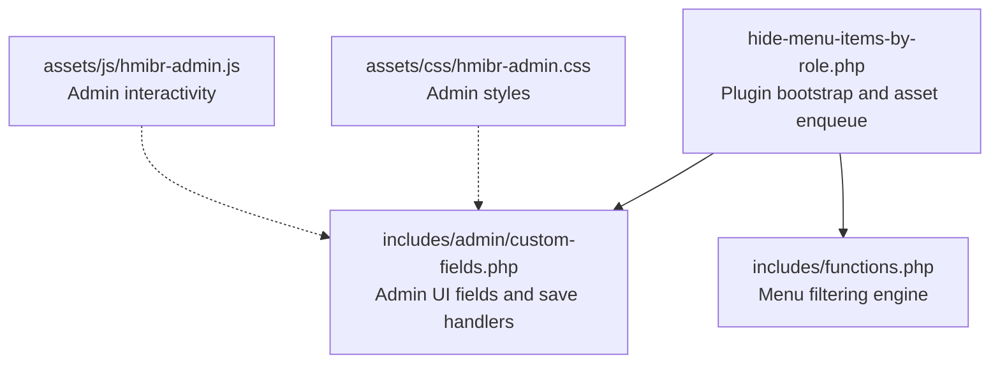
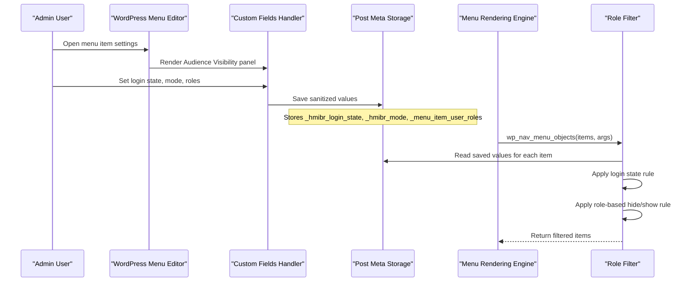
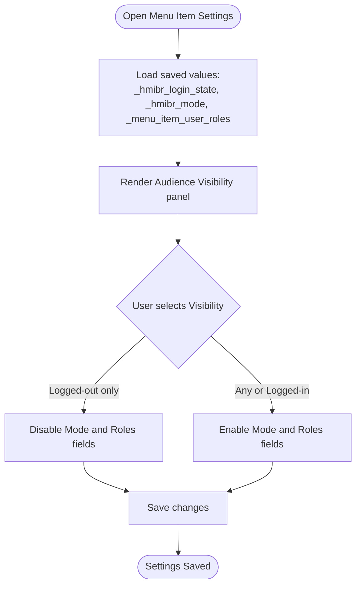
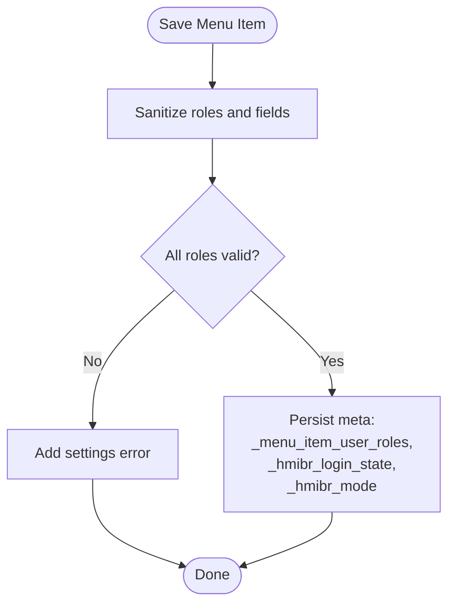
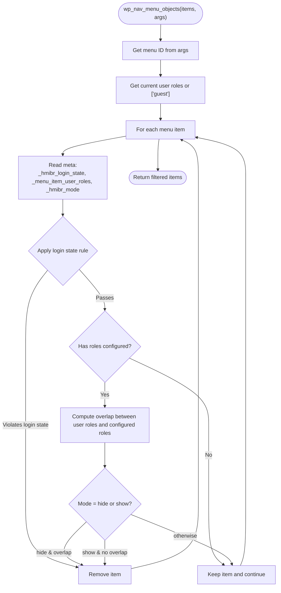
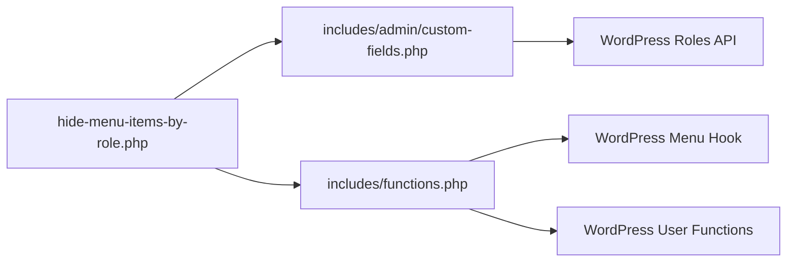

# Role-Based Menu Visibility

<cite>
**Referenced Files in This Document**
- [hide-menu-items-by-role.php](file://hide-menu-items-by-role.php)
- [functions.php](file://includes/functions.php)
- [custom-fields.php](file://includes/admin/custom-fields.php)
- [README.txt](file://README.txt)
</cite>

## Table of Contents
1. [Introduction](#introduction)
2. [Project Structure](#project-structure)
3. [Core Components](#core-components)
4. [Architecture Overview](#architecture-overview)
5. [Detailed Component Analysis](#detailed-component-analysis)
6. [Dependency Analysis](#dependency-analysis)
7. [Performance Considerations](#performance-considerations)
8. [Troubleshooting Guide](#troubleshooting-guide)
9. [Conclusion](#conclusion)

## Introduction
This document explains how the plugin implements role-based menu visibility in WordPress. It covers:
- How to configure visibility rules for roles such as Administrator, Editor, Author, Contributor, and Subscriber
- The implementation of role checking logic in the menu filtering system
- Practical examples for hiding or showing menu items based on roles and login state
- Step-by-step instructions for setting up role-based access control through the admin interface
- The underlying data structure used to store role configurations
- How the filtering engine processes these settings during menu rendering

The plugin provides two complementary controls:
- Login state visibility (Everyone, Logged-in only, Logged-out only)
- Role-based visibility mode (Hide from these roles or Show only to these roles)

## Project Structure
The plugin is organized into a main entry file, an admin UI module, and a runtime filter that applies visibility rules when menus are rendered.

**Diagram sources**
- [hide-menu-items-by-role.php:20-46](file://hide-menu-items-by-role.php#L20-L46)
- [custom-fields.php:3-94](file://includes/admin/custom-fields.php#L3-L94)
- [functions.php:1-49](file://includes/functions.php#L1-L49)

**Section sources**
- [hide-menu-items-by-role.php:1-54](file://hide-menu-items-by-role.php#L1-L54)
- [custom-fields.php:1-147](file://includes/admin/custom-fields.php#L1-L147)
- [functions.php:1-50](file://includes/functions.php#L1-L50)

## Core Components
- Plugin bootstrap and assets: Registers admin CSS/JS for the menu editor and includes required files.
- Admin custom fields: Adds “Audience Visibility” panel with fields for login state, visibility mode, and user roles; validates and saves values.
- Menu filtering engine: Hooks into WordPress menu rendering to apply visibility rules based on current user roles and login state.

Key responsibilities:
- Admin UI: Collects and persists configuration per menu item.
- Runtime filter: Applies configured rules to include or exclude menu items for the current visitor.

**Section sources**
- [hide-menu-items-by-role.php:20-46](file://hide-menu-items-by-role.php#L20-L46)
- [custom-fields.php:3-147](file://includes/admin/custom-fields.php#L3-L147)
- [functions.php:1-49](file://includes/functions.php#L1-L49)

## Architecture Overview
The plugin integrates with WordPress at two points:
- Admin side: Adds custom fields to the menu editor and saves them as post meta for each menu item.
- Frontend side: Filters menu objects during rendering to hide or show items based on saved rules and the current user’s context.

**Diagram sources**
- [custom-fields.php:3-147](file://includes/admin/custom-fields.php#L3-L147)
- [functions.php:1-49](file://includes/functions.php#L1-L49)

## Detailed Component Analysis

### Admin Interface: Audience Visibility Panel
The admin panel adds three controls per menu item:
- Visibility (login state): Everyone, Logged-in users only, Logged-out users only
- Menu Item Visibility Mode: Hide from these roles, Show only to these roles
- Select the user roles: Checkbox list of available roles

Behavioral notes:
- When Visibility is set to Logged-out users only, the Mode and Roles fields are disabled to prevent conflicting rules.
- The panel renders existing saved values and allows editing.

**Diagram sources**
- [custom-fields.php:3-94](file://includes/admin/custom-fields.php#L3-L94)

**Section sources**
- [custom-fields.php:3-94](file://includes/admin/custom-fields.php#L3-L94)

### Saving Logic and Validation
When saving a menu item:
- Sanitizes selected roles and validates against editable roles.
- Saves:
  - `_menu_item_user_roles`: Array of selected roles
  - `_hmibr_login_state`: One of any, logged_in, logged_out
  - `_hmibr_mode`: One of hide, show
- Also stores menu ID and title for reference.

**Diagram sources**
- [custom-fields.php:96-147](file://includes/admin/custom-fields.php#L96-L147)

**Section sources**
- [custom-fields.php:96-147](file://includes/admin/custom-fields.php#L96-L147)

### Filtering Engine: Role Checking Logic
During menu rendering, the filter evaluates each menu item:
- Reads saved meta for the item.
- Applies login state rule first (fast path).
- If no roles are configured, keeps the item visible.
- Applies mode logic:
  - Hide from these roles: Exclude if the current user has any of the selected roles.
  - Show only to these roles: Exclude if the current user does not have any of the selected roles.

**Diagram sources**
- [functions.php:1-49](file://includes/functions.php#L1-L49)

**Section sources**
- [functions.php:1-49](file://includes/functions.php#L1-L49)

### Data Structures and Persistence
The plugin stores three pieces of metadata per menu item:
- `_menu_item_user_roles`: Array of role slugs (e.g., administrator, editor, author, contributor, subscriber)
- `_hmibr_login_state`: Enum-like string (any, logged_in, logged_out)
- `_hmibr_mode`: Enum-like string (hide, show)

These values are read during rendering and compared against the current user’s roles to decide inclusion/exclusion.

**Section sources**
- [custom-fields.php:96-147](file://includes/admin/custom-fields.php#L96-L147)
- [functions.php:1-49](file://includes/functions.php#L1-L49)

## Dependency Analysis
- Bootstrap file enqueues admin assets and includes the admin and functions modules.
- Admin module depends on WordPress roles API to render role checkboxes and validate inputs.
- Filter module depends on WordPress menu hooks and user functions to evaluate visibility.

**Diagram sources**
- [hide-menu-items-by-role.php:20-46](file://hide-menu-items-by-role.php#L20-L46)
- [custom-fields.php:3-147](file://includes/admin/custom-fields.php#L3-L147)
- [functions.php:1-49](file://includes/functions.php#L1-L49)

**Section sources**
- [hide-menu-items-by-role.php:20-46](file://hide-menu-items-by-role.php#L20-L46)
- [custom-fields.php:3-147](file://includes/admin/custom-fields.php#L3-L147)
- [functions.php:1-49](file://includes/functions.php#L1-L49)

## Performance Considerations
- Login state check runs before role checks, providing a fast path for simple cases.
- If no roles are configured for an item, the filter skips role evaluation.
- Avoid selecting too many roles unnecessarily; keep rules specific to improve clarity and performance.

[No sources needed since this section provides general guidance]

## Troubleshooting Guide
Common issues and resolutions:
- Menu item still visible to unintended roles:
  - Verify the Visibility Mode and selected roles.
  - Confirm login state is set appropriately (e.g., Logged-in only vs. Everyone).
- Field grayed out in admin:
  - When Visibility is set to Logged-out users only, Mode and Roles are intentionally disabled.
- No change after saving:
  - Ensure you saved the menu and cleared any caching layers.
- Unexpected behavior for guests:
  - Guests are treated as having no roles; ensure your rules account for this by using appropriate login state settings.

**Section sources**
- [custom-fields.php:63-91](file://includes/admin/custom-fields.php#L63-L91)
- [functions.php:1-49](file://includes/functions.php#L1-L49)

## Conclusion
The plugin provides a straightforward, extensible approach to controlling menu visibility:
- Configure login state and role-based rules via the admin panel
- Store settings as post meta for each menu item
- Apply rules efficiently during menu rendering

Use these capabilities to implement member-only navigation, admin-exclusive menus, and public-facing content organization with clear, maintainable rules.

[No sources needed since this section summarizes without analyzing specific files]

## Appendices

### Step-by-Step: Setting Up Role-Based Access Control
1. Install and activate the plugin.
2. Navigate to Appearance > Menus.
3. Open a menu item’s settings and expand Audience Visibility.
4. Choose Visibility:
   - Everyone
   - Logged-in users only
   - Logged-out users only
5. Choose Menu Item Visibility Mode:
   - Hide from these roles
   - Show only to these roles
6. Select one or more roles (Administrator, Editor, Author, Contributor, Subscriber).
7. Save the menu.

**Section sources**
- [README.txt:22-30](file://README.txt#L22-L30)
- [custom-fields.php:3-94](file://includes/admin/custom-fields.php#L3-L94)

### Practical Examples

- Member-only navigation:
  - Visibility: Logged-in users only
  - Mode: Show only to these roles
  - Roles: Subscriber, Author, Editor, Administrator
  - Result: Only logged-in members see the item.

- Admin-exclusive menus:
  - Visibility: Logged-in users only
  - Mode: Show only to these roles
  - Roles: Administrator
  - Result: Only administrators see the item.

- Public-facing content organization:
  - Visibility: Everyone
  - Mode: Hide from these roles
  - Roles: Contributor
  - Result: Everyone sees the item except Contributors.

- Guest-only links:
  - Visibility: Logged-out users only
  - Result: Only visitors who are not logged in see the item.

**Section sources**
- [functions.php:1-49](file://includes/functions.php#L1-L49)
- [custom-fields.php:3-94](file://includes/admin/custom-fields.php#L3-L94)
- [README.txt:32-63](file://README.txt#L32-L63)