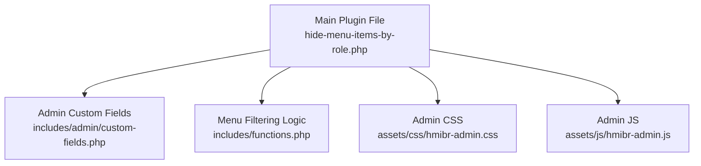
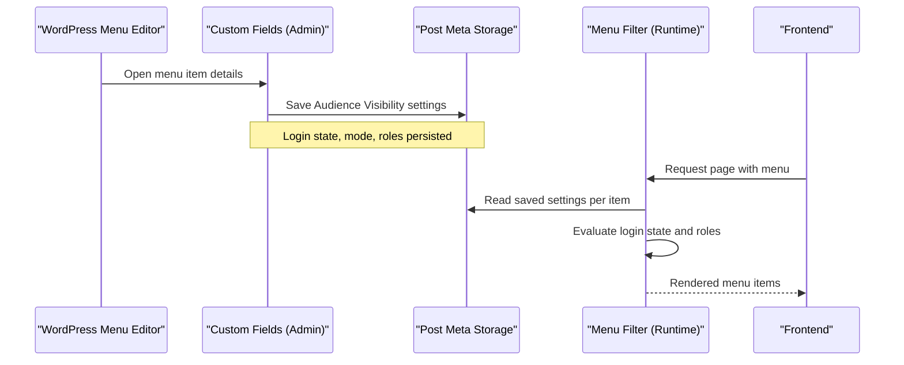
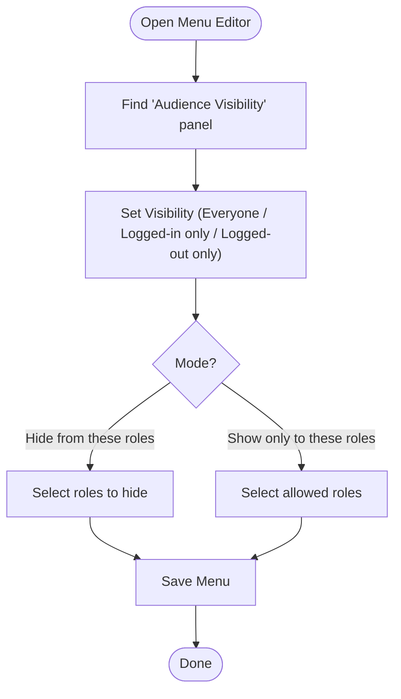
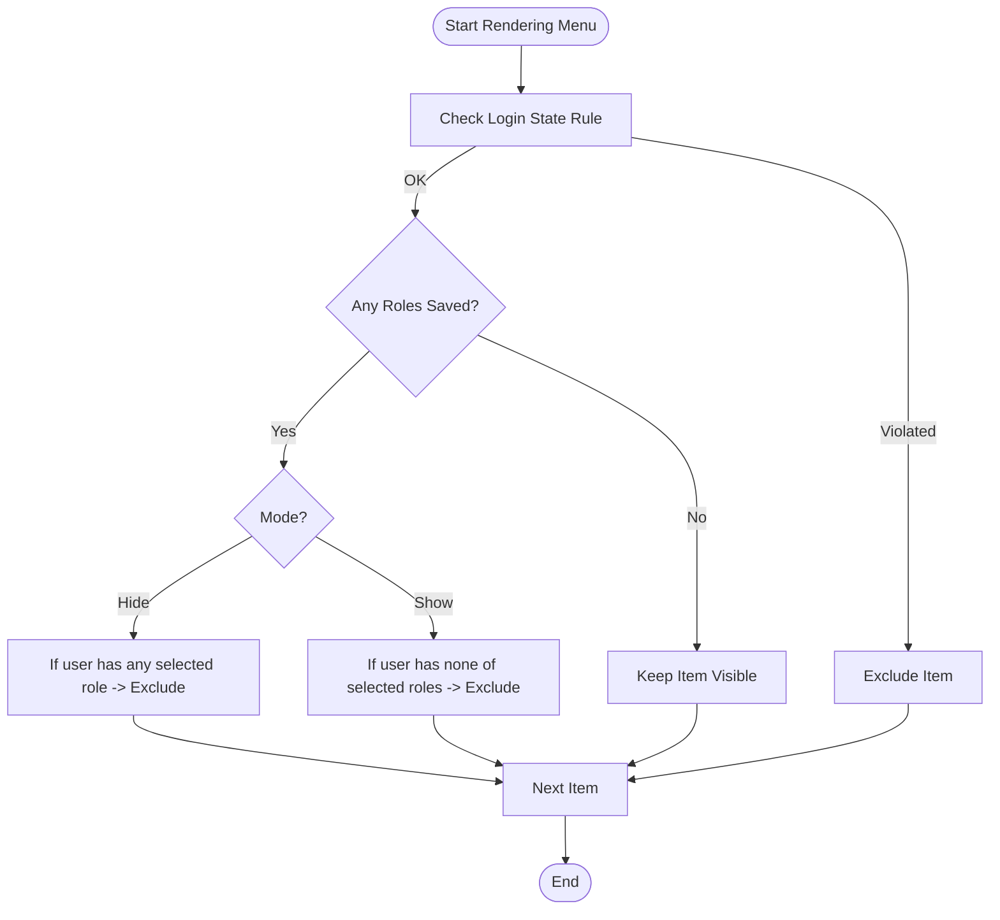
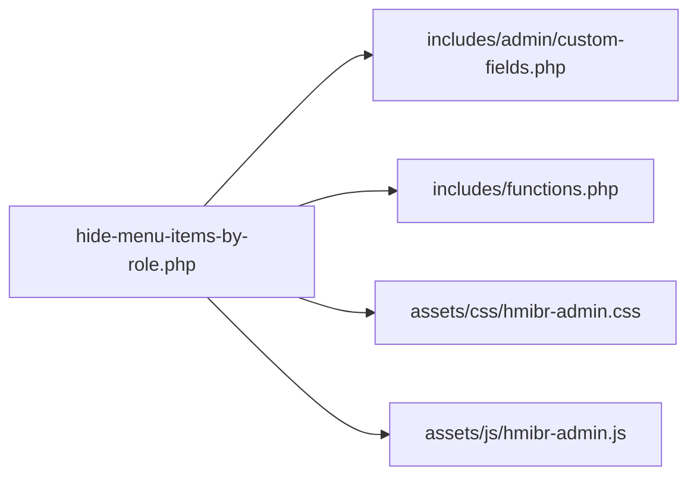

# Getting Started

<cite>
**Referenced Files in This Document**
- [README.txt](file://README.txt)
- [hide-menu-items-by-role.php](file://hide-menu-items-by-role.php)
- [functions.php](file://includes/functions.php)
- [custom-fields.php](file://includes/admin/custom-fields.php)
</cite>

## Table of Contents
1. [Introduction](#introduction)
2. [Project Structure](#project-structure)
3. [Core Components](#core-components)
4. [Architecture Overview](#architecture-overview)
5. [Detailed Component Analysis](#detailed-component-analysis)
6. [Dependency Analysis](#dependency-analysis)
7. [Performance Considerations](#performance-considerations)
8. [Troubleshooting Guide](#troubleshooting-guide)
9. [Conclusion](#conclusion)

## Introduction
Hide Menu Items by Role lets you control the visibility of WordPress navigation menu items based on user roles and login status. You can:
- Hide menu items from specific roles
- Show menu items only to specific roles
- Restrict visibility to logged-in or logged-out users

The plugin integrates into the WordPress menu editor, adds an “Audience Visibility” panel per menu item, and uses core filters for rendering—no JavaScript is required for runtime behavior.

## Project Structure
At a high level, the plugin consists of:
- A main plugin file that registers admin assets and loads includes
- Admin UI code that adds the “Audience Visibility” panel and saves settings
- Runtime logic that filters menu items based on saved rules

**Diagram sources**
- [hide-menu-items-by-role.php:20-46](file://hide-menu-items-by-role.php#L20-L46)
- [custom-fields.php:1-147](file://includes/admin/custom-fields.php#L1-L147)
- [functions.php:1-50](file://includes/functions.php#L1-L50)

**Section sources**
- [hide-menu-items-by-role.php:1-54](file://hide-menu-items-by-role.php#L1-L54)
- [custom-fields.php:1-147](file://includes/admin/custom-fields.php#L1-L147)
- [functions.php:1-50](file://includes/functions.php#L1-L50)

## Core Components
- Main plugin file: Enqueues admin styles/scripts on the menu editor screen and includes the admin and runtime modules.
- Admin custom fields: Adds the “Audience Visibility” panel with controls for login state, hide/show mode, and role selection; validates and saves values.
- Runtime filter: Applies visibility rules when menus are rendered, using stored meta values and current user context.

Key responsibilities:
- Admin UI: Provide intuitive controls and safe saving of configuration.
- Runtime: Efficiently evaluate login state first, then apply role-based hide/show logic.

**Section sources**
- [hide-menu-items-by-role.php:20-46](file://hide-menu-items-by-role.php#L20-L46)
- [custom-fields.php:1-147](file://includes/admin/custom-fields.php#L1-L147)
- [functions.php:1-50](file://includes/functions.php#L1-L50)

## Architecture Overview
The plugin follows a simple separation between admin configuration and runtime filtering:

**Diagram sources**
- [custom-fields.php:96-146](file://includes/admin/custom-fields.php#L96-L146)
- [functions.php:2-49](file://includes/functions.php#L2-L49)

## Detailed Component Analysis

### Installation and Activation
Follow these steps to install and activate the plugin:

- From the WordPress Plugins screen:
  - Search for “Hide Menu Items by Role”
  - Install and Activate
- Manual upload:
  - Upload the plugin folder to /wp-content/plugins/
  - Go to Plugins and Activate

After activation, proceed to configure visibility for your menu items.

**Section sources**
- [README.txt:22-30](file://README.txt#L22-L30)

### Initial Configuration and Basic Workflow
Use the following workflow to set up visibility rules:

1. Open the WordPress menu editor (Appearance > Menus).
2. Expand any menu item to reveal its settings.
3. Locate the “Audience Visibility” panel.
4. Configure:
   - Visibility: Everyone, Logged-in users only, or Logged-out users only
   - Mode: Hide from these roles or Show only to these roles
   - Roles: Select one or more roles affected by the rule
5. Save the menu.

Notes:
- When Visibility is set to “Logged-out users only,” the other controls are disabled to prevent conflicting configurations.
- In “Show only to these roles,” if no roles are selected, the item remains visible to everyone during setup.

**Diagram sources**
- [custom-fields.php:10-61](file://includes/admin/custom-fields.php#L10-L61)
- [custom-fields.php:63-91](file://includes/admin/custom-fields.php#L63-L91)

**Section sources**
- [README.txt:22-30](file://README.txt#L22-L30)
- [custom-fields.php:10-61](file://includes/admin/custom-fields.php#L10-L61)
- [custom-fields.php:63-91](file://includes/admin/custom-fields.php#L63-L91)

### How the Rules Are Applied at Runtime
When a visitor views a page, the plugin evaluates each menu item in this order:

1. Check login state rule first:
   - If set to “Logged-in users only” and the visitor is not logged in, hide the item.
   - If set to “Logged-out users only” and the visitor is logged in, hide the item.
2. If no roles are configured for the item, keep it visible.
3. Apply role-based logic:
   - Hide mode: Remove the item if the current user has any of the selected roles.
   - Show mode: Remove the item if the current user does not have any of the selected roles.
   - If show mode has no roles selected, keep the item visible.

**Diagram sources**
- [functions.php:2-49](file://includes/functions.php#L2-L49)

**Section sources**
- [functions.php:2-49](file://includes/functions.php#L2-L49)

### Practical Examples

- Hide premium content from non-logged-in users:
  - Visibility: Logged-in users only
  - Mode: Not applicable (disabled when Visibility is “Logged-out users only”)
  - Roles: Leave default
  - Result: Only logged-in visitors see the item.

- Show a menu only to administrators:
  - Visibility: Everyone
  - Mode: Show only to these roles
  - Roles: Administrator
  - Result: Only administrators see the item.

- Hide a link from editors and contributors:
  - Visibility: Everyone
  - Mode: Hide from these roles
  - Roles: Editor, Contributor
  - Result: Editors and contributors do not see the item; others do.

These examples follow the same steps described in the basic workflow above.

**Section sources**
- [README.txt:32-70](file://README.txt#L32-L70)
- [custom-fields.php:22-59](file://includes/admin/custom-fields.php#L22-L59)
- [functions.php:15-44](file://includes/functions.php#L15-L44)

## Dependency Analysis
The plugin’s internal dependencies are straightforward:

- The main file enqueues admin assets and requires the admin and runtime modules.
- The admin module provides UI and persistence.
- The runtime module applies rules via a core filter.

**Diagram sources**
- [hide-menu-items-by-role.php:20-46](file://hide-menu-items-by-role.php#L20-L46)

**Section sources**
- [hide-menu-items-by-role.php:20-46](file://hide-menu-items-by-role.php#L20-L46)

## Performance Considerations
- Login state checks run first and short-circuit early, avoiding unnecessary role comparisons.
- No JavaScript is used for runtime filtering; all logic runs server-side via a core filter.
- When Visibility is set to “Logged-out users only,” role-based checks are skipped for performance.

[No sources needed since this section provides general guidance]

## Troubleshooting Guide
Common issues and resolutions:

- I don’t see the “Audience Visibility” panel:
  - Ensure the plugin is activated.
  - Confirm you are editing a menu item in Appearance > Menus.
  - Clear any caching layers after activation.

- My changes did not take effect:
  - Make sure you saved the menu after updating the “Audience Visibility” settings.
  - Verify the correct Visibility and Mode are set for the item.

- Controls appear disabled:
  - When Visibility is set to “Logged-out users only,” Mode and Roles are intentionally disabled to avoid conflicts.

- Items still show to unexpected users:
  - For “Show only to these roles,” ensure at least one role is selected; otherwise, the item remains visible to everyone.
  - Confirm the current user’s roles match what you expect.

- Validation errors when saving:
  - Ensure selected roles are valid and editable by the current user.

**Section sources**
- [custom-fields.php:63-91](file://includes/admin/custom-fields.php#L63-L91)
- [custom-fields.php:107-120](file://includes/admin/custom-fields.php#L107-L120)
- [functions.php:15-44](file://includes/functions.php#L15-L44)

## Conclusion
You now have everything you need to install, activate, and configure Hide Menu Items by Role. Use the “Audience Visibility” panel to define who sees each menu item based on login status and roles. Start with simple rules like restricting items to logged-in users, then expand to role-specific visibility as needed.

[No sources needed since this section summarizes without analyzing specific files]