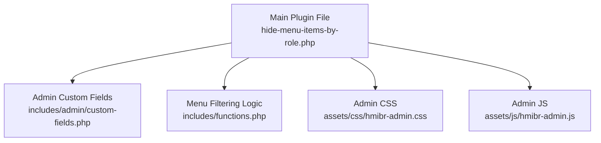
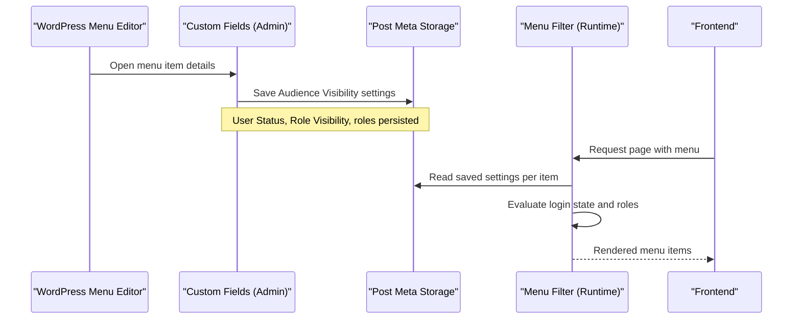
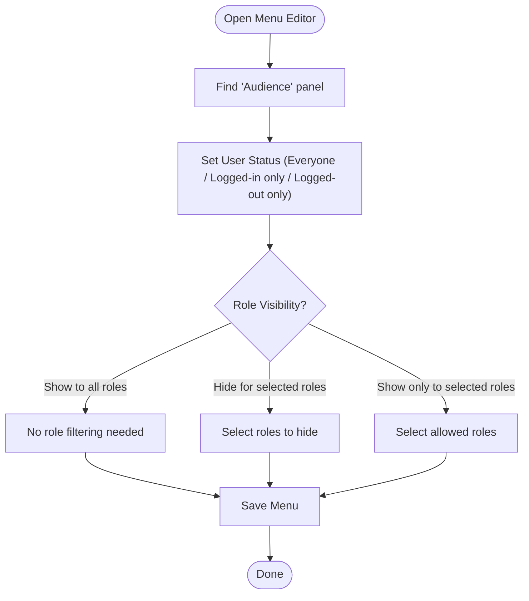
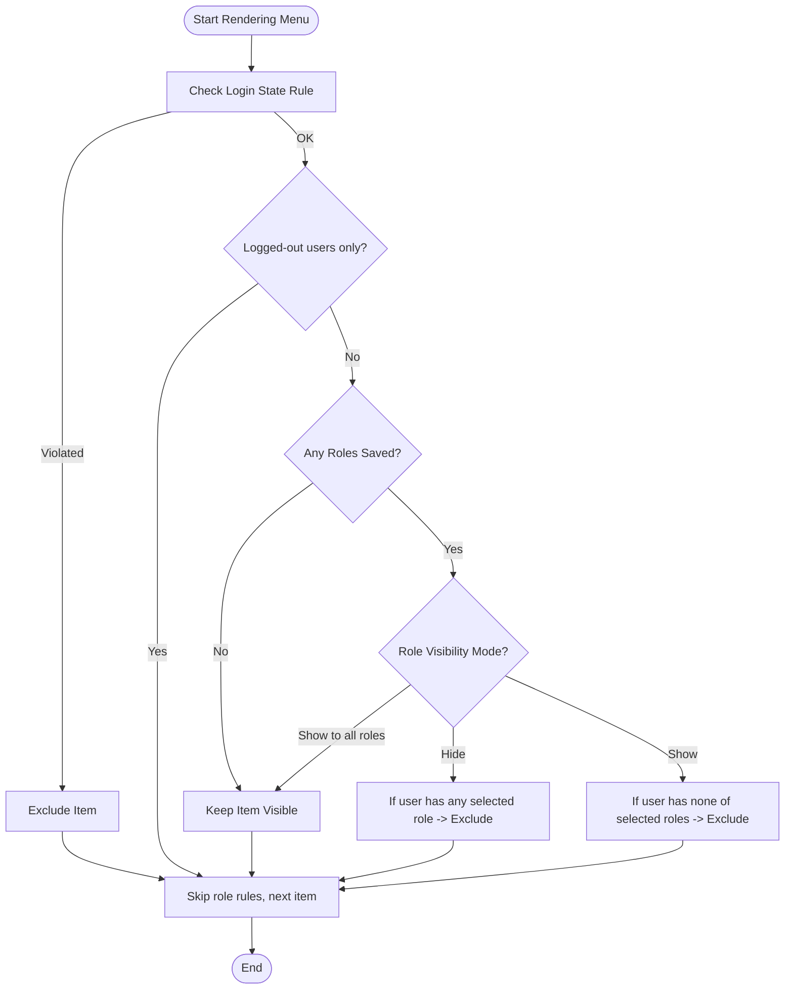
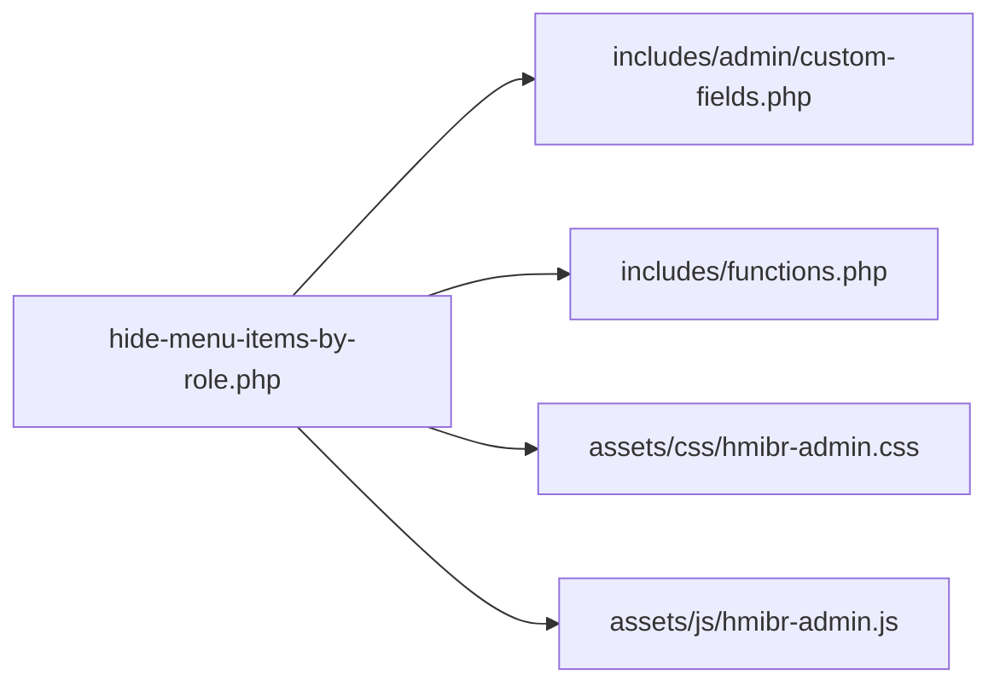

# Getting Started

<cite>
**Referenced Files in This Document**
- [README.txt](file://README.txt)
- [hide-menu-items-by-role.php](file://hide-menu-items-by-role.php)
- [functions.php](file://includes/functions.php)
- [custom-fields.php](file://includes/admin/custom-fields.php)
- [hmibr-admin.css](file://assets/css/hmibr-admin.css)
- [hmibr-admin.js](file://assets/js/hmibr-admin.js)
</cite>

## Update Summary
**Changes Made**
- Updated installation instructions to reflect new 'Show to All Roles' mode as default
- Enhanced FAQ section with detailed explanations of the three role visibility modes
- Updated basic workflow to include the new Audience panel interface
- Added information about the redesigned collapsible panel structure
- Updated troubleshooting section with new field behavior and validation

## Table of Contents
1. [Introduction](#introduction)
2. [Project Structure](#project-structure)
3. [Core Components](#core-components)
4. [Architecture Overview](#architecture-overview)
5. [Detailed Component Analysis](#detailed-component-analysis)
6. [Dependency Analysis](#dependency-analysis)
7. [Performance Considerations](#performance-considerations)
8. [Troubleshooting Guide](#troubleshooting-guide)
9. [Conclusion](#conclusion)

## Introduction
Hide Menu Items by Role lets you control the visibility of WordPress navigation menu items based on user roles and login status. You can:
- Show menu items to everyone (default "Show to all roles" mode)
- Hide menu items from specific roles
- Show menu items only to specific roles
- Restrict visibility to logged-in or logged-out users

The plugin integrates into the WordPress menu editor with a redesigned collapsible "Audience" panel per menu item, and uses core filters for rendering—no JavaScript is required for runtime behavior.

## Project Structure
At a high level, the plugin consists of:
- A main plugin file that registers admin assets and loads includes
- Admin UI code that adds the redesigned "Audience" panel and saves settings
- Runtime logic that filters menu items based on saved rules

**Diagram sources**
- [hide-menu-items-by-role.php:20-55](file://hide-menu-items-by-role.php#L20-L55)
- [custom-fields.php:1-145](file://includes/admin/custom-fields.php#L1-L145)
- [functions.php:1-67](file://includes/functions.php#L1-L67)

**Section sources**
- [hide-menu-items-by-role.php:1-63](file://hide-menu-items-by-role.php#L1-L63)
- [custom-fields.php:1-145](file://includes/admin/custom-fields.php#L1-L145)
- [functions.php:1-67](file://includes/functions.php#L1-L67)

## Core Components
- Main plugin file: Enqueues admin styles/scripts on the menu editor screen and includes the admin and runtime modules.
- Admin custom fields: Adds the redesigned collapsible "Audience" panel with controls for user status, role visibility mode, and role selection; validates and saves values.
- Runtime filter: Applies visibility rules when menus are rendered, using stored meta values and current user context.

Key responsibilities:
- Admin UI: Provide intuitive controls with the new collapsible panel design and safe saving of configuration.
- Runtime: Efficiently evaluate login state first, then apply role-based hide/show logic with support for the new "Show to all roles" mode.

**Section sources**
- [hide-menu-items-by-role.php:20-55](file://hide-menu-items-by-role.php#L20-L55)
- [custom-fields.php:1-145](file://includes/admin/custom-fields.php#L1-L145)
- [functions.php:1-67](file://includes/functions.php#L1-L67)

## Architecture Overview
The plugin follows a simple separation between admin configuration and runtime filtering:

**Diagram sources**
- [custom-fields.php:88-144](file://includes/admin/custom-fields.php#L88-L144)
- [functions.php:7-66](file://includes/functions.php#L7-L66)

## Detailed Component Analysis

### Installation and Activation
Follow these steps to install and activate the plugin:

- From the WordPress Plugins screen:
  - Search for "Hide Menu Items by Role"
  - Install and Activate
- Manual upload:
  - Upload the plugin folder to /wp-content/plugins/
  - Go to Plugins and Activate

After activation, proceed to configure visibility for your menu items using the redesigned Audience panel.

**Section sources**
- [README.txt:34-42](file://README.txt#L34-L42)

### Initial Configuration and Basic Workflow
Use the following workflow to set up visibility rules with the new Audience panel:

1. Open the WordPress menu editor (Appearance > Menus).
2. Expand any menu item to reveal its settings.
3. Locate the redesigned collapsible "Audience" panel at the bottom of the item.
4. Configure:
   - **User Status**: Everyone, Logged-in users only, or Logged-out users only
   - **Role Visibility**: "Show to all roles" (default), "Hide for selected roles", or "Show only to selected roles"
   - **Select the user roles**: Choose one or more roles affected by the rule (when applicable)
5. Save the menu.

**Updated** The new "Show to all roles" mode is now the default for new menu items, making it easier to start without restrictions.

Notes:
- When User Status is set to "Logged-out users only," the other controls are disabled to prevent conflicting configurations.
- In "Show to all roles" mode, role checkboxes are automatically disabled since no role filtering applies.
- When a role rule is active but no roles are selected, a helpful hint appears reminding you that the item remains visible to everyone until you select at least one role.

**Diagram sources**
- [custom-fields.php:8-85](file://includes/admin/custom-fields.php#L8-L85)
- [custom-fields.php:88-144](file://includes/admin/custom-fields.php#L88-L144)

**Section sources**
- [README.txt:34-42](file://README.txt#L34-L42)
- [custom-fields.php:8-85](file://includes/admin/custom-fields.php#L8-L85)
- [custom-fields.php:88-144](file://includes/admin/custom-fields.php#L88-L144)

### How the Rules Are Applied at Runtime
When a visitor views a page, the plugin evaluates each menu item in this order:

1. Check login state rule first:
   - If set to "Logged-in users only" and the visitor is not logged in, hide the item.
   - If set to "Logged-out users only" and the visitor is logged in, hide the item.
2. Skip role rules for "Logged-out users only" items (they're disabled in the editor too).
3. If no roles are configured for the item, keep it visible.
4. Apply role-based logic:
   - **"Show to all roles" mode**: Skip role filtering entirely, show to everyone
   - Hide mode: Remove the item if the current user has any of the selected roles.
   - Show mode: Remove the item if the current user does not have any of the selected roles.
   - If show mode has no roles selected, keep the item visible.

**Updated** The new "Show to all roles" mode provides a simple way to make items visible to everyone without any role filtering.

**Diagram sources**
- [functions.php:7-66](file://includes/functions.php#L7-L66)

**Section sources**
- [functions.php:7-66](file://includes/functions.php#L7-L66)

### Practical Examples

- **Show premium content to everyone (new default behavior)**:
  - User Status: Everyone
  - Role Visibility: "Show to all roles" (default)
  - Result: Everyone sees the item without any role filtering.

- **Hide premium content from non-logged-in users**:
  - User Status: Logged-in users only
  - Role Visibility: Not applicable (disabled when User Status is "Logged-out users only")
  - Result: Only logged-in visitors see the item.

- **Show a menu only to administrators**:
  - User Status: Everyone
  - Role Visibility: "Show only to selected roles"
  - Roles: Administrator
  - Result: Only administrators see the item.

- **Hide a link from editors and contributors**:
  - User Status: Everyone
  - Role Visibility: "Hide for selected roles"
  - Roles: Editor, Contributor
  - Result: Editors and contributors do not see the item; others do.

These examples follow the same steps described in the basic workflow above, with the new "Show to all roles" mode providing an even simpler option for universal visibility.

**Section sources**
- [README.txt:18-26](file://README.txt#L18-L26)
- [custom-fields.php:18-27](file://includes/admin/custom-fields.php#L18-L27)
- [functions.php:43-61](file://includes/functions.php#L43-L61)

## Dependency Analysis
The plugin's internal dependencies are straightforward:

- The main file enqueues admin assets and requires the admin and runtime modules.
- The admin module provides the redesigned UI with the collapsible Audience panel and persistence.
- The runtime module applies rules via a core filter with support for the new "Show to all roles" mode.

**Diagram sources**
- [hide-menu-items-by-role.php:20-55](file://hide-menu-items-by-role.php#L20-L55)

**Section sources**
- [hide-menu-items-by-role.php:20-55](file://hide-menu-items-by-role.php#L20-L55)

## Performance Considerations
- Login state checks run first and short-circuit early, avoiding unnecessary role comparisons.
- No JavaScript is used for runtime filtering; all logic runs server-side via a core filter.
- When User Status is set to "Logged-out users only," role-based checks are skipped for performance.
- The new "Show to all roles" mode skips role filtering entirely for optimal performance when universal visibility is desired.

## Troubleshooting Guide
Common issues and resolutions:

- **I don't see the "Audience" panel**:
  - Ensure the plugin is activated.
  - Confirm you are editing a menu item in Appearance > Menus.
  - Clear any caching layers after activation.

- **My changes did not take effect**:
  - Make sure you saved the menu after updating the "Audience" settings.
  - Verify the correct User Status and Role Visibility are set for the item.

- **Controls appear disabled**:
  - When User Status is set to "Logged-out users only," Role Visibility and Roles are intentionally disabled to avoid conflicts.
  - When Role Visibility is set to "Show to all roles," role checkboxes are automatically disabled since no role filtering applies.

- **Items still show to unexpected users**:
  - For "Show only to selected roles," ensure at least one role is selected; otherwise, the item remains visible to everyone.
  - For "Show to all roles," remember this mode bypasses all role filtering by design.
  - Confirm the current user's roles match what you expect.

- **Validation errors when saving**:
  - Ensure selected roles are valid and editable by the current user.
  - The plugin validates roles against those the current user can assign.

- **Understanding the new field behavior**:
  - "Show to all roles" (default): Makes items visible to everyone without role filtering
  - "Hide for selected roles": Hides items from specific roles you select
  - "Show only to selected roles": Shows items only to specific roles you select
  - Role checkboxes are disabled when they don't apply (logged-out only or show to all roles)

**Section sources**
- [custom-fields.php:24-27](file://includes/admin/custom-fields.php#L24-L27)
- [custom-fields.php:99-120](file://includes/admin/custom-fields.php#L99-L120)
- [functions.php:31-35](file://includes/functions.php#L31-L35)
- [functions.php:46-49](file://includes/functions.php#L46-L49)

## Conclusion
You now have everything you need to install, activate, and configure Hide Menu Items by Role. The redesigned "Audience" panel makes it easy to define who sees each menu item based on login status and roles. Start with the new "Show to all roles" default for simple universal visibility, then expand to role-specific visibility as needed using the enhanced role visibility modes.