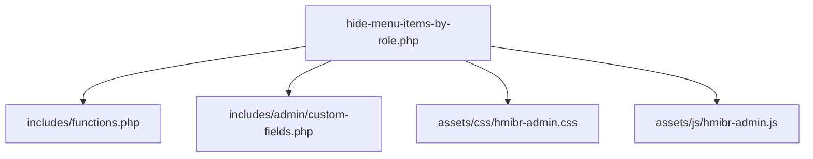
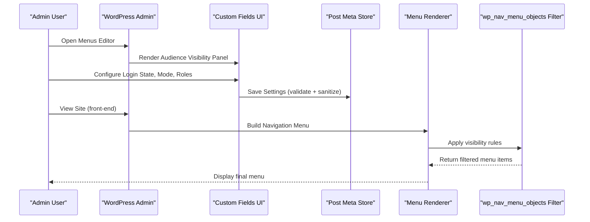
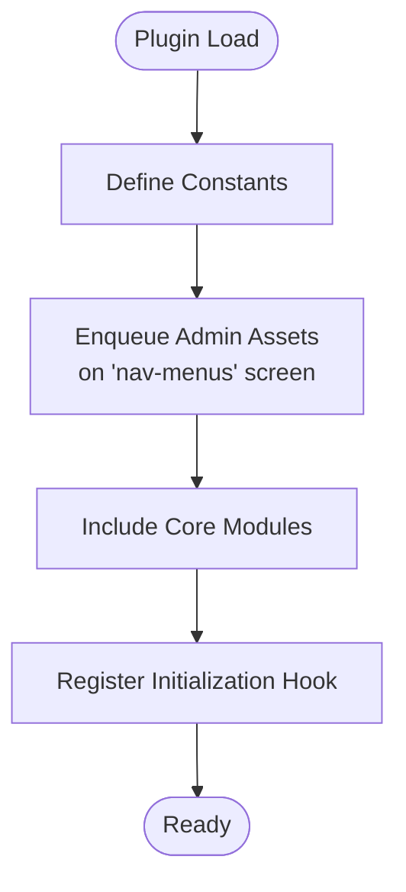
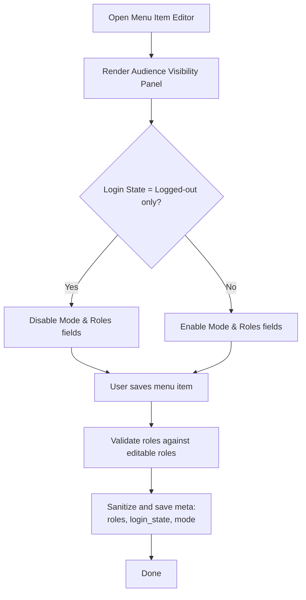
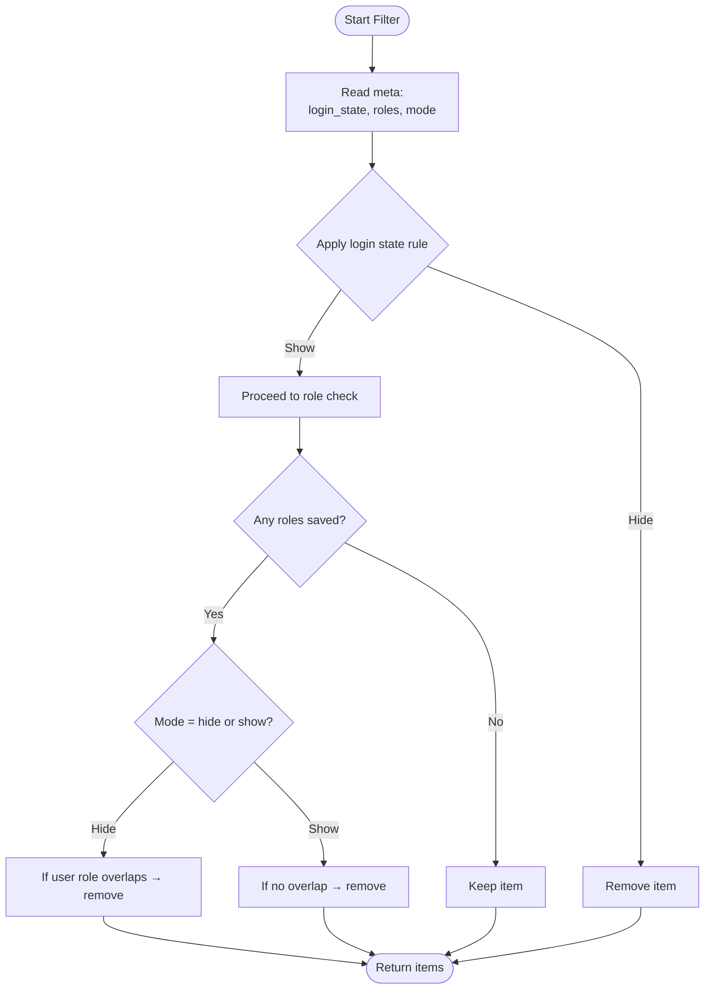
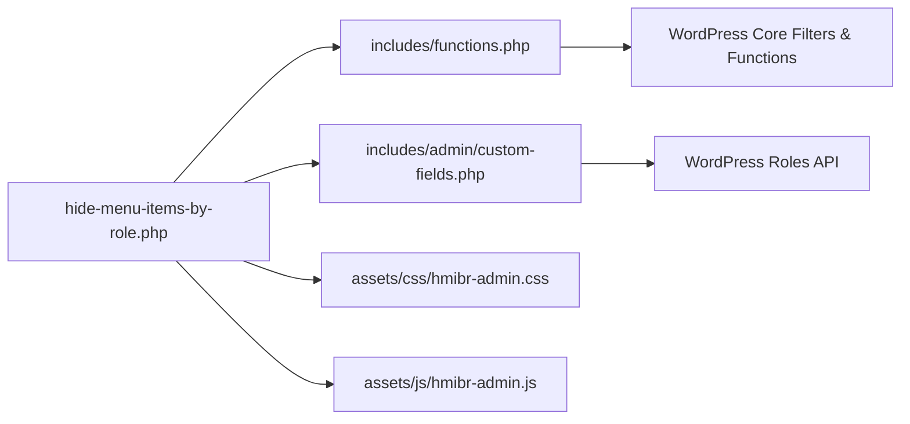

# Plugin Overview

<cite>
**Referenced Files in This Document**
- [hide-menu-items-by-role.php](file://hide-menu-items-by-role.php)
- [functions.php](file://includes/functions.php)
- [custom-fields.php](file://includes/admin/custom-fields.php)
- [README.txt](file://README.txt)
</cite>

## Table of Contents
1. [Introduction](#introduction)
2. [Project Structure](#project-structure)
3. [Core Components](#core-components)
4. [Architecture Overview](#architecture-overview)
5. [Detailed Component Analysis](#detailed-component-analysis)
6. [Dependency Analysis](#dependency-analysis)
7. [Performance Considerations](#performance-considerations)
8. [Troubleshooting Guide](#troubleshooting-guide)
9. [Conclusion](#conclusion)
10. [Appendices](#appendices)

## Introduction
Hide Menu Items by Role is a WordPress plugin that enhances the standard navigation menu system by controlling which menu items are visible to visitors based on user roles and login state. It provides:
- Role-based filtering (hide or show items for specific roles)
- Login state awareness (Everyone, Logged-in only, Logged-out only)
- Dual mode operation (Hide from these roles / Show only to these roles)
- Seamless integration into the WordPress admin Menus editor

The plugin leverages WordPress core filters so no front-end JavaScript or jQuery is required for visibility logic.

**Section sources**
- [README.txt:10-20](file://README.txt#L10-L20)
- [README.txt:22-30](file://README.txt#L22-L30)

## Project Structure
The plugin follows a modular structure separating core functionality, admin interface, and assets:
- Root plugin file: initializes hooks, enqueues admin assets, and includes modules
- includes/functions.php: core logic that filters menu items at render time
- includes/admin/custom-fields.php: admin UI fields and persistence for visibility settings
- assets/css and assets/js: admin-only styles and scripts used in the Menus editor

**Diagram sources**
- [hide-menu-items-by-role.php:20-46](file://hide-menu-items-by-role.php#L20-L46)
- [hide-menu-items-by-role.php:44-46](file://hide-menu-items-by-role.php#L44-L46)

**Section sources**
- [hide-menu-items-by-role.php:16-46](file://hide-menu-items-by-role.php#L16-L46)
- [README.txt:1-14](file://README.txt#L1-L14)

## Core Components
- Root bootstrap and asset loader: defines constants, enqueues admin CSS/JS on the Menus screen, and includes core modules.
- Admin custom fields: adds an “Audience Visibility” panel to each menu item with controls for login state, hide/show mode, and role selection; persists values to post meta.
- Core filter: intercepts menu objects during rendering, applies login state rules first, then role-based hide/show logic using stored meta.

Key responsibilities:
- Admin UI: collect and validate user inputs for visibility configuration per menu item.
- Persistence: store selected roles, login state, and mode as post meta for each menu item.
- Rendering: apply visibility rules via a WordPress filter to conditionally exclude menu items.

**Section sources**
- [hide-menu-items-by-role.php:16-46](file://hide-menu-items-by-role.php#L16-L46)
- [custom-fields.php:3-94](file://includes/admin/custom-fields.php#L3-L94)
- [custom-fields.php:96-146](file://includes/admin/custom-fields.php#L96-L146)
- [functions.php:1-49](file://includes/functions.php#L1-L49)

## Architecture Overview
The plugin integrates with WordPress through well-defined hooks:
- Admin enqueue: loads admin assets when editing menus.
- Admin UI: injects custom fields into the menu item editor.
- Save handler: validates and persists visibility settings.
- Front-end filter: modifies menu output based on current user context.

**Diagram sources**
- [hide-menu-items-by-role.php:20-42](file://hide-menu-items-by-role.php#L20-L42)
- [custom-fields.php:3-94](file://includes/admin/custom-fields.php#L3-L94)
- [custom-fields.php:96-146](file://includes/admin/custom-fields.php#L96-L146)
- [functions.php:1-49](file://includes/functions.php#L1-L49)

## Detailed Component Analysis

### Root Bootstrap and Asset Loader
- Defines plugin constants for directory and URL paths.
- Enqueues admin CSS and JS only on the nav-menus screen.
- Includes core modules and registers initialization hook.

**Diagram sources**
- [hide-menu-items-by-role.php:16-46](file://hide-menu-items-by-role.php#L16-L46)

**Section sources**
- [hide-menu-items-by-role.php:16-46](file://hide-menu-items-by-role.php#L16-L46)

### Admin Custom Fields and Persistence
- Adds an “Audience Visibility” panel to each menu item with:
  - Visibility dropdown: Everyone, Logged-in only, Logged-out only
  - Mode dropdown: Hide from these roles / Show only to these roles
  - Role checkboxes: one per available WordPress role
- Disables role-related fields when “Logged-out users only” is selected to avoid conflicting configurations.
- Saves sanitized and validated values to post meta:
  - Selected roles
  - Login state
  - Mode

**Diagram sources**
- [custom-fields.php:3-94](file://includes/admin/custom-fields.php#L3-L94)
- [custom-fields.php:96-146](file://includes/admin/custom-fields.php#L96-L146)

**Section sources**
- [custom-fields.php:3-94](file://includes/admin/custom-fields.php#L3-L94)
- [custom-fields.php:96-146](file://includes/admin/custom-fields.php#L96-L146)

### Core Visibility Filter
- Intercepts menu items via the WordPress filter.
- Applies login state rules first for performance:
  - If set to “Logged-in only” and user is not logged in → hide
  - If set to “Logged-out only” and user is logged in → hide
- Then applies role-based logic:
  - Hide mode: remove item if user has any of the selected roles
  - Show mode: remove item if user does not have any of the selected roles
  - If no roles are saved in show mode, keep item visible to everyone

**Diagram sources**
- [functions.php:1-49](file://includes/functions.php#L1-L49)

**Section sources**
- [functions.php:1-49](file://includes/functions.php#L1-L49)

## Dependency Analysis
- The root file depends on:
  - includes/functions.php for core filtering logic
  - includes/admin/custom-fields.php for admin UI and saving
  - assets/css and assets/js for admin styling and behavior
- The core filter depends on:
  - WordPress functions for user roles and login checks
  - Post meta storage for menu item visibility settings
- Admin UI depends on:
  - WordPress roles API to list available roles
  - WordPress menu editor hooks to inject fields and save data

**Diagram sources**
- [hide-menu-items-by-role.php:20-46](file://hide-menu-items-by-role.php#L20-L46)
- [functions.php:1-49](file://includes/functions.php#L1-L49)
- [custom-fields.php:3-94](file://includes/admin/custom-fields.php#L3-L94)

**Section sources**
- [hide-menu-items-by-role.php:20-46](file://hide-menu-items-by-role.php#L20-L46)
- [functions.php:1-49](file://includes/functions.php#L1-L49)
- [custom-fields.php:3-94](file://includes/admin/custom-fields.php#L3-L94)

## Performance Considerations
- Login state checks are evaluated first to short-circuit processing when possible.
- When “Logged-out users only” is selected, role-based checks are skipped to reduce overhead.
- No front-end JavaScript is required for visibility logic; all filtering occurs server-side via WordPress filters.

[No sources needed since this section provides general guidance]

## Troubleshooting Guide
- If menu items do not appear/disappear as expected:
  - Verify the menu item’s Audience Visibility settings in the Menus editor.
  - Ensure the correct roles are selected and the intended mode (hide/show) is applied.
  - Confirm the login state setting aligns with your testing scenario.
- If changes are not saved:
  - Check that you are saving the menu after updating visibility settings.
  - Validate that the roles selected exist and are editable by the current user.

**Section sources**
- [custom-fields.php:96-146](file://includes/admin/custom-fields.php#L96-L146)
- [functions.php:1-49](file://includes/functions.php#L1-L49)

## Conclusion
Hide Menu Items by Role extends WordPress’s default menu system with flexible, role-aware visibility controls and login state awareness. Its modular design cleanly separates admin UI, persistence, and core filtering, making it easy to configure and maintain while leveraging WordPress best practices.

[No sources needed since this section summarizes without analyzing specific files]

## Appendices

### Installation Instructions
- Upload the plugin files to /wp-content/plugins/ or install directly from the WordPress plugins screen.
- Activate the plugin from the Plugins page.

**Section sources**
- [README.txt:22-26](file://README.txt#L22-L26)

### Basic Setup Guide
- Create or edit a menu item.
- In the Audience Visibility panel:
  - Select visibility (Everyone, Logged-in only, Logged-out only).
  - Choose mode (Hide from these roles / Show only to these roles).
  - Select one or more user roles to affect visibility.
- Save the menu.

**Section sources**
- [README.txt:26-30](file://README.txt#L26-L30)

### Quick Start Tutorial
- To hide a menu item from Editors:
  - Set Visibility to Everyone.
  - Choose Hide from these roles.
  - Select the Editors role.
  - Save the menu.
- To show a menu item only to Subscribers:
  - Set Visibility to Everyone.
  - Choose Show only to these roles.
  - Select the Subscribers role.
  - Save the menu.

**Section sources**
- [README.txt:32-53](file://README.txt#L32-L53)

### Supported Versions and Requirements
- Requires WordPress at least version 5.0
- Tested up to WordPress 7.0.0
- Requires PHP 7.0 or higher

**Section sources**
- [README.txt:4-6](file://README.txt#L4-L6)
- [hide-menu-items-by-role.php:7-8](file://hide-menu-items-by-role.php#L7-L8)