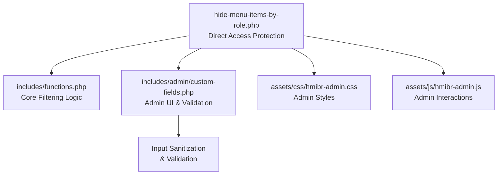
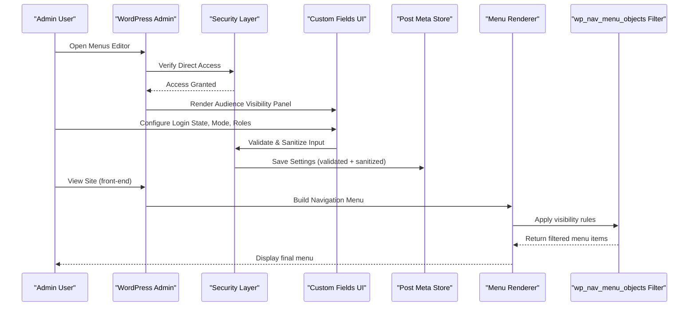
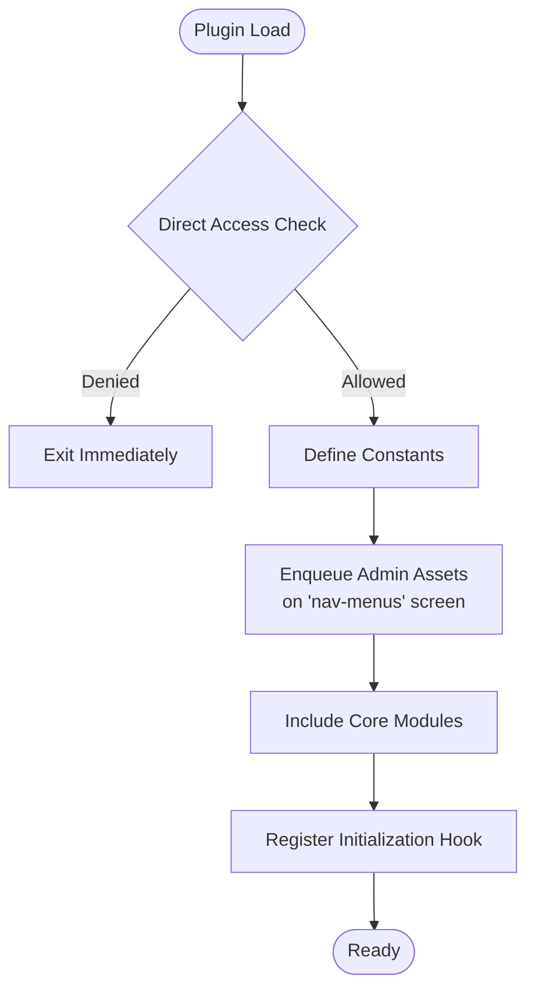
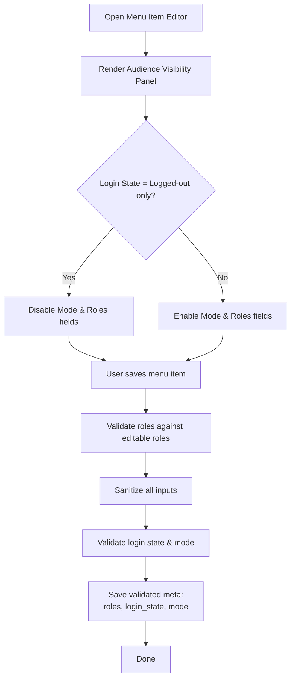
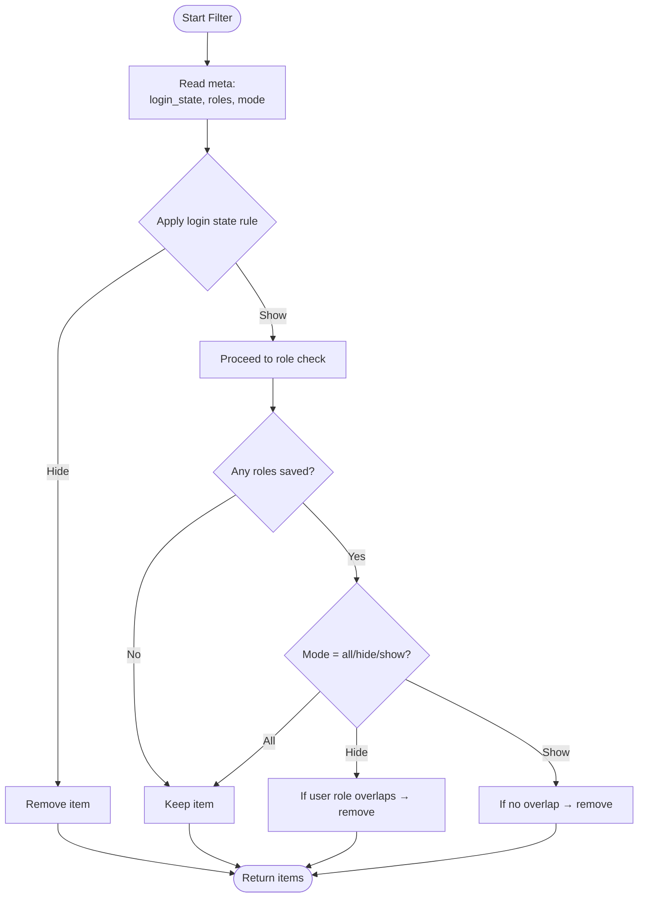
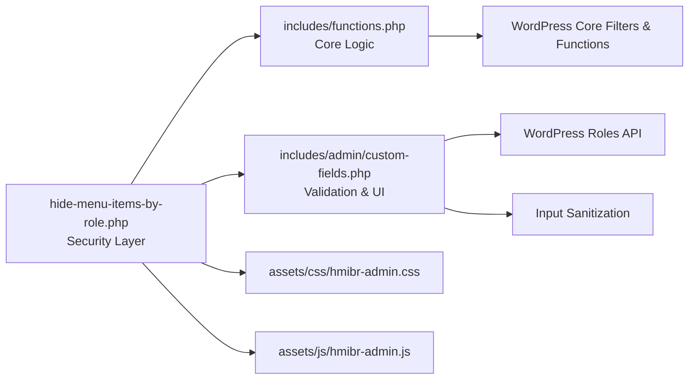

# Plugin Overview

<cite>
**Referenced Files in This Document**
- [hide-menu-items-by-role.php](file://hide-menu-items-by-role.php)
- [functions.php](file://includes/functions.php)
- [custom-fields.php](file://includes/admin/custom-fields.php)
- [README.txt](file://README.txt)
- [hmibr-admin.css](file://assets/css/hmibr-admin.css)
- [hmibr-admin.js](file://assets/js/hmibr-admin.js)
</cite>

## Update Summary
**Changes Made**
- Updated version information from 2.0.0 to 2.1.0 throughout documentation
- Added security enhancements section covering direct access protection and input sanitization
- Updated architecture diagrams to reflect improved performance optimizations
- Enhanced installation and setup instructions with new Audience panel interface
- Updated supported versions and requirements based on current plugin metadata

## Table of Contents
1. [Introduction](#introduction)
2. [Project Structure](#project-structure)
3. [Core Components](#core-components)
4. [Architecture Overview](#architecture-overview)
5. [Security Enhancements](#security-enhancements)
6. [Detailed Component Analysis](#detailed-component-analysis)
7. [Dependency Analysis](#dependency-analysis)
8. [Performance Considerations](#performance-considerations)
9. [Installation and Setup](#installation-and-setup)
10. [Troubleshooting Guide](#troubleshooting-guide)
11. [Conclusion](#conclusion)
12. [Appendices](#appendices)

## Introduction
Hide Menu Items by Role is a WordPress plugin that enhances the standard navigation menu system by controlling which menu items are visible to visitors based on user roles and login state. Now at version 2.1.0, it provides enhanced security, improved performance, and a redesigned user interface.

Key features include:
- **Role-based filtering** (hide or show items for specific roles)
- **Login state awareness** (Everyone, Logged-in only, Logged-out only)
- **Dual mode operation** (Hide from these roles / Show only to these roles)
- **Enhanced security** with direct access protection and input sanitization
- **Improved performance** with optimized filtering logic
- **Redesigned Audience panel** for intuitive configuration
- **Seamless integration** into the WordPress admin Menus editor

The plugin leverages WordPress core filters so no front-end JavaScript or jQuery is required for visibility logic.

**Section sources**
- [README.txt:10-26](file://README.txt#L10-L26)
- [hide-menu-items-by-role.php:6-8](file://hide-menu-items-by-role.php#L6-L8)

## Project Structure
The plugin follows a modular structure separating core functionality, admin interface, and assets with enhanced security measures:
- Root plugin file: initializes hooks, enqueues admin assets, includes modules, and implements direct access protection
- includes/functions.php: core logic that filters menu items at render time with input sanitization
- includes/admin/custom-fields.php: admin UI fields and persistence for visibility settings with comprehensive validation
- assets/css and assets/js: admin-only styles and scripts used in the Menus editor

**Diagram sources**
- [hide-menu-items-by-role.php:16-55](file://hide-menu-items-by-role.php#L16-L55)
- [functions.php:2-5](file://includes/functions.php#L2-L5)
- [custom-fields.php:2-5](file://includes/admin/custom-fields.php#L2-L5)

**Section sources**
- [hide-menu-items-by-role.php:16-55](file://hide-menu-items-by-role.php#L16-L55)
- [README.txt:1-14](file://README.txt#L1-L14)

## Core Components
- **Root bootstrap and asset loader**: defines constants, enqueues admin CSS/JS on the Menus screen, includes core modules, and implements direct access protection.
- **Admin custom fields**: adds an "Audience Visibility" panel to each menu item with controls for login state, hide/show mode, and role selection; persists values to post meta with comprehensive validation.
- **Core filter**: intercepts menu objects during rendering, applies login state rules first, then role-based hide/show logic using stored meta with optimized performance.

Key responsibilities:
- **Admin UI**: collect and validate user inputs for visibility configuration per menu item.
- **Persistence**: store selected roles, login state, and mode as post meta for each menu item with sanitization.
- **Rendering**: apply visibility rules via a WordPress filter to conditionally exclude menu items.
- **Security**: protect against direct access and sanitize all user inputs.

**Section sources**
- [hide-menu-items-by-role.php:16-55](file://hide-menu-items-by-role.php#L16-L55)
- [custom-fields.php:8-86](file://includes/admin/custom-fields.php#L8-L86)
- [custom-fields.php:88-145](file://includes/admin/custom-fields.php#L88-L145)
- [functions.php:7-66](file://includes/functions.php#L7-L66)

## Architecture Overview
The plugin integrates with WordPress through well-defined hooks with enhanced security:
- **Admin enqueue**: loads admin assets when editing menus.
- **Admin UI**: injects custom fields into the menu item editor.
- **Save handler**: validates and persists visibility settings with comprehensive sanitization.
- **Front-end filter**: modifies menu output based on current user context.

**Diagram sources**
- [hide-menu-items-by-role.php:16-55](file://hide-menu-items-by-role.php#L16-L55)
- [custom-fields.php:88-145](file://includes/admin/custom-fields.php#L88-L145)
- [functions.php:7-66](file://includes/functions.php#L7-L66)

## Security Enhancements
Version 2.1.0 introduces comprehensive security improvements:

### Direct Access Protection
All PHP files now include direct access protection using WordPress's `ABSPATH` constant:
- Prevents unauthorized direct file access
- Ensures code only executes through WordPress core
- Protects sensitive plugin functionality

### Input Sanitization and Validation
Enhanced input handling throughout the plugin:
- **User roles**: sanitized using `sanitize_text_field()` and validated against editable roles
- **Login state**: validated against allowed values (`any`, `logged_in`, `logged_out`)
- **Mode settings**: validated against permitted modes (`all`, `hide`, `show`)
- **Form data**: properly unslashed and sanitized before processing

### Data Integrity
- Comprehensive validation ensures only valid role names are saved
- Error handling for invalid inputs prevents data corruption
- Consistent sanitization across all data persistence operations

**Section sources**
- [hide-menu-items-by-role.php:16-19](file://hide-menu-items-by-role.php#L16-L19)
- [functions.php:2-5](file://includes/functions.php#L2-L5)
- [custom-fields.php:2-5](file://includes/admin/custom-fields.php#L2-L5)
- [custom-fields.php:91-141](file://includes/admin/custom-fields.php#L91-L141)

## Detailed Component Analysis

### Root Bootstrap and Asset Loader
- Defines plugin constants for directory and URL paths.
- Enqueues admin CSS and JS only on the nav-menus screen.
- Includes core modules and registers initialization hook.
- Implements direct access protection.

**Diagram sources**
- [hide-menu-items-by-role.php:16-55](file://hide-menu-items-by-role.php#L16-L55)

**Section sources**
- [hide-menu-items-by-role.php:16-55](file://hide-menu-items-by-role.php#L16-L55)

### Admin Custom Fields and Persistence
- Adds an "Audience Visibility" panel to each menu item with:
  - Visibility dropdown: Everyone, Logged-in only, Logged-out only
  - Mode dropdown: Show to all roles / Hide for selected roles / Show only to selected roles
  - Role checkboxes: one per available WordPress role
- Disables role-related fields when "Logged-out users only" is selected to avoid conflicting configurations.
- Saves sanitized and validated values to post meta:
  - Selected roles (validated against editable roles)
  - Login state (validated against allowed values)
  - Mode (validated against permitted modes)

**Diagram sources**
- [custom-fields.php:8-86](file://includes/admin/custom-fields.php#L8-L86)
- [custom-fields.php:88-145](file://includes/admin/custom-fields.php#L88-L145)

**Section sources**
- [custom-fields.php:8-86](file://includes/admin/custom-fields.php#L8-L86)
- [custom-fields.php:88-145](file://includes/admin/custom-fields.php#L88-L145)

### Core Visibility Filter
- Intercepts menu items via the WordPress filter.
- Applies login state rules first for performance optimization:
  - If set to "Logged-in only" and user is not logged in → hide
  - If set to "Logged-out only" and user is logged in → hide
- Then applies role-based logic with enhanced efficiency:
  - Hide mode: remove item if user has any of the selected roles
  - Show mode: remove item if user does not have any of the selected roles
  - If no roles are saved in show mode, keep item visible to everyone
  - New "Show to all roles" mode bypasses role checking entirely

**Diagram sources**
- [functions.php:7-66](file://includes/functions.php#L7-L66)

**Section sources**
- [functions.php:7-66](file://includes/functions.php#L7-L66)

## Dependency Analysis
- The root file depends on:
  - includes/functions.php for core filtering logic
  - includes/admin/custom-fields.php for admin UI and saving
  - assets/css and assets/js for admin styling and behavior
- The core filter depends on:
  - WordPress functions for user roles and login checks
  - Post meta storage for menu item visibility settings
- Admin UI depends on:
  - WordPress roles API to list available roles
  - WordPress menu editor hooks to inject fields and save data

**Diagram sources**
- [hide-menu-items-by-role.php:16-55](file://hide-menu-items-by-role.php#L16-L55)
- [functions.php:7-66](file://includes/functions.php#L7-L66)
- [custom-fields.php:88-145](file://includes/admin/custom-fields.php#L88-L145)

**Section sources**
- [hide-menu-items-by-role.php:16-55](file://hide-menu-items-by-role.php#L16-L55)
- [functions.php:7-66](file://includes/functions.php#L7-L66)
- [custom-fields.php:88-145](file://includes/admin/custom-fields.php#L88-L145)

## Performance Considerations
- **Optimized filtering**: Login state checks are evaluated first to short-circuit processing when possible.
- **Early returns**: When "Logged-out users only" is selected, role-based checks are skipped to reduce overhead.
- **Efficient role matching**: Uses array intersection for optimal role comparison performance.
- **No front-end JavaScript**: All filtering occurs server-side via WordPress filters, eliminating client-side overhead.
- **Cached asset loading**: File modification times used for cache busting instead of hardcoded versions.

[No sources needed since this section provides general guidance]

## Installation and Setup

### Installation Instructions
- Upload the plugin files to `/wp-content/plugins/` or install directly from the WordPress plugins screen.
- Activate the plugin from the Plugins page.

**Section sources**
- [README.txt:34-42](file://README.txt#L34-L42)

### Basic Setup Guide
- Create or edit a menu item.
- In the **Audience Visibility** panel:
  - Select visibility (Everyone, Logged-in only, Logged-out only).
  - Choose mode (Show to all roles / Hide for selected roles / Show only to selected roles).
  - Select one or more user roles to affect visibility.
- Save the menu.

**Section sources**
- [README.txt:38-42](file://README.txt#L38-L42)

### Quick Start Tutorial
- To hide a menu item from Editors:
  - Set Visibility to Everyone.
  - Choose Hide for selected roles.
  - Select the Editors role.
  - Save the menu.
- To show a menu item only to Subscribers:
  - Set Visibility to Everyone.
  - Choose Show only to selected roles.
  - Select the Subscribers role.
  - Save the menu.

**Section sources**
- [README.txt:44-68](file://README.txt#L44-L68)

## Troubleshooting Guide
- If menu items do not appear/disappear as expected:
  - Verify the menu item's Audience Visibility settings in the Menus editor.
  - Ensure the correct roles are selected and the intended mode (hide/show/all) is applied.
  - Confirm the login state setting aligns with your testing scenario.
- If changes are not saved:
  - Check that you are saving the menu after updating visibility settings.
  - Validate that the roles selected exist and are editable by the current user.
  - Ensure proper permissions and that the plugin is activated.
- Security-related issues:
  - Verify that direct access protection is working (files should not load when accessed directly).
  - Check that all inputs are being properly sanitized and validated.

**Section sources**
- [custom-fields.php:88-145](file://includes/admin/custom-fields.php#L88-L145)
- [functions.php:7-66](file://includes/functions.php#L7-L66)

## Conclusion
Hide Menu Items by Role extends WordPress's default menu system with flexible, role-aware visibility controls and login state awareness. Version 2.1.0 brings significant improvements including enhanced security with direct access protection and input sanitization, optimized performance with efficient filtering logic, and a redesigned Audience panel for better user experience. Its modular design cleanly separates admin UI, persistence, and core filtering, making it easy to configure and maintain while leveraging WordPress best practices.

[No sources needed since this section summarizes without analyzing specific files]

## Appendices

### Supported Versions and Requirements
- **Requires WordPress**: at least version 5.0
- **Tested up to**: WordPress 7.1.3
- **Requires PHP**: 7.0 or higher
- **Current Version**: 2.1.0

**Section sources**
- [README.txt:4-6](file://README.txt#L4-L6)
- [hide-menu-items-by-role.php:6-8](file://hide-menu-items-by-role.php#L6-L8)

### Changelog Highlights
- **Version 2.1.0**: Added "Show to all roles" mode, redesigned Audience panel, enhanced security, improved performance
- **Version 2.0.0**: Added login state visibility control, show/hide mode toggle, UI enhancements
- **Version 1.0.1**: Updated for compatibility with WordPress 6.7.1
- **Version 1.0.0**: Initial release with basic role-based hiding functionality

**Section sources**
- [README.txt:89-125](file://README.txt#L89-L125)