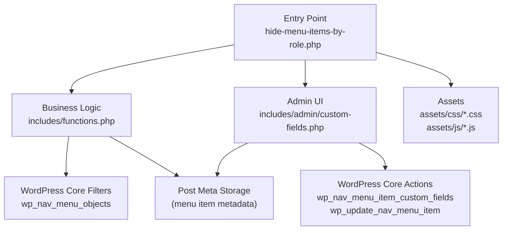
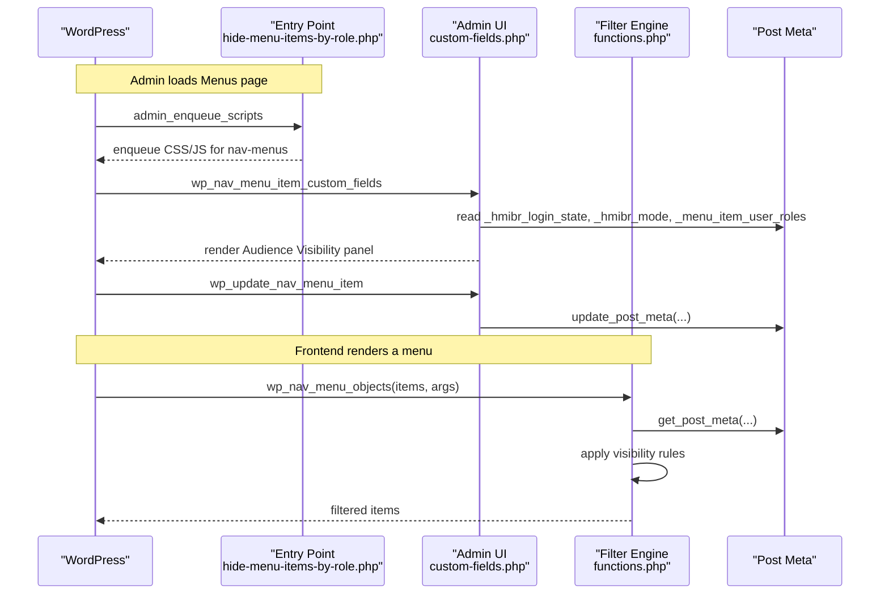
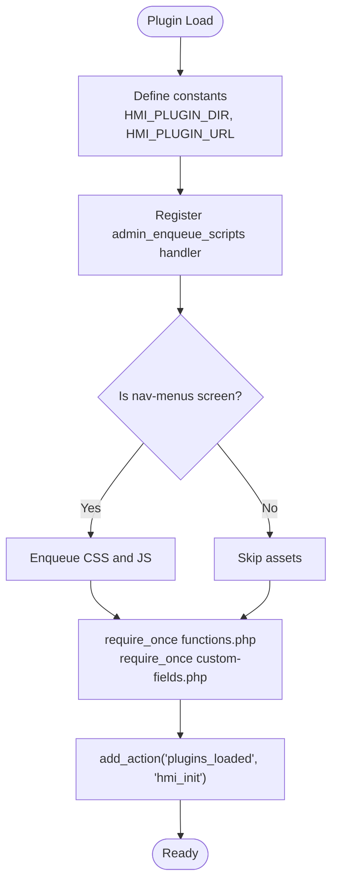
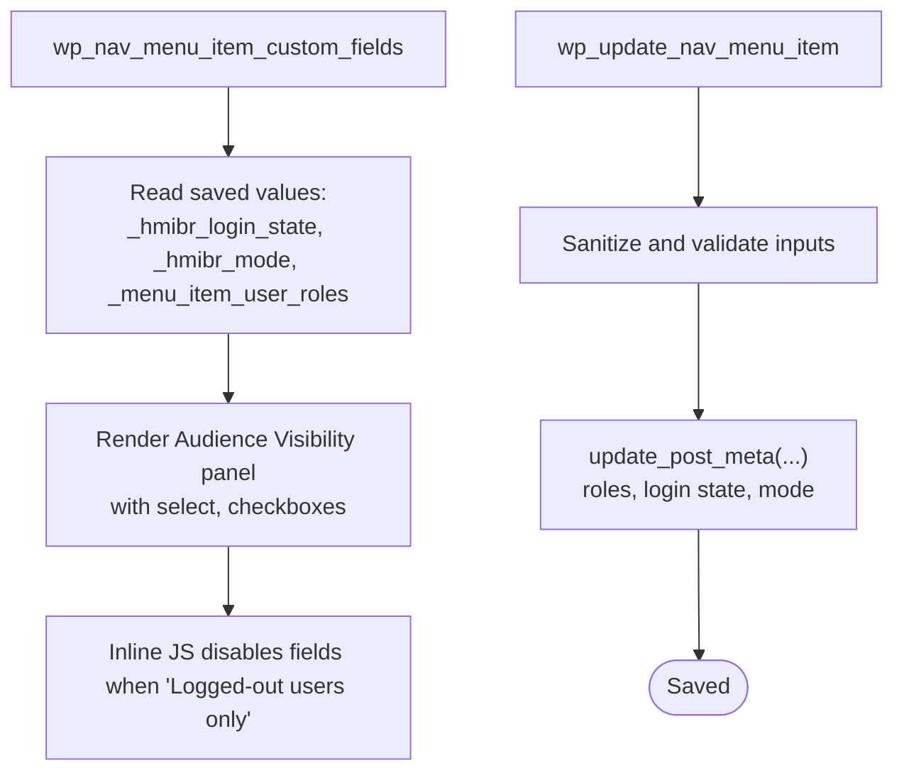
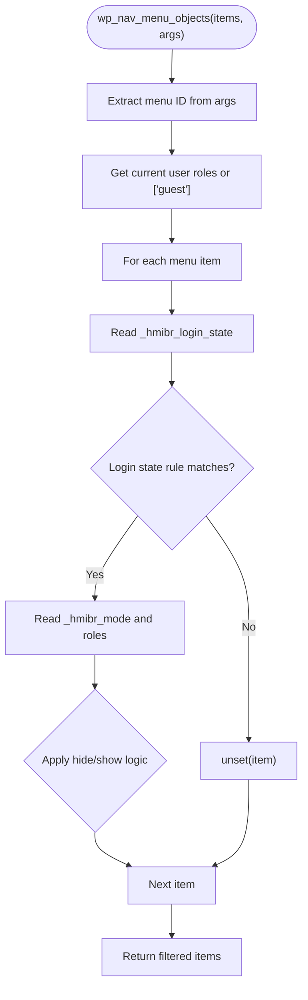
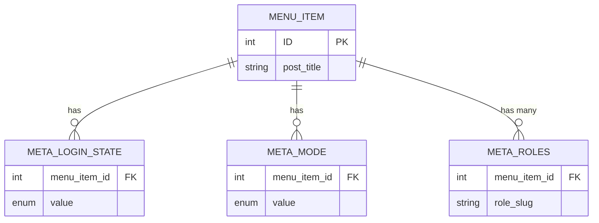
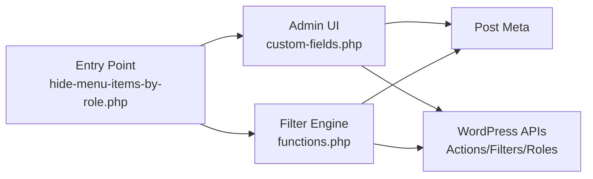

# Component Interactions

<cite>
**Referenced Files in This Document**
- [hide-menu-items-by-role.php](file://hide-menu-items-by-role.php)
- [functions.php](file://includes/functions.php)
- [custom-fields.php](file://includes/admin/custom-fields.php)
- [README.txt](file://README.txt)
</cite>

## Table of Contents
1. [Introduction](#introduction)
2. [Project Structure](#project-structure)
3. [Core Components](#core-components)
4. [Architecture Overview](#architecture-overview)
5. [Detailed Component Analysis](#detailed-component-analysis)
6. [Dependency Analysis](#dependency-analysis)
7. [Performance Considerations](#performance-considerations)
8. [Troubleshooting Guide](#troubleshooting-guide)
9. [Conclusion](#conclusion)

## Introduction
This document explains how the plugin’s components interact within WordPress’s hook-driven architecture. The main entry point coordinates asset loading and module inclusion, while the menu filtering engine applies visibility rules at runtime, and the admin field manager provides the UI for configuring those rules. Communication between modules occurs through WordPress APIs (hooks, filters, and post meta), not direct function calls, enabling clear separation of concerns and independent testing.

## Project Structure
The plugin is organized into three primary files:
- Entry point: loads assets, includes modules, and initializes hooks.
- Business logic: filters menu items based on user roles and login state.
- Admin UI: renders custom fields in the Menu Editor and persists configuration.

**Diagram sources**
- [hide-menu-items-by-role.php:20-46](file://hide-menu-items-by-role.php#L20-L46)
- [functions.php:1-50](file://includes/functions.php#L1-L50)
- [custom-fields.php:1-147](file://includes/admin/custom-fields.php#L1-L147)

**Section sources**
- [hide-menu-items-by-role.php:1-54](file://hide-menu-items-by-role.php#L1-L54)
- [functions.php:1-50](file://includes/functions.php#L1-L50)
- [custom-fields.php:1-147](file://includes/admin/custom-fields.php#L1-L147)

## Core Components
- Entry point (hide-menu-items-by-role.php):
  - Defines plugin constants for directory paths and URLs.
  - Enqueues admin CSS and JS only on the nav-menus screen.
  - Includes business logic and admin UI modules.
  - Registers a placeholder initialization hook.

- Menu filtering engine (functions.php):
  - Hooks into wp_nav_menu_objects to filter menu items.
  - Reads per-item metadata for login state, mode, and roles.
  - Applies visibility rules based on current user context.

- Admin field manager (custom-fields.php):
  - Adds an “Audience Visibility” panel to each menu item.
  - Renders controls for login state, mode, and role selection.
  - Validates and saves settings via WordPress actions and post meta.

**Section sources**
- [hide-menu-items-by-role.php:16-54](file://hide-menu-items-by-role.php#L16-L54)
- [functions.php:1-50](file://includes/functions.php#L1-L50)
- [custom-fields.php:1-147](file://includes/admin/custom-fields.php#L1-L147)

## Architecture Overview
The plugin follows a modular design with clear responsibilities:
- Asset management lives in the entry point.
- Business logic resides in functions.php.
- UI rendering and persistence live in custom-fields.php.
- All inter-module communication uses WordPress APIs (filters, actions, and post meta).

**Diagram sources**
- [hide-menu-items-by-role.php:20-46](file://hide-menu-items-by-role.php#L20-L46)
- [custom-fields.php:3-94](file://includes/admin/custom-fields.php#L3-L94)
- [custom-fields.php:96-147](file://includes/admin/custom-fields.php#L96-L147)
- [functions.php:1-50](file://includes/functions.php#L1-L50)

## Detailed Component Analysis

### Entry Point: Asset Management and Module Inclusion
Responsibilities:
- Define constants for plugin paths and URLs.
- Conditionally enqueue admin assets on the nav-menus screen.
- Include business logic and admin UI modules.
- Register a plugins_loaded action for future initialization.

Key interactions:
- Uses add_action('admin_enqueue_scripts', ...) to register asset loading.
- Uses require_once to load functions.php and custom-fields.php.
- Uses add_action('plugins_loaded', ...) to initialize later.

**Diagram sources**
- [hide-menu-items-by-role.php:16-54](file://hide-menu-items-by-role.php#L16-L54)

**Section sources**
- [hide-menu-items-by-role.php:16-54](file://hide-menu-items-by-role.php#L16-L54)

### Admin Field Manager: Rendering and Saving Configuration
Responsibilities:
- Render the “Audience Visibility” panel inside the Menu Editor.
- Provide controls for login state, mode, and role selection.
- Validate inputs and persist them as post meta.

Key interactions:
- Hooked to wp_nav_menu_item_custom_fields to render fields.
- Hooked to wp_update_nav_menu_item to save fields.
- Uses get_post_meta/update_post_meta for data persistence.
- Uses WordPress helpers like wp_roles(), get_editable_roles(), esc_attr(), esc_html().

**Diagram sources**
- [custom-fields.php:3-94](file://includes/admin/custom-fields.php#L3-L94)
- [custom-fields.php:96-147](file://includes/admin/custom-fields.php#L96-L147)

**Section sources**
- [custom-fields.php:3-94](file://includes/admin/custom-fields.php#L3-L94)
- [custom-fields.php:96-147](file://includes/admin/custom-fields.php#L96-L147)

### Menu Filtering Engine: Runtime Visibility Rules
Responsibilities:
- Intercept menu items via wp_nav_menu_objects.
- Determine current user roles and login state.
- Apply per-item visibility rules using stored metadata.

Key interactions:
- Hooked to wp_nav_menu_objects.
- Reads post meta for login state, mode, and roles.
- Uses WordPress functions like is_user_logged_in() and wp_get_current_user().

**Diagram sources**
- [functions.php:1-50](file://includes/functions.php#L1-L50)

**Section sources**
- [functions.php:1-50](file://includes/functions.php#L1-L50)

### Data Model and Persistence
The plugin stores visibility configuration per menu item using post meta keys:
- _hmibr_login_state: one of any, logged_in, logged_out.
- _hmibr_mode: one of hide, show.
- _menu_item_user_roles: array of role slugs.
- Additional metadata for menu identification and title.

**Diagram sources**
- [custom-fields.php:96-147](file://includes/admin/custom-fields.php#L96-L147)
- [functions.php:1-50](file://includes/functions.php#L1-L50)

**Section sources**
- [custom-fields.php:96-147](file://includes/admin/custom-fields.php#L96-L147)
- [functions.php:1-50](file://includes/functions.php#L1-L50)

## Dependency Analysis
- Entry point depends on:
  - WordPress hooks for asset enqueueing and initialization.
  - File system includes for modules.
- Admin UI depends on:
  - WordPress actions for rendering and saving menu item fields.
  - Post meta API for persistence.
  - Role APIs for listing and validating roles.
- Filter engine depends on:
  - WordPress filter wp_nav_menu_objects.
  - User context APIs to determine roles and login state.
  - Post meta API to read visibility rules.

**Diagram sources**
- [hide-menu-items-by-role.php:20-54](file://hide-menu-items-by-role.php#L20-L54)
- [custom-fields.php:1-147](file://includes/admin/custom-fields.php#L1-L147)
- [functions.php:1-50](file://includes/functions.php#L1-L50)

**Section sources**
- [hide-menu-items-by-role.php:20-54](file://hide-menu-items-by-role.php#L20-L54)
- [custom-fields.php:1-147](file://includes/admin/custom-fields.php#L1-L147)
- [functions.php:1-50](file://includes/functions.php#L1-L50)

## Performance Considerations
- Early exit optimization: When login state is set to “Logged-out users only,” the admin UI disables role-based controls, reducing unnecessary processing during editing.
- Minimal overhead: The filter reads only necessary post meta and short-circuits when no roles are configured for an item.
- Conditional asset loading: Admin assets are enqueued only on the nav-menus screen to avoid unnecessary requests elsewhere.

[No sources needed since this section provides general guidance]

## Troubleshooting Guide
Common issues and resolutions:
- Fields not appearing in the Menu Editor:
  - Ensure the plugin is active and the nav-menus screen is being used.
  - Verify that custom-fields.php is included by the entry point.
- Settings not saving:
  - Confirm that wp_update_nav_menu_item is triggered and that sanitization/validation passes.
  - Check that post meta keys match expected names.
- Menu items not hiding/showing as expected:
  - Verify post meta values for _hmibr_login_state, _hmibr_mode, and _menu_item_user_roles.
  - Ensure the current user has the expected roles and login state.

**Section sources**
- [custom-fields.php:96-147](file://includes/admin/custom-fields.php#L96-L147)
- [functions.php:1-50](file://includes/functions.php#L1-L50)

## Conclusion
The plugin cleanly separates concerns across three modules:
- Entry point manages assets and includes modules.
- Admin UI handles configuration rendering and persistence.
- Filter engine applies visibility rules at runtime.
All interactions use WordPress APIs, which decouples components and enables independent testing and maintenance. The modular design supports future enhancements without tight coupling between modules.

[No sources needed since this section summarizes without analyzing specific files]