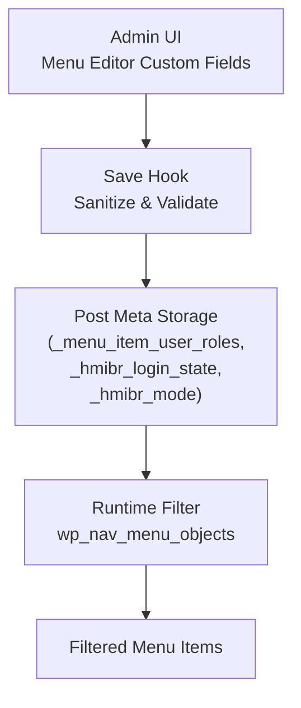
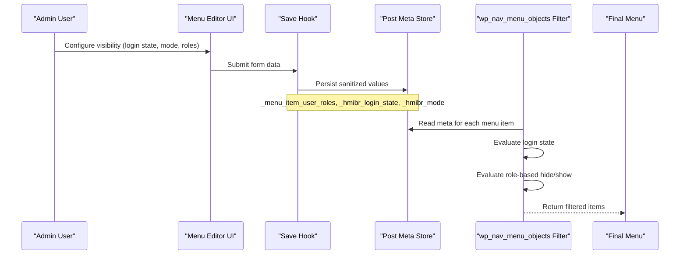
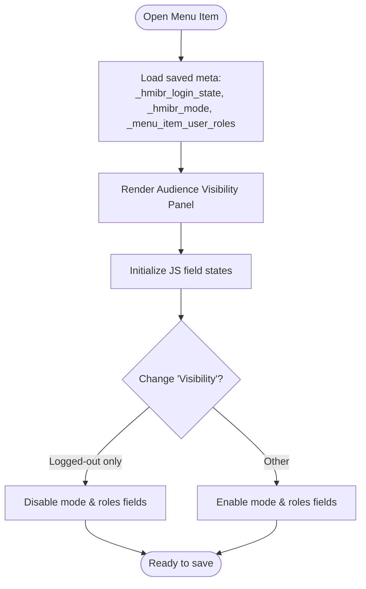
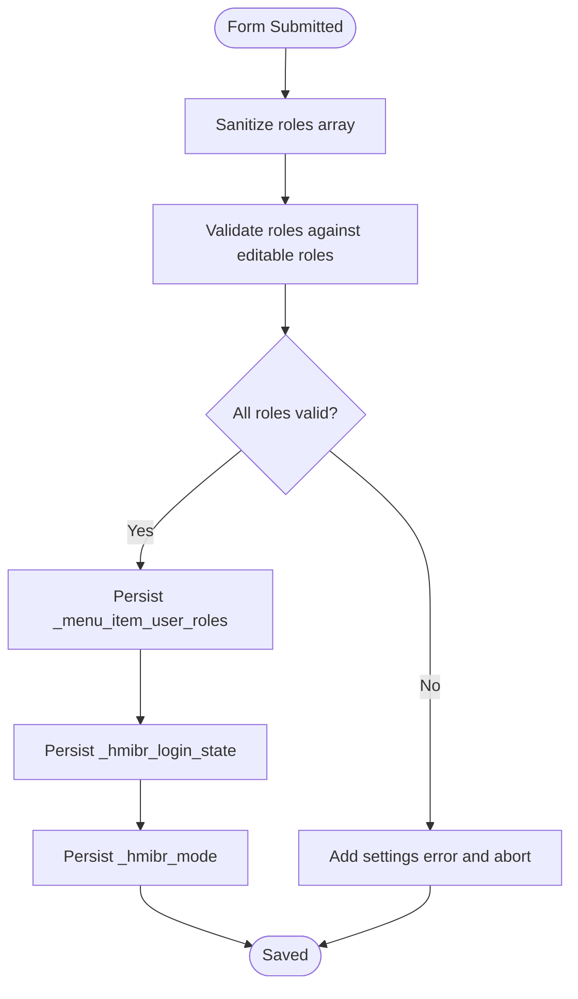
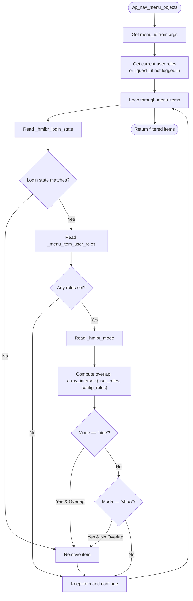
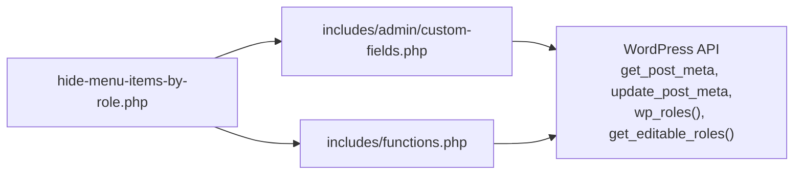

# Data Flow Pipeline

<cite>
**Referenced Files in This Document**
- [hide-menu-items-by-role.php](file://hide-menu-items-by-role.php)
- [functions.php](file://includes/functions.php)
- [custom-fields.php](file://includes/admin/custom-fields.php)
- [README.txt](file://README.txt)
</cite>

## Table of Contents
1. [Introduction](#introduction)
2. [Project Structure](#project-structure)
3. [Core Components](#core-components)
4. [Architecture Overview](#architecture-overview)
5. [Detailed Component Analysis](#detailed-component-analysis)
6. [Dependency Analysis](#dependency-analysis)
7. [Performance Considerations](#performance-considerations)
8. [Troubleshooting Guide](#troubleshooting-guide)
9. [Conclusion](#conclusion)

## Introduction
This document explains the end-to-end data flow pipeline for a WordPress plugin that controls menu item visibility based on user roles and login state. It covers the complete lifecycle from admin field input, through validation and sanitization, to post meta storage, and finally runtime menu filtering. It also details how user roles and login state are evaluated during menu rendering, including array operations for role matching and boolean logic for visibility determination. Error handling and fallback mechanisms when data is missing or invalid are documented as well.

## Project Structure
The plugin consists of:
- A main plugin file that registers hooks, enqueues admin assets, and includes core modules.
- An admin module that adds custom fields to the menu editor and persists them to post meta.
- A runtime filter that evaluates visibility rules and removes items from the menu accordingly.



**Diagram sources**
- [hide-menu-items-by-role.php:20-46](file://hide-menu-items-by-role.php#L20-L46)
- [custom-fields.php:96-146](file://includes/admin/custom-fields.php#L96-L146)
- [functions.php:1-49](file://includes/functions.php#L1-L49)

**Section sources**
- [hide-menu-items-by-role.php:16-46](file://hide-menu-items-by-role.php#L16-L46)
- [custom-fields.php:1-147](file://includes/admin/custom-fields.php#L1-L147)
- [functions.php:1-49](file://includes/functions.php#L1-L49)

## Core Components
- Admin custom fields: Adds “Audience Visibility” panel with login state, mode (hide/show), and role checkboxes. It also disables role-related fields when login state is “logged-out only.”
- Save handler: Sanitizes inputs, validates roles against editable roles, and stores values in post meta.
- Runtime filter: Reads current user roles and login state, applies login-state gating first, then applies role-based hide/show logic using array intersection and boolean checks.

Key responsibilities:
- Admin UI: Present configuration options and enforce UI constraints.
- Persistence: Ensure only valid, sanitized values are stored.
- Rendering: Apply deterministic visibility rules at runtime.

**Section sources**
- [custom-fields.php:3-94](file://includes/admin/custom-fields.php#L3-L94)
- [custom-fields.php:96-146](file://includes/admin/custom-fields.php#L96-L146)
- [functions.php:1-49](file://includes/functions.php#L1-L49)

## Architecture Overview
The system follows a clear separation between admin configuration and runtime evaluation:



**Diagram sources**
- [custom-fields.php:3-94](file://includes/admin/custom-fields.php#L3-L94)
- [custom-fields.php:96-146](file://includes/admin/custom-fields.php#L96-L146)
- [functions.php:1-49](file://includes/functions.php#L1-L49)

## Detailed Component Analysis

### Admin Interface: Audience Visibility Panel
- Inputs:
  - Login state: any, logged_in, logged_out
  - Mode: hide, show
  - Roles: one or more WordPress roles
- Behavior:
  - When login state is “logged-out only,” the mode and roles fields are disabled via JavaScript to prevent conflicting configurations.
  - The panel renders existing saved values and provides checkboxes for all available roles.



**Diagram sources**
- [custom-fields.php:3-94](file://includes/admin/custom-fields.php#L3-L94)

**Section sources**
- [custom-fields.php:3-94](file://includes/admin/custom-fields.php#L3-L94)

### Save Handler: Validation and Sanitization
- Sanitization:
  - Roles: sanitized per element using text field sanitizer.
  - Login state and mode: validated against allowlists; defaults applied if invalid.
- Validation:
  - Each selected role must exist in editable roles; otherwise, an error message is added and saving is aborted.
- Persistence:
  - Stores roles under `_menu_item_user_roles`.
  - Stores login state under `_hmibr_login_state`.
  - Stores mode under `_hmibr_mode`.



**Diagram sources**
- [custom-fields.php:96-146](file://includes/admin/custom-fields.php#L96-L146)

**Section sources**
- [custom-fields.php:96-146](file://includes/admin/custom-fields.php#L96-L146)

### Runtime Filter: Menu Filtering Logic
- Input:
  - Menu items array and args containing the menu object.
- Steps:
  1. Determine current user roles:
     - If logged in: use actual roles.
     - If not logged in: treat as guest.
  2. For each menu item:
     - Read login state meta; apply immediate exclusion if it conflicts with current login state.
     - If no roles are configured, keep the item.
     - Read mode meta; default to hide if missing.
     - Compute overlap between user roles and configured roles using array intersection.
     - Apply boolean logic:
       - Hide mode: exclude if there is overlap.
       - Show mode: exclude if there is no overlap and roles are configured.
  3. Return filtered items.



**Diagram sources**
- [functions.php:1-49](file://includes/functions.php#L1-L49)

**Section sources**
- [functions.php:1-49](file://includes/functions.php#L1-L49)

### Data Models and Storage Keys
- Post meta keys used for persistence:
  - `_menu_item_user_roles`: Array of allowed/restricted roles.
  - `_hmibr_login_state`: Enum-like string value for login gating.
  - `_hmibr_mode`: Enum-like string value for hide/show behavior.

```mermaid
erDiagram
MENU_ITEM {
int ID PK
string title
}
MENU_ITEM ||--o{ META : "has"
META {
int post_id FK
string meta_key
longtext meta_value
}
META {
string key_role_array : "_menu_item_user_roles"
string key_login_state : "_hmibr_login_state"
string key_mode : "_hmibr_mode"
}
```

**Diagram sources**
- [custom-fields.php:122-143](file://includes/admin/custom-fields.php#L122-L143)
- [functions.php:16-36](file://includes/functions.php#L16-L36)

## Dependency Analysis
- Entry point:
  - Main plugin file enqueues admin assets and includes core modules.
- Admin module:
  - Hooks into menu editor to render custom fields.
  - Hooks into menu update to persist sanitized and validated data.
- Runtime module:
  - Hooks into `wp_nav_menu_objects` to filter menu items.



**Diagram sources**
- [hide-menu-items-by-role.php:20-46](file://hide-menu-items-by-role.php#L20-L46)
- [custom-fields.php:96-146](file://includes/admin/custom-fields.php#L96-L146)
- [functions.php:1-49](file://includes/functions.php#L1-L49)

**Section sources**
- [hide-menu-items-by-role.php:20-46](file://hide-menu-items-by-role.php#L20-L46)
- [custom-fields.php:96-146](file://includes/admin/custom-fields.php#L96-L146)
- [functions.php:1-49](file://includes/functions.php#L1-L49)

## Performance Considerations
- Early login-state gating avoids unnecessary role checks when login state does not match, reducing overhead.
- Role arrays are small and compared once per menu item; complexity is linear in the number of roles per item.
- Avoiding JavaScript/jQuery for runtime filtering keeps server-side logic simple and consistent.

[No sources needed since this section provides general guidance]

## Troubleshooting Guide
Common issues and resolutions:
- Invalid role selected:
  - Symptom: Settings error appears and save is aborted.
  - Cause: Selected role not present in editable roles.
  - Resolution: Select only valid roles from the list.
- Missing meta values:
  - Symptom: Unexpected visibility behavior.
  - Causes:
    - No roles configured: item remains visible by default.
    - Missing mode: defaults to hide.
    - Missing login state: defaults to any.
  - Resolution: Configure all required fields in the admin panel.
- Conflicting UI state:
  - Symptom: Role fields disabled unexpectedly.
  - Cause: Login state set to “logged-out only.”
  - Resolution: Change login state to “any” or “logged-in only” to enable role configuration.

**Section sources**
- [custom-fields.php:107-120](file://includes/admin/custom-fields.php#L107-L120)
- [functions.php:16-44](file://includes/functions.php#L16-L44)

## Conclusion
The plugin implements a robust, predictable pipeline:
- Admin UI collects configuration with clear constraints.
- Save handler ensures data integrity via sanitization and validation.
- Runtime filter applies deterministic visibility rules, prioritizing login state and then role-based hide/show logic.
Fallbacks ensure safe defaults when data is missing, while early gating improves performance. Together, these components provide a reliable mechanism for controlling menu visibility based on user roles and login state.

[No sources needed since this section summarizes without analyzing specific files]