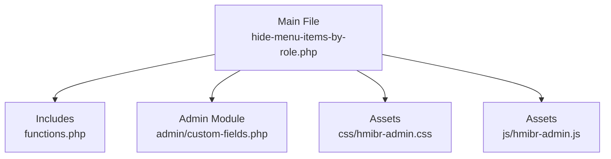
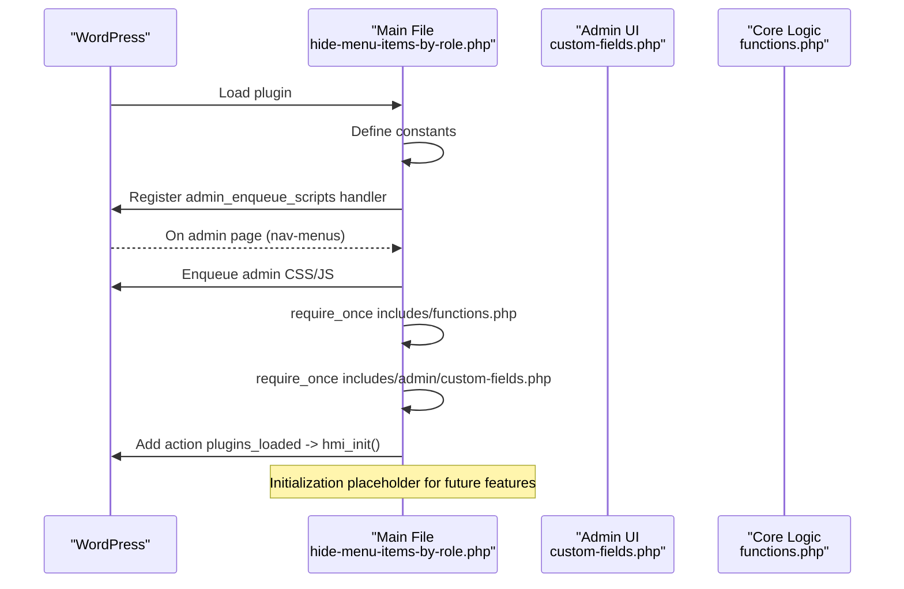
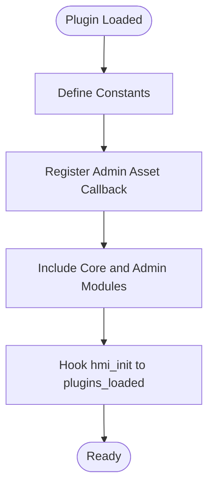
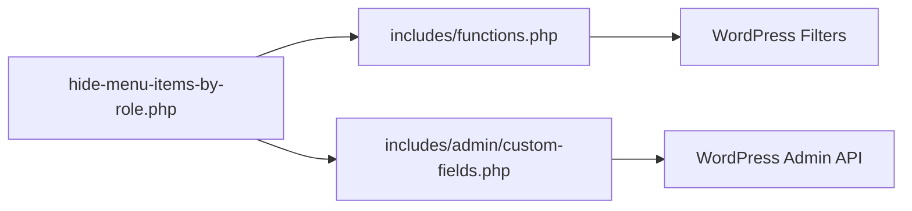

# Plugin Architecture Patterns

<cite>
**Referenced Files in This Document**
- [hide-menu-items-by-role.php](file://hide-menu-items-by-role.php)
- [functions.php](file://includes/functions.php)
- [custom-fields.php](file://includes/admin/custom-fields.php)
- [README.txt](file://README.txt)
</cite>

## Table of Contents
1. [Introduction](#introduction)
2. [Project Structure](#project-structure)
3. [Core Components](#core-components)
4. [Architecture Overview](#architecture-overview)
5. [Detailed Component Analysis](#detailed-component-analysis)
6. [Dependency Analysis](#dependency-analysis)
7. [Performance Considerations](#performance-considerations)
8. [Troubleshooting Guide](#troubleshooting-guide)
9. [Conclusion](#conclusion)

## Introduction
This document explains the plugin’s core architecture patterns, focusing on the WordPress plugin bootstrap pattern used in the main file. It covers constant definitions, metadata structure, conditional loading of admin assets, and the separation between frontend and backend concerns. The include mechanism for modular functionality is detailed to show how it supports maintainability and performance optimization. Finally, the initialization flow is explained and justified against alternative architectures.

## Project Structure
The plugin follows a clear separation of concerns:
- Main entry point defines metadata, constants, admin asset enqueueing, includes, and initialization hooks.
- Core logic resides in a dedicated functions file that filters menu rendering at runtime.
- Admin UI logic (custom fields and saving) lives under an admin-specific module.
- Assets are organized by type (CSS/JS) and loaded only when needed.

**Diagram sources**
- [hide-menu-items-by-role.php:16-46](file://hide-menu-items-by-role.php#L16-L46)
- [functions.php:1-50](file://includes/functions.php#L1-L50)
- [custom-fields.php:1-147](file://includes/admin/custom-fields.php#L1-L147)

**Section sources**
- [hide-menu-items-by-role.php:1-54](file://hide-menu-items-by-role.php#L1-L54)
- [functions.php:1-50](file://includes/functions.php#L1-L50)
- [custom-fields.php:1-147](file://includes/admin/custom-fields.php#L1-L147)

## Core Components
- Bootstrap and metadata: The main file declares plugin metadata headers and defines constants for directory and URL paths.
- Conditional admin assets: Admin CSS and JS are enqueued only on the WordPress nav-menus screen using a screen ID check.
- Modular includes: Core logic and admin modules are included via require_once statements.
- Initialization hook: The plugin registers an initialization function on plugins_loaded.

Key responsibilities:
- hide-menu-items-by-role.php: Metadata, constants, admin asset enqueueing, includes, init hook.
- includes/functions.php: Filters menu items based on user roles and login state.
- includes/admin/custom-fields.php: Adds custom fields to the menu editor and persists settings.

**Section sources**
- [hide-menu-items-by-role.php:1-54](file://hide-menu-items-by-role.php#L1-L54)
- [functions.php:1-50](file://includes/functions.php#L1-L50)
- [custom-fields.php:1-147](file://includes/admin/custom-fields.php#L1-L147)

## Architecture Overview
The plugin uses a classic WordPress bootstrap pattern:
- Define metadata and constants early.
- Conditionally load admin-only code and assets.
- Include modular files once.
- Hook into WordPress lifecycle events for initialization and processing.

**Diagram sources**
- [hide-menu-items-by-role.php:16-53](file://hide-menu-items-by-role.php#L16-L53)
- [custom-fields.php:94-147](file://includes/admin/custom-fields.php#L94-L147)
- [functions.php:49-50](file://includes/functions.php#L49-L50)

## Detailed Component Analysis

### Bootstrap and Metadata (hide-menu-items-by-role.php)
- Metadata header: Declares plugin name, description, version, requirements, author, license, and text domain.
- Constants: Defines HMI_PLUGIN_DIR and HMI_PLUGIN_URL for consistent path resolution across the plugin.
- Admin asset enqueueing: Uses get_current_screen() to ensure styles and scripts are loaded only on the nav-menus screen.
- Includes: Loads core functions and admin module with require_once to prevent duplicate loading.
- Initialization: Hooks hmi_init to plugins_loaded; currently a placeholder for extensibility.

Why this approach:
- Keeps the bootstrap minimal and fast.
- Avoids unnecessary overhead on front-end requests.
- Provides a single place to extend initialization safely.

**Section sources**
- [hide-menu-items-by-role.php:1-14](file://hide-menu-items-by-role.php#L1-L14)
- [hide-menu-items-by-role.php:16-18](file://hide-menu-items-by-role.php#L16-L18)
- [hide-menu-items-by-role.php:20-42](file://hide-menu-items-by-role.php#L20-L42)
- [hide-menu-items-by-role.php:44-53](file://hide-menu-items-by-role.php#L44-L53)

### Frontend vs Backend Separation
- Frontend: Menu filtering occurs via a WordPress filter applied during wp_nav_menu rendering. No JavaScript is required for runtime behavior.
- Backend: Custom fields and persistence live in the admin module and are only relevant within the WordPress admin interface.

Benefits:
- Clear separation reduces coupling.
- Admin-only code and assets do not impact front-end performance.
- Easier testing and maintenance per concern.

**Section sources**
- [functions.php:1-50](file://includes/functions.php#L1-L50)
- [custom-fields.php:1-94](file://includes/admin/custom-fields.php#L1-L94)

### Include Mechanism and Modularity
- require_once ensures each module is loaded exactly once.
- Modularization isolates concerns:
  - functions.php: Core filtering logic.
  - admin/custom-fields.php: Admin UI and data persistence.
- This pattern supports:
  - Maintainability: Changes are localized to specific modules.
  - Performance: Only necessary modules are included.

**Section sources**
- [hide-menu-items-by-role.php:44-46](file://hide-menu-items-by-role.php#L44-L46)
- [functions.php:1-50](file://includes/functions.php#L1-L50)
- [custom-fields.php:1-147](file://includes/admin/custom-fields.php#L1-L147)

### Initialization Flow
The initialization sequence:
1. WordPress loads the plugin file.
2. Constants are defined.
3. Admin asset enqueue callback is registered.
4. Core and admin modules are included.
5. hmi_init is hooked to plugins_loaded.

**Diagram sources**
- [hide-menu-items-by-role.php:16-53](file://hide-menu-items-by-role.php#L16-L53)

**Section sources**
- [hide-menu-items-by-role.php:16-53](file://hide-menu-items-by-role.php#L16-L53)

### Why This Pattern Over Alternatives
- Versus autoloading all classes upfront: Reduces initial load cost and avoids unnecessary class instantiation.
- Versus monolithic single-file design: Improves readability, testability, and feature isolation.
- Versus heavy front-end dependencies: Relies on WordPress core filters for runtime behavior, minimizing JavaScript usage and improving compatibility.

[No sources needed since this section provides general guidance]

## Dependency Analysis
The plugin’s internal dependencies are straightforward:
- Main file depends on:
  - includes/functions.php (core filtering)
  - includes/admin/custom-fields.php (admin UI and persistence)
- Admin module depends on WordPress admin APIs and menus hooks.
- Core module depends on WordPress filters and user role utilities.

**Diagram sources**
- [hide-menu-items-by-role.php:44-46](file://hide-menu-items-by-role.php#L44-L46)
- [functions.php:49-50](file://includes/functions.php#L49-L50)
- [custom-fields.php:94-147](file://includes/admin/custom-fields.php#L94-L147)

**Section sources**
- [hide-menu-items-by-role.php:44-46](file://hide-menu-items-by-role.php#L44-L46)
- [functions.php:49-50](file://includes/functions.php#L49-L50)
- [custom-fields.php:94-147](file://includes/admin/custom-fields.php#L94-L147)

## Performance Considerations
- Conditional admin assets: Styles and scripts are enqueued only on the nav-menus screen, avoiding unnecessary front-end overhead.
- Minimal runtime logic: Menu filtering uses efficient checks and early exits when no roles are configured.
- Early login-state gating: When login state restricts visibility, role-based checks are skipped to reduce processing.

Recommendations:
- Keep admin-only code isolated to admin contexts.
- Prefer WordPress core filters/actions over custom HTTP endpoints or heavy client-side logic.
- Validate and sanitize inputs in admin handlers to avoid unnecessary reprocessing.

**Section sources**
- [hide-menu-items-by-role.php:20-42](file://hide-menu-items-by-role.php#L20-L42)
- [functions.php:11-45](file://includes/functions.php#L11-L45)
- [custom-fields.php:96-147](file://includes/admin/custom-fields.php#L96-L147)

## Troubleshooting Guide
Common issues and resolutions:
- Admin styles/scripts not loading:
  - Ensure you are on the nav-menus screen; the enqueue callback targets that screen specifically.
- Custom fields not appearing:
  - Verify the admin module is included and the custom fields hook is active.
- Settings not persisting:
  - Confirm the save hook runs and meta keys are updated correctly.
- Menu items not hiding/showing as expected:
  - Check the stored meta values for login state, mode, and roles.
  - Validate that the current user’s roles match expectations.

Operational notes:
- The README clarifies that when login state is set to “Logged-out users only,” role-based rules are not checked, which can affect perceived behavior.

**Section sources**
- [hide-menu-items-by-role.php:20-42](file://hide-menu-items-by-role.php#L20-L42)
- [custom-fields.php:94-147](file://includes/admin/custom-fields.php#L94-L147)
- [functions.php:11-45](file://includes/functions.php#L11-L45)
- [README.txt:55-63](file://README.txt#L55-L63)

## Conclusion
The plugin employs a clean WordPress bootstrap pattern: define metadata and constants, conditionally load admin assets, include modular components, and initialize via a lifecycle hook. This approach separates frontend and backend concerns, improves maintainability, and optimizes performance by limiting admin-only code and assets to admin contexts. The use of WordPress core filters for runtime behavior keeps the solution lightweight and compatible.

[No sources needed since this section summarizes without analyzing specific files]