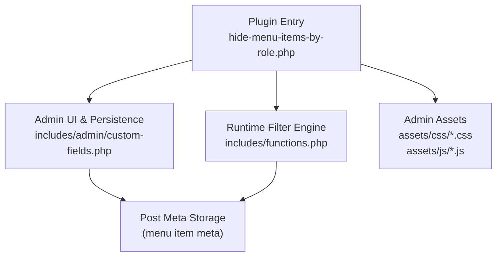
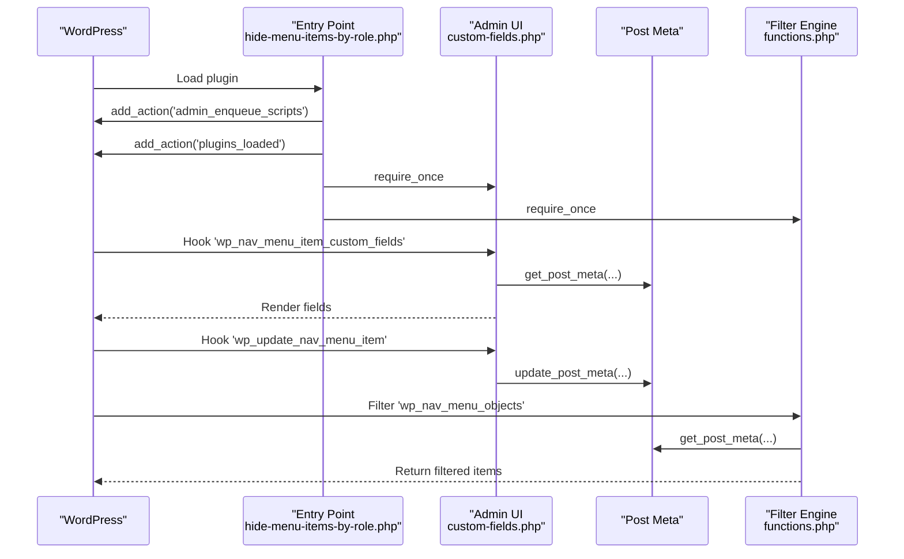
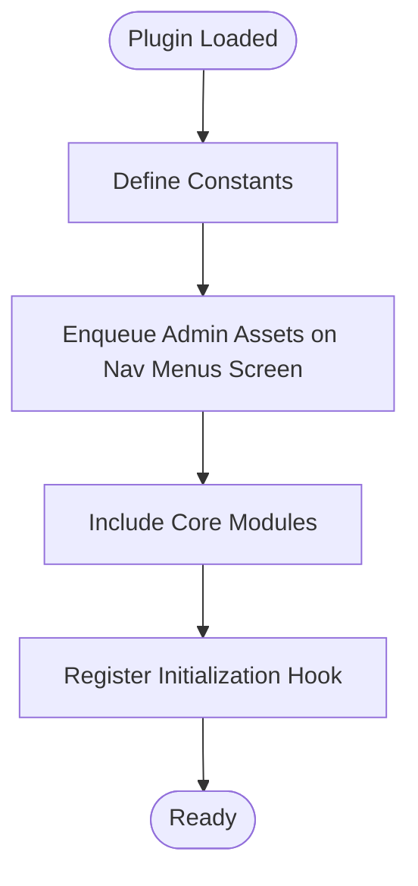
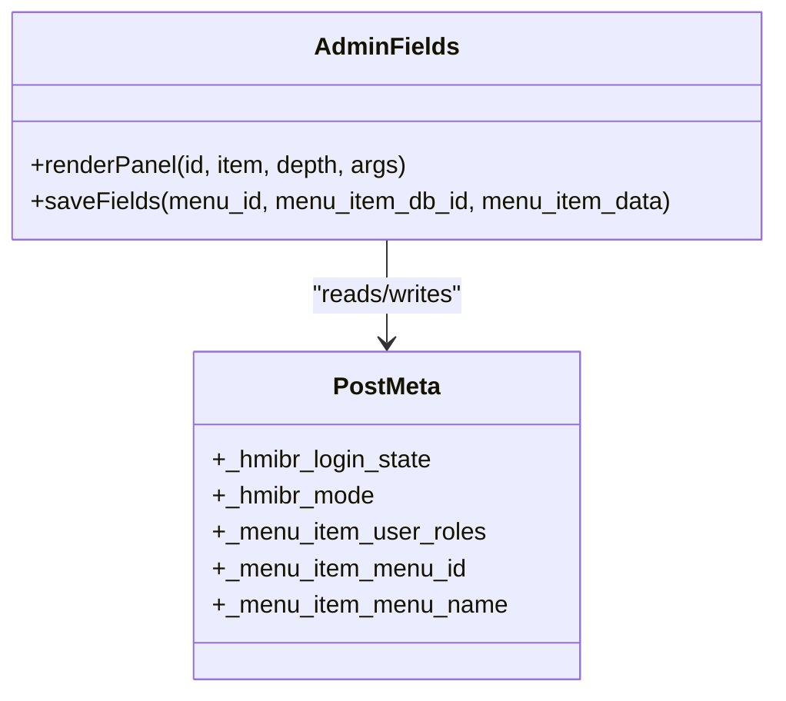
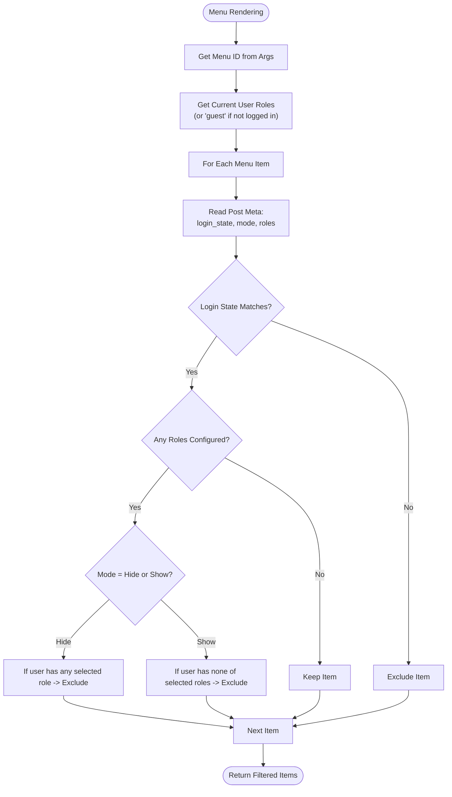
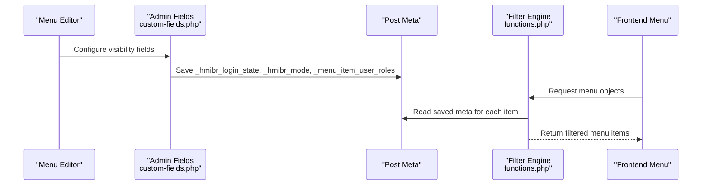
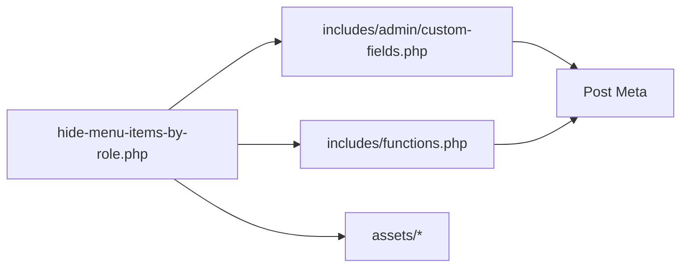

# Technical Architecture

<cite>
**Referenced Files in This Document**
- [hide-menu-items-by-role.php](file://hide-menu-items-by-role.php)
- [functions.php](file://includes/functions.php)
- [custom-fields.php](file://includes/admin/custom-fields.php)
- [hmibr-admin.css](file://assets/css/hmibr-admin.css)
- [hmibr-admin.js](file://assets/js/hmibr-admin.js)
- [README.txt](file://README.txt)
</cite>

## Table of Contents
1. [Introduction](#introduction)
2. [Project Structure](#project-structure)
3. [Core Components](#core-components)
4. [Architecture Overview](#architecture-overview)
5. [Detailed Component Analysis](#detailed-component-analysis)
6. [Dependency Analysis](#dependency-analysis)
7. [Performance Considerations](#performance-considerations)
8. [Troubleshooting Guide](#troubleshooting-guide)
9. [Conclusion](#conclusion)

## Introduction
This document describes the technical architecture of the Hide Menu Items by Role plugin. It follows WordPress plugin conventions with a clear separation between core runtime logic, admin interface, and assets. The plugin uses WordPress hooks to integrate seamlessly: it registers admin UI fields for menu items, persists configuration via post meta, and filters menu output at runtime using a core filter.

The design emphasizes modularity and extensibility:
- Plugin entry point wires up asset loading and includes modules.
- Admin module adds custom fields and saves configuration.
- Core module applies visibility rules during menu rendering.

## Project Structure
The plugin is organized into logical layers:
- Root plugin file: defines metadata, constants, asset enqueueing, and bootstrap.
- Includes:
  - functions.php: runtime menu filtering engine.
  - admin/custom-fields.php: admin UI and persistence for menu item settings.
- Assets:
  - CSS and JS files loaded only on the menu editor screen.

**Diagram sources**
- [hide-menu-items-by-role.php:16-46](file://hide-menu-items-by-role.php#L16-L46)
- [custom-fields.php:94-146](file://includes/admin/custom-fields.php#L94-L146)
- [functions.php:1-49](file://includes/functions.php#L1-L49)

**Section sources**
- [hide-menu-items-by-role.php:1-54](file://hide-menu-items-by-role.php#L1-L54)
- [README.txt:10-30](file://README.txt#L10-L30)

## Core Components
- Plugin entry point:
  - Defines plugin metadata and constants.
  - Enqueues admin CSS/JS on the nav-menus screen.
  - Includes core modules and initializes the plugin lifecycle hook.
- Admin field manager:
  - Adds an “Audience Visibility” panel to each menu item.
  - Provides controls for login state, mode (hide/show), and user roles.
  - Validates and persists settings to post meta.
- Runtime menu filter:
  - Hooks into the menu object pipeline.
  - Applies login state and role-based visibility rules.
  - Returns filtered menu items for rendering.

**Section sources**
- [hide-menu-items-by-role.php:16-53](file://hide-menu-items-by-role.php#L16-L53)
- [custom-fields.php:3-146](file://includes/admin/custom-fields.php#L3-L146)
- [functions.php:1-49](file://includes/functions.php#L1-L49)

## Architecture Overview
The plugin integrates with WordPress through actions and filters:
- Action hooks:
  - admin_enqueue_scripts: load admin assets on the menu editor.
  - wp_nav_menu_item_custom_fields: render custom fields per menu item.
  - wp_update_nav_menu_item: persist menu item settings.
  - plugins_loaded: initialize plugin code.
- Filter hooks:
  - wp_nav_menu_objects: apply visibility rules to menu items at runtime.

**Diagram sources**
- [hide-menu-items-by-role.php:20-46](file://hide-menu-items-by-role.php#L20-L46)
- [custom-fields.php:94-146](file://includes/admin/custom-fields.php#L94-L146)
- [functions.php:49-49](file://includes/functions.php#L49-L49)

## Detailed Component Analysis

### Plugin Entry Point
Responsibilities:
- Define constants for plugin directory and URL.
- Conditionally enqueue admin styles and scripts on the nav-menus screen.
- Include core modules and register initialization hook.

Key behaviors:
- Asset enqueueing is scoped to the nav-menus screen to avoid unnecessary overhead elsewhere.
- Bootstrap uses a standard WordPress action to ensure modules are included early.

**Diagram sources**
- [hide-menu-items-by-role.php:16-53](file://hide-menu-items-by-role.php#L16-L53)

**Section sources**
- [hide-menu-items-by-role.php:16-53](file://hide-menu-items-by-role.php#L16-L53)

### Admin Field Manager
Responsibilities:
- Render a collapsible “Audience Visibility” panel for each menu item.
- Provide controls for:
  - Login state: Everyone, Logged-in users only, Logged-out users only.
  - Mode: Hide from these roles or Show only to these roles.
  - User roles: Multi-select checkboxes derived from current roles.
- Persist settings to post meta upon saving a menu item.

Data model (post meta keys):
- _hmibr_login_state: one of any, logged_in, logged_out.
- _hmibr_mode: hide or show.
- _menu_item_user_roles: array of role slugs.
- _menu_item_menu_id and _menu_item_menu_name: context metadata.

Validation and sanitization:
- Roles are sanitized and validated against editable roles.
- Login state and mode values are whitelisted before saving.

Client-side behavior:
- When login state is set to “Logged-out users only,” the mode and roles fields are disabled to prevent conflicting configurations.

**Diagram sources**
- [custom-fields.php:3-94](file://includes/admin/custom-fields.php#L3-L94)
- [custom-fields.php:97-146](file://includes/admin/custom-fields.php#L97-L146)

**Section sources**
- [custom-fields.php:3-146](file://includes/admin/custom-fields.php#L3-L146)

### Runtime Menu Filter Engine
Responsibilities:
- Intercept menu objects during rendering.
- Apply visibility rules based on:
  - Current user’s login state.
  - Selected roles and mode for each menu item.

Processing logic:
- Determine the current menu ID from arguments.
- Retrieve the current user’s roles; default to guest if not logged in.
- For each menu item:
  - Check login state rule first; exclude if mismatched.
  - If no roles are configured, keep the item.
  - Apply mode:
    - Hide mode: remove item if user has any selected role.
    - Show mode: remove item if user does not have any selected role (unless no roles selected, then show to everyone).

**Diagram sources**
- [functions.php:2-49](file://includes/functions.php#L2-L49)

**Section sources**
- [functions.php:2-49](file://includes/functions.php#L2-L49)

### Data Flow: From Admin Configuration to Runtime Filtering

**Diagram sources**
- [custom-fields.php:97-146](file://includes/admin/custom-fields.php#L97-L146)
- [functions.php:2-49](file://includes/functions.php#L2-L49)

## Dependency Analysis
- Entry point depends on:
  - Admin module for UI and persistence.
  - Runtime module for filtering.
  - Assets for admin styling and interactivity.
- Admin module depends on:
  - WordPress roles API to list available roles.
  - Post meta API to read/write configuration.
- Runtime module depends on:
  - WordPress user APIs to determine current user roles.
  - Post meta API to read configuration.

**Diagram sources**
- [hide-menu-items-by-role.php:44-46](file://hide-menu-items-by-role.php#L44-L46)
- [custom-fields.php:8-8](file://includes/admin/custom-fields.php#L8-L8)
- [functions.php:8-8](file://includes/functions.php#L8-L8)

**Section sources**
- [hide-menu-items-by-role.php:44-46](file://hide-menu-items-by-role.php#L44-L46)
- [custom-fields.php:8-8](file://includes/admin/custom-fields.php#L8-L8)
- [functions.php:8-8](file://includes/functions.php#L8-L8)

## Performance Considerations
- Early exclusion by login state reduces unnecessary role checks for items that do not match the login requirement.
- Skipping role checks when no roles are configured avoids extra processing.
- Assets are enqueued only on the nav-menus screen to minimize overhead on other admin pages.
- Using post meta keeps configuration lightweight and leverages WordPress caching mechanisms.

[No sources needed since this section provides general guidance]

## Troubleshooting Guide
Common issues and resolutions:
- Menu items not hiding as expected:
  - Verify that roles are correctly selected and saved in the menu item editor.
  - Confirm that the mode is set appropriately (hide vs show).
  - Ensure login state setting matches the intended audience.
- Settings not persisting:
  - Check that the save hook is triggered and meta keys are updated.
  - Validate that role slugs exist and are editable.
- Admin fields not appearing:
  - Confirm the plugin is active and the nav-menus screen is being used.
  - Ensure required files are included by the entry point.

**Section sources**
- [custom-fields.php:97-146](file://includes/admin/custom-fields.php#L97-L146)
- [functions.php:2-49](file://includes/functions.php#L2-L49)

## Conclusion
The Hide Menu Items by Role plugin implements a clean, hook-driven architecture aligned with WordPress best practices. The separation of concerns between the entry point, admin UI, and runtime filter enables maintainability and extensibility. Configuration is stored efficiently using post meta, and runtime filtering leverages core filters to integrate seamlessly with WordPress navigation. The modular structure supports future enhancements while keeping performance and usability in focus.

[No sources needed since this section summarizes without analyzing specific files]