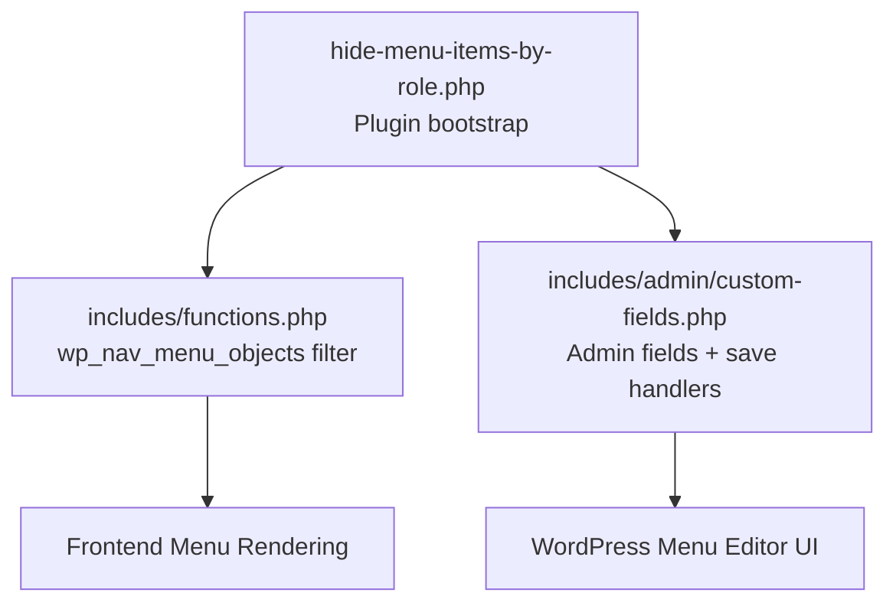
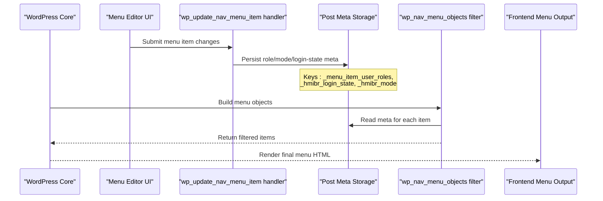
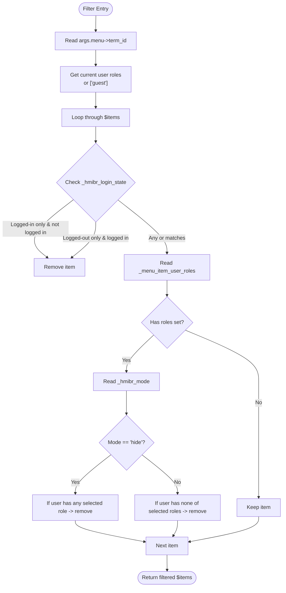
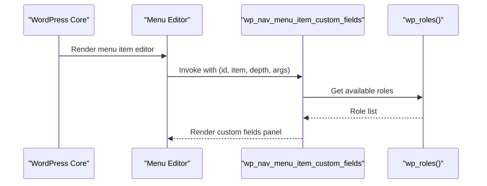
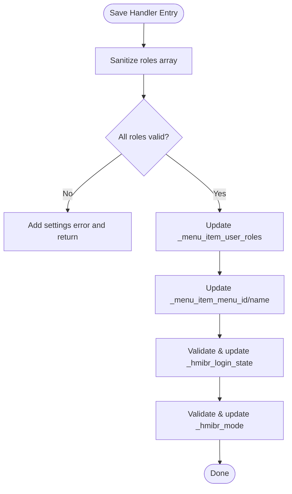
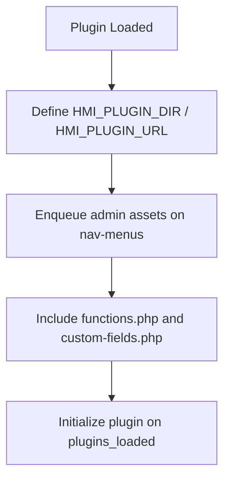
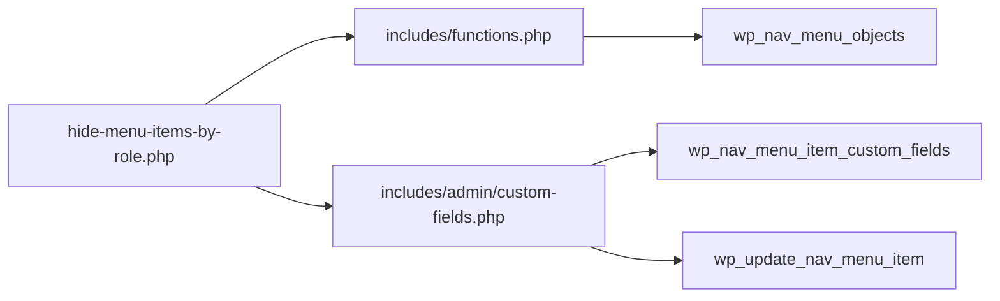

# WordPress Hook System Integration

<cite>
**Referenced Files in This Document**
- [hide-menu-items-by-role.php](file://hide-menu-items-by-role.php)
- [functions.php](file://includes/functions.php)
- [custom-fields.php](file://includes/admin/custom-fields.php)
- [README.txt](file://README.txt)
</cite>

## Table of Contents
1. [Introduction](#introduction)
2. [Project Structure](#project-structure)
3. [Core Components](#core-components)
4. [Architecture Overview](#architecture-overview)
5. [Detailed Component Analysis](#detailed-component-analysis)
6. [Dependency Analysis](#dependency-analysis)
7. [Performance Considerations](#performance-considerations)
8. [Troubleshooting Guide](#troubleshooting-guide)
9. [Conclusion](#conclusion)

## Introduction
This document explains how the plugin integrates with WordPress using its hook system to control menu item visibility based on user roles and login state. It focuses on:
- Filter-based architecture using wp_nav_menu_objects for runtime filtering of menu items
- Admin interface integration via action hooks wp_nav_menu_item_custom_fields and wp_update_nav_menu_item
- Hook registration, parameter passing, and return value handling
- How the plugin intercepts core functionality without modifying WordPress core files
- Examples of hook usage, parameter structures, and return values
- Benefits for compatibility and extensibility

The plugin is designed to be non-invasive, leveraging WordPress filters and actions to extend behavior safely and remain compatible across WordPress versions.

## Project Structure
The plugin follows a simple structure:
- Main plugin file registers admin assets and includes required modules
- Core logic resides in functions.php, which applies the wp_nav_menu_objects filter
- Admin UI and persistence are handled in custom-fields.php, hooked into the menu editor

**Diagram sources**
- [hide-menu-items-by-role.php:20-46](file://hide-menu-items-by-role.php#L20-L46)
- [functions.php:1-49](file://includes/functions.php#L1-L49)
- [custom-fields.php:1-147](file://includes/admin/custom-fields.php#L1-L147)

**Section sources**
- [hide-menu-items-by-role.php:1-54](file://hide-menu-items-by-role.php#L1-L54)
- [README.txt:10-30](file://README.txt#L10-L30)

## Core Components
- Plugin bootstrap (hide-menu-items-by-role.php):
  - Defines constants for plugin directory and URL
  - Enqueues admin CSS/JS only on the nav-menus screen
  - Includes core logic and admin field handlers
  - Initializes the plugin on plugins_loaded

- Menu filtering (includes/functions.php):
  - Registers a filter on wp_nav_menu_objects
  - Reads per-item meta for login state, mode, and allowed roles
  - Applies visibility rules and returns filtered items

- Admin UI and persistence (includes/admin/custom-fields.php):
  - Adds custom fields to the menu item editor via wp_nav_menu_item_custom_fields
  - Saves sanitized values via wp_update_nav_menu_item
  - Stores meta keys: _menu_item_user_roles, _hmibr_login_state, _hmibr_mode

**Section sources**
- [hide-menu-items-by-role.php:16-54](file://hide-menu-items-by-role.php#L16-L54)
- [functions.php:1-49](file://includes/functions.php#L1-L49)
- [custom-fields.php:1-147](file://includes/admin/custom-fields.php#L1-L147)

## Architecture Overview
The plugin uses a clean separation between admin configuration and runtime filtering:

**Diagram sources**
- [custom-fields.php:96-146](file://includes/admin/custom-fields.php#L96-L146)
- [functions.php:1-49](file://includes/functions.php#L1-L49)

## Detailed Component Analysis

### Filter-Based Menu Filtering (wp_nav_menu_objects)
Purpose:
- Intercept the array of menu objects before rendering
- Apply visibility rules based on current user’s roles and login state
- Return a modified array of menu items

Hook registration:
- add_filter('wp_nav_menu_objects', 'hmi_hide_menu_items_based_on_role', 10, 2)

Parameters:
- $items: Array of menu item objects to be rendered
- $args: Arguments object containing context such as the menu being rendered ($args->menu->term_id)

Return value:
- Modified $items array after applying visibility rules

Processing logic:
- Determine current user roles; default to guest if not logged in
- For each menu item:
  - Read _hmibr_login_state and apply immediate hide/show based on login status
  - If no roles are configured for the item, keep it visible
  - Read _hmibr_mode ('hide' or 'show') and _menu_item_user_roles
  - In 'hide' mode: remove items where the user has any of the selected roles
  - In 'show' mode: remove items unless the user has at least one of the selected roles
- Return the filtered items

**Diagram sources**
- [functions.php:2-49](file://includes/functions.php#L2-L49)

**Section sources**
- [functions.php:1-49](file://includes/functions.php#L1-L49)

### Admin Interface Integration (wp_nav_menu_item_custom_fields)
Purpose:
- Add custom fields to the menu item editor to configure visibility settings

Hook registration:
- add_action('wp_nav_menu_item_custom_fields', 'hmi_custom_menu_item_fields', 10, 4)

Parameters:
- $id: Menu item ID
- $item: Menu item object
- $depth: Depth level in the menu tree
- $args: Additional arguments passed by WordPress

Behavior:
- Load saved values for login state, mode, and roles
- Render an “Audience Visibility” panel with:
  - Visibility dropdown (Everyone, Logged-in users only, Logged-out users only)
  - Mode selector (Hide from these roles / Show only to these roles)
  - Role checkboxes populated from wp_roles()->get_names()
- Include inline JavaScript to disable role-related fields when visibility is set to “Logged-out users only”

**Diagram sources**
- [custom-fields.php:3-94](file://includes/admin/custom-fields.php#L3-L94)

**Section sources**
- [custom-fields.php:1-94](file://includes/admin/custom-fields.php#L1-L94)

### Saving Custom Fields (wp_update_nav_menu_item)
Purpose:
- Persist the custom visibility settings when a menu item is saved

Hook registration:
- add_action('wp_update_nav_menu_item', 'hmi_save_custom_menu_item_fields', 10, 3)

Parameters:
- $menu_id: The menu ID
- $menu_item_db_id: The menu item post ID
- $menu_item_data: Data associated with the menu item

Behavior:
- Sanitize and validate selected roles against editable roles
- If invalid roles are present, add a settings error and abort saving
- Persist meta:
  - _menu_item_user_roles: Array of selected roles
  - _menu_item_menu_id: Menu ID
  - _menu_item_menu_name: Menu title
  - _hmibr_login_state: One of 'any', 'logged_in', 'logged_out'
  - _hmibr_mode: One of 'hide', 'show'

**Diagram sources**
- [custom-fields.php:96-146](file://includes/admin/custom-fields.php#L96-L146)

**Section sources**
- [custom-fields.php:96-146](file://includes/admin/custom-fields.php#L96-L146)

### Plugin Bootstrap and Asset Loading
Responsibilities:
- Define plugin constants for paths and URLs
- Enqueue admin CSS/JS only on the nav-menus screen
- Include core logic and admin field handlers
- Initialize the plugin on plugins_loaded

**Diagram sources**
- [hide-menu-items-by-role.php:16-54](file://hide-menu-items-by-role.php#L16-L54)

**Section sources**
- [hide-menu-items-by-role.php:16-54](file://hide-menu-items-by-role.php#L16-L54)

## Dependency Analysis
Key dependencies and relationships:
- hide-menu-items-by-role.php depends on:
  - includes/functions.php (filter registration)
  - includes/admin/custom-fields.php (admin fields and save handlers)
- functions.php depends on:
  - WordPress core filters (wp_nav_menu_objects)
  - User and role APIs (is_user_logged_in, wp_get_current_user, wp_roles)
  - Post meta APIs (get_post_meta)
- custom-fields.php depends on:
  - WordPress actions (wp_nav_menu_item_custom_fields, wp_update_nav_menu_item)
  - Role APIs (wp_roles, get_editable_roles)
  - Post meta APIs (update_post_meta)

**Diagram sources**
- [hide-menu-items-by-role.php:44-49](file://hide-menu-items-by-role.php#L44-L49)
- [functions.php:49-49](file://includes/functions.php#L49-L49)
- [custom-fields.php:94-94](file://includes/admin/custom-fields.php#L94-L94)
- [custom-fields.php:146-146](file://includes/admin/custom-fields.php#L146-L146)

**Section sources**
- [hide-menu-items-by-role.php:44-49](file://hide-menu-items-by-role.php#L44-L49)
- [functions.php:49-49](file://includes/functions.php#L49-L49)
- [custom-fields.php:94-94](file://includes/admin/custom-fields.php#L94-L94)
- [custom-fields.php:146-146](file://includes/admin/custom-fields.php#L146-L146)

## Performance Considerations
- Early exit on login state: When visibility is set to “Logged-out users only,” role checks are skipped, reducing overhead.
- Minimal meta reads: Only necessary meta keys are read per item during filtering.
- Conditional asset loading: Admin assets are enqueued only on the nav-menus screen to avoid unnecessary load elsewhere.

[No sources needed since this section provides general guidance]

## Troubleshooting Guide
Common issues and resolutions:
- Invalid roles selected:
  - Symptom: Settings error appears when saving menu items
  - Cause: Selected roles do not exist in get_editable_roles()
  - Resolution: Ensure roles match existing WordPress roles
- Items unexpectedly hidden:
  - Symptom: Menu items disappear for certain users
  - Causes:
    - Login state mismatch (e.g., “Logged-in users only”)
    - Mode set to “Show only to these roles” with no matching user roles
  - Resolution: Review per-item visibility settings and ensure correct mode and roles are selected
- Admin fields not appearing:
  - Symptom: Custom fields missing in menu editor
  - Causes:
    - Plugin not activated
    - Incorrect hook registration
  - Resolution: Verify activation and that hooks are registered in the appropriate files

**Section sources**
- [custom-fields.php:107-120](file://includes/admin/custom-fields.php#L107-L120)
- [functions.php:15-43](file://includes/functions.php#L15-L43)

## Conclusion
By leveraging WordPress hooks, the plugin achieves robust, maintainable integration:
- Non-invasive design: No core modifications; all behavior is added via filters and actions
- Clear separation of concerns: Admin configuration vs. runtime filtering
- Extensible and compatible: Future changes can build upon existing hooks without breaking core functionality
- Predictable data flow: Admin saves meta; runtime filter reads meta and applies rules consistently

This approach ensures long-term compatibility with WordPress updates and allows other plugins/themes to extend or override behavior through the same hooks.

[No sources needed since this section summarizes without analyzing specific files]