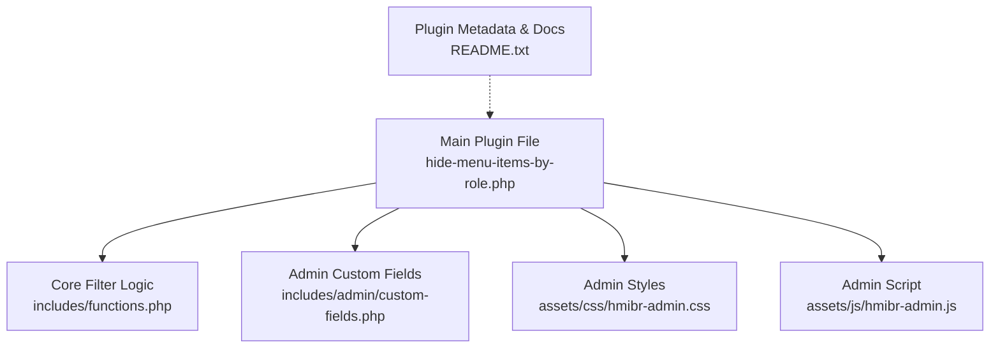
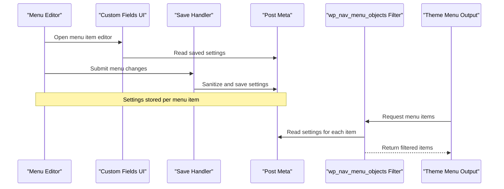
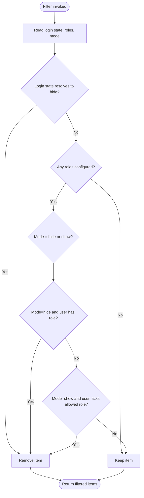
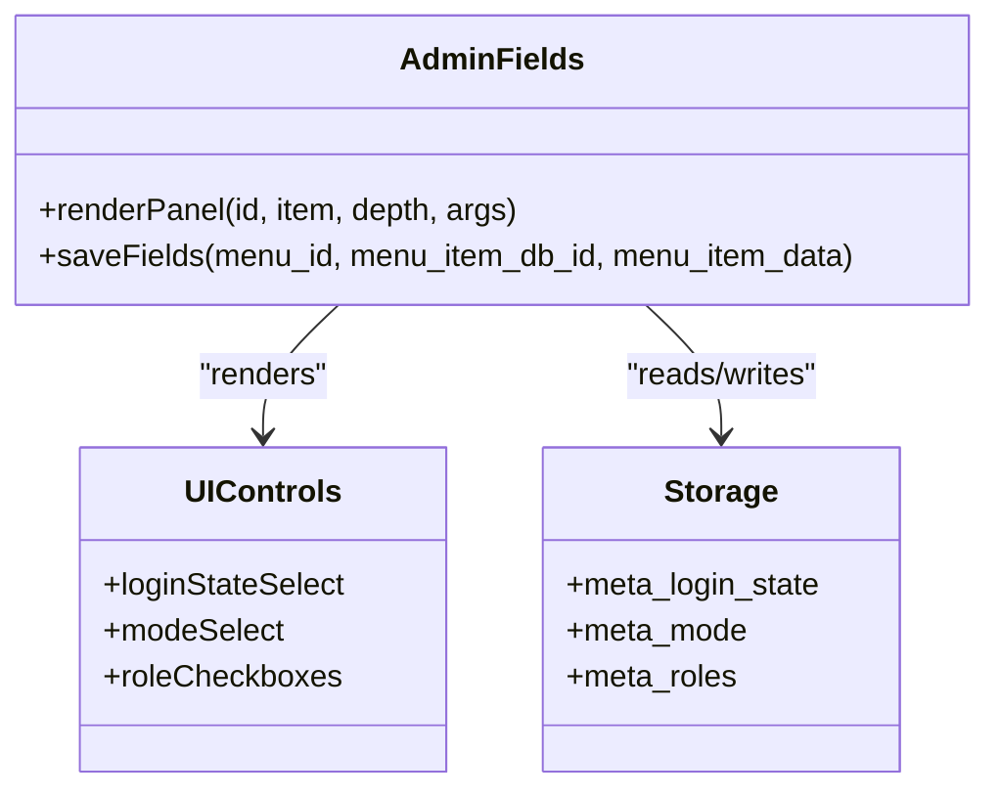
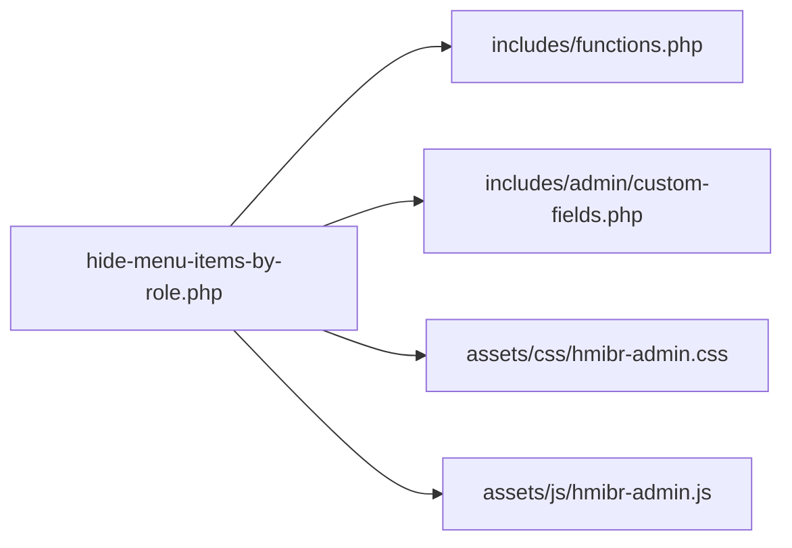

# Troubleshooting

<cite>
**Referenced Files in This Document**
- [hide-menu-items-by-role.php](file://hide-menu-items-by-role.php)
- [functions.php](file://includes/functions.php)
- [custom-fields.php](file://includes/admin/custom-fields.php)
- [hmibr-admin.css](file://assets/css/hmibr-admin.css)
- [hmibr-admin.js](file://assets/js/hmibr-admin.js)
- [README.txt](file://README.txt)
</cite>

## Table of Contents
1. [Introduction](#introduction)
2. [Project Structure](#project-structure)
3. [Core Components](#core-components)
4. [Architecture Overview](#architecture-overview)
5. [Detailed Component Analysis](#detailed-component-analysis)
6. [Dependency Analysis](#dependency-analysis)
7. [Performance Considerations](#performance-considerations)
8. [Troubleshooting Guide](#troubleshooting-guide)
9. [Security Considerations and Best Practices](#security-considerations-and-best-practices)
10. [Escalation Paths](#escalation-paths)
11. [Conclusion](#conclusion)

## Introduction
This document provides comprehensive troubleshooting guidance for the Hide Menu Items by Role plugin. It focuses on common issues such as menu items not hiding correctly, conflicts with other plugins or themes, performance problems with large menus, and compatibility concerns. It also includes step-by-step diagnostic procedures, debugging techniques using WordPress debug mode, log analysis guidance, security best practices, and escalation paths for bug reports and feature requests.

## Project Structure
The plugin is organized into a small set of focused files:
- Main plugin file that defines constants, enqueues admin assets, and loads core logic
- Core filtering function that hides/shows menu items based on user roles and login state
- Admin custom fields to configure visibility per menu item
- Admin CSS and JS for the menu editor UI
- Plugin metadata and documentation

**Diagram sources**
- [hide-menu-items-by-role.php:16-46](file://hide-menu-items-by-role.php#L16-L46)
- [functions.php:1-49](file://includes/functions.php#L1-L49)
- [custom-fields.php:1-147](file://includes/admin/custom-fields.php#L1-L147)
- [hmibr-admin.css:1-262](file://assets/css/hmibr-admin.css#L1-L262)
- [hmibr-admin.js:1-41](file://assets/js/hmibr-admin.js#L1-L41)
- [README.txt:1-100](file://README.txt#L1-L100)

**Section sources**
- [hide-menu-items-by-role.php:16-46](file://hide-menu-items-by-role.php#L16-L46)
- [README.txt:1-100](file://README.txt#L1-L100)

## Core Components
- Main plugin bootstrap:
  - Defines plugin constants for directory and URL
  - Enqueues admin CSS/JS only on the nav-menus screen
  - Loads core logic and admin custom fields
- Core filter:
  - Hooks into wp_nav_menu_objects to hide/show menu items based on:
    - Login state (Everyone, Logged-in only, Logged-out only)
    - Mode (Hide from these roles / Show only to these roles)
    - Selected user roles
- Admin UI:
  - Adds an “Audience Visibility” panel in the menu editor
  - Provides controls for login state, mode, and role selection
  - Disables role/mode controls when login state is “Logged-out users only”
  - Saves sanitized values to post meta

**Section sources**
- [hide-menu-items-by-role.php:16-46](file://hide-menu-items-by-role.php#L16-L46)
- [functions.php:1-49](file://includes/functions.php#L1-L49)
- [custom-fields.php:1-147](file://includes/admin/custom-fields.php#L1-L147)

## Architecture Overview
The plugin uses a simple, low-coupling architecture:
- Bootstrap enqueues admin assets and includes core modules
- Admin UI adds configuration fields and saves them to post meta
- Frontend rendering filters menu objects to apply visibility rules

**Diagram sources**
- [custom-fields.php:3-94](file://includes/admin/custom-fields.php#L3-L94)
- [custom-fields.php:97-146](file://includes/admin/custom-fields.php#L97-L146)
- [functions.php:1-49](file://includes/functions.php#L1-L49)

## Detailed Component Analysis

### Main Plugin File
Responsibilities:
- Define constants for plugin paths and URLs
- Enqueue admin styles and scripts only on the nav-menus screen
- Include core logic and admin custom fields
- Provide a placeholder initialization hook

Common issues and fixes:
- Assets not loading in menu editor:
  - Ensure you are editing menus under Appearance > Menus
  - Verify the screen ID check allows nav-menus
- Initialization hook empty:
  - The init function is intentionally minimal; add hooks there if extending behavior

**Section sources**
- [hide-menu-items-by-role.php:16-46](file://hide-menu-items-by-role.php#L16-L46)

### Core Filter Logic
Responsibilities:
- Apply visibility rules per menu item based on:
  - Login state
  - Mode (hide/show)
  - User roles
- Early exit when no roles are configured for an item

Key behaviors:
- If login state is “logged_in” and user is not logged in, hide the item
- If login state is “logged_out” and user is logged in, hide the item
- If no roles are selected, keep the item visible
- In “show” mode without any roles selected, show to everyone

Potential pitfalls:
- Incorrect meta keys or missing meta values can cause unexpected visibility
- Non-array user roles handled defensively but still rely on correct data

**Diagram sources**
- [functions.php:1-49](file://includes/functions.php#L1-L49)

**Section sources**
- [functions.php:1-49](file://includes/functions.php#L1-L49)

### Admin Custom Fields
Responsibilities:
- Add “Audience Visibility” panel with:
  - Visibility dropdown (Everyone, Logged-in only, Logged-out only)
  - Mode dropdown (Hide from these roles / Show only to these roles)
  - Role checkboxes
- Disable mode and role fields when visibility is “Logged-out users only”
- Save sanitized values to post meta

Validation and sanitization:
- Roles validated against editable roles
- Login state and mode whitelisted before saving

UI behavior:
- Inline script disables related fields when “Logged-out users only” is selected
- CSS applies disabled styling

**Diagram sources**
- [custom-fields.php:3-94](file://includes/admin/custom-fields.php#L3-L94)
- [custom-fields.php:97-146](file://includes/admin/custom-fields.php#L97-L146)

**Section sources**
- [custom-fields.php:1-147](file://includes/admin/custom-fields.php#L1-L147)

### Admin Assets (CSS/JS)
Responsibilities:
- Style the “Audience Visibility” panel and its controls
- Provide interactive behavior to disable fields when needed

Common issues:
- Disabled fields not appearing visually disabled:
  - Ensure hmibr-admin.css is loaded on the menu editor page
- Field disabling not updating dynamically:
  - Confirm hmibr-admin.js is enqueued and jQuery is available

**Section sources**
- [hmibr-admin.css:1-262](file://assets/css/hmibr-admin.css#L1-L262)
- [hmibr-admin.js:1-41](file://assets/js/hmibr-admin.js#L1-L41)

## Dependency Analysis
- The main plugin file depends on:
  - includes/functions.php for core filtering
  - includes/admin/custom-fields.php for admin UI and saving
  - assets/css/hmibr-admin.css and assets/js/hmibr-admin.js for admin UX
- External dependencies:
  - WordPress core functions for roles, menus, and post meta
  - jQuery for admin interactivity

**Diagram sources**
- [hide-menu-items-by-role.php:16-46](file://hide-menu-items-by-role.php#L16-L46)

**Section sources**
- [hide-menu-items-by-role.php:16-46](file://hide-menu-items-by-role.php#L16-L46)

## Performance Considerations
- The filter runs on every menu render and reads post meta for each item. For very large menus:
  - Avoid excessive menu items where possible
  - Use caching layers (object cache, page cache) carefully to avoid serving stale menus to different user roles
  - Minimize heavy operations in other plugins hooked into the same filter
- The plugin already short-circuits when no roles are configured, which helps reduce unnecessary checks.

[No sources needed since this section provides general guidance]

## Troubleshooting Guide

### Symptom: Menu items not hiding correctly
Possible causes and resolutions:
- No roles configured for the item:
  - The plugin keeps items visible when no roles are set
  - Action: Select at least one role for the intended restriction
- Wrong mode selected:
  - “Show only to these roles” requires selecting allowed roles; otherwise it shows to everyone
  - Action: Choose the appropriate mode and select roles accordingly
- Login state mismatch:
  - “Logged-in only” hides items from visitors; “Logged-out only” hides items from logged-in users
  - Action: Adjust the visibility setting to match your intent
- Conflicting plugins/themes:
  - Other code may modify wp_nav_menu_objects or alter menu structure
  - Action: Temporarily deactivate other plugins and switch to a default theme to isolate the issue

Step-by-step diagnostics:
1. Open the menu item and verify:
   - Visibility (Everyone, Logged-in only, Logged-out only)
   - Mode (Hide from these roles / Show only to these roles)
   - Selected roles
2. Test with a standard theme (e.g., Twenty Twenty-Four) and all other plugins deactivated
3. Clear caches (page cache, object cache, CDN) and retest
4. Re-enable plugins one by one to identify conflicts

**Section sources**
- [functions.php:1-49](file://includes/functions.php#L1-L49)
- [custom-fields.php:3-94](file://includes/admin/custom-fields.php#L3-L94)

### Symptom: Admin fields not visible or not saving
Possible causes and resolutions:
- Not on the correct screen:
  - Admin assets are enqueued only on nav-menus
  - Action: Edit menus under Appearance > Menus
- JavaScript/CSS not loading:
  - Inspect network tab for 404 errors on hmibr-admin.js and hmibr-admin.css
  - Action: Verify asset paths and ensure they are accessible
- Saving validation error:
  - Invalid role selected triggers a settings error message
  - Action: Ensure roles are valid and present in the system

Step-by-step diagnostics:
1. Confirm you are on the menu editor page
2. Open browser DevTools Console and Network panels for errors
3. Check for settings error notices after saving
4. Validate that post meta exists for the menu item (via database tools or WP-CLI)

**Section sources**
- [hide-menu-items-by-role.php:20-42](file://hide-menu-items-by-role.php#L20-L42)
- [custom-fields.php:97-146](file://includes/admin/custom-fields.php#L97-L146)

### Symptom: Performance issues with large menus
Possible causes and resolutions:
- Excessive menu items increase meta reads and loop iterations
- Heavy third-party filters on wp_nav_menu_objects
- Aggressive caching serving incorrect menus across roles

Step-by-step diagnostics:
1. Measure time spent in wp_nav_menu_objects using profiling tools
2. Reduce menu size or split into multiple menus
3. Review other plugins/hooks affecting menu rendering
4. Validate cache invalidation for role-based content

**Section sources**
- [functions.php:1-49](file://includes/functions.php#L1-L49)

### Symptom: Conflicts with other plugins or themes
Resolution steps:
- Deactivate all plugins except Hide Menu Items by Role
- Switch to a default theme
- Reproduce the issue
- Reactivate plugins one by one to identify the conflict
- If a conflict is found, contact the conflicting plugin/theme author with details

**Section sources**
- [README.txt:10-20](file://README.txt#L10-L20)

### Symptom: Compatibility issues with WordPress versions, themes, or plugins
Known compatibility:
- Requires WordPress 5.0+
- Tested up to WordPress 7.0.0
- Requires PHP 7.0+

Resolution steps:
- Update WordPress and PHP to supported versions
- Check for theme overrides of menu templates or filters
- Review changelog for version-specific updates

**Section sources**
- [hide-menu-items-by-role.php:1-14](file://hide-menu-items-by-role.php#L1-L14)
- [README.txt:1-10](file://README.txt#L1-L10)
- [README.txt:76-88](file://README.txt#L76-L88)

### Debugging Techniques Using WordPress Debug Mode
Enable debug logging:
- Set WP_DEBUG to true
- Enable WP_DEBUG_LOG to write logs to wp-content/debug.log
- Optionally enable WP_DEBUG_DISPLAY to display errors on screen during development

Log analysis:
- Look for PHP warnings/notices around menu rendering or meta access
- Identify fatal errors caused by incompatible plugins or themes
- Correlate timestamps with menu edits and frontend requests

Best practices:
- Disable WP_DEBUG_DISPLAY in production
- Rotate and archive debug logs regularly
- Avoid logging sensitive data

**Section sources**
- [README.txt:10-20](file://README.txt#L10-L20)

### Step-by-Step Diagnostic Procedures for Configuration Problems
1. Verify environment:
   - WordPress version meets minimum requirement
   - PHP version meets minimum requirement
2. Validate menu item configuration:
   - Check Visibility, Mode, and Roles
3. Isolate conflicts:
   - Switch to default theme
   - Deactivate other plugins
4. Inspect admin assets:
   - Confirm CSS/JS load successfully
5. Check saved data:
   - Ensure post meta exists for the menu item
6. Reproduce and document:
   - Record steps, expected vs actual behavior, and environment details

**Section sources**
- [hide-menu-items-by-role.php:16-46](file://hide-menu-items-by-role.php#L16-L46)
- [custom-fields.php:3-94](file://includes/admin/custom-fields.php#L3-L94)
- [functions.php:1-49](file://includes/functions.php#L1-L49)

## Security Considerations and Best Practices
- Input validation and sanitization:
  - Roles are validated against editable roles
  - Login state and mode are whitelisted before saving
- Least privilege:
  - Only administrators typically edit menus; restrict access to menu management
- Data integrity:
  - Avoid direct database modifications; use provided save handlers
- Auditability:
  - Keep change logs for menu configurations in your CMS workflow
- Caching safety:
  - Ensure cached pages are invalidated for different user roles to prevent leaking restricted content

**Section sources**
- [custom-fields.php:97-146](file://includes/admin/custom-fields.php#L97-L146)

## Escalation Paths
When to escalate:
- Issue persists after isolation steps
- Regression introduced by a specific plugin/theme
- Security vulnerability suspected
- Feature request requiring architectural changes

How to report bugs:
- Gather environment details:
  - WordPress version, PHP version, active theme, list of active plugins
- Reproduce steps:
  - Clear reproduction steps and expected vs actual results
- Attach logs:
  - WordPress debug.log entries (redact sensitive data)
- Where to submit:
  - Use the plugin’s official repository or support channel referenced in the plugin metadata

Feature enhancement requests:
- Describe the desired behavior and use cases
- Explain impact on performance and security
- Provide examples of similar features in other plugins

**Section sources**
- [README.txt:1-10](file://README.txt#L1-L10)

## Conclusion
This guide covers the most common issues with Hide Menu Items by Role, including configuration mistakes, conflicts, performance bottlenecks, and compatibility considerations. By following the diagnostic procedures, enabling debug logging, and adhering to security best practices, you can quickly identify and resolve problems. When issues persist or require deeper changes, use the escalation paths to engage maintainers with well-documented evidence and clear requirements.